# FirebladeECS smoke comparison: 1.4.3 vs main (16 entities, not a performance claim)

- Baseline: `1.4.3` (c85607bfe6893549bc7d058d36a4d662e8834eda)
- Inputs: 2 result files, 3 series
- Selection filter: `^(entity\.create\.no-entities .* / 0|.* / 16)$`
- Values are per iteration. Deltas are series minus baseline; ratio is series / baseline. Anything missing or not comparable is `unavailable`, never zero.
- Percentiles follow the Benchmark package: for metrics where larger is better, p0 is the largest value.

## Warnings

- 12 metric rows have different measurement counts between series (`component.add` / 16 Malloc (total), `component.add` / 16 Memory (resident peak), `component.add` / 16 Throughput (# / s), `component.add` / 16 Time (total CPU), `component.add` / 16 Time (wall clock), ...); see the measurements row of each table.

## Provenance

### 1.4.3

| Field | Value |
| --- | --- |
| Requested ref | 1.4.3 |
| Ref SHA | c85607bfe6893549bc7d058d36a4d662e8834eda |
| Component model | class |
| Backends | default |
| Suite SHA | a719747069da640a0e6452bd8a4b5c9e15a2cbee |
| Suite target | ECSCompatBenchmark |
| Configuration hash | 45ffb08d590888dd03463b88aa4bd145f908c68508b8fd9c42107e018ba5cd8b |
| Run | 47E6586C-473E-4E02-9321-D14F7F7E01CD (2026-10-29T22:39:44Z to 2026-10-29T22:40:23Z) |
| Batch | 5445A854-EA80-41FC-B12C-D8C77528BF2D |
| Toolchain | swift-driver version: 1.168.6 Apple Swift version 6.4 (swiftlang-6.4.0.34.1 clang-2100.3.34.1); Target: arm64-apple-macosx26.0 (release) |
| Host | macOS 26.7.1, arm64, Apple M1 Max, 10 cores, 68719476736 bytes memory |
| Packages | benchmark 1.38.1 ca4a9d300fc1; hdrhistogram-swift 0.2.0 c2e1210df04b; malloc-interposer 1.6.0 f479398f73b1; swift-argument-parser 1.8.2 6a52f3251125; swift-atomics 1.3.1 0442cb5a3f98; swift-numerics 1.1.1 0c0290ff6b24; swift-syntax 604.0.0 050f1a346fbb; swift-system 1.8.1 869129b7bf4e; texttable 0.0.2 a27a07300cf4 |

### main

| Field | Value |
| --- | --- |
| Requested ref | main |
| Ref SHA | ed692003ec0b268cbed0b823141cc5f382ef790a |
| Component model | value |
| Backends | archetype, sparseSet |
| Suite SHA | a719747069da640a0e6452bd8a4b5c9e15a2cbee |
| Suite target | ECSCompatBenchmark |
| Configuration hash | 45ffb08d590888dd03463b88aa4bd145f908c68508b8fd9c42107e018ba5cd8b |
| Run | C3D40DE2-7D42-456C-9139-25036A6075C4 (2026-10-29T22:41:53Z to 2026-10-29T22:42:32Z) |
| Batch | 5445A854-EA80-41FC-B12C-D8C77528BF2D |
| Toolchain | swift-driver version: 1.168.6 Apple Swift version 6.4 (swiftlang-6.4.0.34.1 clang-2100.3.34.1); Target: arm64-apple-macosx26.0 (release) |
| Host | macOS 26.7.1, arm64, Apple M1 Max, 10 cores, 68719476736 bytes memory |
| Packages | benchmark 1.38.1 ca4a9d300fc1; hdrhistogram-swift 0.2.0 c2e1210df04b; malloc-interposer 1.6.0 f479398f73b1; swift-argument-parser 1.8.2 6a52f3251125; swift-atomics 1.3.1 0442cb5a3f98; swift-numerics 1.1.1 0c0290ff6b24; swift-syntax 604.0.0 050f1a346fbb; swift-system 1.8.1 869129b7bf4e; texttable 0.0.2 a27a07300cf4 |

## Series and pairing

| Series | Compared with |
| --- | --- |
| 1.4.3 (class, default) | baseline |
| main (value, archetype) | 1.4.3 (class, default) |
| main (value, sparseSet) | 1.4.3 (class, default) |

## Workloads

| Workload | Parity | Refs |
| --- | --- | --- |
| `component.add` | adapted: component one is removed from the whole batch before timing; upstream pauses to remove per entity | 1.4.3, main |
| `component.remove-add` | adapted: payload is a single Int vs upstream float structs; every set allocates a new class instance on 1.x vs a value copy on value revisions; nexus teardown is outside the timed region | 1.4.3, main |
| `entity.create.empty` | adapted: nexus teardown is outside the timed region; upstream times registry teardown | 1.4.3, main |
| `entity.create.minimal` | adapted: nexus teardown is outside the timed region; upstream times registry teardown | 1.4.3, main |
| `entity.create.no-entities` | adapted: nexus teardown is outside the timed region; upstream times registry teardown | 1.4.3, main |
| `entity.destroy.minimal` | adapted: nexus teardown is outside the timed region; upstream times registry teardown | 1.4.3, main |
| `entity.lookup.mixed-three` | adapted: population and lookup count match; payload is a single Int per component and gets return the component | 1.4.3, main |
| `entity.lookup.none` | adapted: payload is a single Int per component vs upstream float structs; gets return class references on 1.x and value copies on value revisions; the miss is a get of an absent component; entities are created outside timing | 1.4.3, main |
| `entity.lookup.one` | adapted: payload is a single Int per component vs upstream float structs; gets return class references on 1.x and value copies on value revisions; two separate gets per entity for lookupTwo; entities are created outside timing | 1.4.3, main |
| `entity.lookup.two` | adapted: payload is a single Int per component vs upstream float structs; gets return class references on 1.x and value copies on value revisions; two separate gets per entity for lookupTwo; entities are created outside timing | 1.4.3, main |
| `event.component.publish-update.mixed` | adapted: pass count is pinned (10 warmup + 100 measured passes); base-only mixed population (no players) as upstream's EnTT factory; effective upstream workload: Position+Velocity update, empty marker view visits zero, per-entity clear of an empty marker pool via a scratch array collected inside the timed region; no native type-wide component clear | 1.4.3, main |
| `event.component.publish.mixed` | adapted: pass count is pinned (10 warmup + 100 measured passes); base-only mixed population (Position, Velocity, Data; no players) as upstream's EnTT factory; per-entity marker add then per-entity remove through a scratch array that is collected inside the timed region; no native type-wide component clear | 1.4.3, main |
| `iteration.mixed-three` | adapted: membership recipe matches upstream; each revision uses its native family iteration (value copies vs class references); family built before timing | 1.4.3, main |
| `iteration.one` | adapted: each revision uses its native family iteration (forEach(reading:) value copies on value revisions, plain iteration over class references on 1.x); family built before timing; upstream boundary varies by wrapper | 1.4.3, main |
| `iteration.two` | adapted: each revision uses its native family iteration (forEach(reading:) value copies on value revisions, plain iteration over class references on 1.x); family built before timing; upstream boundary varies by wrapper | 1.4.3, main |
| `system.update.basic.mixed` | adapted: system list (Movement, Data), order and formulas follow upstream; pass count is pinned (10 warmup + 100 measured passes on one persistent world) so every revision runs the same passes; player RNG seeds are ordinal, not address-derived; each revision uses its native family iteration instead of upstream's virtual system dispatch | 1.4.3, main |
| `system.update.basic.uniform` | adapted: system list (Movement, Data), order and formulas follow upstream; pass count is pinned (10 warmup + 100 measured passes on one persistent world) so every revision runs the same passes; player RNG seeds are ordinal, not address-derived; each revision uses its native family iteration instead of upstream's virtual system dispatch | 1.4.3, main |
| `system.update.complex.mixed` | adapted: system list (Movement, Data, MoreComplex, Health, Damage, Sprite, Render), order and formulas follow upstream UseMoreComplexSystems; pass count is pinned (10 warmup + 100 measured passes on one persistent world) so every revision runs the same passes; player RNG seeds are ordinal, not address-derived; each revision uses its native family iteration instead of upstream's virtual system dispatch | 1.4.3, main |
| `system.update.complex.uniform` | adapted: system list (Movement, Data, MoreComplex, Health, Damage, Sprite, Render), order and formulas follow upstream UseMoreComplexSystems; pass count is pinned (10 warmup + 100 measured passes on one persistent world) so every revision runs the same passes; player RNG seeds are ordinal, not address-derived; each revision uses its native family iteration instead of upstream's virtual system dispatch | 1.4.3, main |

Unsupported workloads are not measured and not approximated.

| Workload | Reason | Refs |
| --- | --- | --- |
| `entity.create.empty-bulk` | no native bulk operation; createEntities(count:) loops over per-entity creation and Family.destroyMembers destroys entity by entity | 1.4.3, main |
| `entity.create.minimal-bulk` | no native bulk operation; createEntities(count:) loops over per-entity creation and Family.destroyMembers destroys entity by entity | 1.4.3, main |
| `entity.destroy.minimal-bulk` | no native bulk operation; createEntities(count:) loops over per-entity creation and Family.destroyMembers destroys entity by entity | 1.4.3, main |
| `event.dispatch.enqueue-only.mixed` | no arbitrary-event dispatcher or queue API | 1.4.3, main |
| `event.dispatch.enqueue-update.mixed` | no arbitrary-event dispatcher or queue API | 1.4.3, main |
| `event.dispatch.trigger-update.mixed` | no arbitrary-event dispatcher or queue API | 1.4.3, main |
| `event.dispatch.update-only.mixed` | no arbitrary-event dispatcher or queue API | 1.4.3, main |
| `event.observer.emit-update.mixed` | no arbitrary-event observer or emit API; Nexus events are structural only | 1.4.3, main |
| `event.observer.enqueue-update.mixed` | no arbitrary-event observer or emit API; Nexus events are structural only | 1.4.3, main |
| `event.receiver.post-update.mixed` | no arbitrary-event receiver or event-bus API | 1.4.3, main |

## Results

### `component.add` / 16

#### Time (wall clock) (smaller is better)

| Statistic | 1.4.3 (class, default) (baseline) | main (value, archetype) | main (value, sparseSet) |
| --- | --- | --- | --- |
| measurements | 8235 | 10000 | 10000 |
| mean | 53.884 μs | 2.5681 μs (Δ -51.316 μs, ×0.047659, -95.234%, better) | 1.5071 μs (Δ -52.377 μs, ×0.02797, -97.203%, better) |
| std dev | 4133.7 ns | 231.13 ns (Δ -3902.6 ns, ×0.055913, -94.409%, better) | 93.857 ns (Δ -4039.9 ns, ×0.022705, -97.729%, better) |
| p0 | 47.833 μs | 2.333 μs (Δ -45.5 μs, ×0.048774, -95.123%, better) | 1.375 μs (Δ -46.458 μs, ×0.028746, -97.125%, better) |
| p25 | 52.063 μs | 2.459 μs (Δ -49.604 μs, ×0.047231, -95.277%, better) | 1.459 μs (Δ -50.604 μs, ×0.028024, -97.198%, better) |
| p50 | 53.887 μs | 2.501 μs (Δ -51.386 μs, ×0.046412, -95.359%, better) | 1.5 μs (Δ -52.387 μs, ×0.027836, -97.216%, better) |
| p75 | 55.359 μs | 2.543 μs (Δ -52.816 μs, ×0.045937, -95.406%, better) | 1.541 μs (Δ -53.818 μs, ×0.027836, -97.216%, better) |
| p90 | 56.607 μs | 2.793 μs (Δ -53.814 μs, ×0.04934, -95.066%, better) | 1.583 μs (Δ -55.024 μs, ×0.027965, -97.204%, better) |
| p99 | 72.255 μs | 3.375 μs (Δ -68.88 μs, ×0.04671, -95.329%, better) | 1.625 μs (Δ -70.63 μs, ×0.02249, -97.751%, better) |
| p100 | 97.875 μs | 8.042 μs (Δ -89.833 μs, ×0.082166, -91.783%, better) | 8.209 μs (Δ -89.666 μs, ×0.083872, -91.613%, better) |

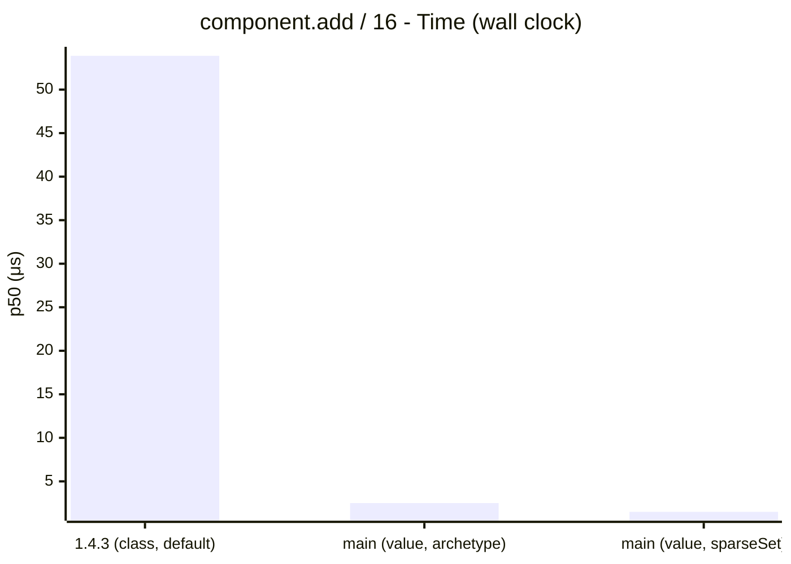

#### Time (total CPU) (smaller is better)

| Statistic | 1.4.3 (class, default) (baseline) | main (value, archetype) | main (value, sparseSet) |
| --- | --- | --- | --- |
| measurements | 8235 | 10000 | 10000 |
| mean | 54.637 μs | 3.2982 μs (Δ -51.338 μs, ×0.060366, -93.963%, better) | 2.3182 μs (Δ -52.318 μs, ×0.042429, -95.757%, better) |
| std dev | 4193.9 ns | 300.82 ns (Δ -3893 ns, ×0.071728, -92.827%, better) | 131.06 ns (Δ -4062.8 ns, ×0.03125, -96.875%, better) |
| p0 | 48.541 μs | 2.959 μs (Δ -45.582 μs, ×0.060959, -93.904%, better) | 2.124 μs (Δ -46.417 μs, ×0.043757, -95.624%, better) |
| p25 | 52.767 μs | 3.167 μs (Δ -49.6 μs, ×0.060019, -93.998%, better) | 2.251 μs (Δ -50.516 μs, ×0.042659, -95.734%, better) |
| p50 | 54.591 μs | 3.209 μs (Δ -51.382 μs, ×0.058783, -94.122%, better) | 2.293 μs (Δ -52.298 μs, ×0.042003, -95.8%, better) |
| p75 | 56.095 μs | 3.293 μs (Δ -52.802 μs, ×0.058704, -94.13%, better) | 2.335 μs (Δ -53.76 μs, ×0.041626, -95.837%, better) |
| p90 | 57.375 μs | 3.585 μs (Δ -53.79 μs, ×0.062484, -93.752%, better) | 2.417 μs (Δ -54.958 μs, ×0.042126, -95.787%, better) |
| p99 | 73.215 μs | 4.335 μs (Δ -68.88 μs, ×0.059209, -94.079%, better) | 2.543 μs (Δ -70.672 μs, ×0.034733, -96.527%, better) |
| p100 | 98.792 μs | 8.75 μs (Δ -90.042 μs, ×0.08857, -91.143%, better) | 9 μs (Δ -89.792 μs, ×0.0911, -90.89%, better) |


#### Throughput (# / s) (larger is better)

| Statistic | 1.4.3 (class, default) (baseline) | main (value, archetype) | main (value, sparseSet) |
| --- | --- | --- | --- |
| measurements | 8235 | 10000 | 10000 |
| mean | 18.65 Kops/s | 392.01 Kops/s (Δ +373.36 Kops/s, ×21.019, +2001.9%, better) | 664.63 Kops/s (Δ +645.98 Kops/s, ×35.636, +3463.6%, better) |
| std dev | 1.2218 Kops/s | 28.229 Kops/s (Δ +27.007 Kops/s, ×23.103, +2210.3%, better) | 21.795 Kops/s (Δ +20.573 Kops/s, ×17.838, +1683.8%, better) |
| p0 | 20.906 Kops/s | 428.63 Kops/s (Δ +407.73 Kops/s, ×20.503, +1950.3%, better) | 727.27 Kops/s (Δ +706.37 Kops/s, ×34.788, +3378.8%, better) |
| p25 | 19.215 Kops/s | 407.04 Kops/s (Δ +387.82 Kops/s, ×21.183, +2018.3%, better) | 685.57 Kops/s (Δ +666.35 Kops/s, ×35.679, +3467.9%, better) |
| p50 | 18.575 Kops/s | 400.13 Kops/s (Δ +381.55 Kops/s, ×21.541, +2054.1%, better) | 667.13 Kops/s (Δ +648.56 Kops/s, ×35.916, +3491.6%, better) |
| p75 | 18.079 Kops/s | 393.47 Kops/s (Δ +375.39 Kops/s, ×21.764, +2076.4%, better) | 649.22 Kops/s (Δ +631.14 Kops/s, ×35.91, +3491%, better) |
| p90 | 17.679 Kops/s | 358.4 Kops/s (Δ +340.72 Kops/s, ×20.273, +1927.3%, better) | 631.81 Kops/s (Δ +614.13 Kops/s, ×35.738, +3473.8%, better) |
| p99 | 13.855 Kops/s | 296.45 Kops/s (Δ +282.59 Kops/s, ×21.396, +2039.6%, better) | 615.42 Kops/s (Δ +601.57 Kops/s, ×44.419, +4341.9%, better) |
| p100 | 10.217 Kops/s | 124.35 Kops/s (Δ +114.13 Kops/s, ×12.171, +1117.1%, better) | 121.82 Kops/s (Δ +111.6 Kops/s, ×11.923, +1092.3%, better) |

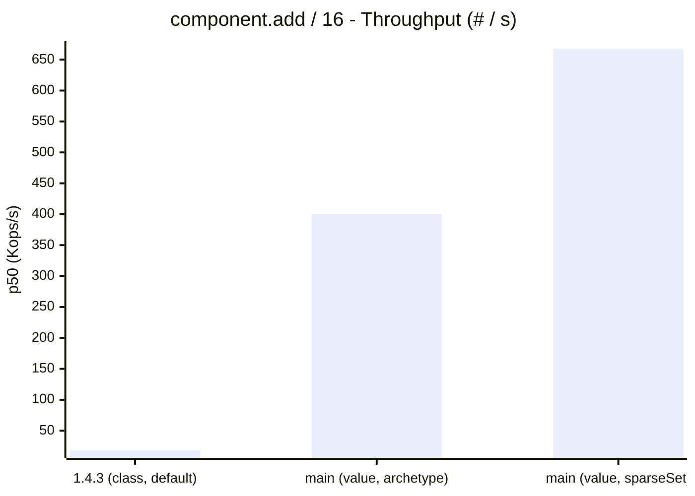

#### Memory (resident peak) (smaller is better)

| Statistic | 1.4.3 (class, default) (baseline) | main (value, archetype) | main (value, sparseSet) |
| --- | --- | --- | --- |
| measurements | 8235 | 10000 | 10000 |
| mean | 10.645 MB | 10.419 MB (Δ -0.22677 MB, ×0.9787, -2.1303%, better) | 10.448 MB (Δ -0.19697 MB, ×0.9815, -1.8503%, better) |
| std dev | 133.97 kB | 103.83 kB (Δ -30.142 kB, ×0.77501, -22.499%, better) | 139.2 kB (Δ +5.2246 kB, ×1.039, +3.8998%, worse) |
| p0 | 9.9615 MB | 9.9287 MB (Δ -0.032768 MB, ×0.99671, -0.32895%, better) | 9.9779 MB (Δ +0.016384 MB, ×1.0016, +0.16447%, worse) |
| p25 | 10.576 MB | 10.437 MB (Δ -0.13926 MB, ×0.98683, -1.3168%, better) | 10.486 MB (Δ -0.090111 MB, ×0.99148, -0.85204%, better) |
| p50 | 10.576 MB | 10.437 MB (Δ -0.13926 MB, ×0.98683, -1.3168%, better) | 10.486 MB (Δ -0.090111 MB, ×0.99148, -0.85204%, better) |
| p75 | 10.83 MB | 10.437 MB (Δ -0.39322 MB, ×0.96369, -3.6309%, better) | 10.486 MB (Δ -0.34406 MB, ×0.96823, -3.177%, better) |
| p90 | 10.83 MB | 10.437 MB (Δ -0.39322 MB, ×0.96369, -3.6309%, better) | 10.486 MB (Δ -0.34406 MB, ×0.96823, -3.177%, better) |
| p99 | 10.83 MB | 10.437 MB (Δ -0.39322 MB, ×0.96369, -3.6309%, better) | 10.486 MB (Δ -0.34406 MB, ×0.96823, -3.177%, better) |
| p100 | 10.83 MB | 10.437 MB (Δ -0.39322 MB, ×0.96369, -3.6309%, better) | 10.486 MB (Δ -0.34406 MB, ×0.96823, -3.177%, better) |

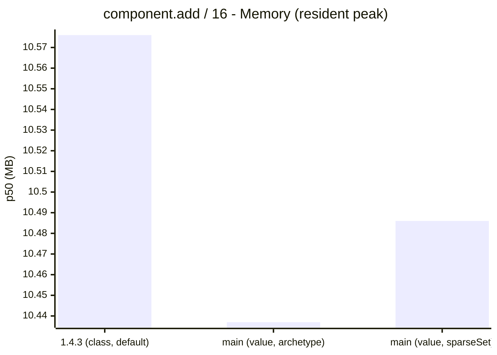

#### Malloc (total) (smaller is better)

| Statistic | 1.4.3 (class, default) (baseline) | main (value, archetype) | main (value, sparseSet) |
| --- | --- | --- | --- |
| measurements | 8235 | 10000 | 10000 |
| mean | 66 | 1 (Δ -65, ×0.015152, -98.485%, better) | 0 (Δ -66, ×0, -100%, better) |
| std dev | 0 | 0 (Δ 0, ratio and change unavailable: zero baseline, unchanged) | 0 (Δ 0, ratio and change unavailable: zero baseline, unchanged) |
| p0 | 66 | 1 (Δ -65, ×0.015152, -98.485%, better) | 0 (Δ -66, ×0, -100%, better) |
| p25 | 66 | 1 (Δ -65, ×0.015152, -98.485%, better) | 0 (Δ -66, ×0, -100%, better) |
| p50 | 66 | 1 (Δ -65, ×0.015152, -98.485%, better) | 0 (Δ -66, ×0, -100%, better) |
| p75 | 66 | 1 (Δ -65, ×0.015152, -98.485%, better) | 0 (Δ -66, ×0, -100%, better) |
| p90 | 66 | 1 (Δ -65, ×0.015152, -98.485%, better) | 0 (Δ -66, ×0, -100%, better) |
| p99 | 66 | 1 (Δ -65, ×0.015152, -98.485%, better) | 0 (Δ -66, ×0, -100%, better) |
| p100 | 66 | 1 (Δ -65, ×0.015152, -98.485%, better) | 0 (Δ -66, ×0, -100%, better) |

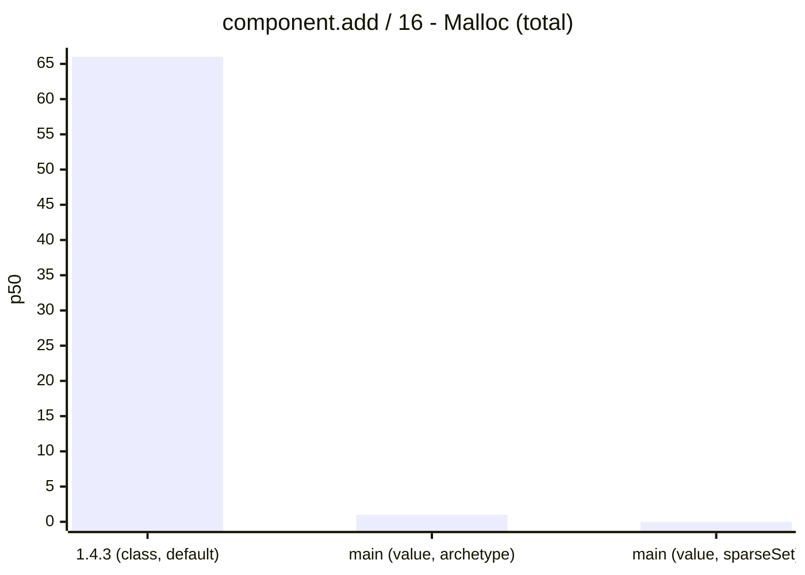

### `component.remove-add` / 16

#### Time (wall clock) (smaller is better)

| Statistic | 1.4.3 (class, default) (baseline) | main (value, archetype) | main (value, sparseSet) |
| --- | --- | --- | --- |
| measurements | 10000 | 10000 | 10000 |
| mean | 11.918 μs | 5.6825 μs (Δ -6.2352 μs, ×0.47681, -52.319%, better) | 3.8766 μs (Δ -8.0411 μs, ×0.32528, -67.472%, better) |
| std dev | 750.33 ns | 388.37 ns (Δ -361.97 ns, ×0.51759, -48.241%, better) | 167.87 ns (Δ -582.46 ns, ×0.22373, -77.627%, better) |
| p0 | 11.708 μs | 5.416 μs (Δ -6.292 μs, ×0.46259, -53.741%, better) | 3.667 μs (Δ -8.041 μs, ×0.3132, -68.68%, better) |
| p25 | 11.839 μs | 5.587 μs (Δ -6.252 μs, ×0.47191, -52.809%, better) | 3.793 μs (Δ -8.046 μs, ×0.32038, -67.962%, better) |
| p50 | 11.879 μs | 5.711 μs (Δ -6.168 μs, ×0.48076, -51.924%, better) | 3.875 μs (Δ -8.004 μs, ×0.32621, -67.379%, better) |
| p75 | 11.919 μs | 5.711 μs (Δ -6.208 μs, ×0.47915, -52.085%, better) | 3.917 μs (Δ -8.002 μs, ×0.32863, -67.137%, better) |
| p90 | 11.959 μs | 5.791 μs (Δ -6.168 μs, ×0.48424, -51.576%, better) | 4.001 μs (Δ -7.958 μs, ×0.33456, -66.544%, better) |
| p99 | 12.631 μs | 6.043 μs (Δ -6.588 μs, ×0.47843, -52.157%, better) | 4.127 μs (Δ -8.504 μs, ×0.32674, -67.326%, better) |
| p100 | 48.708 μs | 41 μs (Δ -7.708 μs, ×0.84175, -15.825%, better) | 11.667 μs (Δ -37.041 μs, ×0.23953, -76.047%, better) |


#### Time (total CPU) (smaller is better)

| Statistic | 1.4.3 (class, default) (baseline) | main (value, archetype) | main (value, sparseSet) |
| --- | --- | --- | --- |
| measurements | 10000 | 10000 | 10000 |
| mean | 12.609 μs | 6.3713 μs (Δ -6.2373 μs, ×0.50531, -49.469%, better) | 4.5751 μs (Δ -8.0335 μs, ×0.36285, -63.715%, better) |
| std dev | 859.02 ns | 407.84 ns (Δ -451.18 ns, ×0.47478, -52.522%, better) | 248.59 ns (Δ -610.42 ns, ×0.28939, -71.061%, better) |
| p0 | 12.334 μs | 6.042 μs (Δ -6.292 μs, ×0.48987, -51.013%, better) | 4.332 μs (Δ -8.002 μs, ×0.35122, -64.878%, better) |
| p25 | 12.503 μs | 6.291 μs (Δ -6.212 μs, ×0.50316, -49.684%, better) | 4.503 μs (Δ -8 μs, ×0.36015, -63.985%, better) |
| p50 | 12.543 μs | 6.375 μs (Δ -6.168 μs, ×0.50825, -49.175%, better) | 4.543 μs (Δ -8 μs, ×0.36219, -63.781%, better) |
| p75 | 12.591 μs | 6.419 μs (Δ -6.172 μs, ×0.50981, -49.019%, better) | 4.627 μs (Δ -7.964 μs, ×0.36748, -63.252%, better) |
| p90 | 12.671 μs | 6.503 μs (Δ -6.168 μs, ×0.51322, -48.678%, better) | 4.711 μs (Δ -7.96 μs, ×0.37179, -62.821%, better) |
| p99 | 13.375 μs | 6.795 μs (Δ -6.58 μs, ×0.50804, -49.196%, better) | 4.919 μs (Δ -8.456 μs, ×0.36778, -63.222%, better) |
| p100 | 50.5 μs | 41.666 μs (Δ -8.834 μs, ×0.82507, -17.493%, better) | 13.583 μs (Δ -36.917 μs, ×0.26897, -73.103%, better) |

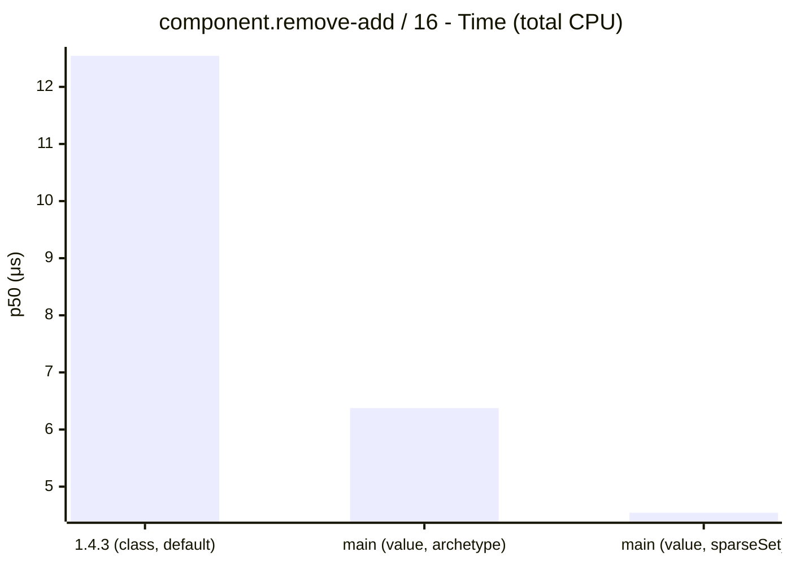

#### Throughput (# / s) (larger is better)

| Statistic | 1.4.3 (class, default) (baseline) | main (value, archetype) | main (value, sparseSet) |
| --- | --- | --- | --- |
| measurements | 10000 | 10000 | 10000 |
| mean | 84.031 Kops/s | 176.18 Kops/s (Δ +92.15 Kops/s, ×2.0966, +109.66%, better) | 258.29 Kops/s (Δ +174.26 Kops/s, ×3.0738, +207.38%, better) |
| std dev | 2.0125 Kops/s | 4.0911 Kops/s (Δ +2.0786 Kops/s, ×2.0329, +103.29%, better) | 7.2423 Kops/s (Δ +5.2298 Kops/s, ×3.5987, +259.87%, better) |
| p0 | 85.412 Kops/s | 184.64 Kops/s (Δ +99.226 Kops/s, ×2.1617, +116.17%, better) | 272.7 Kops/s (Δ +187.29 Kops/s, ×3.1928, +219.28%, better) |
| p25 | 84.543 Kops/s | 179.2 Kops/s (Δ +94.656 Kops/s, ×2.1196, +111.96%, better) | 263.94 Kops/s (Δ +179.39 Kops/s, ×3.1219, +212.19%, better) |
| p50 | 84.223 Kops/s | 175.23 Kops/s (Δ +91.008 Kops/s, ×2.0806, +108.06%, better) | 258.18 Kops/s (Δ +173.95 Kops/s, ×3.0654, +206.54%, better) |
| p75 | 83.967 Kops/s | 175.23 Kops/s (Δ +91.264 Kops/s, ×2.0869, +108.69%, better) | 255.36 Kops/s (Δ +171.39 Kops/s, ×3.0412, +204.12%, better) |
| p90 | 83.647 Kops/s | 172.8 Kops/s (Δ +89.152 Kops/s, ×2.0658, +106.58%, better) | 250.11 Kops/s (Δ +166.46 Kops/s, ×2.9901, +199.01%, better) |
| p99 | 79.231 Kops/s | 165.63 Kops/s (Δ +86.4 Kops/s, ×2.0905, +109.05%, better) | 242.43 Kops/s (Δ +163.2 Kops/s, ×3.0598, +205.98%, better) |
| p100 | 20.531 Kops/s | 24.39 Kops/s (Δ +3.859 Kops/s, ×1.188, +18.796%, better) | 85.712 Kops/s (Δ +65.181 Kops/s, ×4.1748, +317.48%, better) |

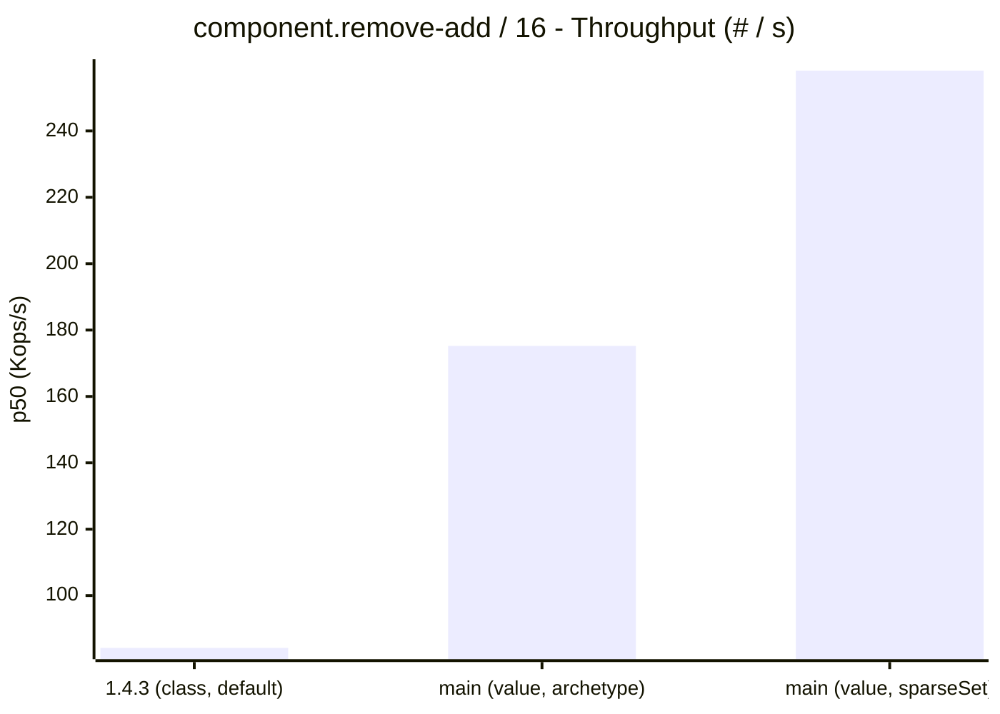

#### Memory (resident peak) (smaller is better)

| Statistic | 1.4.3 (class, default) (baseline) | main (value, archetype) | main (value, sparseSet) |
| --- | --- | --- | --- |
| measurements | 10000 | 10000 | 10000 |
| mean | 10.558 MB | 10.427 MB (Δ -0.13133 MB, ×0.98756, -1.2439%, better) | 10.467 MB (Δ -0.091311 MB, ×0.99135, -0.86483%, better) |
| std dev | 88.04 kB | 121.95 kB (Δ +33.912 kB, ×1.3852, +38.519%, worse) | 128.28 kB (Δ +40.238 kB, ×1.457, +45.704%, worse) |
| p0 | 9.9779 MB | 9.9287 MB (Δ -0.049152 MB, ×0.99507, -0.49261%, better) | 10.043 MB (Δ +0.065536 MB, ×1.0066, +0.65681%, worse) |
| p25 | 10.568 MB | 10.453 MB (Δ -0.11469 MB, ×0.98915, -1.0853%, better) | 10.502 MB (Δ -0.065536 MB, ×0.9938, -0.62016%, better) |
| p50 | 10.568 MB | 10.453 MB (Δ -0.11469 MB, ×0.98915, -1.0853%, better) | 10.502 MB (Δ -0.065536 MB, ×0.9938, -0.62016%, better) |
| p75 | 10.568 MB | 10.453 MB (Δ -0.11469 MB, ×0.98915, -1.0853%, better) | 10.502 MB (Δ -0.065536 MB, ×0.9938, -0.62016%, better) |
| p90 | 10.568 MB | 10.453 MB (Δ -0.11469 MB, ×0.98915, -1.0853%, better) | 10.502 MB (Δ -0.065536 MB, ×0.9938, -0.62016%, better) |
| p99 | 10.568 MB | 10.453 MB (Δ -0.11469 MB, ×0.98915, -1.0853%, better) | 10.502 MB (Δ -0.065536 MB, ×0.9938, -0.62016%, better) |
| p100 | 10.568 MB | 10.453 MB (Δ -0.11469 MB, ×0.98915, -1.0853%, better) | 10.502 MB (Δ -0.065536 MB, ×0.9938, -0.62016%, better) |

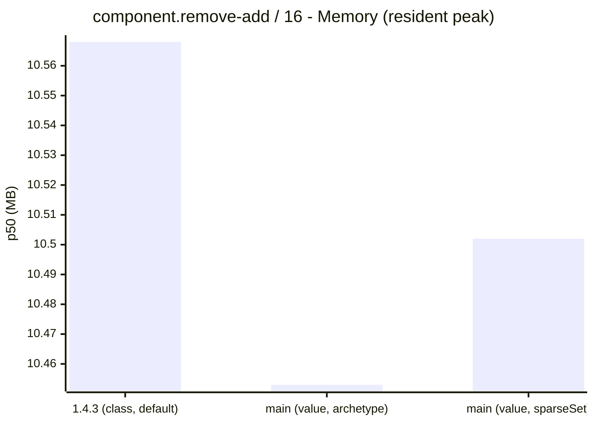

#### Malloc (total) (smaller is better)

| Statistic | 1.4.3 (class, default) (baseline) | main (value, archetype) | main (value, sparseSet) |
| --- | --- | --- | --- |
| measurements | 10000 | 10000 | 10000 |
| mean | 144 | 12 (Δ -132, ×0.083333, -91.667%, better) | 0 (Δ -144, ×0, -100%, better) |
| std dev | 0 | 0 (Δ 0, ratio and change unavailable: zero baseline, unchanged) | 0 (Δ 0, ratio and change unavailable: zero baseline, unchanged) |
| p0 | 144 | 12 (Δ -132, ×0.083333, -91.667%, better) | 0 (Δ -144, ×0, -100%, better) |
| p25 | 144 | 12 (Δ -132, ×0.083333, -91.667%, better) | 0 (Δ -144, ×0, -100%, better) |
| p50 | 144 | 12 (Δ -132, ×0.083333, -91.667%, better) | 0 (Δ -144, ×0, -100%, better) |
| p75 | 144 | 12 (Δ -132, ×0.083333, -91.667%, better) | 0 (Δ -144, ×0, -100%, better) |
| p90 | 144 | 12 (Δ -132, ×0.083333, -91.667%, better) | 0 (Δ -144, ×0, -100%, better) |
| p99 | 144 | 12 (Δ -132, ×0.083333, -91.667%, better) | 0 (Δ -144, ×0, -100%, better) |
| p100 | 144 | 12 (Δ -132, ×0.083333, -91.667%, better) | 0 (Δ -144, ×0, -100%, better) |

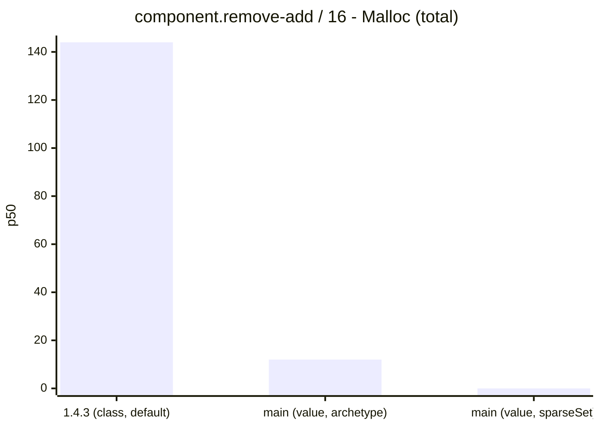

### `entity.create.empty` / 16

#### Time (wall clock) (smaller is better)

| Statistic | 1.4.3 (class, default) (baseline) | main (value, archetype) | main (value, sparseSet) |
| --- | --- | --- | --- |
| measurements | 10000 | 10000 | 10000 |
| mean | 2.2263 μs | 2.2621 μs (Δ +0.035841 μs, ×1.0161, +1.6099%, worse) | 1.5265 μs (Δ -0.69973 μs, ×0.68569, -31.431%, better) |
| std dev | 285.19 ns | 105.02 ns (Δ -180.17 ns, ×0.36823, -63.177%, better) | 51.779 ns (Δ -233.41 ns, ×0.18156, -81.844%, better) |
| p0 | 2.084 μs | 2.125 μs (Δ +0.041 μs, ×1.0197, +1.9674%, worse) | 1.416 μs (Δ -0.668 μs, ×0.67946, -32.054%, better) |
| p25 | 2.209 μs | 2.209 μs (Δ 0 μs, ×1, 0%, unchanged) | 1.5 μs (Δ -0.709 μs, ×0.67904, -32.096%, better) |
| p50 | 2.209 μs | 2.251 μs (Δ +0.042 μs, ×1.019, +1.9013%, worse) | 1.541 μs (Δ -0.668 μs, ×0.6976, -30.24%, better) |
| p75 | 2.251 μs | 2.293 μs (Δ +0.042 μs, ×1.0187, +1.8658%, worse) | 1.542 μs (Δ -0.709 μs, ×0.68503, -31.497%, better) |
| p90 | 2.251 μs | 2.335 μs (Δ +0.084 μs, ×1.0373, +3.7317%, worse) | 1.542 μs (Δ -0.709 μs, ×0.68503, -31.497%, better) |
| p99 | 2.375 μs | 2.501 μs (Δ +0.126 μs, ×1.0531, +5.3053%, worse) | 1.667 μs (Δ -0.708 μs, ×0.70189, -29.811%, better) |
| p100 | 20.792 μs | 6.959 μs (Δ -13.833 μs, ×0.3347, -66.53%, better) | 3.958 μs (Δ -16.834 μs, ×0.19036, -80.964%, better) |

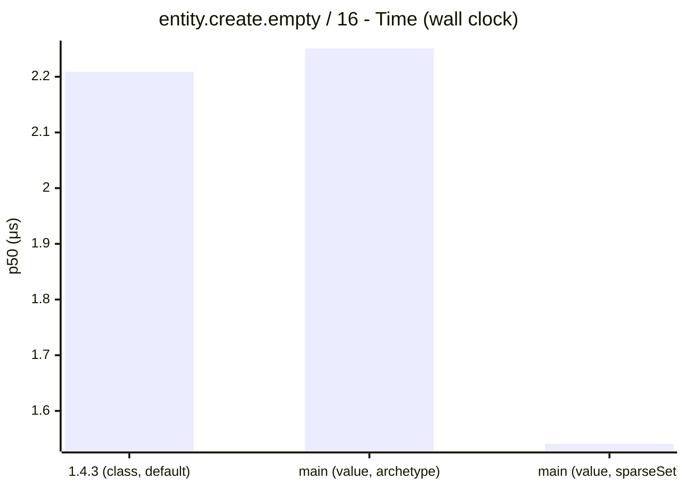

#### Time (total CPU) (smaller is better)

| Statistic | 1.4.3 (class, default) (baseline) | main (value, archetype) | main (value, sparseSet) |
| --- | --- | --- | --- |
| measurements | 10000 | 10000 | 10000 |
| mean | 2.8551 μs | 2.9802 μs (Δ +0.12508 μs, ×1.0438, +4.3809%, worse) | 2.1611 μs (Δ -0.69403 μs, ×0.75692, -24.308%, better) |
| std dev | 293.72 ns | 150.77 ns (Δ -142.95 ns, ×0.5133, -48.67%, better) | 94.971 ns (Δ -198.75 ns, ×0.32334, -67.666%, better) |
| p0 | 2.708 μs | 2.791 μs (Δ +0.083 μs, ×1.0306, +3.065%, worse) | 2 μs (Δ -0.708 μs, ×0.73855, -26.145%, better) |
| p25 | 2.833 μs | 2.917 μs (Δ +0.084 μs, ×1.0297, +2.9651%, worse) | 2.125 μs (Δ -0.708 μs, ×0.75009, -24.991%, better) |
| p50 | 2.835 μs | 2.959 μs (Δ +0.124 μs, ×1.0437, +4.3739%, worse) | 2.167 μs (Δ -0.668 μs, ×0.76437, -23.563%, better) |
| p75 | 2.875 μs | 3.001 μs (Δ +0.126 μs, ×1.0438, +4.3826%, worse) | 2.167 μs (Δ -0.708 μs, ×0.75374, -24.626%, better) |
| p90 | 2.917 μs | 3.085 μs (Δ +0.168 μs, ×1.0576, +5.7593%, worse) | 2.209 μs (Δ -0.708 μs, ×0.75728, -24.272%, better) |
| p99 | 3.041 μs | 3.293 μs (Δ +0.252 μs, ×1.0829, +8.2867%, worse) | 2.335 μs (Δ -0.706 μs, ×0.76784, -23.216%, better) |
| p100 | 21.417 μs | 9.208 μs (Δ -12.209 μs, ×0.42994, -57.006%, better) | 6.5 μs (Δ -14.917 μs, ×0.3035, -69.65%, better) |

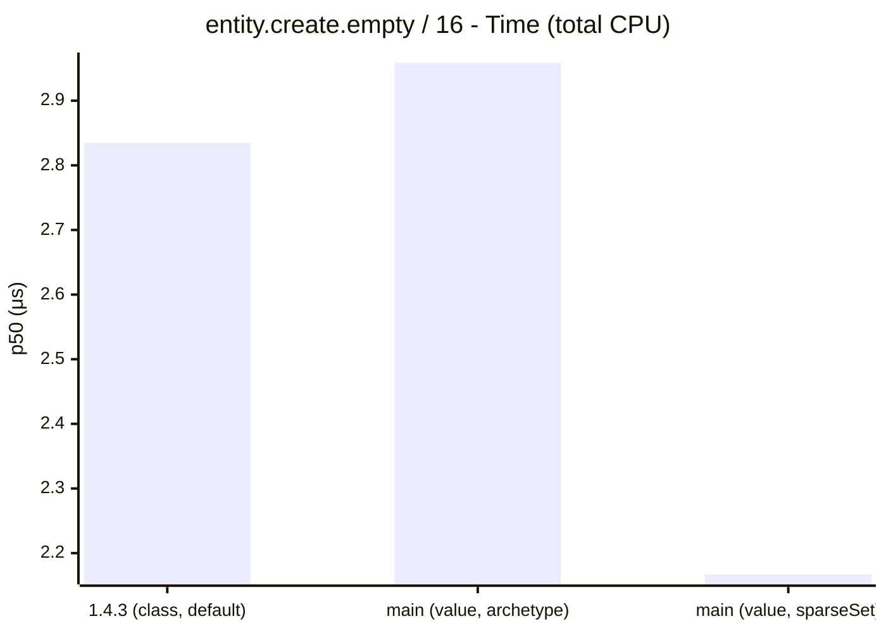

#### Throughput (# / s) (larger is better)

| Statistic | 1.4.3 (class, default) (baseline) | main (value, archetype) | main (value, sparseSet) |
| --- | --- | --- | --- |
| measurements | 10000 | 10000 | 10000 |
| mean | 450.61 Kops/s | 442.86 Kops/s (Δ -7.7456 Kops/s, ×0.98281, -1.7189%, worse) | 655.71 Kops/s (Δ +205.1 Kops/s, ×1.4552, +45.515%, better) |
| std dev | 12.858 Kops/s | 14.267 Kops/s (Δ +1.4091 Kops/s, ×1.1096, +10.959%, better) | 17.558 Kops/s (Δ +4.6998 Kops/s, ×1.3655, +36.552%, better) |
| p0 | 479.85 Kops/s | 470.59 Kops/s (Δ -9.258 Kops/s, ×0.98071, -1.9294%, worse) | 706.22 Kops/s (Δ +226.37 Kops/s, ×1.4718, +47.175%, better) |
| p25 | 453.12 Kops/s | 453.12 Kops/s (Δ 0 Kops/s, ×1, 0%, unchanged) | 667.13 Kops/s (Δ +214.02 Kops/s, ×1.4723, +47.232%, better) |
| p50 | 453.12 Kops/s | 444.67 Kops/s (Δ -8.448 Kops/s, ×0.98136, -1.8644%, worse) | 649.22 Kops/s (Δ +196.1 Kops/s, ×1.4328, +43.277%, better) |
| p75 | 444.67 Kops/s | 436.48 Kops/s (Δ -8.192 Kops/s, ×0.98158, -1.8423%, worse) | 648.7 Kops/s (Δ +204.03 Kops/s, ×1.4588, +45.884%, better) |
| p90 | 444.67 Kops/s | 428.54 Kops/s (Δ -16.128 Kops/s, ×0.96373, -3.627%, worse) | 648.7 Kops/s (Δ +204.03 Kops/s, ×1.4588, +45.884%, better) |
| p99 | 421.12 Kops/s | 400.13 Kops/s (Δ -20.992 Kops/s, ×0.95015, -4.9848%, worse) | 600.06 Kops/s (Δ +178.94 Kops/s, ×1.4249, +42.493%, better) |
| p100 | 48.095 Kops/s | 143.7 Kops/s (Δ +95.604 Kops/s, ×2.9878, +198.78%, better) | 252.65 Kops/s (Δ +204.56 Kops/s, ×5.2532, +425.32%, better) |

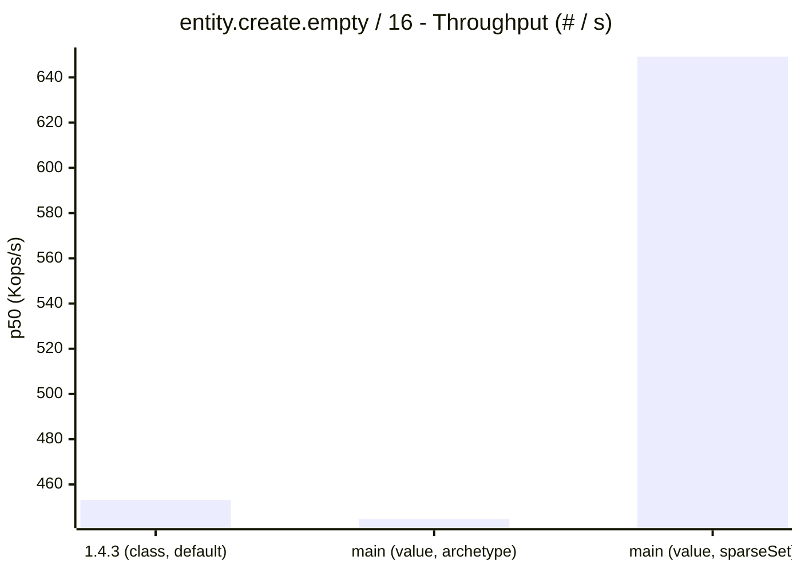

#### Memory (resident peak) (smaller is better)

| Statistic | 1.4.3 (class, default) (baseline) | main (value, archetype) | main (value, sparseSet) |
| --- | --- | --- | --- |
| measurements | 10000 | 10000 | 10000 |
| mean | 10.206 MB | 10.282 MB (Δ +0.075981 MB, ×1.0074, +0.74447%, worse) | 10.161 MB (Δ -0.04532 MB, ×0.99556, -0.44405%, better) |
| std dev | 167.73 kB | 171.31 kB (Δ +3.5777 kB, ×1.0213, +2.133%, worse) | 171.14 kB (Δ +3.4135 kB, ×1.0204, +2.0351%, worse) |
| p0 | 9.8796 MB | 9.8959 MB (Δ +0.016384 MB, ×1.0017, +0.16584%, worse) | 9.8632 MB (Δ -0.016384 MB, ×0.99834, -0.16584%, better) |
| p25 | 10.289 MB | 10.355 MB (Δ +0.065536 MB, ×1.0064, +0.63694%, worse) | 9.8714 MB (Δ -0.41779 MB, ×0.95939, -4.0605%, better) |
| p50 | 10.289 MB | 10.355 MB (Δ +0.065536 MB, ×1.0064, +0.63694%, worse) | 10.256 MB (Δ -0.032768 MB, ×0.99682, -0.31847%, better) |
| p75 | 10.289 MB | 10.355 MB (Δ +0.065536 MB, ×1.0064, +0.63694%, worse) | 10.256 MB (Δ -0.032768 MB, ×0.99682, -0.31847%, better) |
| p90 | 10.289 MB | 10.355 MB (Δ +0.065536 MB, ×1.0064, +0.63694%, worse) | 10.256 MB (Δ -0.032768 MB, ×0.99682, -0.31847%, better) |
| p99 | 10.289 MB | 10.355 MB (Δ +0.065536 MB, ×1.0064, +0.63694%, worse) | 10.256 MB (Δ -0.032768 MB, ×0.99682, -0.31847%, better) |
| p100 | 10.289 MB | 10.355 MB (Δ +0.065536 MB, ×1.0064, +0.63694%, worse) | 10.256 MB (Δ -0.032768 MB, ×0.99682, -0.31847%, better) |

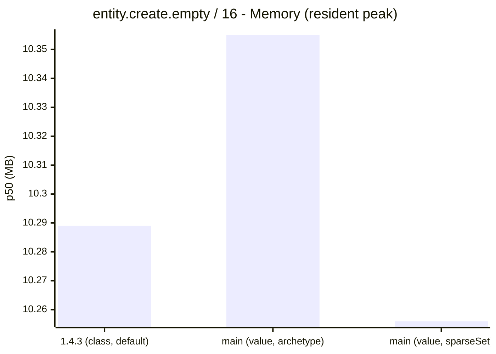

#### Malloc (total) (smaller is better)

| Statistic | 1.4.3 (class, default) (baseline) | main (value, archetype) | main (value, sparseSet) |
| --- | --- | --- | --- |
| measurements | 10000 | 10000 | 10000 |
| mean | 6 | 16 (Δ +10, ×2.6667, +166.67%, worse) | 9 (Δ +3, ×1.5, +50%, worse) |
| std dev | 0 | 0 (Δ 0, ratio and change unavailable: zero baseline, unchanged) | 0 (Δ 0, ratio and change unavailable: zero baseline, unchanged) |
| p0 | 6 | 16 (Δ +10, ×2.6667, +166.67%, worse) | 9 (Δ +3, ×1.5, +50%, worse) |
| p25 | 6 | 16 (Δ +10, ×2.6667, +166.67%, worse) | 9 (Δ +3, ×1.5, +50%, worse) |
| p50 | 6 | 16 (Δ +10, ×2.6667, +166.67%, worse) | 9 (Δ +3, ×1.5, +50%, worse) |
| p75 | 6 | 16 (Δ +10, ×2.6667, +166.67%, worse) | 9 (Δ +3, ×1.5, +50%, worse) |
| p90 | 6 | 16 (Δ +10, ×2.6667, +166.67%, worse) | 9 (Δ +3, ×1.5, +50%, worse) |
| p99 | 6 | 16 (Δ +10, ×2.6667, +166.67%, worse) | 9 (Δ +3, ×1.5, +50%, worse) |
| p100 | 6 | 16 (Δ +10, ×2.6667, +166.67%, worse) | 9 (Δ +3, ×1.5, +50%, worse) |

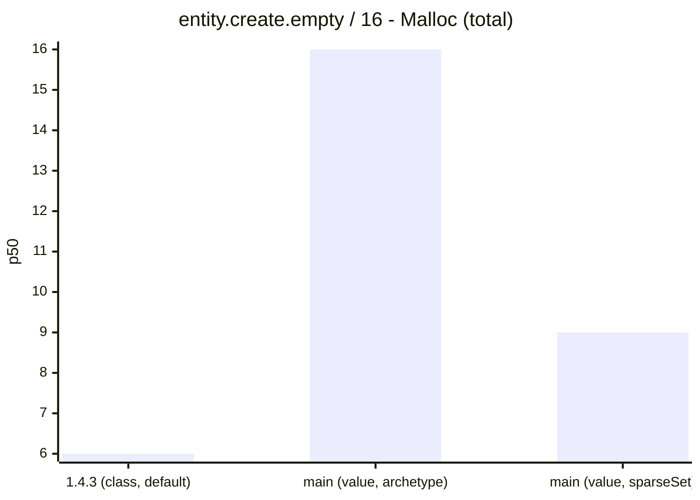

### `entity.create.minimal` / 16

#### Time (wall clock) (smaller is better)

| Statistic | 1.4.3 (class, default) (baseline) | main (value, archetype) | main (value, sparseSet) |
| --- | --- | --- | --- |
| measurements | 10000 | 10000 | 10000 |
| mean | 18.156 μs | 8.8341 μs (Δ -9.3222 μs, ×0.48656, -51.344%, better) | 6.5537 μs (Δ -11.603 μs, ×0.36096, -63.904%, better) |
| std dev | 393.84 ns | 209.56 ns (Δ -184.28 ns, ×0.53209, -46.791%, better) | 154.33 ns (Δ -239.51 ns, ×0.39186, -60.814%, better) |
| p0 | 17.708 μs | 8.417 μs (Δ -9.291 μs, ×0.47532, -52.468%, better) | 6.25 μs (Δ -11.458 μs, ×0.35295, -64.705%, better) |
| p25 | 17.967 μs | 8.791 μs (Δ -9.176 μs, ×0.48929, -51.071%, better) | 6.503 μs (Δ -11.464 μs, ×0.36194, -63.806%, better) |
| p50 | 18.175 μs | 8.839 μs (Δ -9.336 μs, ×0.48633, -51.367%, better) | 6.543 μs (Δ -11.632 μs, ×0.36, -64%, better) |
| p75 | 18.255 μs | 8.879 μs (Δ -9.376 μs, ×0.48639, -51.361%, better) | 6.583 μs (Δ -11.672 μs, ×0.36061, -63.939%, better) |
| p90 | 18.335 μs | 9.047 μs (Δ -9.288 μs, ×0.49343, -50.657%, better) | 6.627 μs (Δ -11.708 μs, ×0.36144, -63.856%, better) |
| p99 | 19.263 μs | 9.335 μs (Δ -9.928 μs, ×0.48461, -51.539%, better) | 7.003 μs (Δ -12.26 μs, ×0.36355, -63.645%, better) |
| p100 | 33.375 μs | 14.458 μs (Δ -18.917 μs, ×0.4332, -56.68%, better) | 12.208 μs (Δ -21.167 μs, ×0.36578, -63.422%, better) |

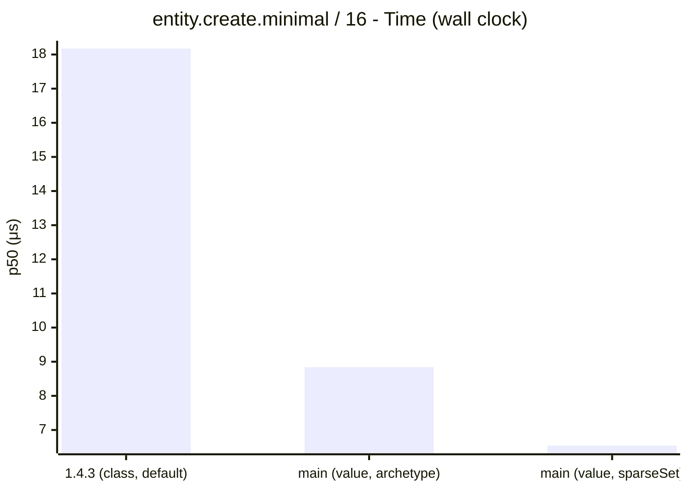

#### Time (total CPU) (smaller is better)

| Statistic | 1.4.3 (class, default) (baseline) | main (value, archetype) | main (value, sparseSet) |
| --- | --- | --- | --- |
| measurements | 10000 | 10000 | 10000 |
| mean | 18.862 μs | 9.5108 μs (Δ -9.3514 μs, ×0.50423, -49.577%, better) | 7.1999 μs (Δ -11.662 μs, ×0.38171, -61.829%, better) |
| std dev | 468.75 ns | 263.41 ns (Δ -205.34 ns, ×0.56194, -43.806%, better) | 214.93 ns (Δ -253.82 ns, ×0.45851, -54.149%, better) |
| p0 | 18.416 μs | 9.083 μs (Δ -9.333 μs, ×0.49321, -50.679%, better) | 6.833 μs (Δ -11.583 μs, ×0.37104, -62.896%, better) |
| p25 | 18.671 μs | 9.463 μs (Δ -9.208 μs, ×0.50683, -49.317%, better) | 7.127 μs (Δ -11.544 μs, ×0.38171, -61.829%, better) |
| p50 | 18.879 μs | 9.503 μs (Δ -9.376 μs, ×0.50336, -49.664%, better) | 7.167 μs (Δ -11.712 μs, ×0.37963, -62.037%, better) |
| p75 | 18.959 μs | 9.583 μs (Δ -9.376 μs, ×0.50546, -49.454%, better) | 7.211 μs (Δ -11.748 μs, ×0.38035, -61.965%, better) |
| p90 | 19.055 μs | 9.751 μs (Δ -9.304 μs, ×0.51173, -48.827%, better) | 7.291 μs (Δ -11.764 μs, ×0.38263, -61.737%, better) |
| p99 | 20.047 μs | 10.087 μs (Δ -9.96 μs, ×0.50317, -49.683%, better) | 7.711 μs (Δ -12.336 μs, ×0.38465, -61.535%, better) |
| p100 | 34.084 μs | 15.959 μs (Δ -18.125 μs, ×0.46823, -53.177%, better) | 13.75 μs (Δ -20.334 μs, ×0.40342, -59.658%, better) |

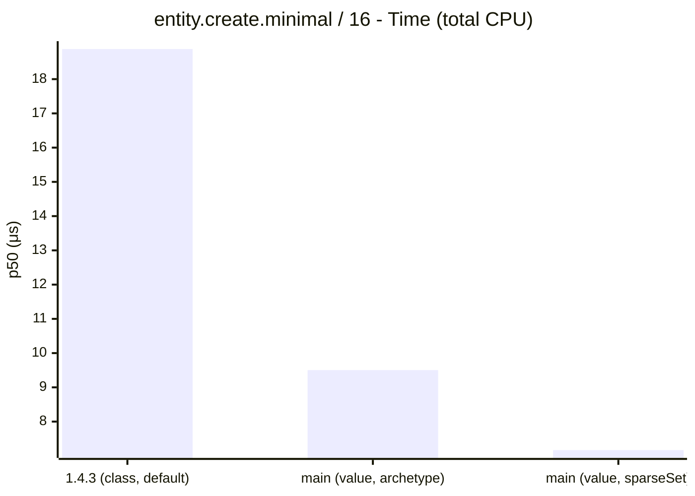

#### Throughput (# / s) (larger is better)

| Statistic | 1.4.3 (class, default) (baseline) | main (value, archetype) | main (value, sparseSet) |
| --- | --- | --- | --- |
| measurements | 10000 | 10000 | 10000 |
| mean | 55.109 Kops/s | 113.27 Kops/s (Δ +58.156 Kops/s, ×2.0553, +105.53%, better) | 152.66 Kops/s (Δ +97.548 Kops/s, ×2.7701, +177.01%, better) |
| std dev | 945.97 ops/s | 2408.5 ops/s (Δ +1462.5 ops/s, ×2.546, +154.6%, better) | 2835.8 ops/s (Δ +1889.8 ops/s, ×2.9978, +199.78%, better) |
| p0 | 56.472 Kops/s | 118.81 Kops/s (Δ +62.335 Kops/s, ×2.1038, +110.38%, better) | 160 Kops/s (Δ +103.53 Kops/s, ×2.8333, +183.33%, better) |
| p25 | 55.711 Kops/s | 113.79 Kops/s (Δ +58.08 Kops/s, ×2.0425, +104.25%, better) | 153.85 Kops/s (Δ +98.144 Kops/s, ×2.7617, +176.17%, better) |
| p50 | 55.071 Kops/s | 113.22 Kops/s (Δ +58.144 Kops/s, ×2.0558, +105.58%, better) | 152.96 Kops/s (Δ +97.888 Kops/s, ×2.7775, +177.75%, better) |
| p75 | 54.815 Kops/s | 112.7 Kops/s (Δ +57.888 Kops/s, ×2.0561, +105.61%, better) | 151.94 Kops/s (Δ +97.12 Kops/s, ×2.7718, +177.18%, better) |
| p90 | 54.559 Kops/s | 110.66 Kops/s (Δ +56.096 Kops/s, ×2.0282, +102.82%, better) | 151.04 Kops/s (Δ +96.48 Kops/s, ×2.7684, +176.84%, better) |
| p99 | 51.839 Kops/s | 106.69 Kops/s (Δ +54.848 Kops/s, ×2.058, +105.8%, better) | 142.97 Kops/s (Δ +91.136 Kops/s, ×2.7581, +175.81%, better) |
| p100 | 29.963 Kops/s | 69.166 Kops/s (Δ +39.203 Kops/s, ×2.3084, +130.84%, better) | 81.913 Kops/s (Δ +51.95 Kops/s, ×2.7338, +173.38%, better) |

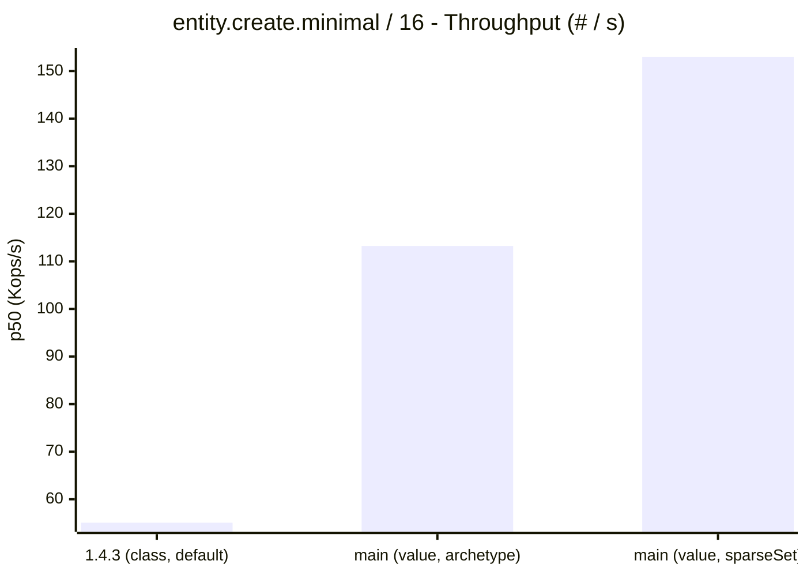

#### Memory (resident peak) (smaller is better)

| Statistic | 1.4.3 (class, default) (baseline) | main (value, archetype) | main (value, sparseSet) |
| --- | --- | --- | --- |
| measurements | 10000 | 10000 | 10000 |
| mean | 10.511 MB | 10.37 MB (Δ -0.14081 MB, ×0.9866, -1.3397%, better) | 10.408 MB (Δ -0.10272 MB, ×0.99023, -0.97728%, better) |
| std dev | 82.222 kB | 126.7 kB (Δ +44.478 kB, ×1.5409, +54.095%, worse) | 141.98 kB (Δ +59.759 kB, ×1.7268, +72.68%, worse) |
| p0 | 9.9451 MB | 9.9451 MB (Δ 0 MB, ×1, 0%, unchanged) | 9.9942 MB (Δ +0.049152 MB, ×1.0049, +0.49423%, worse) |
| p25 | 10.519 MB | 10.404 MB (Δ -0.11469 MB, ×0.9891, -1.0903%, better) | 10.453 MB (Δ -0.065536 MB, ×0.99377, -0.62305%, better) |
| p50 | 10.519 MB | 10.404 MB (Δ -0.11469 MB, ×0.9891, -1.0903%, better) | 10.453 MB (Δ -0.065536 MB, ×0.99377, -0.62305%, better) |
| p75 | 10.519 MB | 10.404 MB (Δ -0.11469 MB, ×0.9891, -1.0903%, better) | 10.453 MB (Δ -0.065536 MB, ×0.99377, -0.62305%, better) |
| p90 | 10.519 MB | 10.404 MB (Δ -0.11469 MB, ×0.9891, -1.0903%, better) | 10.453 MB (Δ -0.065536 MB, ×0.99377, -0.62305%, better) |
| p99 | 10.519 MB | 10.404 MB (Δ -0.11469 MB, ×0.9891, -1.0903%, better) | 10.453 MB (Δ -0.065536 MB, ×0.99377, -0.62305%, better) |
| p100 | 10.519 MB | 10.404 MB (Δ -0.11469 MB, ×0.9891, -1.0903%, better) | 10.453 MB (Δ -0.065536 MB, ×0.99377, -0.62305%, better) |

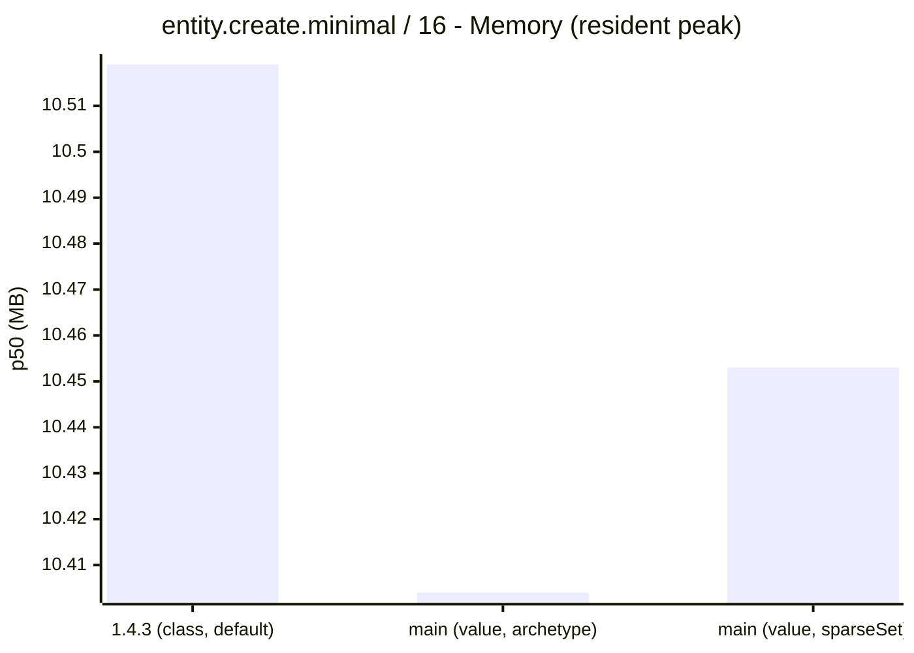

#### Malloc (total) (smaller is better)

| Statistic | 1.4.3 (class, default) (baseline) | main (value, archetype) | main (value, sparseSet) |
| --- | --- | --- | --- |
| measurements | 10000 | 10000 | 10000 |
| mean | 170 | 46 (Δ -124, ×0.27059, -72.941%, better) | 30 (Δ -140, ×0.17647, -82.353%, better) |
| std dev | 0 | 0 (Δ 0, ratio and change unavailable: zero baseline, unchanged) | 0 (Δ 0, ratio and change unavailable: zero baseline, unchanged) |
| p0 | 170 | 46 (Δ -124, ×0.27059, -72.941%, better) | 30 (Δ -140, ×0.17647, -82.353%, better) |
| p25 | 170 | 46 (Δ -124, ×0.27059, -72.941%, better) | 30 (Δ -140, ×0.17647, -82.353%, better) |
| p50 | 170 | 46 (Δ -124, ×0.27059, -72.941%, better) | 30 (Δ -140, ×0.17647, -82.353%, better) |
| p75 | 170 | 46 (Δ -124, ×0.27059, -72.941%, better) | 30 (Δ -140, ×0.17647, -82.353%, better) |
| p90 | 170 | 46 (Δ -124, ×0.27059, -72.941%, better) | 30 (Δ -140, ×0.17647, -82.353%, better) |
| p99 | 170 | 46 (Δ -124, ×0.27059, -72.941%, better) | 30 (Δ -140, ×0.17647, -82.353%, better) |
| p100 | 170 | 46 (Δ -124, ×0.27059, -72.941%, better) | 30 (Δ -140, ×0.17647, -82.353%, better) |

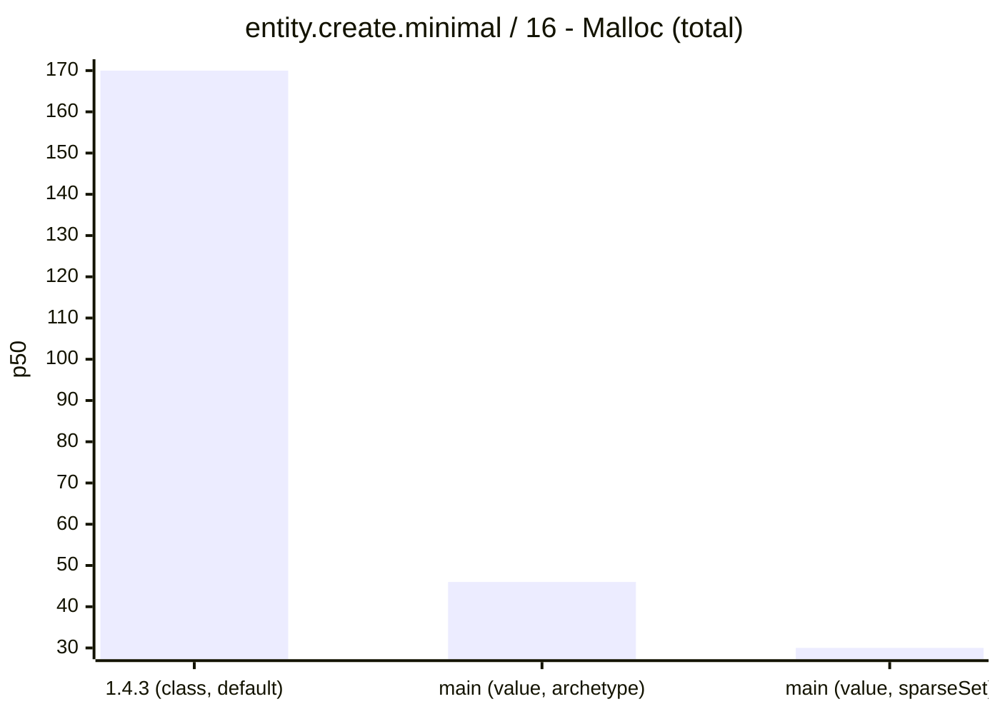

### `entity.create.no-entities` / 0

#### Time (wall clock) (smaller is better)

| Statistic | 1.4.3 (class, default) (baseline) | main (value, archetype) | main (value, sparseSet) |
| --- | --- | --- | --- |
| measurements | 9786 | 9978 | 8333 |
| mean | 42.805 ns | 49.736 ns (Δ +6.9316 ns, ×1.1619, +16.194%, worse) | 42.012 ns (Δ -0.79228 ns, ×0.98149, -1.8509%, better) |
| std dev | 6.9522 ns | 16.794 ns (Δ +9.842 ns, ×2.4157, +141.57%, worse) | 11.024 ns (Δ +4.0718 ns, ×1.5857, +58.568%, worse) |
| p0 | 41 ns | 41 ns (Δ 0 ns, ×1, 0%, unchanged) | 41 ns (Δ 0 ns, ×1, 0%, unchanged) |
| p25 | 41 ns | 41 ns (Δ 0 ns, ×1, 0%, unchanged) | 41 ns (Δ 0 ns, ×1, 0%, unchanged) |
| p50 | 42 ns | 42 ns (Δ 0 ns, ×1, 0%, unchanged) | 42 ns (Δ 0 ns, ×1, 0%, unchanged) |
| p75 | 42 ns | 42 ns (Δ 0 ns, ×1, 0%, unchanged) | 42 ns (Δ 0 ns, ×1, 0%, unchanged) |
| p90 | 42 ns | 83 ns (Δ +41 ns, ×1.9762, +97.619%, worse) | 42 ns (Δ 0 ns, ×1, 0%, unchanged) |
| p99 | 83 ns | 84 ns (Δ +1 ns, ×1.012, +1.2048%, worse) | 42 ns (Δ -41 ns, ×0.50602, -49.398%, better) |
| p100 | 167 ns | 292 ns (Δ +125 ns, ×1.7485, +74.85%, worse) | 958 ns (Δ +791 ns, ×5.7365, +473.65%, worse) |

```mermaid
xychart-beta
    title "entity.create.no-entities / 0 - Time (wall clock)"
    x-axis ["1.4.3 (class, default)", "main (value, archetype)", "main (value, sparseSet)"]
    y-axis "p50 (ns)"
    bar [42, 42, 42]
```

#### Time (total CPU) (smaller is better)

| Statistic | 1.4.3 (class, default) (baseline) | main (value, archetype) | main (value, sparseSet) |
| --- | --- | --- | --- |
| measurements | 10000 | 10000 | 10000 |
| mean | 694.66 ns | 748.9 ns (Δ +54.241 ns, ×1.0781, +7.8084%, worse) | 728.93 ns (Δ +34.277 ns, ×1.0493, +4.9343%, worse) |
| std dev | 38.667 ns | 43.14 ns (Δ +4.473 ns, ×1.1157, +11.568%, worse) | 159.25 ns (Δ +120.59 ns, ×4.1186, +311.86%, worse) |
| p0 | 583 ns | 666 ns (Δ +83 ns, ×1.1424, +14.237%, worse) | 625 ns (Δ +42 ns, ×1.072, +7.2041%, worse) |
| p25 | 667 ns | 709 ns (Δ +42 ns, ×1.063, +6.2969%, worse) | 708 ns (Δ +41 ns, ×1.0615, +6.1469%, worse) |
| p50 | 708 ns | 750 ns (Δ +42 ns, ×1.0593, +5.9322%, worse) | 709 ns (Δ +1 ns, ×1.0014, +0.14124%, worse) |
| p75 | 709 ns | 751 ns (Δ +42 ns, ×1.0592, +5.9238%, worse) | 750 ns (Δ +41 ns, ×1.0578, +5.7828%, worse) |
| p90 | 750 ns | 792 ns (Δ +42 ns, ×1.056, +5.6%, worse) | 751 ns (Δ +1 ns, ×1.0013, +0.13333%, worse) |
| p99 | 793 ns | 875 ns (Δ +82 ns, ×1.1034, +10.34%, worse) | 834 ns (Δ +41 ns, ×1.0517, +5.1702%, worse) |
| p100 | 2 μs | 2.793 μs (Δ +0.793 μs, ×1.3965, +39.65%, worse) | 15.5 μs (Δ +13.5 μs, ×7.75, +675%, worse) |

```mermaid
xychart-beta
    title "entity.create.no-entities / 0 - Time (total CPU)"
    x-axis ["1.4.3 (class, default)", "main (value, archetype)", "main (value, sparseSet)"]
    y-axis "p50 (ns)"
    bar [708, 750, 709]
```

#### Throughput (# / s) (larger is better)

| Statistic | 1.4.3 (class, default) (baseline) | main (value, archetype) | main (value, sparseSet) |
| --- | --- | --- | --- |
| measurements | 9786 | 9978 | 8333 |
| mean | 23.68 Mops/s | 21.696 Mops/s (Δ -1.9842 Mops/s, ×0.91621, -8.3794%, worse) | 23.952 Mops/s (Δ +0.27181 Mops/s, ×1.0115, +1.1478%, better) |
| std dev | 1965.6 Kops/s | 4746.8 Kops/s (Δ +2781.2 Kops/s, ×2.415, +141.5%, better) | 918.91 Kops/s (Δ -1046.7 Kops/s, ×0.4675, -53.25%, worse) |
| p0 | 24.39 Mops/s | 24.39 Mops/s (Δ 0 Mops/s, ×1, 0%, unchanged) | 24.39 Mops/s (Δ 0 Mops/s, ×1, 0%, unchanged) |
| p25 | 24.39 Mops/s | 24.39 Mops/s (Δ 0 Mops/s, ×1, 0%, unchanged) | 24.39 Mops/s (Δ 0 Mops/s, ×1, 0%, unchanged) |
| p50 | 23.822 Mops/s | 23.822 Mops/s (Δ 0 Mops/s, ×1, 0%, unchanged) | 23.822 Mops/s (Δ 0 Mops/s, ×1, 0%, unchanged) |
| p75 | 23.822 Mops/s | 23.822 Mops/s (Δ 0 Mops/s, ×1, 0%, unchanged) | 23.822 Mops/s (Δ 0 Mops/s, ×1, 0%, unchanged) |
| p90 | 23.822 Mops/s | 12.05 Mops/s (Δ -11.772 Mops/s, ×0.50585, -49.415%, worse) | 23.822 Mops/s (Δ 0 Mops/s, ×1, 0%, unchanged) |
| p99 | 12.05 Mops/s | 11.911 Mops/s (Δ -0.13926 Mops/s, ×0.98844, -1.1557%, worse) | 23.822 Mops/s (Δ +11.772 Mops/s, ×1.9769, +97.689%, better) |
| p100 | 5.988 Mops/s | 3.4247 Mops/s (Δ -2.5634 Mops/s, ×0.57192, -42.808%, worse) | 1.0438 Mops/s (Δ -4.9442 Mops/s, ×0.17432, -82.568%, worse) |

```mermaid
xychart-beta
    title "entity.create.no-entities / 0 - Throughput (# / s)"
    x-axis ["1.4.3 (class, default)", "main (value, archetype)", "main (value, sparseSet)"]
    y-axis "p50 (Mops/s)"
    bar [23.822, 23.822, 23.822]
```

#### Memory (resident peak) (smaller is better)

| Statistic | 1.4.3 (class, default) (baseline) | main (value, archetype) | main (value, sparseSet) |
| --- | --- | --- | --- |
| measurements | 10000 | 10000 | 10000 |
| mean | 10.082 MB | 10.109 MB (Δ +0.026459 MB, ×1.0026, +0.26242%, worse) | 10.105 MB (Δ +0.02214 MB, ×1.0022, +0.21959%, worse) |
| std dev | 161.39 kB | 148.98 kB (Δ -12.41 kB, ×0.92311, -7.689%, better) | 169.78 kB (Δ +8.389 kB, ×1.052, +5.1979%, worse) |
| p0 | 9.8468 MB | 9.8468 MB (Δ 0 MB, ×1, 0%, unchanged) | 9.8304 MB (Δ -0.016384 MB, ×0.99834, -0.16639%, better) |
| p25 | 9.855 MB | 9.855 MB (Δ 0 MB, ×1, 0%, unchanged) | 9.8386 MB (Δ -0.016384 MB, ×0.99834, -0.16625%, better) |
| p50 | 10.191 MB | 10.191 MB (Δ 0 MB, ×1, 0%, unchanged) | 10.207 MB (Δ +0.016384 MB, ×1.0016, +0.16077%, worse) |
| p75 | 10.191 MB | 10.191 MB (Δ 0 MB, ×1, 0%, unchanged) | 10.207 MB (Δ +0.016384 MB, ×1.0016, +0.16077%, worse) |
| p90 | 10.191 MB | 10.191 MB (Δ 0 MB, ×1, 0%, unchanged) | 10.207 MB (Δ +0.016384 MB, ×1.0016, +0.16077%, worse) |
| p99 | 10.191 MB | 10.191 MB (Δ 0 MB, ×1, 0%, unchanged) | 10.207 MB (Δ +0.016384 MB, ×1.0016, +0.16077%, worse) |
| p100 | 10.191 MB | 10.191 MB (Δ 0 MB, ×1, 0%, unchanged) | 10.207 MB (Δ +0.016384 MB, ×1.0016, +0.16077%, worse) |

```mermaid
xychart-beta
    title "entity.create.no-entities / 0 - Memory (resident peak)"
    x-axis ["1.4.3 (class, default)", "main (value, archetype)", "main (value, sparseSet)"]
    y-axis "p50 (MB)"
    bar [10.191, 10.191, 10.207]
```

#### Malloc (total) (smaller is better)

| Statistic | 1.4.3 (class, default) (baseline) | main (value, archetype) | main (value, sparseSet) |
| --- | --- | --- | --- |
| measurements | 10000 | 10000 | 10000 |
| mean | 0 | 0 (Δ 0, ratio and change unavailable: zero baseline, unchanged) | 0 (Δ 0, ratio and change unavailable: zero baseline, unchanged) |
| std dev | 0 | 0 (Δ 0, ratio and change unavailable: zero baseline, unchanged) | 0 (Δ 0, ratio and change unavailable: zero baseline, unchanged) |
| p0 | 0 | 0 (Δ 0, ratio and change unavailable: zero baseline, unchanged) | 0 (Δ 0, ratio and change unavailable: zero baseline, unchanged) |
| p25 | 0 | 0 (Δ 0, ratio and change unavailable: zero baseline, unchanged) | 0 (Δ 0, ratio and change unavailable: zero baseline, unchanged) |
| p50 | 0 | 0 (Δ 0, ratio and change unavailable: zero baseline, unchanged) | 0 (Δ 0, ratio and change unavailable: zero baseline, unchanged) |
| p75 | 0 | 0 (Δ 0, ratio and change unavailable: zero baseline, unchanged) | 0 (Δ 0, ratio and change unavailable: zero baseline, unchanged) |
| p90 | 0 | 0 (Δ 0, ratio and change unavailable: zero baseline, unchanged) | 0 (Δ 0, ratio and change unavailable: zero baseline, unchanged) |
| p99 | 0 | 0 (Δ 0, ratio and change unavailable: zero baseline, unchanged) | 0 (Δ 0, ratio and change unavailable: zero baseline, unchanged) |
| p100 | 0 | 0 (Δ 0, ratio and change unavailable: zero baseline, unchanged) | 0 (Δ 0, ratio and change unavailable: zero baseline, unchanged) |

```mermaid
xychart-beta
    title "entity.create.no-entities / 0 - Malloc (total)"
    x-axis ["1.4.3 (class, default)", "main (value, archetype)", "main (value, sparseSet)"]
    y-axis "p50"
    bar [0, 0, 0]
```

### `entity.destroy.minimal` / 16

#### Time (wall clock) (smaller is better)

| Statistic | 1.4.3 (class, default) (baseline) | main (value, archetype) | main (value, sparseSet) |
| --- | --- | --- | --- |
| measurements | 10000 | 10000 | 10000 |
| mean | 40.182 μs | 6.9413 μs (Δ -33.241 μs, ×0.17275, -82.725%, better) | 6.607 μs (Δ -33.575 μs, ×0.16443, -83.557%, better) |
| std dev | 1925.9 ns | 475.29 ns (Δ -1450.6 ns, ×0.24679, -75.321%, better) | 159.47 ns (Δ -1766.5 ns, ×0.082803, -91.72%, better) |
| p0 | 39.5 μs | 6.666 μs (Δ -32.834 μs, ×0.16876, -83.124%, better) | 6.334 μs (Δ -33.166 μs, ×0.16035, -83.965%, better) |
| p25 | 39.807 μs | 6.795 μs (Δ -33.012 μs, ×0.1707, -82.93%, better) | 6.503 μs (Δ -33.304 μs, ×0.16336, -83.664%, better) |
| p50 | 39.935 μs | 6.959 μs (Δ -32.976 μs, ×0.17426, -82.574%, better) | 6.627 μs (Δ -33.308 μs, ×0.16594, -83.406%, better) |
| p75 | 40.031 μs | 7.043 μs (Δ -32.988 μs, ×0.17594, -82.406%, better) | 6.667 μs (Δ -33.364 μs, ×0.16655, -83.345%, better) |
| p90 | 40.959 μs | 7.083 μs (Δ -33.876 μs, ×0.17293, -82.707%, better) | 6.751 μs (Δ -34.208 μs, ×0.16482, -83.518%, better) |
| p99 | 43.359 μs | 7.375 μs (Δ -35.984 μs, ×0.17009, -82.991%, better) | 7.003 μs (Δ -36.356 μs, ×0.16151, -83.849%, better) |
| p100 | 79.792 μs | 48.541 μs (Δ -31.251 μs, ×0.60834, -39.166%, better) | 11.625 μs (Δ -68.167 μs, ×0.14569, -85.431%, better) |

```mermaid
xychart-beta
    title "entity.destroy.minimal / 16 - Time (wall clock)"
    x-axis ["1.4.3 (class, default)", "main (value, archetype)", "main (value, sparseSet)"]
    y-axis "p50 (μs)"
    bar [39.935, 6.959, 6.627]
```

#### Time (total CPU) (smaller is better)

| Statistic | 1.4.3 (class, default) (baseline) | main (value, archetype) | main (value, sparseSet) |
| --- | --- | --- | --- |
| measurements | 10000 | 10000 | 10000 |
| mean | 40.999 μs | 7.7163 μs (Δ -33.283 μs, ×0.18821, -81.179%, better) | 7.4058 μs (Δ -33.594 μs, ×0.18063, -81.937%, better) |
| std dev | 1952.7 ns | 518.55 ns (Δ -1434.2 ns, ×0.26555, -73.445%, better) | 204.61 ns (Δ -1748.1 ns, ×0.10478, -89.522%, better) |
| p0 | 40.292 μs | 7.375 μs (Δ -32.917 μs, ×0.18304, -81.696%, better) | 7.124 μs (Δ -33.168 μs, ×0.17681, -82.319%, better) |
| p25 | 40.607 μs | 7.543 μs (Δ -33.064 μs, ×0.18576, -81.424%, better) | 7.291 μs (Δ -33.316 μs, ×0.17955, -82.045%, better) |
| p50 | 40.735 μs | 7.751 μs (Δ -32.984 μs, ×0.19028, -80.972%, better) | 7.419 μs (Δ -33.316 μs, ×0.18213, -81.787%, better) |
| p75 | 40.799 μs | 7.795 μs (Δ -33.004 μs, ×0.19106, -80.894%, better) | 7.503 μs (Δ -33.296 μs, ×0.1839, -81.61%, better) |
| p90 | 41.759 μs | 7.875 μs (Δ -33.884 μs, ×0.18858, -81.142%, better) | 7.583 μs (Δ -34.176 μs, ×0.18159, -81.841%, better) |
| p99 | 45.727 μs | 8.255 μs (Δ -37.472 μs, ×0.18053, -81.947%, better) | 7.879 μs (Δ -37.848 μs, ×0.17231, -82.769%, better) |
| p100 | 80.625 μs | 49.375 μs (Δ -31.25 μs, ×0.6124, -38.76%, better) | 13.25 μs (Δ -67.375 μs, ×0.16434, -83.566%, better) |

```mermaid
xychart-beta
    title "entity.destroy.minimal / 16 - Time (total CPU)"
    x-axis ["1.4.3 (class, default)", "main (value, archetype)", "main (value, sparseSet)"]
    y-axis "p50 (μs)"
    bar [40.735, 7.751, 7.419]
```

#### Throughput (# / s) (larger is better)

| Statistic | 1.4.3 (class, default) (baseline) | main (value, archetype) | main (value, sparseSet) |
| --- | --- | --- | --- |
| measurements | 10000 | 10000 | 10000 |
| mean | 24.923 Kops/s | 144.28 Kops/s (Δ +119.35 Kops/s, ×5.7889, +478.89%, better) | 151.43 Kops/s (Δ +126.51 Kops/s, ×6.0759, +507.59%, better) |
| std dev | 734.56 ops/s | 3679.4 ops/s (Δ +2944.8 ops/s, ×5.009, +400.9%, better) | 3221.4 ops/s (Δ +2486.9 ops/s, ×4.3855, +338.55%, better) |
| p0 | 25.316 Kops/s | 150.01 Kops/s (Δ +124.7 Kops/s, ×5.9257, +492.57%, better) | 157.88 Kops/s (Δ +132.56 Kops/s, ×6.2363, +523.63%, better) |
| p25 | 25.135 Kops/s | 147.33 Kops/s (Δ +122.19 Kops/s, ×5.8614, +486.14%, better) | 153.85 Kops/s (Δ +128.72 Kops/s, ×6.1211, +512.11%, better) |
| p50 | 25.055 Kops/s | 143.74 Kops/s (Δ +118.69 Kops/s, ×5.7371, +473.71%, better) | 151.04 Kops/s (Δ +125.98 Kops/s, ×6.0283, +502.83%, better) |
| p75 | 25.007 Kops/s | 142.08 Kops/s (Δ +117.07 Kops/s, ×5.6816, +468.16%, better) | 150.01 Kops/s (Δ +125.01 Kops/s, ×5.9989, +499.89%, better) |
| p90 | 24.415 Kops/s | 141.18 Kops/s (Δ +116.77 Kops/s, ×5.7826, +478.26%, better) | 148.22 Kops/s (Δ +123.81 Kops/s, ×6.071, +507.1%, better) |
| p99 | 23.055 Kops/s | 135.68 Kops/s (Δ +112.62 Kops/s, ×5.885, +488.5%, better) | 142.97 Kops/s (Δ +119.92 Kops/s, ×6.2015, +520.15%, better) |
| p100 | 12.533 Kops/s | 20.601 Kops/s (Δ +8.068 Kops/s, ×1.6437, +64.374%, better) | 86.022 Kops/s (Δ +73.489 Kops/s, ×6.8636, +586.36%, better) |

```mermaid
xychart-beta
    title "entity.destroy.minimal / 16 - Throughput (# / s)"
    x-axis ["1.4.3 (class, default)", "main (value, archetype)", "main (value, sparseSet)"]
    y-axis "p50 (Kops/s)"
    bar [25.055, 143.74, 151.04]
```

#### Memory (resident peak) (smaller is better)

| Statistic | 1.4.3 (class, default) (baseline) | main (value, archetype) | main (value, sparseSet) |
| --- | --- | --- | --- |
| measurements | 10000 | 10000 | 10000 |
| mean | 10.351 MB | 10.4 MB (Δ +0.049406 MB, ×1.0048, +0.47731%, worse) | 10.421 MB (Δ +0.070563 MB, ×1.0068, +0.6817%, worse) |
| std dev | 56.208 kB | 104.04 kB (Δ +47.834 kB, ×1.851, +85.102%, worse) | 91.916 kB (Δ +35.708 kB, ×1.6353, +63.527%, worse) |
| p0 | 9.9451 MB | 9.9451 MB (Δ 0 MB, ×1, 0%, unchanged) | 9.9779 MB (Δ +0.032768 MB, ×1.0033, +0.32949%, worse) |
| p25 | 10.355 MB | 10.42 MB (Δ +0.065536 MB, ×1.0063, +0.63291%, worse) | 10.437 MB (Δ +0.08192 MB, ×1.0079, +0.79114%, worse) |
| p50 | 10.355 MB | 10.42 MB (Δ +0.065536 MB, ×1.0063, +0.63291%, worse) | 10.437 MB (Δ +0.08192 MB, ×1.0079, +0.79114%, worse) |
| p75 | 10.355 MB | 10.42 MB (Δ +0.065536 MB, ×1.0063, +0.63291%, worse) | 10.437 MB (Δ +0.08192 MB, ×1.0079, +0.79114%, worse) |
| p90 | 10.355 MB | 10.42 MB (Δ +0.065536 MB, ×1.0063, +0.63291%, worse) | 10.437 MB (Δ +0.08192 MB, ×1.0079, +0.79114%, worse) |
| p99 | 10.355 MB | 10.42 MB (Δ +0.065536 MB, ×1.0063, +0.63291%, worse) | 10.437 MB (Δ +0.08192 MB, ×1.0079, +0.79114%, worse) |
| p100 | 10.355 MB | 10.42 MB (Δ +0.065536 MB, ×1.0063, +0.63291%, worse) | 10.437 MB (Δ +0.08192 MB, ×1.0079, +0.79114%, worse) |

```mermaid
xychart-beta
    title "entity.destroy.minimal / 16 - Memory (resident peak)"
    x-axis ["1.4.3 (class, default)", "main (value, archetype)", "main (value, sparseSet)"]
    y-axis "p50 (MB)"
    bar [10.355, 10.42, 10.437]
```

#### Malloc (total) (smaller is better)

| Statistic | 1.4.3 (class, default) (baseline) | main (value, archetype) | main (value, sparseSet) |
| --- | --- | --- | --- |
| measurements | 10000 | 10000 | 10000 |
| mean | 179 | 31 (Δ -148, ×0.17318, -82.682%, better) | 19 (Δ -160, ×0.10615, -89.385%, better) |
| std dev | 0 | 0 (Δ 0, ratio and change unavailable: zero baseline, unchanged) | 0 (Δ 0, ratio and change unavailable: zero baseline, unchanged) |
| p0 | 179 | 31 (Δ -148, ×0.17318, -82.682%, better) | 19 (Δ -160, ×0.10615, -89.385%, better) |
| p25 | 179 | 31 (Δ -148, ×0.17318, -82.682%, better) | 19 (Δ -160, ×0.10615, -89.385%, better) |
| p50 | 179 | 31 (Δ -148, ×0.17318, -82.682%, better) | 19 (Δ -160, ×0.10615, -89.385%, better) |
| p75 | 179 | 31 (Δ -148, ×0.17318, -82.682%, better) | 19 (Δ -160, ×0.10615, -89.385%, better) |
| p90 | 179 | 31 (Δ -148, ×0.17318, -82.682%, better) | 19 (Δ -160, ×0.10615, -89.385%, better) |
| p99 | 179 | 31 (Δ -148, ×0.17318, -82.682%, better) | 19 (Δ -160, ×0.10615, -89.385%, better) |
| p100 | 179 | 31 (Δ -148, ×0.17318, -82.682%, better) | 19 (Δ -160, ×0.10615, -89.385%, better) |

```mermaid
xychart-beta
    title "entity.destroy.minimal / 16 - Malloc (total)"
    x-axis ["1.4.3 (class, default)", "main (value, archetype)", "main (value, sparseSet)"]
    y-axis "p50"
    bar [179, 31, 19]
```

### `entity.lookup.mixed-three` / 16

#### Time (wall clock) (smaller is better)

| Statistic | 1.4.3 (class, default) (baseline) | main (value, archetype) | main (value, sparseSet) |
| --- | --- | --- | --- |
| measurements | 10000 | 10000 | 10000 |
| mean | 1.4871 μs | 1.1444 μs (Δ -0.34271 μs, ×0.76954, -23.046%, better) | 1.1369 μs (Δ -0.35018 μs, ×0.76453, -23.547%, better) |
| std dev | 542.98 ns | 72.674 ns (Δ -470.31 ns, ×0.13384, -86.616%, better) | 135.46 ns (Δ -407.52 ns, ×0.24947, -75.053%, better) |
| p0 | 1.375 μs | 1.041 μs (Δ -0.334 μs, ×0.75709, -24.291%, better) | 1 μs (Δ -0.375 μs, ×0.72727, -27.273%, better) |
| p25 | 1.458 μs | 1.125 μs (Δ -0.333 μs, ×0.7716, -22.84%, better) | 1.083 μs (Δ -0.375 μs, ×0.7428, -25.72%, better) |
| p50 | 1.459 μs | 1.125 μs (Δ -0.334 μs, ×0.77108, -22.892%, better) | 1.125 μs (Δ -0.334 μs, ×0.77108, -22.892%, better) |
| p75 | 1.5 μs | 1.167 μs (Δ -0.333 μs, ×0.778, -22.2%, better) | 1.167 μs (Δ -0.333 μs, ×0.778, -22.2%, better) |
| p90 | 1.5 μs | 1.208 μs (Δ -0.292 μs, ×0.80533, -19.467%, better) | 1.25 μs (Δ -0.25 μs, ×0.83333, -16.667%, better) |
| p99 | 1.584 μs | 1.25 μs (Δ -0.334 μs, ×0.78914, -21.086%, better) | 1.292 μs (Δ -0.292 μs, ×0.81566, -18.434%, better) |
| p100 | 38.084 μs | 5.917 μs (Δ -32.167 μs, ×0.15537, -84.463%, better) | 11.833 μs (Δ -26.251 μs, ×0.31071, -68.929%, better) |

```mermaid
xychart-beta
    title "entity.lookup.mixed-three / 16 - Time (wall clock)"
    x-axis ["1.4.3 (class, default)", "main (value, archetype)", "main (value, sparseSet)"]
    y-axis "p50 (μs)"
    bar [1.459, 1.125, 1.125]
```

#### Time (total CPU) (smaller is better)

| Statistic | 1.4.3 (class, default) (baseline) | main (value, archetype) | main (value, sparseSet) |
| --- | --- | --- | --- |
| measurements | 10000 | 10000 | 10000 |
| mean | 2.1926 μs | 1.8542 μs (Δ -0.33839 μs, ×0.84566, -15.434%, better) | 1.8305 μs (Δ -0.36204 μs, ×0.83488, -16.512%, better) |
| std dev | 593.99 ns | 114 ns (Δ -479.99 ns, ×0.19192, -80.808%, better) | 288.18 ns (Δ -305.81 ns, ×0.48516, -51.484%, better) |
| p0 | 2.041 μs | 1.708 μs (Δ -0.333 μs, ×0.83684, -16.316%, better) | 1.666 μs (Δ -0.375 μs, ×0.81627, -18.373%, better) |
| p25 | 2.127 μs | 1.792 μs (Δ -0.335 μs, ×0.8425, -15.75%, better) | 1.75 μs (Δ -0.377 μs, ×0.82276, -17.724%, better) |
| p50 | 2.167 μs | 1.834 μs (Δ -0.333 μs, ×0.84633, -15.367%, better) | 1.792 μs (Δ -0.375 μs, ×0.82695, -17.305%, better) |
| p75 | 2.209 μs | 1.875 μs (Δ -0.334 μs, ×0.8488, -15.12%, better) | 1.875 μs (Δ -0.334 μs, ×0.8488, -15.12%, better) |
| p90 | 2.209 μs | 1.917 μs (Δ -0.292 μs, ×0.86781, -13.219%, better) | 1.958 μs (Δ -0.251 μs, ×0.88637, -11.363%, better) |
| p99 | 2.375 μs | 2.125 μs (Δ -0.25 μs, ×0.89474, -10.526%, better) | 2.083 μs (Δ -0.292 μs, ×0.87705, -12.295%, better) |
| p100 | 38.791 μs | 6.916 μs (Δ -31.875 μs, ×0.17829, -82.171%, better) | 26.583 μs (Δ -12.208 μs, ×0.68529, -31.471%, better) |

```mermaid
xychart-beta
    title "entity.lookup.mixed-three / 16 - Time (total CPU)"
    x-axis ["1.4.3 (class, default)", "main (value, archetype)", "main (value, sparseSet)"]
    y-axis "p50 (μs)"
    bar [2.167, 1.834, 1.792]
```

#### Throughput (# / s) (larger is better)

| Statistic | 1.4.3 (class, default) (baseline) | main (value, archetype) | main (value, sparseSet) |
| --- | --- | --- | --- |
| measurements | 10000 | 10000 | 10000 |
| mean | 676.95 Kops/s | 875.77 Kops/s (Δ +198.82 Kops/s, ×1.2937, +29.37%, better) | 883.3 Kops/s (Δ +206.36 Kops/s, ×1.3048, +30.483%, better) |
| std dev | 18.791 Kops/s | 35.902 Kops/s (Δ +17.111 Kops/s, ×1.9106, +91.059%, better) | 47.226 Kops/s (Δ +28.435 Kops/s, ×2.5132, +151.32%, better) |
| p0 | 727.27 Kops/s | 960.62 Kops/s (Δ +233.34 Kops/s, ×1.3208, +32.085%, better) | 1000 Kops/s (Δ +272.73 Kops/s, ×1.375, +37.5%, better) |
| p25 | 686.08 Kops/s | 889.34 Kops/s (Δ +203.26 Kops/s, ×1.2963, +29.627%, better) | 923.65 Kops/s (Δ +237.57 Kops/s, ×1.3463, +34.627%, better) |
| p50 | 685.57 Kops/s | 889.34 Kops/s (Δ +203.78 Kops/s, ×1.2972, +29.724%, better) | 889.34 Kops/s (Δ +203.78 Kops/s, ×1.2972, +29.724%, better) |
| p75 | 667.13 Kops/s | 857.09 Kops/s (Δ +189.95 Kops/s, ×1.2847, +28.473%, better) | 857.09 Kops/s (Δ +189.95 Kops/s, ×1.2847, +28.473%, better) |
| p90 | 667.13 Kops/s | 827.9 Kops/s (Δ +160.77 Kops/s, ×1.241, +24.098%, better) | 800.25 Kops/s (Δ +133.12 Kops/s, ×1.1995, +19.954%, better) |
| p99 | 631.81 Kops/s | 800.25 Kops/s (Δ +168.45 Kops/s, ×1.2666, +26.661%, better) | 774.14 Kops/s (Δ +142.34 Kops/s, ×1.2253, +22.528%, better) |
| p100 | 26.258 Kops/s | 169 Kops/s (Δ +142.75 Kops/s, ×6.4363, +543.63%, better) | 84.509 Kops/s (Δ +58.251 Kops/s, ×3.2184, +221.84%, better) |

```mermaid
xychart-beta
    title "entity.lookup.mixed-three / 16 - Throughput (# / s)"
    x-axis ["1.4.3 (class, default)", "main (value, archetype)", "main (value, sparseSet)"]
    y-axis "p50 (Kops/s)"
    bar [685.57, 889.34, 889.34]
```

#### Memory (resident peak) (smaller is better)

| Statistic | 1.4.3 (class, default) (baseline) | main (value, archetype) | main (value, sparseSet) |
| --- | --- | --- | --- |
| measurements | 10000 | 10000 | 10000 |
| mean | 10.608 MB | 10.375 MB (Δ -0.23304 MB, ×0.97803, -2.1969%, better) | 10.517 MB (Δ -0.090594 MB, ×0.99146, -0.85404%, better) |
| std dev | 92.422 kB | 121.39 kB (Δ +28.968 kB, ×1.3134, +31.343%, worse) | 150.3 kB (Δ +57.875 kB, ×1.6262, +62.62%, worse) |
| p0 | 9.9615 MB | 9.9287 MB (Δ -0.032768 MB, ×0.99671, -0.32895%, better) | 10.043 MB (Δ +0.08192 MB, ×1.0082, +0.82237%, worse) |
| p25 | 10.617 MB | 10.404 MB (Δ -0.21299 MB, ×0.97994, -2.0062%, better) | 10.543 MB (Δ -0.073729 MB, ×0.99306, -0.69445%, better) |
| p50 | 10.617 MB | 10.404 MB (Δ -0.21299 MB, ×0.97994, -2.0062%, better) | 10.576 MB (Δ -0.040961 MB, ×0.99614, -0.38581%, better) |
| p75 | 10.617 MB | 10.404 MB (Δ -0.21299 MB, ×0.97994, -2.0062%, better) | 10.584 MB (Δ -0.032768 MB, ×0.99691, -0.30864%, better) |
| p90 | 10.617 MB | 10.404 MB (Δ -0.21299 MB, ×0.97994, -2.0062%, better) | 10.584 MB (Δ -0.032768 MB, ×0.99691, -0.30864%, better) |
| p99 | 10.617 MB | 10.404 MB (Δ -0.21299 MB, ×0.97994, -2.0062%, better) | 10.584 MB (Δ -0.032768 MB, ×0.99691, -0.30864%, better) |
| p100 | 10.617 MB | 10.404 MB (Δ -0.21299 MB, ×0.97994, -2.0062%, better) | 10.584 MB (Δ -0.032768 MB, ×0.99691, -0.30864%, better) |

```mermaid
xychart-beta
    title "entity.lookup.mixed-three / 16 - Memory (resident peak)"
    x-axis ["1.4.3 (class, default)", "main (value, archetype)", "main (value, sparseSet)"]
    y-axis "p50 (MB)"
    bar [10.617, 10.404, 10.576]
```

#### Malloc (total) (smaller is better)

| Statistic | 1.4.3 (class, default) (baseline) | main (value, archetype) | main (value, sparseSet) |
| --- | --- | --- | --- |
| measurements | 10000 | 10000 | 10000 |
| mean | 0 | 0 (Δ 0, ratio and change unavailable: zero baseline, unchanged) | 0 (Δ 0, ratio and change unavailable: zero baseline, unchanged) |
| std dev | 0 | 0 (Δ 0, ratio and change unavailable: zero baseline, unchanged) | 0 (Δ 0, ratio and change unavailable: zero baseline, unchanged) |
| p0 | 0 | 0 (Δ 0, ratio and change unavailable: zero baseline, unchanged) | 0 (Δ 0, ratio and change unavailable: zero baseline, unchanged) |
| p25 | 0 | 0 (Δ 0, ratio and change unavailable: zero baseline, unchanged) | 0 (Δ 0, ratio and change unavailable: zero baseline, unchanged) |
| p50 | 0 | 0 (Δ 0, ratio and change unavailable: zero baseline, unchanged) | 0 (Δ 0, ratio and change unavailable: zero baseline, unchanged) |
| p75 | 0 | 0 (Δ 0, ratio and change unavailable: zero baseline, unchanged) | 0 (Δ 0, ratio and change unavailable: zero baseline, unchanged) |
| p90 | 0 | 0 (Δ 0, ratio and change unavailable: zero baseline, unchanged) | 0 (Δ 0, ratio and change unavailable: zero baseline, unchanged) |
| p99 | 0 | 0 (Δ 0, ratio and change unavailable: zero baseline, unchanged) | 0 (Δ 0, ratio and change unavailable: zero baseline, unchanged) |
| p100 | 0 | 0 (Δ 0, ratio and change unavailable: zero baseline, unchanged) | 0 (Δ 0, ratio and change unavailable: zero baseline, unchanged) |

```mermaid
xychart-beta
    title "entity.lookup.mixed-three / 16 - Malloc (total)"
    x-axis ["1.4.3 (class, default)", "main (value, archetype)", "main (value, sparseSet)"]
    y-axis "p50"
    bar [0, 0, 0]
```

### `entity.lookup.none` / 16

#### Time (wall clock) (smaller is better)

| Statistic | 1.4.3 (class, default) (baseline) | main (value, archetype) | main (value, sparseSet) |
| --- | --- | --- | --- |
| measurements | 10000 | 10000 | 10000 |
| mean | 329.8 ns | 678.74 ns (Δ +348.95 ns, ×2.0581, +105.81%, worse) | 665.55 ns (Δ +335.76 ns, ×2.0181, +101.81%, worse) |
| std dev | 19.815 ns | 71.884 ns (Δ +52.07 ns, ×3.6279, +262.79%, worse) | 92.125 ns (Δ +72.31 ns, ×4.6494, +364.94%, worse) |
| p0 | 291 ns | 583 ns (Δ +292 ns, ×2.0034, +100.34%, worse) | 541 ns (Δ +250 ns, ×1.8591, +85.911%, worse) |
| p25 | 333 ns | 625 ns (Δ +292 ns, ×1.8769, +87.688%, worse) | 625 ns (Δ +292 ns, ×1.8769, +87.688%, worse) |
| p50 | 333 ns | 667 ns (Δ +334 ns, ×2.003, +100.3%, worse) | 666 ns (Δ +333 ns, ×2, +100%, worse) |
| p75 | 334 ns | 708 ns (Δ +374 ns, ×2.1198, +111.98%, worse) | 708 ns (Δ +374 ns, ×2.1198, +111.98%, worse) |
| p90 | 334 ns | 750 ns (Δ +416 ns, ×2.2455, +124.55%, worse) | 709 ns (Δ +375 ns, ×2.1228, +112.28%, worse) |
| p99 | 375 ns | 792 ns (Δ +417 ns, ×2.112, +111.2%, worse) | 791 ns (Δ +416 ns, ×2.1093, +110.93%, worse) |
| p100 | 833 ns | 6375 ns (Δ +5542 ns, ×7.6531, +665.31%, worse) | 6250 ns (Δ +5417 ns, ×7.503, +650.3%, worse) |

```mermaid
xychart-beta
    title "entity.lookup.none / 16 - Time (wall clock)"
    x-axis ["1.4.3 (class, default)", "main (value, archetype)", "main (value, sparseSet)"]
    y-axis "p50 (ns)"
    bar [333, 667, 666]
```

#### Time (total CPU) (smaller is better)

| Statistic | 1.4.3 (class, default) (baseline) | main (value, archetype) | main (value, sparseSet) |
| --- | --- | --- | --- |
| measurements | 10000 | 10000 | 10000 |
| mean | 988.38 ns | 1410.9 ns (Δ +422.49 ns, ×1.4275, +42.746%, worse) | 1336.2 ns (Δ +347.78 ns, ×1.3519, +35.187%, worse) |
| std dev | 69.823 ns | 87.621 ns (Δ +17.799 ns, ×1.2549, +25.491%, worse) | 115.64 ns (Δ +45.819 ns, ×1.6562, +65.622%, worse) |
| p0 | 875 ns | 1251 ns (Δ +376 ns, ×1.4297, +42.971%, worse) | 1167 ns (Δ +292 ns, ×1.3337, +33.371%, worse) |
| p25 | 958 ns | 1375 ns (Δ +417 ns, ×1.4353, +43.528%, worse) | 1292 ns (Δ +334 ns, ×1.3486, +34.864%, worse) |
| p50 | 999 ns | 1416 ns (Δ +417 ns, ×1.4174, +41.742%, worse) | 1333 ns (Δ +334 ns, ×1.3343, +33.433%, worse) |
| p75 | 1 μs | 1.418 μs (Δ +0.418 μs, ×1.418, +41.8%, worse) | 1.375 μs (Δ +0.375 μs, ×1.375, +37.5%, worse) |
| p90 | 1.041 μs | 1.5 μs (Δ +0.459 μs, ×1.4409, +44.092%, worse) | 1.376 μs (Δ +0.335 μs, ×1.3218, +32.181%, worse) |
| p99 | 1.166 μs | 1.625 μs (Δ +0.459 μs, ×1.3937, +39.365%, worse) | 1.5 μs (Δ +0.334 μs, ×1.2864, +28.645%, worse) |
| p100 | 4 μs | 7.042 μs (Δ +3.042 μs, ×1.7605, +76.05%, worse) | 6.875 μs (Δ +2.875 μs, ×1.7188, +71.875%, worse) |

```mermaid
xychart-beta
    title "entity.lookup.none / 16 - Time (total CPU)"
    x-axis ["1.4.3 (class, default)", "main (value, archetype)", "main (value, sparseSet)"]
    y-axis "p50 (ns)"
    bar [999, 1416, 1333]
```

#### Throughput (# / s) (larger is better)

| Statistic | 1.4.3 (class, default) (baseline) | main (value, archetype) | main (value, sparseSet) |
| --- | --- | --- | --- |
| measurements | 10000 | 10000 | 10000 |
| mean | 3.0424 Mops/s | 1.4806 Mops/s (Δ -1.5618 Mops/s, ×0.48666, -51.334%, worse) | 1.5117 Mops/s (Δ -1.5307 Mops/s, ×0.49688, -50.312%, worse) |
| std dev | 175.34 Kops/s | 93.919 Kops/s (Δ -81.42 Kops/s, ×0.53564, -46.436%, worse) | 100.18 Kops/s (Δ -75.162 Kops/s, ×0.57133, -42.867%, worse) |
| p0 | 3.4364 Mops/s | 1.7153 Mops/s (Δ -1.7212 Mops/s, ×0.49914, -50.086%, worse) | 1.8484 Mops/s (Δ -1.588 Mops/s, ×0.53789, -46.211%, worse) |
| p25 | 3.0044 Mops/s | 1.6005 Mops/s (Δ -1.4039 Mops/s, ×0.53272, -46.728%, worse) | 1.6005 Mops/s (Δ -1.4039 Mops/s, ×0.53272, -46.728%, worse) |
| p50 | 3.0044 Mops/s | 1.5002 Mops/s (Δ -1.5043 Mops/s, ×0.49932, -50.068%, worse) | 1.5022 Mops/s (Δ -1.5022 Mops/s, ×0.5, -50%, worse) |
| p75 | 2.9942 Mops/s | 1.4131 Mops/s (Δ -1.5811 Mops/s, ×0.47196, -52.804%, worse) | 1.4131 Mops/s (Δ -1.5811 Mops/s, ×0.47196, -52.804%, worse) |
| p90 | 2.9942 Mops/s | 1.3343 Mops/s (Δ -1.6599 Mops/s, ×0.44562, -55.438%, worse) | 1.4111 Mops/s (Δ -1.5831 Mops/s, ×0.47127, -52.873%, worse) |
| p99 | 2.6685 Mops/s | 1.2636 Mops/s (Δ -1.4049 Mops/s, ×0.47352, -52.648%, worse) | 1.2646 Mops/s (Δ -1.4039 Mops/s, ×0.47391, -52.609%, worse) |
| p100 | 1200.5 Kops/s | 156.86 Kops/s (Δ -1043.6 Kops/s, ×0.13067, -86.933%, worse) | 160 Kops/s (Δ -1040.5 Kops/s, ×0.13328, -86.672%, worse) |

```mermaid
xychart-beta
    title "entity.lookup.none / 16 - Throughput (# / s)"
    x-axis ["1.4.3 (class, default)", "main (value, archetype)", "main (value, sparseSet)"]
    y-axis "p50 (Mops/s)"
    bar [3.0044, 1.5002, 1.5022]
```

#### Memory (resident peak) (smaller is better)

| Statistic | 1.4.3 (class, default) (baseline) | main (value, archetype) | main (value, sparseSet) |
| --- | --- | --- | --- |
| measurements | 10000 | 10000 | 10000 |
| mean | 10.268 MB | 10.299 MB (Δ +0.030694 MB, ×1.003, +0.29892%, worse) | 10.241 MB (Δ -0.026657 MB, ×0.9974, -0.25961%, better) |
| std dev | 167.75 kB | 170.9 kB (Δ +3.1443 kB, ×1.0187, +1.8744%, worse) | 173.96 kB (Δ +6.2055 kB, ×1.037, +3.6992%, worse) |
| p0 | 9.9123 MB | 9.9123 MB (Δ 0 MB, ×1, 0%, unchanged) | 9.8796 MB (Δ -0.032768 MB, ×0.99669, -0.33058%, better) |
| p25 | 10.346 MB | 10.371 MB (Δ +0.024577 MB, ×1.0024, +0.23754%, worse) | 10.322 MB (Δ -0.024575 MB, ×0.99762, -0.23752%, better) |
| p50 | 10.346 MB | 10.371 MB (Δ +0.024577 MB, ×1.0024, +0.23754%, worse) | 10.322 MB (Δ -0.024575 MB, ×0.99762, -0.23752%, better) |
| p75 | 10.355 MB | 10.371 MB (Δ +0.016384 MB, ×1.0016, +0.15823%, worse) | 10.322 MB (Δ -0.032768 MB, ×0.99684, -0.31646%, better) |
| p90 | 10.355 MB | 10.371 MB (Δ +0.016384 MB, ×1.0016, +0.15823%, worse) | 10.322 MB (Δ -0.032768 MB, ×0.99684, -0.31646%, better) |
| p99 | 10.355 MB | 10.371 MB (Δ +0.016384 MB, ×1.0016, +0.15823%, worse) | 10.322 MB (Δ -0.032768 MB, ×0.99684, -0.31646%, better) |
| p100 | 10.355 MB | 10.371 MB (Δ +0.016384 MB, ×1.0016, +0.15823%, worse) | 10.322 MB (Δ -0.032768 MB, ×0.99684, -0.31646%, better) |

```mermaid
xychart-beta
    title "entity.lookup.none / 16 - Memory (resident peak)"
    x-axis ["1.4.3 (class, default)", "main (value, archetype)", "main (value, sparseSet)"]
    y-axis "p50 (MB)"
    bar [10.346, 10.371, 10.322]
```

#### Malloc (total) (smaller is better)

| Statistic | 1.4.3 (class, default) (baseline) | main (value, archetype) | main (value, sparseSet) |
| --- | --- | --- | --- |
| measurements | 10000 | 10000 | 10000 |
| mean | 0 | 0 (Δ 0, ratio and change unavailable: zero baseline, unchanged) | 0 (Δ 0, ratio and change unavailable: zero baseline, unchanged) |
| std dev | 0 | 0 (Δ 0, ratio and change unavailable: zero baseline, unchanged) | 0 (Δ 0, ratio and change unavailable: zero baseline, unchanged) |
| p0 | 0 | 0 (Δ 0, ratio and change unavailable: zero baseline, unchanged) | 0 (Δ 0, ratio and change unavailable: zero baseline, unchanged) |
| p25 | 0 | 0 (Δ 0, ratio and change unavailable: zero baseline, unchanged) | 0 (Δ 0, ratio and change unavailable: zero baseline, unchanged) |
| p50 | 0 | 0 (Δ 0, ratio and change unavailable: zero baseline, unchanged) | 0 (Δ 0, ratio and change unavailable: zero baseline, unchanged) |
| p75 | 0 | 0 (Δ 0, ratio and change unavailable: zero baseline, unchanged) | 0 (Δ 0, ratio and change unavailable: zero baseline, unchanged) |
| p90 | 0 | 0 (Δ 0, ratio and change unavailable: zero baseline, unchanged) | 0 (Δ 0, ratio and change unavailable: zero baseline, unchanged) |
| p99 | 0 | 0 (Δ 0, ratio and change unavailable: zero baseline, unchanged) | 0 (Δ 0, ratio and change unavailable: zero baseline, unchanged) |
| p100 | 0 | 0 (Δ 0, ratio and change unavailable: zero baseline, unchanged) | 0 (Δ 0, ratio and change unavailable: zero baseline, unchanged) |

```mermaid
xychart-beta
    title "entity.lookup.none / 16 - Malloc (total)"
    x-axis ["1.4.3 (class, default)", "main (value, archetype)", "main (value, sparseSet)"]
    y-axis "p50"
    bar [0, 0, 0]
```

### `entity.lookup.one` / 16

#### Time (wall clock) (smaller is better)

| Statistic | 1.4.3 (class, default) (baseline) | main (value, archetype) | main (value, sparseSet) |
| --- | --- | --- | --- |
| measurements | 10000 | 10000 | 10000 |
| mean | 693.7 ns | 655.35 ns (Δ -38.348 ns, ×0.94472, -5.5281%, better) | 653.2 ns (Δ -40.493 ns, ×0.94163, -5.8373%, better) |
| std dev | 76.433 ns | 373.44 ns (Δ +297 ns, ×4.8858, +388.58%, worse) | 68.448 ns (Δ -7.9853 ns, ×0.89553, -10.447%, better) |
| p0 | 584 ns | 541 ns (Δ -43 ns, ×0.92637, -7.363%, better) | 542 ns (Δ -42 ns, ×0.92808, -7.1918%, better) |
| p25 | 667 ns | 625 ns (Δ -42 ns, ×0.93703, -6.2969%, better) | 625 ns (Δ -42 ns, ×0.93703, -6.2969%, better) |
| p50 | 708 ns | 625 ns (Δ -83 ns, ×0.88277, -11.723%, better) | 625 ns (Δ -83 ns, ×0.88277, -11.723%, better) |
| p75 | 708 ns | 667 ns (Δ -41 ns, ×0.94209, -5.791%, better) | 667 ns (Δ -41 ns, ×0.94209, -5.791%, better) |
| p90 | 709 ns | 709 ns (Δ 0 ns, ×1, 0%, unchanged) | 709 ns (Δ 0 ns, ×1, 0%, unchanged) |
| p99 | 750 ns | 750 ns (Δ 0 ns, ×1, 0%, unchanged) | 750 ns (Δ 0 ns, ×1, 0%, unchanged) |
| p100 | 5.875 μs | 37.791 μs (Δ +31.916 μs, ×6.4325, +543.25%, worse) | 6.042 μs (Δ +0.167 μs, ×1.0284, +2.8426%, worse) |

```mermaid
xychart-beta
    title "entity.lookup.one / 16 - Time (wall clock)"
    x-axis ["1.4.3 (class, default)", "main (value, archetype)", "main (value, sparseSet)"]
    y-axis "p50 (ns)"
    bar [708, 625, 625]
```

#### Time (total CPU) (smaller is better)

| Statistic | 1.4.3 (class, default) (baseline) | main (value, archetype) | main (value, sparseSet) |
| --- | --- | --- | --- |
| measurements | 10000 | 10000 | 10000 |
| mean | 1.4302 μs | 1.3371 μs (Δ -0.093121 μs, ×0.93489, -6.5108%, better) | 1.3712 μs (Δ -0.05902 μs, ×0.95873, -4.1266%, better) |
| std dev | 104.51 ns | 138.33 ns (Δ +33.82 ns, ×1.3236, +32.359%, worse) | 89.003 ns (Δ -15.511 ns, ×0.85159, -14.841%, better) |
| p0 | 1.291 μs | 1.207 μs (Δ -0.084 μs, ×0.93493, -6.5066%, better) | 1.209 μs (Δ -0.082 μs, ×0.93648, -6.3517%, better) |
| p25 | 1.416 μs | 1.292 μs (Δ -0.124 μs, ×0.91243, -8.7571%, better) | 1.333 μs (Δ -0.083 μs, ×0.94138, -5.8616%, better) |
| p50 | 1.417 μs | 1.333 μs (Δ -0.084 μs, ×0.94072, -5.928%, better) | 1.374 μs (Δ -0.043 μs, ×0.96965, -3.0346%, better) |
| p75 | 1.458 μs | 1.375 μs (Δ -0.083 μs, ×0.94307, -5.6927%, better) | 1.416 μs (Δ -0.042 μs, ×0.97119, -2.8807%, better) |
| p90 | 1.459 μs | 1.417 μs (Δ -0.042 μs, ×0.97121, -2.8787%, better) | 1.458 μs (Δ -0.001 μs, ×0.99931, -0.06854%, better) |
| p99 | 1.584 μs | 1.543 μs (Δ -0.041 μs, ×0.97412, -2.5884%, better) | 1.583 μs (Δ -0.001 μs, ×0.99937, -0.063131%, better) |
| p100 | 6.624 μs | 9.75 μs (Δ +3.126 μs, ×1.4719, +47.192%, worse) | 6.751 μs (Δ +0.127 μs, ×1.0192, +1.9173%, worse) |

```mermaid
xychart-beta
    title "entity.lookup.one / 16 - Time (total CPU)"
    x-axis ["1.4.3 (class, default)", "main (value, archetype)", "main (value, sparseSet)"]
    y-axis "p50 (μs)"
    bar [1.417, 1.333, 1.374]
```

#### Throughput (# / s) (larger is better)

| Statistic | 1.4.3 (class, default) (baseline) | main (value, archetype) | main (value, sparseSet) |
| --- | --- | --- | --- |
| measurements | 10000 | 10000 | 10000 |
| mean | 1.4454 Mops/s | 1.5402 Mops/s (Δ +0.094804 Mops/s, ×1.0656, +6.559%, better) | 1.5383 Mops/s (Δ +0.092918 Mops/s, ×1.0643, +6.4284%, better) |
| std dev | 53.05 Kops/s | 92.153 Kops/s (Δ +39.104 Kops/s, ×1.7371, +73.712%, better) | 96.499 Kops/s (Δ +43.449 Kops/s, ×1.819, +81.902%, better) |
| p0 | 1.7123 Mops/s | 1.8484 Mops/s (Δ +0.1361 Mops/s, ×1.0795, +7.9482%, better) | 1.845 Mops/s (Δ +0.13269 Mops/s, ×1.0775, +7.749%, better) |
| p25 | 1.5002 Mops/s | 1.6005 Mops/s (Δ +0.10035 Mops/s, ×1.0669, +6.6894%, better) | 1.6005 Mops/s (Δ +0.10035 Mops/s, ×1.0669, +6.6894%, better) |
| p50 | 1.4131 Mops/s | 1.6005 Mops/s (Δ +0.18739 Mops/s, ×1.1326, +13.261%, better) | 1.6005 Mops/s (Δ +0.18739 Mops/s, ×1.1326, +13.261%, better) |
| p75 | 1.4131 Mops/s | 1.5002 Mops/s (Δ +0.08704 Mops/s, ×1.0616, +6.1594%, better) | 1.5002 Mops/s (Δ +0.08704 Mops/s, ×1.0616, +6.1594%, better) |
| p90 | 1.4111 Mops/s | 1.4111 Mops/s (Δ 0 Mops/s, ×1, 0%, unchanged) | 1.4111 Mops/s (Δ 0 Mops/s, ×1, 0%, unchanged) |
| p99 | 1.3343 Mops/s | 1.3343 Mops/s (Δ 0 Mops/s, ×1, 0%, unchanged) | 1.3343 Mops/s (Δ 0 Mops/s, ×1, 0%, unchanged) |
| p100 | 170.21 Kops/s | 26.461 Kops/s (Δ -143.75 Kops/s, ×0.15546, -84.454%, worse) | 165.51 Kops/s (Δ -4.705 Kops/s, ×0.97236, -2.7642%, worse) |

```mermaid
xychart-beta
    title "entity.lookup.one / 16 - Throughput (# / s)"
    x-axis ["1.4.3 (class, default)", "main (value, archetype)", "main (value, sparseSet)"]
    y-axis "p50 (Mops/s)"
    bar [1.4131, 1.6005, 1.6005]
```

#### Memory (resident peak) (smaller is better)

| Statistic | 1.4.3 (class, default) (baseline) | main (value, archetype) | main (value, sparseSet) |
| --- | --- | --- | --- |
| measurements | 10000 | 10000 | 10000 |
| mean | 10.507 MB | 10.395 MB (Δ -0.11184 MB, ×0.98936, -1.0645%, better) | 10.392 MB (Δ -0.11489 MB, ×0.98907, -1.0935%, better) |
| std dev | 91.634 kB | 116.82 kB (Δ +25.187 kB, ×1.2749, +27.486%, worse) | 138.8 kB (Δ +47.164 kB, ×1.5147, +51.47%, worse) |
| p0 | 9.9779 MB | 9.9287 MB (Δ -0.049152 MB, ×0.99507, -0.49261%, better) | 9.9942 MB (Δ +0.016384 MB, ×1.0016, +0.1642%, worse) |
| p25 | 10.519 MB | 10.42 MB (Δ -0.098304 MB, ×0.99065, -0.93458%, better) | 10.437 MB (Δ -0.08192 MB, ×0.99221, -0.77882%, better) |
| p50 | 10.519 MB | 10.42 MB (Δ -0.098304 MB, ×0.99065, -0.93458%, better) | 10.437 MB (Δ -0.08192 MB, ×0.99221, -0.77882%, better) |
| p75 | 10.519 MB | 10.42 MB (Δ -0.098304 MB, ×0.99065, -0.93458%, better) | 10.437 MB (Δ -0.08192 MB, ×0.99221, -0.77882%, better) |
| p90 | 10.519 MB | 10.42 MB (Δ -0.098304 MB, ×0.99065, -0.93458%, better) | 10.437 MB (Δ -0.08192 MB, ×0.99221, -0.77882%, better) |
| p99 | 10.519 MB | 10.42 MB (Δ -0.098304 MB, ×0.99065, -0.93458%, better) | 10.437 MB (Δ -0.08192 MB, ×0.99221, -0.77882%, better) |
| p100 | 10.519 MB | 10.42 MB (Δ -0.098304 MB, ×0.99065, -0.93458%, better) | 10.437 MB (Δ -0.08192 MB, ×0.99221, -0.77882%, better) |

```mermaid
xychart-beta
    title "entity.lookup.one / 16 - Memory (resident peak)"
    x-axis ["1.4.3 (class, default)", "main (value, archetype)", "main (value, sparseSet)"]
    y-axis "p50 (MB)"
    bar [10.519, 10.42, 10.437]
```

#### Malloc (total) (smaller is better)

| Statistic | 1.4.3 (class, default) (baseline) | main (value, archetype) | main (value, sparseSet) |
| --- | --- | --- | --- |
| measurements | 10000 | 10000 | 10000 |
| mean | 0 | 0 (Δ 0, ratio and change unavailable: zero baseline, unchanged) | 0 (Δ 0, ratio and change unavailable: zero baseline, unchanged) |
| std dev | 0 | 0 (Δ 0, ratio and change unavailable: zero baseline, unchanged) | 0 (Δ 0, ratio and change unavailable: zero baseline, unchanged) |
| p0 | 0 | 0 (Δ 0, ratio and change unavailable: zero baseline, unchanged) | 0 (Δ 0, ratio and change unavailable: zero baseline, unchanged) |
| p25 | 0 | 0 (Δ 0, ratio and change unavailable: zero baseline, unchanged) | 0 (Δ 0, ratio and change unavailable: zero baseline, unchanged) |
| p50 | 0 | 0 (Δ 0, ratio and change unavailable: zero baseline, unchanged) | 0 (Δ 0, ratio and change unavailable: zero baseline, unchanged) |
| p75 | 0 | 0 (Δ 0, ratio and change unavailable: zero baseline, unchanged) | 0 (Δ 0, ratio and change unavailable: zero baseline, unchanged) |
| p90 | 0 | 0 (Δ 0, ratio and change unavailable: zero baseline, unchanged) | 0 (Δ 0, ratio and change unavailable: zero baseline, unchanged) |
| p99 | 0 | 0 (Δ 0, ratio and change unavailable: zero baseline, unchanged) | 0 (Δ 0, ratio and change unavailable: zero baseline, unchanged) |
| p100 | 0 | 0 (Δ 0, ratio and change unavailable: zero baseline, unchanged) | 0 (Δ 0, ratio and change unavailable: zero baseline, unchanged) |

```mermaid
xychart-beta
    title "entity.lookup.one / 16 - Malloc (total)"
    x-axis ["1.4.3 (class, default)", "main (value, archetype)", "main (value, sparseSet)"]
    y-axis "p50"
    bar [0, 0, 0]
```

### `entity.lookup.two` / 16

#### Time (wall clock) (smaller is better)

| Statistic | 1.4.3 (class, default) (baseline) | main (value, archetype) | main (value, sparseSet) |
| --- | --- | --- | --- |
| measurements | 10000 | 10000 | 10000 |
| mean | 1.3276 μs | 1.4408 μs (Δ +0.11324 μs, ×1.0853, +8.53%, worse) | 1.263 μs (Δ -0.064653 μs, ×0.9513, -4.8699%, better) |
| std dev | 122.91 ns | 165.19 ns (Δ +42.281 ns, ×1.344, +34.4%, worse) | 98.609 ns (Δ -24.3 ns, ×0.80229, -19.771%, better) |
| p0 | 1.208 μs | 1.292 μs (Δ +0.084 μs, ×1.0695, +6.9536%, worse) | 1.125 μs (Δ -0.083 μs, ×0.93129, -6.8709%, better) |
| p25 | 1.292 μs | 1.375 μs (Δ +0.083 μs, ×1.0642, +6.4241%, worse) | 1.208 μs (Δ -0.084 μs, ×0.93498, -6.5015%, better) |
| p50 | 1.333 μs | 1.417 μs (Δ +0.084 μs, ×1.063, +6.3016%, worse) | 1.25 μs (Δ -0.083 μs, ×0.93773, -6.2266%, better) |
| p75 | 1.334 μs | 1.459 μs (Δ +0.125 μs, ×1.0937, +9.3703%, worse) | 1.333 μs (Δ -0.001 μs, ×0.99925, -0.074963%, better) |
| p90 | 1.375 μs | 1.542 μs (Δ +0.167 μs, ×1.1215, +12.145%, worse) | 1.375 μs (Δ 0 μs, ×1, 0%, unchanged) |
| p99 | 1.459 μs | 1.625 μs (Δ +0.166 μs, ×1.1138, +11.378%, worse) | 1.417 μs (Δ -0.042 μs, ×0.97121, -2.8787%, better) |
| p100 | 9 μs | 16.167 μs (Δ +7.167 μs, ×1.7963, +79.633%, worse) | 7.375 μs (Δ -1.625 μs, ×0.81944, -18.056%, better) |

```mermaid
xychart-beta
    title "entity.lookup.two / 16 - Time (wall clock)"
    x-axis ["1.4.3 (class, default)", "main (value, archetype)", "main (value, sparseSet)"]
    y-axis "p50 (μs)"
    bar [1.333, 1.417, 1.25]
```

#### Time (total CPU) (smaller is better)

| Statistic | 1.4.3 (class, default) (baseline) | main (value, archetype) | main (value, sparseSet) |
| --- | --- | --- | --- |
| measurements | 10000 | 10000 | 10000 |
| mean | 2.1186 μs | 2.1725 μs (Δ +0.053821 μs, ×1.0254, +2.5404%, worse) | 1.9812 μs (Δ -0.13739 μs, ×0.93515, -6.4846%, better) |
| std dev | 188.11 ns | 157.11 ns (Δ -31.001 ns, ×0.8352, -16.48%, better) | 133.99 ns (Δ -54.129 ns, ×0.71226, -28.774%, better) |
| p0 | 1.917 μs | 1.999 μs (Δ +0.082 μs, ×1.0428, +4.2775%, worse) | 1.791 μs (Δ -0.126 μs, ×0.93427, -6.5728%, better) |
| p25 | 2.042 μs | 2.125 μs (Δ +0.083 μs, ×1.0406, +4.0646%, worse) | 1.917 μs (Δ -0.125 μs, ×0.93879, -6.1214%, better) |
| p50 | 2.085 μs | 2.167 μs (Δ +0.082 μs, ×1.0393, +3.9329%, worse) | 1.958 μs (Δ -0.127 μs, ×0.93909, -6.0911%, better) |
| p75 | 2.127 μs | 2.209 μs (Δ +0.082 μs, ×1.0386, +3.8552%, worse) | 2.041 μs (Δ -0.086 μs, ×0.95957, -4.0433%, better) |
| p90 | 2.209 μs | 2.293 μs (Δ +0.084 μs, ×1.038, +3.8026%, worse) | 2.083 μs (Δ -0.126 μs, ×0.94296, -5.7039%, better) |
| p99 | 2.459 μs | 2.459 μs (Δ 0 μs, ×1, 0%, unchanged) | 2.209 μs (Δ -0.25 μs, ×0.89833, -10.167%, better) |
| p100 | 9.791 μs | 12.292 μs (Δ +2.501 μs, ×1.2554, +25.544%, worse) | 8.166 μs (Δ -1.625 μs, ×0.83403, -16.597%, better) |

```mermaid
xychart-beta
    title "entity.lookup.two / 16 - Time (total CPU)"
    x-axis ["1.4.3 (class, default)", "main (value, archetype)", "main (value, sparseSet)"]
    y-axis "p50 (μs)"
    bar [2.085, 2.167, 1.958]
```

#### Throughput (# / s) (larger is better)

| Statistic | 1.4.3 (class, default) (baseline) | main (value, archetype) | main (value, sparseSet) |
| --- | --- | --- | --- |
| measurements | 10000 | 10000 | 10000 |
| mean | 754.89 Kops/s | 696.36 Kops/s (Δ -58.535 Kops/s, ×0.92246, -7.754%, worse) | 794.63 Kops/s (Δ +39.737 Kops/s, ×1.0526, +5.2639%, better) |
| std dev | 24.745 Kops/s | 32.911 Kops/s (Δ +8.1664 Kops/s, ×1.33, +33.002%, better) | 43.16 Kops/s (Δ +18.415 Kops/s, ×1.7442, +74.418%, better) |
| p0 | 827.82 Kops/s | 773.99 Kops/s (Δ -53.821 Kops/s, ×0.93498, -6.5016%, worse) | 888.89 Kops/s (Δ +61.074 Kops/s, ×1.0738, +7.3777%, better) |
| p25 | 774.14 Kops/s | 727.55 Kops/s (Δ -46.592 Kops/s, ×0.93981, -6.0185%, worse) | 827.9 Kops/s (Δ +53.76 Kops/s, ×1.0694, +6.9445%, better) |
| p50 | 750.59 Kops/s | 706.05 Kops/s (Δ -44.544 Kops/s, ×0.94065, -5.9345%, worse) | 800.25 Kops/s (Δ +49.664 Kops/s, ×1.0662, +6.6167%, better) |
| p75 | 750.08 Kops/s | 685.57 Kops/s (Δ -64.512 Kops/s, ×0.91399, -8.6007%, worse) | 750.59 Kops/s (Δ +0.512 Kops/s, ×1.0007, +0.068259%, better) |
| p90 | 727.55 Kops/s | 648.7 Kops/s (Δ -78.848 Kops/s, ×0.89163, -10.837%, worse) | 727.55 Kops/s (Δ 0 Kops/s, ×1, 0%, unchanged) |
| p99 | 685.57 Kops/s | 615.42 Kops/s (Δ -70.144 Kops/s, ×0.89768, -10.232%, worse) | 706.05 Kops/s (Δ +20.48 Kops/s, ×1.0299, +2.9873%, better) |
| p100 | 111.11 Kops/s | 61.854 Kops/s (Δ -49.257 Kops/s, ×0.55669, -44.331%, worse) | 135.59 Kops/s (Δ +24.482 Kops/s, ×1.2203, +22.034%, better) |

```mermaid
xychart-beta
    title "entity.lookup.two / 16 - Throughput (# / s)"
    x-axis ["1.4.3 (class, default)", "main (value, archetype)", "main (value, sparseSet)"]
    y-axis "p50 (Kops/s)"
    bar [750.59, 706.05, 800.25]
```

#### Memory (resident peak) (smaller is better)

| Statistic | 1.4.3 (class, default) (baseline) | main (value, archetype) | main (value, sparseSet) |
| --- | --- | --- | --- |
| measurements | 10000 | 10000 | 10000 |
| mean | 10.508 MB | 10.388 MB (Δ -0.12035 MB, ×0.98855, -1.1453%, better) | 10.478 MB (Δ -0.030761 MB, ×0.99707, -0.29273%, better) |
| std dev | 86.681 kB | 128.59 kB (Δ +41.904 kB, ×1.4834, +48.343%, worse) | 113.1 kB (Δ +26.421 kB, ×1.3048, +30.48%, worse) |
| p0 | 9.9779 MB | 9.9287 MB (Δ -0.049152 MB, ×0.99507, -0.49261%, better) | 10.027 MB (Δ +0.049152 MB, ×1.0049, +0.49261%, worse) |
| p25 | 10.519 MB | 10.42 MB (Δ -0.098304 MB, ×0.99065, -0.93458%, better) | 10.502 MB (Δ -0.016384 MB, ×0.99844, -0.15576%, better) |
| p50 | 10.519 MB | 10.42 MB (Δ -0.098304 MB, ×0.99065, -0.93458%, better) | 10.502 MB (Δ -0.016384 MB, ×0.99844, -0.15576%, better) |
| p75 | 10.519 MB | 10.42 MB (Δ -0.098304 MB, ×0.99065, -0.93458%, better) | 10.502 MB (Δ -0.016384 MB, ×0.99844, -0.15576%, better) |
| p90 | 10.519 MB | 10.42 MB (Δ -0.098304 MB, ×0.99065, -0.93458%, better) | 10.502 MB (Δ -0.016384 MB, ×0.99844, -0.15576%, better) |
| p99 | 10.519 MB | 10.42 MB (Δ -0.098304 MB, ×0.99065, -0.93458%, better) | 10.502 MB (Δ -0.016384 MB, ×0.99844, -0.15576%, better) |
| p100 | 10.519 MB | 10.42 MB (Δ -0.098304 MB, ×0.99065, -0.93458%, better) | 10.502 MB (Δ -0.016384 MB, ×0.99844, -0.15576%, better) |

```mermaid
xychart-beta
    title "entity.lookup.two / 16 - Memory (resident peak)"
    x-axis ["1.4.3 (class, default)", "main (value, archetype)", "main (value, sparseSet)"]
    y-axis "p50 (MB)"
    bar [10.519, 10.42, 10.502]
```

#### Malloc (total) (smaller is better)

| Statistic | 1.4.3 (class, default) (baseline) | main (value, archetype) | main (value, sparseSet) |
| --- | --- | --- | --- |
| measurements | 10000 | 10000 | 10000 |
| mean | 0 | 0 (Δ 0, ratio and change unavailable: zero baseline, unchanged) | 0 (Δ 0, ratio and change unavailable: zero baseline, unchanged) |
| std dev | 0 | 0 (Δ 0, ratio and change unavailable: zero baseline, unchanged) | 0 (Δ 0, ratio and change unavailable: zero baseline, unchanged) |
| p0 | 0 | 0 (Δ 0, ratio and change unavailable: zero baseline, unchanged) | 0 (Δ 0, ratio and change unavailable: zero baseline, unchanged) |
| p25 | 0 | 0 (Δ 0, ratio and change unavailable: zero baseline, unchanged) | 0 (Δ 0, ratio and change unavailable: zero baseline, unchanged) |
| p50 | 0 | 0 (Δ 0, ratio and change unavailable: zero baseline, unchanged) | 0 (Δ 0, ratio and change unavailable: zero baseline, unchanged) |
| p75 | 0 | 0 (Δ 0, ratio and change unavailable: zero baseline, unchanged) | 0 (Δ 0, ratio and change unavailable: zero baseline, unchanged) |
| p90 | 0 | 0 (Δ 0, ratio and change unavailable: zero baseline, unchanged) | 0 (Δ 0, ratio and change unavailable: zero baseline, unchanged) |
| p99 | 0 | 0 (Δ 0, ratio and change unavailable: zero baseline, unchanged) | 0 (Δ 0, ratio and change unavailable: zero baseline, unchanged) |
| p100 | 0 | 0 (Δ 0, ratio and change unavailable: zero baseline, unchanged) | 0 (Δ 0, ratio and change unavailable: zero baseline, unchanged) |

```mermaid
xychart-beta
    title "entity.lookup.two / 16 - Malloc (total)"
    x-axis ["1.4.3 (class, default)", "main (value, archetype)", "main (value, sparseSet)"]
    y-axis "p50"
    bar [0, 0, 0]
```

### `event.component.publish-update.mixed` / 16

#### Time (wall clock) (smaller is better)

| Statistic | 1.4.3 (class, default) (baseline) | main (value, archetype) | main (value, sparseSet) |
| --- | --- | --- | --- |
| measurements | 100 | 100 | 100 |
| mean | 1917.5 ns | 505 ns (Δ -1412.5 ns, ×0.26336, -73.664%, better) | 485.42 ns (Δ -1432.1 ns, ×0.25315, -74.685%, better) |
| std dev | 113.83 ns | 81.234 ns (Δ -32.598 ns, ×0.71363, -28.637%, better) | 71.02 ns (Δ -42.812 ns, ×0.6239, -37.61%, better) |
| p0 | 1833 ns | 458 ns (Δ -1375 ns, ×0.24986, -75.014%, better) | 417 ns (Δ -1416 ns, ×0.2275, -77.25%, better) |
| p25 | 1875 ns | 459 ns (Δ -1416 ns, ×0.2448, -75.52%, better) | 458 ns (Δ -1417 ns, ×0.24427, -75.573%, better) |
| p50 | 1875 ns | 500 ns (Δ -1375 ns, ×0.26667, -73.333%, better) | 459 ns (Δ -1416 ns, ×0.2448, -75.52%, better) |
| p75 | 1917 ns | 500 ns (Δ -1417 ns, ×0.26082, -73.918%, better) | 500 ns (Δ -1417 ns, ×0.26082, -73.918%, better) |
| p90 | 2000 ns | 542 ns (Δ -1458 ns, ×0.271, -72.9%, better) | 500 ns (Δ -1500 ns, ×0.25, -75%, better) |
| p99 | 2209 ns | 916 ns (Δ -1293 ns, ×0.41467, -58.533%, better) | 791 ns (Δ -1418 ns, ×0.35808, -64.192%, better) |
| p100 | 2.875 μs | 1.083 μs (Δ -1.792 μs, ×0.3767, -62.33%, better) | 1.042 μs (Δ -1.833 μs, ×0.36243, -63.757%, better) |

```mermaid
xychart-beta
    title "event.component.publish-update.mixed / 16 - Time (wall clock)"
    x-axis ["1.4.3 (class, default)", "main (value, archetype)", "main (value, sparseSet)"]
    y-axis "p50 (ns)"
    bar [1875, 500, 459]
```

#### Time (total CPU) (smaller is better)

| Statistic | 1.4.3 (class, default) (baseline) | main (value, archetype) | main (value, sparseSet) |
| --- | --- | --- | --- |
| measurements | 100 | 100 | 100 |
| mean | 2.6143 μs | 1.1335 μs (Δ -1.4808 μs, ×0.43356, -56.644%, better) | 1.1488 μs (Δ -1.4655 μs, ×0.43942, -56.058%, better) |
| std dev | 134.8 ns | 92.213 ns (Δ -42.588 ns, ×0.68407, -31.593%, better) | 84.836 ns (Δ -49.966 ns, ×0.62934, -37.066%, better) |
| p0 | 2.5 μs | 1.042 μs (Δ -1.458 μs, ×0.4168, -58.32%, better) | 1.082 μs (Δ -1.418 μs, ×0.4328, -56.72%, better) |
| p25 | 2.543 μs | 1.084 μs (Δ -1.459 μs, ×0.42627, -57.373%, better) | 1.124 μs (Δ -1.419 μs, ×0.442, -55.8%, better) |
| p50 | 2.585 μs | 1.125 μs (Δ -1.46 μs, ×0.4352, -56.48%, better) | 1.125 μs (Δ -1.46 μs, ×0.4352, -56.48%, better) |
| p75 | 2.625 μs | 1.126 μs (Δ -1.499 μs, ×0.42895, -57.105%, better) | 1.167 μs (Δ -1.458 μs, ×0.44457, -55.543%, better) |
| p90 | 2.709 μs | 1.167 μs (Δ -1.542 μs, ×0.43079, -56.921%, better) | 1.208 μs (Δ -1.501 μs, ×0.44592, -55.408%, better) |
| p99 | 2.959 μs | 1.584 μs (Δ -1.375 μs, ×0.53532, -46.468%, better) | 1.501 μs (Δ -1.458 μs, ×0.50727, -49.273%, better) |
| p100 | 3.75 μs | 1.75 μs (Δ -2 μs, ×0.46667, -53.333%, better) | 1.749 μs (Δ -2.001 μs, ×0.4664, -53.36%, better) |

```mermaid
xychart-beta
    title "event.component.publish-update.mixed / 16 - Time (total CPU)"
    x-axis ["1.4.3 (class, default)", "main (value, archetype)", "main (value, sparseSet)"]
    y-axis "p50 (μs)"
    bar [2.585, 1.125, 1.125]
```

#### Throughput (# / s) (larger is better)

| Statistic | 1.4.3 (class, default) (baseline) | main (value, archetype) | main (value, sparseSet) |
| --- | --- | --- | --- |
| measurements | 100 | 100 | 100 |
| mean | 522.84 Kops/s | 2011.2 Kops/s (Δ +1488.3 Kops/s, ×3.8466, +284.66%, better) | 2086.6 Kops/s (Δ +1563.7 Kops/s, ×3.9908, +299.08%, better) |
| std dev | 23.49 Kops/s | 198.98 Kops/s (Δ +175.49 Kops/s, ×8.4706, +747.06%, better) | 187.42 Kops/s (Δ +163.93 Kops/s, ×7.9786, +697.86%, better) |
| p0 | 545.55 Kops/s | 2183.4 Kops/s (Δ +1637.9 Kops/s, ×4.0022, +300.22%, better) | 2398.1 Kops/s (Δ +1852.5 Kops/s, ×4.3957, +339.57%, better) |
| p25 | 533.5 Kops/s | 2179.1 Kops/s (Δ +1645.6 Kops/s, ×4.0845, +308.45%, better) | 2185.2 Kops/s (Δ +1651.7 Kops/s, ×4.096, +309.6%, better) |
| p50 | 533.5 Kops/s | 2000.9 Kops/s (Δ +1467.4 Kops/s, ×3.7505, +275.05%, better) | 2179.1 Kops/s (Δ +1645.6 Kops/s, ×4.0845, +308.45%, better) |
| p75 | 521.73 Kops/s | 2000.9 Kops/s (Δ +1479.2 Kops/s, ×3.8351, +283.51%, better) | 2000.9 Kops/s (Δ +1479.2 Kops/s, ×3.8351, +283.51%, better) |
| p90 | 500.22 Kops/s | 1845.2 Kops/s (Δ +1345 Kops/s, ×3.6888, +268.88%, better) | 1849.3 Kops/s (Δ +1349.1 Kops/s, ×3.697, +269.7%, better) |
| p99 | 347.9 Kops/s | 923.65 Kops/s (Δ +575.74 Kops/s, ×2.6549, +165.49%, better) | 960 Kops/s (Δ +612.1 Kops/s, ×2.7594, +175.94%, better) |
| p100 | 347.83 Kops/s | 923.36 Kops/s (Δ +575.53 Kops/s, ×2.6547, +165.47%, better) | 959.69 Kops/s (Δ +611.87 Kops/s, ×2.7591, +175.91%, better) |

```mermaid
xychart-beta
    title "event.component.publish-update.mixed / 16 - Throughput (# / s)"
    x-axis ["1.4.3 (class, default)", "main (value, archetype)", "main (value, sparseSet)"]
    y-axis "p50 (Kops/s)"
    bar [533.5, 2000.9, 2179.1]
```

#### Memory (resident peak) (smaller is better)

| Statistic | 1.4.3 (class, default) (baseline) | main (value, archetype) | main (value, sparseSet) |
| --- | --- | --- | --- |
| measurements | 100 | 100 | 100 |
| mean | 10.621 MB | 10.097 MB (Δ -0.52429 MB, ×0.95064, -4.9364%, better) | 10.146 MB (Δ -0.47514 MB, ×0.95526, -4.4736%, better) |
| std dev | 0 B | 0 B (Δ 0 B, ratio and change unavailable: zero baseline, unchanged) | 0 B (Δ 0 B, ratio and change unavailable: zero baseline, unchanged) |
| p0 | 10.617 MB | 10.093 MB (Δ -0.52429 MB, ×0.95062, -4.9383%, better) | 10.142 MB (Δ -0.47514 MB, ×0.95525, -4.4753%, better) |
| p25 | 10.617 MB | 10.093 MB (Δ -0.52429 MB, ×0.95062, -4.9383%, better) | 10.142 MB (Δ -0.47514 MB, ×0.95525, -4.4753%, better) |
| p50 | 10.617 MB | 10.093 MB (Δ -0.52429 MB, ×0.95062, -4.9383%, better) | 10.142 MB (Δ -0.47514 MB, ×0.95525, -4.4753%, better) |
| p75 | 10.617 MB | 10.093 MB (Δ -0.52429 MB, ×0.95062, -4.9383%, better) | 10.142 MB (Δ -0.47514 MB, ×0.95525, -4.4753%, better) |
| p90 | 10.617 MB | 10.093 MB (Δ -0.52429 MB, ×0.95062, -4.9383%, better) | 10.142 MB (Δ -0.47514 MB, ×0.95525, -4.4753%, better) |
| p99 | 10.617 MB | 10.093 MB (Δ -0.52429 MB, ×0.95062, -4.9383%, better) | 10.142 MB (Δ -0.47514 MB, ×0.95525, -4.4753%, better) |
| p100 | 10.617 MB | 10.093 MB (Δ -0.52429 MB, ×0.95062, -4.9383%, better) | 10.142 MB (Δ -0.47514 MB, ×0.95525, -4.4753%, better) |

```mermaid
xychart-beta
    title "event.component.publish-update.mixed / 16 - Memory (resident peak)"
    x-axis ["1.4.3 (class, default)", "main (value, archetype)", "main (value, sparseSet)"]
    y-axis "p50 (MB)"
    bar [10.617, 10.093, 10.142]
```

#### Malloc (total) (smaller is better)

| Statistic | 1.4.3 (class, default) (baseline) | main (value, archetype) | main (value, sparseSet) |
| --- | --- | --- | --- |
| measurements | 100 | 100 | 100 |
| mean | 0 | 0 (Δ 0, ratio and change unavailable: zero baseline, unchanged) | 0 (Δ 0, ratio and change unavailable: zero baseline, unchanged) |
| std dev | 0 | 0 (Δ 0, ratio and change unavailable: zero baseline, unchanged) | 0 (Δ 0, ratio and change unavailable: zero baseline, unchanged) |
| p0 | 0 | 0 (Δ 0, ratio and change unavailable: zero baseline, unchanged) | 0 (Δ 0, ratio and change unavailable: zero baseline, unchanged) |
| p25 | 0 | 0 (Δ 0, ratio and change unavailable: zero baseline, unchanged) | 0 (Δ 0, ratio and change unavailable: zero baseline, unchanged) |
| p50 | 0 | 0 (Δ 0, ratio and change unavailable: zero baseline, unchanged) | 0 (Δ 0, ratio and change unavailable: zero baseline, unchanged) |
| p75 | 0 | 0 (Δ 0, ratio and change unavailable: zero baseline, unchanged) | 0 (Δ 0, ratio and change unavailable: zero baseline, unchanged) |
| p90 | 0 | 0 (Δ 0, ratio and change unavailable: zero baseline, unchanged) | 0 (Δ 0, ratio and change unavailable: zero baseline, unchanged) |
| p99 | 0 | 0 (Δ 0, ratio and change unavailable: zero baseline, unchanged) | 0 (Δ 0, ratio and change unavailable: zero baseline, unchanged) |
| p100 | 0 | 0 (Δ 0, ratio and change unavailable: zero baseline, unchanged) | 0 (Δ 0, ratio and change unavailable: zero baseline, unchanged) |

```mermaid
xychart-beta
    title "event.component.publish-update.mixed / 16 - Malloc (total)"
    x-axis ["1.4.3 (class, default)", "main (value, archetype)", "main (value, sparseSet)"]
    y-axis "p50"
    bar [0, 0, 0]
```

### `event.component.publish.mixed` / 16

#### Time (wall clock) (smaller is better)

| Statistic | 1.4.3 (class, default) (baseline) | main (value, archetype) | main (value, sparseSet) |
| --- | --- | --- | --- |
| measurements | 100 | 100 | 100 |
| mean | 130.49 μs | 12.366 μs (Δ -118.12 μs, ×0.094767, -90.523%, better) | 10.047 μs (Δ -120.44 μs, ×0.076996, -92.3%, better) |
| std dev | 6906 ns | 206.98 ns (Δ -6699 ns, ×0.029971, -97.003%, better) | 451.16 ns (Δ -6454.8 ns, ×0.065329, -93.467%, better) |
| p0 | 124.83 μs | 12 μs (Δ -112.83 μs, ×0.096128, -90.387%, better) | 9.792 μs (Δ -115.04 μs, ×0.07844, -92.156%, better) |
| p25 | 125.31 μs | 12.255 μs (Δ -113.06 μs, ×0.097797, -90.22%, better) | 9.919 μs (Δ -115.39 μs, ×0.079155, -92.084%, better) |
| p50 | 125.57 μs | 12.335 μs (Δ -113.23 μs, ×0.098234, -90.177%, better) | 10.007 μs (Δ -115.56 μs, ×0.079695, -92.031%, better) |
| p75 | 137.09 μs | 12.423 μs (Δ -124.66 μs, ×0.090621, -90.938%, better) | 10.047 μs (Δ -127.04 μs, ×0.073289, -92.671%, better) |
| p90 | 140.41 μs | 12.503 μs (Δ -127.91 μs, ×0.089043, -91.096%, better) | 10.127 μs (Δ -130.29 μs, ×0.072122, -92.788%, better) |
| p99 | 145.15 μs | 13.047 μs (Δ -132.1 μs, ×0.089886, -91.011%, better) | 11.087 μs (Δ -134.06 μs, ×0.076383, -92.362%, better) |
| p100 | 152 μs | 13.791 μs (Δ -138.21 μs, ×0.09073, -90.927%, better) | 14.291 μs (Δ -137.71 μs, ×0.09402, -90.598%, better) |

```mermaid
xychart-beta
    title "event.component.publish.mixed / 16 - Time (wall clock)"
    x-axis ["1.4.3 (class, default)", "main (value, archetype)", "main (value, sparseSet)"]
    y-axis "p50 (μs)"
    bar [125.57, 12.335, 10.007]
```

#### Time (total CPU) (smaller is better)

| Statistic | 1.4.3 (class, default) (baseline) | main (value, archetype) | main (value, sparseSet) |
| --- | --- | --- | --- |
| measurements | 100 | 100 | 100 |
| mean | 131.16 μs | 13.027 μs (Δ -118.14 μs, ×0.099316, -90.068%, better) | 10.722 μs (Δ -120.44 μs, ×0.081744, -91.826%, better) |
| std dev | 6905.3 ns | 219.93 ns (Δ -6685.4 ns, ×0.031849, -96.815%, better) | 480.32 ns (Δ -6425 ns, ×0.069558, -93.044%, better) |
| p0 | 125.58 μs | 12.583 μs (Δ -113 μs, ×0.1002, -89.98%, better) | 10.458 μs (Δ -115.12 μs, ×0.083276, -91.672%, better) |
| p25 | 126.02 μs | 12.919 μs (Δ -113.1 μs, ×0.10252, -89.748%, better) | 10.631 μs (Δ -115.38 μs, ×0.084363, -91.564%, better) |
| p50 | 126.27 μs | 13.007 μs (Δ -113.26 μs, ×0.10301, -89.699%, better) | 10.671 μs (Δ -115.6 μs, ×0.084509, -91.549%, better) |
| p75 | 137.73 μs | 13.087 μs (Δ -124.64 μs, ×0.095021, -90.498%, better) | 10.711 μs (Δ -127.02 μs, ×0.07777, -92.223%, better) |
| p90 | 141.06 μs | 13.127 μs (Δ -127.93 μs, ×0.093063, -90.694%, better) | 10.799 μs (Δ -130.26 μs, ×0.076559, -92.344%, better) |
| p99 | 145.92 μs | 13.799 μs (Δ -132.12 μs, ×0.094566, -90.543%, better) | 11.839 μs (Δ -134.08 μs, ×0.081134, -91.887%, better) |
| p100 | 152.67 μs | 14.541 μs (Δ -138.12 μs, ×0.095247, -90.475%, better) | 15.25 μs (Δ -137.42 μs, ×0.099891, -90.011%, better) |

```mermaid
xychart-beta
    title "event.component.publish.mixed / 16 - Time (total CPU)"
    x-axis ["1.4.3 (class, default)", "main (value, archetype)", "main (value, sparseSet)"]
    y-axis "p50 (μs)"
    bar [126.27, 13.007, 10.671]
```

#### Throughput (# / s) (larger is better)

| Statistic | 1.4.3 (class, default) (baseline) | main (value, archetype) | main (value, sparseSet) |
| --- | --- | --- | --- |
| measurements | 100 | 100 | 100 |
| mean | 7.6846 Kops/s | 80.883 Kops/s (Δ +73.199 Kops/s, ×10.525, +952.53%, better) | 99.686 Kops/s (Δ +92.001 Kops/s, ×12.972, +1197.2%, better) |
| std dev | 389.77 ops/s | 1279 ops/s (Δ +889.22 ops/s, ×3.2814, +228.14%, better) | 3291.3 ops/s (Δ +2901.6 ops/s, ×8.4443, +744.43%, better) |
| p0 | 8.011 Kops/s | 83.333 Kops/s (Δ +75.322 Kops/s, ×10.402, +940.23%, better) | 102.12 Kops/s (Δ +94.113 Kops/s, ×12.748, +1174.8%, better) |
| p25 | 7.983 Kops/s | 81.663 Kops/s (Δ +73.68 Kops/s, ×10.23, +922.96%, better) | 100.86 Kops/s (Δ +92.88 Kops/s, ×12.635, +1163.5%, better) |
| p50 | 7.967 Kops/s | 81.087 Kops/s (Δ +73.12 Kops/s, ×10.178, +917.79%, better) | 100.03 Kops/s (Δ +92.064 Kops/s, ×12.556, +1155.6%, better) |
| p75 | 7.275 Kops/s | 80.575 Kops/s (Δ +73.3 Kops/s, ×11.076, +1007.6%, better) | 99.583 Kops/s (Δ +92.308 Kops/s, ×13.688, +1268.8%, better) |
| p90 | 7.115 Kops/s | 79.743 Kops/s (Δ +72.628 Kops/s, ×11.208, +1020.8%, better) | 98.815 Kops/s (Δ +91.7 Kops/s, ×13.888, +1288.8%, better) |
| p99 | 6.579 Kops/s | 72.511 Kops/s (Δ +65.932 Kops/s, ×11.022, +1002.2%, better) | 70.015 Kops/s (Δ +63.436 Kops/s, ×10.642, +964.22%, better) |
| p100 | 6.579 Kops/s | 72.511 Kops/s (Δ +65.932 Kops/s, ×11.022, +1002.2%, better) | 69.974 Kops/s (Δ +63.395 Kops/s, ×10.636, +963.6%, better) |

```mermaid
xychart-beta
    title "event.component.publish.mixed / 16 - Throughput (# / s)"
    x-axis ["1.4.3 (class, default)", "main (value, archetype)", "main (value, sparseSet)"]
    y-axis "p50 (Kops/s)"
    bar [7.967, 81.087, 100.03]
```

#### Memory (resident peak) (smaller is better)

| Statistic | 1.4.3 (class, default) (baseline) | main (value, archetype) | main (value, sparseSet) |
| --- | --- | --- | --- |
| measurements | 100 | 100 | 100 |
| mean | 10.637 MB | 10.097 MB (Δ -0.54067 MB, ×0.94917, -5.0828%, better) | 10.146 MB (Δ -0.49152 MB, ×0.95379, -4.6207%, better) |
| std dev | 0 B | 0 B (Δ 0 B, ratio and change unavailable: zero baseline, unchanged) | 0 B (Δ 0 B, ratio and change unavailable: zero baseline, unchanged) |
| p0 | 10.633 MB | 10.093 MB (Δ -0.54067 MB, ×0.94915, -5.0847%, better) | 10.142 MB (Δ -0.49152 MB, ×0.95378, -4.6225%, better) |
| p25 | 10.633 MB | 10.093 MB (Δ -0.54067 MB, ×0.94915, -5.0847%, better) | 10.142 MB (Δ -0.49152 MB, ×0.95378, -4.6225%, better) |
| p50 | 10.633 MB | 10.093 MB (Δ -0.54067 MB, ×0.94915, -5.0847%, better) | 10.142 MB (Δ -0.49152 MB, ×0.95378, -4.6225%, better) |
| p75 | 10.633 MB | 10.093 MB (Δ -0.54067 MB, ×0.94915, -5.0847%, better) | 10.142 MB (Δ -0.49152 MB, ×0.95378, -4.6225%, better) |
| p90 | 10.633 MB | 10.093 MB (Δ -0.54067 MB, ×0.94915, -5.0847%, better) | 10.142 MB (Δ -0.49152 MB, ×0.95378, -4.6225%, better) |
| p99 | 10.633 MB | 10.093 MB (Δ -0.54067 MB, ×0.94915, -5.0847%, better) | 10.142 MB (Δ -0.49152 MB, ×0.95378, -4.6225%, better) |
| p100 | 10.633 MB | 10.093 MB (Δ -0.54067 MB, ×0.94915, -5.0847%, better) | 10.142 MB (Δ -0.49152 MB, ×0.95378, -4.6225%, better) |

```mermaid
xychart-beta
    title "event.component.publish.mixed / 16 - Memory (resident peak)"
    x-axis ["1.4.3 (class, default)", "main (value, archetype)", "main (value, sparseSet)"]
    y-axis "p50 (MB)"
    bar [10.633, 10.093, 10.142]
```

#### Malloc (total) (smaller is better)

| Statistic | 1.4.3 (class, default) (baseline) | main (value, archetype) | main (value, sparseSet) |
| --- | --- | --- | --- |
| measurements | 100 | 100 | 100 |
| mean | 110 | 0 (Δ -110, ×0, -100%, better) | 0 (Δ -110, ×0, -100%, better) |
| std dev | 0 | 0 (Δ 0, ratio and change unavailable: zero baseline, unchanged) | 0 (Δ 0, ratio and change unavailable: zero baseline, unchanged) |
| p0 | 110 | 0 (Δ -110, ×0, -100%, better) | 0 (Δ -110, ×0, -100%, better) |
| p25 | 110 | 0 (Δ -110, ×0, -100%, better) | 0 (Δ -110, ×0, -100%, better) |
| p50 | 110 | 0 (Δ -110, ×0, -100%, better) | 0 (Δ -110, ×0, -100%, better) |
| p75 | 110 | 0 (Δ -110, ×0, -100%, better) | 0 (Δ -110, ×0, -100%, better) |
| p90 | 110 | 0 (Δ -110, ×0, -100%, better) | 0 (Δ -110, ×0, -100%, better) |
| p99 | 110 | 0 (Δ -110, ×0, -100%, better) | 0 (Δ -110, ×0, -100%, better) |
| p100 | 110 | 0 (Δ -110, ×0, -100%, better) | 0 (Δ -110, ×0, -100%, better) |

```mermaid
xychart-beta
    title "event.component.publish.mixed / 16 - Malloc (total)"
    x-axis ["1.4.3 (class, default)", "main (value, archetype)", "main (value, sparseSet)"]
    y-axis "p50"
    bar [110, 0, 0]
```

### `iteration.mixed-three` / 16

#### Time (wall clock) (smaller is better)

| Statistic | 1.4.3 (class, default) (baseline) | main (value, archetype) | main (value, sparseSet) |
| --- | --- | --- | --- |
| measurements | 2165 | 10000 | 10000 |
| mean | 2355.5 ns | 361.76 ns (Δ -1993.7 ns, ×0.15358, -84.642%, better) | 379.23 ns (Δ -1976.2 ns, ×0.161, -83.9%, better) |
| std dev | 314.48 ns | 33.897 ns (Δ -280.58 ns, ×0.10779, -89.221%, better) | 42.639 ns (Δ -271.84 ns, ×0.13559, -86.441%, better) |
| p0 | 2250 ns | 291 ns (Δ -1959 ns, ×0.12933, -87.067%, better) | 291 ns (Δ -1959 ns, ×0.12933, -87.067%, better) |
| p25 | 2333 ns | 334 ns (Δ -1999 ns, ×0.14316, -85.684%, better) | 375 ns (Δ -1958 ns, ×0.16074, -83.926%, better) |
| p50 | 2333 ns | 375 ns (Δ -1958 ns, ×0.16074, -83.926%, better) | 375 ns (Δ -1958 ns, ×0.16074, -83.926%, better) |
| p75 | 2375 ns | 375 ns (Δ -2000 ns, ×0.15789, -84.211%, better) | 375 ns (Δ -2000 ns, ×0.15789, -84.211%, better) |
| p90 | 2375 ns | 375 ns (Δ -2000 ns, ×0.15789, -84.211%, better) | 417 ns (Δ -1958 ns, ×0.17558, -82.442%, better) |
| p99 | 2541 ns | 417 ns (Δ -2124 ns, ×0.16411, -83.589%, better) | 459 ns (Δ -2082 ns, ×0.18064, -81.936%, better) |
| p100 | 16.5 μs | 2.208 μs (Δ -14.292 μs, ×0.13382, -86.618%, better) | 3.125 μs (Δ -13.375 μs, ×0.18939, -81.061%, better) |

```mermaid
xychart-beta
    title "iteration.mixed-three / 16 - Time (wall clock)"
    x-axis ["1.4.3 (class, default)", "main (value, archetype)", "main (value, sparseSet)"]
    y-axis "p50 (ns)"
    bar [2333, 375, 375]
```

#### Time (total CPU) (smaller is better)

| Statistic | 1.4.3 (class, default) (baseline) | main (value, archetype) | main (value, sparseSet) |
| --- | --- | --- | --- |
| measurements | 2165 | 10000 | 10000 |
| mean | 3.4263 μs | 1.078 μs (Δ -2.3482 μs, ×0.31464, -68.536%, better) | 1.1541 μs (Δ -2.2722 μs, ×0.33684, -66.316%, better) |
| std dev | 1068.4 ns | 164.2 ns (Δ -904.19 ns, ×0.15369, -84.631%, better) | 183.47 ns (Δ -884.91 ns, ×0.17173, -82.827%, better) |
| p0 | 3083 ns | 957 ns (Δ -2126 ns, ×0.31041, -68.959%, better) | 999 ns (Δ -2084 ns, ×0.32404, -67.596%, better) |
| p25 | 3.167 μs | 1.041 μs (Δ -2.126 μs, ×0.3287, -67.13%, better) | 1.084 μs (Δ -2.083 μs, ×0.34228, -65.772%, better) |
| p50 | 3.209 μs | 1.042 μs (Δ -2.167 μs, ×0.32471, -67.529%, better) | 1.125 μs (Δ -2.084 μs, ×0.35058, -64.942%, better) |
| p75 | 3.291 μs | 1.084 μs (Δ -2.207 μs, ×0.32938, -67.062%, better) | 1.167 μs (Δ -2.124 μs, ×0.3546, -64.54%, better) |
| p90 | 3.417 μs | 1.125 μs (Δ -2.292 μs, ×0.32924, -67.076%, better) | 1.25 μs (Δ -2.167 μs, ×0.36582, -63.418%, better) |
| p99 | 6.043 μs | 1.375 μs (Δ -4.668 μs, ×0.22754, -77.246%, better) | 1.458 μs (Δ -4.585 μs, ×0.24127, -75.873%, better) |
| p100 | 40.625 μs | 5.625 μs (Δ -35 μs, ×0.13846, -86.154%, better) | 13.834 μs (Δ -26.791 μs, ×0.34053, -65.947%, better) |

```mermaid
xychart-beta
    title "iteration.mixed-three / 16 - Time (total CPU)"
    x-axis ["1.4.3 (class, default)", "main (value, archetype)", "main (value, sparseSet)"]
    y-axis "p50 (μs)"
    bar [3.209, 1.042, 1.125]
```

#### Throughput (# / s) (larger is better)

| Statistic | 1.4.3 (class, default) (baseline) | main (value, archetype) | main (value, sparseSet) |
| --- | --- | --- | --- |
| measurements | 2165 | 10000 | 10000 |
| mean | 425.97 Kops/s | 2778.6 Kops/s (Δ +2352.6 Kops/s, ×6.5229, +552.29%, better) | 2656.8 Kops/s (Δ +2230.8 Kops/s, ×6.237, +523.7%, better) |
| std dev | 13.174 Kops/s | 180.23 Kops/s (Δ +167.05 Kops/s, ×13.68, +1268%, better) | 214.75 Kops/s (Δ +201.57 Kops/s, ×16.3, +1530%, better) |
| p0 | 444.44 Kops/s | 3436.4 Kops/s (Δ +2992 Kops/s, ×7.732, +673.2%, better) | 3436.4 Kops/s (Δ +2992 Kops/s, ×7.732, +673.2%, better) |
| p25 | 428.8 Kops/s | 2994.2 Kops/s (Δ +2565.4 Kops/s, ×6.9827, +598.27%, better) | 2668.5 Kops/s (Δ +2239.7 Kops/s, ×6.2233, +522.33%, better) |
| p50 | 428.8 Kops/s | 2668.5 Kops/s (Δ +2239.7 Kops/s, ×6.2233, +522.33%, better) | 2668.5 Kops/s (Δ +2239.7 Kops/s, ×6.2233, +522.33%, better) |
| p75 | 421.12 Kops/s | 2668.5 Kops/s (Δ +2247.4 Kops/s, ×6.3368, +533.68%, better) | 2668.5 Kops/s (Δ +2247.4 Kops/s, ×6.3368, +533.68%, better) |
| p90 | 421.12 Kops/s | 2668.5 Kops/s (Δ +2247.4 Kops/s, ×6.3368, +533.68%, better) | 2398.2 Kops/s (Δ +1977.1 Kops/s, ×5.6948, +469.48%, better) |
| p99 | 393.73 Kops/s | 2398.2 Kops/s (Δ +2004.5 Kops/s, ×6.091, +509.1%, better) | 2179.1 Kops/s (Δ +1785.3 Kops/s, ×5.5345, +453.45%, better) |
| p100 | 60.606 Kops/s | 452.9 Kops/s (Δ +392.29 Kops/s, ×7.4728, +647.28%, better) | 320 Kops/s (Δ +259.39 Kops/s, ×5.28, +428%, better) |

```mermaid
xychart-beta
    title "iteration.mixed-three / 16 - Throughput (# / s)"
    x-axis ["1.4.3 (class, default)", "main (value, archetype)", "main (value, sparseSet)"]
    y-axis "p50 (Kops/s)"
    bar [428.8, 2668.5, 2668.5]
```

#### Memory (resident peak) (smaller is better)

| Statistic | 1.4.3 (class, default) (baseline) | main (value, archetype) | main (value, sparseSet) |
| --- | --- | --- | --- |
| measurements | 2165 | 10000 | 10000 |
| mean | 11 MB | 10.532 MB (Δ -0.468 MB, ×0.95745, -4.2546%, better) | 10.547 MB (Δ -0.45249 MB, ×0.95886, -4.1136%, better) |
| std dev | 120.3 kB | 111.87 kB (Δ -8.438 kB, ×0.92986, -7.0138%, better) | 106.11 kB (Δ -14.194 kB, ×0.88202, -11.798%, better) |
| p0 | 9.9451 MB | 9.9942 MB (Δ +0.049152 MB, ×1.0049, +0.49423%, worse) | 10.109 MB (Δ +0.16384 MB, ×1.0165, +1.6474%, worse) |
| p25 | 11.01 MB | 10.551 MB (Δ -0.45875 MB, ×0.95833, -4.1667%, better) | 10.576 MB (Δ -0.43418 MB, ×0.96057, -3.9435%, better) |
| p50 | 11.01 MB | 10.551 MB (Δ -0.45875 MB, ×0.95833, -4.1667%, better) | 10.576 MB (Δ -0.43418 MB, ×0.96057, -3.9435%, better) |
| p75 | 11.01 MB | 10.551 MB (Δ -0.45875 MB, ×0.95833, -4.1667%, better) | 10.576 MB (Δ -0.43418 MB, ×0.96057, -3.9435%, better) |
| p90 | 11.01 MB | 10.551 MB (Δ -0.45875 MB, ×0.95833, -4.1667%, better) | 10.576 MB (Δ -0.43418 MB, ×0.96057, -3.9435%, better) |
| p99 | 11.01 MB | 10.551 MB (Δ -0.45875 MB, ×0.95833, -4.1667%, better) | 10.584 MB (Δ -0.42598 MB, ×0.96131, -3.869%, better) |
| p100 | 11.01 MB | 10.551 MB (Δ -0.45875 MB, ×0.95833, -4.1667%, better) | 10.584 MB (Δ -0.42598 MB, ×0.96131, -3.869%, better) |

```mermaid
xychart-beta
    title "iteration.mixed-three / 16 - Memory (resident peak)"
    x-axis ["1.4.3 (class, default)", "main (value, archetype)", "main (value, sparseSet)"]
    y-axis "p50 (MB)"
    bar [11.01, 10.551, 10.576]
```

#### Malloc (total) (smaller is better)

| Statistic | 1.4.3 (class, default) (baseline) | main (value, archetype) | main (value, sparseSet) |
| --- | --- | --- | --- |
| measurements | 2165 | 10000 | 10000 |
| mean | 0 | 0 (Δ 0, ratio and change unavailable: zero baseline, unchanged) | 0 (Δ 0, ratio and change unavailable: zero baseline, unchanged) |
| std dev | 0 | 0 (Δ 0, ratio and change unavailable: zero baseline, unchanged) | 0 (Δ 0, ratio and change unavailable: zero baseline, unchanged) |
| p0 | 0 | 0 (Δ 0, ratio and change unavailable: zero baseline, unchanged) | 0 (Δ 0, ratio and change unavailable: zero baseline, unchanged) |
| p25 | 0 | 0 (Δ 0, ratio and change unavailable: zero baseline, unchanged) | 0 (Δ 0, ratio and change unavailable: zero baseline, unchanged) |
| p50 | 0 | 0 (Δ 0, ratio and change unavailable: zero baseline, unchanged) | 0 (Δ 0, ratio and change unavailable: zero baseline, unchanged) |
| p75 | 0 | 0 (Δ 0, ratio and change unavailable: zero baseline, unchanged) | 0 (Δ 0, ratio and change unavailable: zero baseline, unchanged) |
| p90 | 0 | 0 (Δ 0, ratio and change unavailable: zero baseline, unchanged) | 0 (Δ 0, ratio and change unavailable: zero baseline, unchanged) |
| p99 | 0 | 0 (Δ 0, ratio and change unavailable: zero baseline, unchanged) | 0 (Δ 0, ratio and change unavailable: zero baseline, unchanged) |
| p100 | 0 | 0 (Δ 0, ratio and change unavailable: zero baseline, unchanged) | 0 (Δ 0, ratio and change unavailable: zero baseline, unchanged) |

```mermaid
xychart-beta
    title "iteration.mixed-three / 16 - Malloc (total)"
    x-axis ["1.4.3 (class, default)", "main (value, archetype)", "main (value, sparseSet)"]
    y-axis "p50"
    bar [0, 0, 0]
```

### `iteration.one` / 16

#### Time (wall clock) (smaller is better)

| Statistic | 1.4.3 (class, default) (baseline) | main (value, archetype) | main (value, sparseSet) |
| --- | --- | --- | --- |
| measurements | 10000 | 10000 | 10000 |
| mean | 874.16 ns | 265.67 ns (Δ -608.48 ns, ×0.30392, -69.608%, better) | 191.74 ns (Δ -682.42 ns, ×0.21934, -78.066%, better) |
| std dev | 96.761 ns | 36.428 ns (Δ -60.334 ns, ×0.37647, -62.353%, better) | 35.876 ns (Δ -60.885 ns, ×0.37077, -62.923%, better) |
| p0 | 791 ns | 208 ns (Δ -583 ns, ×0.26296, -73.704%, better) | 125 ns (Δ -666 ns, ×0.15803, -84.197%, better) |
| p25 | 875 ns | 250 ns (Δ -625 ns, ×0.28571, -71.429%, better) | 167 ns (Δ -708 ns, ×0.19086, -80.914%, better) |
| p50 | 875 ns | 250 ns (Δ -625 ns, ×0.28571, -71.429%, better) | 208 ns (Δ -667 ns, ×0.23771, -76.229%, better) |
| p75 | 875 ns | 291 ns (Δ -584 ns, ×0.33257, -66.743%, better) | 208 ns (Δ -667 ns, ×0.23771, -76.229%, better) |
| p90 | 916 ns | 292 ns (Δ -624 ns, ×0.31878, -68.122%, better) | 209 ns (Δ -707 ns, ×0.22817, -77.183%, better) |
| p99 | 917 ns | 333 ns (Δ -584 ns, ×0.36314, -63.686%, better) | 209 ns (Δ -708 ns, ×0.22792, -77.208%, better) |
| p100 | 7.5 μs | 2.667 μs (Δ -4.833 μs, ×0.3556, -64.44%, better) | 3.042 μs (Δ -4.458 μs, ×0.4056, -59.44%, better) |

```mermaid
xychart-beta
    title "iteration.one / 16 - Time (wall clock)"
    x-axis ["1.4.3 (class, default)", "main (value, archetype)", "main (value, sparseSet)"]
    y-axis "p50 (ns)"
    bar [875, 250, 208]
```

#### Time (total CPU) (smaller is better)

| Statistic | 1.4.3 (class, default) (baseline) | main (value, archetype) | main (value, sparseSet) |
| --- | --- | --- | --- |
| measurements | 10000 | 10000 | 10000 |
| mean | 1565.2 ns | 1034.2 ns (Δ -530.97 ns, ×0.66076, -33.924%, better) | 933.68 ns (Δ -631.49 ns, ×0.59654, -40.346%, better) |
| std dev | 139.96 ns | 134.42 ns (Δ -5.5419 ns, ×0.9604, -3.9597%, better) | 65.109 ns (Δ -74.85 ns, ×0.4652, -53.48%, better) |
| p0 | 1457 ns | 916 ns (Δ -541 ns, ×0.62869, -37.131%, better) | 792 ns (Δ -665 ns, ×0.54358, -45.642%, better) |
| p25 | 1541 ns | 1000 ns (Δ -541 ns, ×0.64893, -35.107%, better) | 916 ns (Δ -625 ns, ×0.59442, -40.558%, better) |
| p50 | 1542 ns | 1001 ns (Δ -541 ns, ×0.64916, -35.084%, better) | 917 ns (Δ -625 ns, ×0.59468, -40.532%, better) |
| p75 | 1583 ns | 1042 ns (Δ -541 ns, ×0.65824, -34.176%, better) | 958 ns (Δ -625 ns, ×0.60518, -39.482%, better) |
| p90 | 1.625 μs | 1.125 μs (Δ -0.5 μs, ×0.69231, -30.769%, better) | 1 μs (Δ -0.625 μs, ×0.61538, -38.462%, better) |
| p99 | 1.75 μs | 1.333 μs (Δ -0.417 μs, ×0.76171, -23.829%, better) | 1.124 μs (Δ -0.626 μs, ×0.64229, -35.771%, better) |
| p100 | 9.125 μs | 8.791 μs (Δ -0.334 μs, ×0.9634, -3.6603%, better) | 4.125 μs (Δ -5 μs, ×0.45205, -54.795%, better) |

```mermaid
xychart-beta
    title "iteration.one / 16 - Time (total CPU)"
    x-axis ["1.4.3 (class, default)", "main (value, archetype)", "main (value, sparseSet)"]
    y-axis "p50 (ns)"
    bar [1542, 1001, 917]
```

#### Throughput (# / s) (larger is better)

| Statistic | 1.4.3 (class, default) (baseline) | main (value, archetype) | main (value, sparseSet) |
| --- | --- | --- | --- |
| measurements | 10000 | 10000 | 10000 |
| mean | 1.1471 Mops/s | 3.7969 Mops/s (Δ +2.6498 Mops/s, ×3.3099, +230.99%, better) | 5.2911 Mops/s (Δ +4.1439 Mops/s, ×4.6124, +361.24%, better) |
| std dev | 37.665 Kops/s | 309.45 Kops/s (Δ +271.78 Kops/s, ×8.2157, +721.57%, better) | 611.97 Kops/s (Δ +574.3 Kops/s, ×16.247, +1524.7%, better) |
| p0 | 1.2642 Mops/s | 4.8077 Mops/s (Δ +3.5435 Mops/s, ×3.8029, +280.29%, better) | 8 Mops/s (Δ +6.7358 Mops/s, ×6.328, +532.8%, better) |
| p25 | 1.1438 Mops/s | 4.0018 Mops/s (Δ +2.858 Mops/s, ×3.4987, +249.87%, better) | 5.9884 Mops/s (Δ +4.8445 Mops/s, ×5.2355, +423.55%, better) |
| p50 | 1.1438 Mops/s | 4.0018 Mops/s (Δ +2.858 Mops/s, ×3.4987, +249.87%, better) | 4.8087 Mops/s (Δ +3.6649 Mops/s, ×4.2041, +320.41%, better) |
| p75 | 1.1438 Mops/s | 3.4365 Mops/s (Δ +2.2927 Mops/s, ×3.0045, +200.45%, better) | 4.8087 Mops/s (Δ +3.6649 Mops/s, ×4.2041, +320.41%, better) |
| p90 | 1.0926 Mops/s | 3.4263 Mops/s (Δ +2.3337 Mops/s, ×3.1359, +213.59%, better) | 4.7882 Mops/s (Δ +3.6956 Mops/s, ×4.3824, +338.24%, better) |
| p99 | 1.0906 Mops/s | 3.0044 Mops/s (Δ +1.9139 Mops/s, ×2.7549, +175.49%, better) | 4.7882 Mops/s (Δ +3.6977 Mops/s, ×4.3906, +339.06%, better) |
| p100 | 133.33 Kops/s | 374.95 Kops/s (Δ +241.62 Kops/s, ×2.8122, +181.22%, better) | 328.73 Kops/s (Δ +195.4 Kops/s, ×2.4655, +146.55%, better) |

```mermaid
xychart-beta
    title "iteration.one / 16 - Throughput (# / s)"
    x-axis ["1.4.3 (class, default)", "main (value, archetype)", "main (value, sparseSet)"]
    y-axis "p50 (Mops/s)"
    bar [1.1438, 4.0018, 4.8087]
```

#### Memory (resident peak) (smaller is better)

| Statistic | 1.4.3 (class, default) (baseline) | main (value, archetype) | main (value, sparseSet) |
| --- | --- | --- | --- |
| measurements | 10000 | 10000 | 10000 |
| mean | 10.56 MB | 10.455 MB (Δ -0.10458 MB, ×0.9901, -0.99036%, better) | 10.507 MB (Δ -0.053289 MB, ×0.99495, -0.50463%, better) |
| std dev | 128.69 kB | 129.8 kB (Δ +1.1153 kB, ×1.0087, +0.86669%, worse) | 123.86 kB (Δ -4.8312 kB, ×0.96246, -3.7542%, better) |
| p0 | 9.9779 MB | 9.9615 MB (Δ -0.016384 MB, ×0.99836, -0.1642%, better) | 10.027 MB (Δ +0.049152 MB, ×1.0049, +0.49261%, worse) |
| p25 | 10.6 MB | 10.486 MB (Δ -0.11469 MB, ×0.98918, -1.0819%, better) | 10.535 MB (Δ -0.065536 MB, ×0.99382, -0.61824%, better) |
| p50 | 10.6 MB | 10.486 MB (Δ -0.11469 MB, ×0.98918, -1.0819%, better) | 10.535 MB (Δ -0.065536 MB, ×0.99382, -0.61824%, better) |
| p75 | 10.6 MB | 10.486 MB (Δ -0.11469 MB, ×0.98918, -1.0819%, better) | 10.535 MB (Δ -0.065536 MB, ×0.99382, -0.61824%, better) |
| p90 | 10.6 MB | 10.486 MB (Δ -0.11469 MB, ×0.98918, -1.0819%, better) | 10.535 MB (Δ -0.065536 MB, ×0.99382, -0.61824%, better) |
| p99 | 10.6 MB | 10.486 MB (Δ -0.11469 MB, ×0.98918, -1.0819%, better) | 10.535 MB (Δ -0.065536 MB, ×0.99382, -0.61824%, better) |
| p100 | 10.6 MB | 10.486 MB (Δ -0.11469 MB, ×0.98918, -1.0819%, better) | 10.535 MB (Δ -0.065536 MB, ×0.99382, -0.61824%, better) |

```mermaid
xychart-beta
    title "iteration.one / 16 - Memory (resident peak)"
    x-axis ["1.4.3 (class, default)", "main (value, archetype)", "main (value, sparseSet)"]
    y-axis "p50 (MB)"
    bar [10.6, 10.486, 10.535]
```

#### Malloc (total) (smaller is better)

| Statistic | 1.4.3 (class, default) (baseline) | main (value, archetype) | main (value, sparseSet) |
| --- | --- | --- | --- |
| measurements | 10000 | 10000 | 10000 |
| mean | 0 | 0 (Δ 0, ratio and change unavailable: zero baseline, unchanged) | 0 (Δ 0, ratio and change unavailable: zero baseline, unchanged) |
| std dev | 0 | 0 (Δ 0, ratio and change unavailable: zero baseline, unchanged) | 0 (Δ 0, ratio and change unavailable: zero baseline, unchanged) |
| p0 | 0 | 0 (Δ 0, ratio and change unavailable: zero baseline, unchanged) | 0 (Δ 0, ratio and change unavailable: zero baseline, unchanged) |
| p25 | 0 | 0 (Δ 0, ratio and change unavailable: zero baseline, unchanged) | 0 (Δ 0, ratio and change unavailable: zero baseline, unchanged) |
| p50 | 0 | 0 (Δ 0, ratio and change unavailable: zero baseline, unchanged) | 0 (Δ 0, ratio and change unavailable: zero baseline, unchanged) |
| p75 | 0 | 0 (Δ 0, ratio and change unavailable: zero baseline, unchanged) | 0 (Δ 0, ratio and change unavailable: zero baseline, unchanged) |
| p90 | 0 | 0 (Δ 0, ratio and change unavailable: zero baseline, unchanged) | 0 (Δ 0, ratio and change unavailable: zero baseline, unchanged) |
| p99 | 0 | 0 (Δ 0, ratio and change unavailable: zero baseline, unchanged) | 0 (Δ 0, ratio and change unavailable: zero baseline, unchanged) |
| p100 | 0 | 0 (Δ 0, ratio and change unavailable: zero baseline, unchanged) | 0 (Δ 0, ratio and change unavailable: zero baseline, unchanged) |

```mermaid
xychart-beta
    title "iteration.one / 16 - Malloc (total)"
    x-axis ["1.4.3 (class, default)", "main (value, archetype)", "main (value, sparseSet)"]
    y-axis "p50"
    bar [0, 0, 0]
```

### `iteration.two` / 16

#### Time (wall clock) (smaller is better)

| Statistic | 1.4.3 (class, default) (baseline) | main (value, archetype) | main (value, sparseSet) |
| --- | --- | --- | --- |
| measurements | 10000 | 10000 | 10000 |
| mean | 2236.9 ns | 332.16 ns (Δ -1904.7 ns, ×0.14849, -85.151%, better) | 290.05 ns (Δ -1946.8 ns, ×0.12967, -87.033%, better) |
| std dev | 96.725 ns | 29.336 ns (Δ -67.389 ns, ×0.30329, -69.671%, better) | 20.397 ns (Δ -76.328 ns, ×0.21087, -78.913%, better) |
| p0 | 2125 ns | 250 ns (Δ -1875 ns, ×0.11765, -88.235%, better) | 208 ns (Δ -1917 ns, ×0.097882, -90.212%, better) |
| p25 | 2209 ns | 333 ns (Δ -1876 ns, ×0.15075, -84.925%, better) | 291 ns (Δ -1918 ns, ×0.13173, -86.827%, better) |
| p50 | 2209 ns | 333 ns (Δ -1876 ns, ×0.15075, -84.925%, better) | 292 ns (Δ -1917 ns, ×0.13219, -86.781%, better) |
| p75 | 2251 ns | 334 ns (Δ -1917 ns, ×0.14838, -85.162%, better) | 292 ns (Δ -1959 ns, ×0.12972, -87.028%, better) |
| p90 | 2291 ns | 334 ns (Δ -1957 ns, ×0.14579, -85.421%, better) | 292 ns (Δ -1999 ns, ×0.12746, -87.254%, better) |
| p99 | 2459 ns | 375 ns (Δ -2084 ns, ×0.1525, -84.75%, better) | 334 ns (Δ -2125 ns, ×0.13583, -86.417%, better) |
| p100 | 7542 ns | 2125 ns (Δ -5417 ns, ×0.28176, -71.824%, better) | 542 ns (Δ -7000 ns, ×0.071864, -92.814%, better) |

```mermaid
xychart-beta
    title "iteration.two / 16 - Time (wall clock)"
    x-axis ["1.4.3 (class, default)", "main (value, archetype)", "main (value, sparseSet)"]
    y-axis "p50 (ns)"
    bar [2209, 333, 292]
```

#### Time (total CPU) (smaller is better)

| Statistic | 1.4.3 (class, default) (baseline) | main (value, archetype) | main (value, sparseSet) |
| --- | --- | --- | --- |
| measurements | 10000 | 10000 | 10000 |
| mean | 2.9613 μs | 1.0864 μs (Δ -1.8748 μs, ×0.36687, -63.313%, better) | 1.1514 μs (Δ -1.8099 μs, ×0.38881, -61.119%, better) |
| std dev | 261.06 ns | 110.72 ns (Δ -150.34 ns, ×0.42412, -57.588%, better) | 88.593 ns (Δ -172.47 ns, ×0.33936, -66.064%, better) |
| p0 | 2792 ns | 958 ns (Δ -1834 ns, ×0.34312, -65.688%, better) | 1041 ns (Δ -1751 ns, ×0.37285, -62.715%, better) |
| p25 | 2.917 μs | 1.042 μs (Δ -1.875 μs, ×0.35722, -64.278%, better) | 1.125 μs (Δ -1.792 μs, ×0.38567, -61.433%, better) |
| p50 | 2.917 μs | 1.083 μs (Δ -1.834 μs, ×0.37127, -62.873%, better) | 1.125 μs (Δ -1.792 μs, ×0.38567, -61.433%, better) |
| p75 | 2.959 μs | 1.124 μs (Δ -1.835 μs, ×0.37986, -62.014%, better) | 1.167 μs (Δ -1.792 μs, ×0.39439, -60.561%, better) |
| p90 | 3.043 μs | 1.126 μs (Δ -1.917 μs, ×0.37003, -62.997%, better) | 1.209 μs (Δ -1.834 μs, ×0.39731, -60.269%, better) |
| p99 | 3.335 μs | 1.333 μs (Δ -2.002 μs, ×0.3997, -60.03%, better) | 1.375 μs (Δ -1.96 μs, ×0.41229, -58.771%, better) |
| p100 | 17.918 μs | 8.25 μs (Δ -9.668 μs, ×0.46043, -53.957%, better) | 5.667 μs (Δ -12.251 μs, ×0.31627, -68.373%, better) |

```mermaid
xychart-beta
    title "iteration.two / 16 - Time (total CPU)"
    x-axis ["1.4.3 (class, default)", "main (value, archetype)", "main (value, sparseSet)"]
    y-axis "p50 (μs)"
    bar [2.917, 1.083, 1.125]
```

#### Throughput (# / s) (larger is better)

| Statistic | 1.4.3 (class, default) (baseline) | main (value, archetype) | main (value, sparseSet) |
| --- | --- | --- | --- |
| measurements | 10000 | 10000 | 10000 |
| mean | 447.72 Kops/s | 3024.8 Kops/s (Δ +2577 Kops/s, ×6.7559, +575.59%, better) | 3464.8 Kops/s (Δ +3017 Kops/s, ×7.7386, +673.86%, better) |
| std dev | 11.879 Kops/s | 194.17 Kops/s (Δ +182.29 Kops/s, ×16.345, +1534.5%, better) | 243.62 Kops/s (Δ +231.75 Kops/s, ×20.509, +1950.9%, better) |
| p0 | 470.59 Kops/s | 4000 Kops/s (Δ +3529.4 Kops/s, ×8.5, +750%, better) | 4807.7 Kops/s (Δ +4337.1 Kops/s, ×10.216, +921.64%, better) |
| p25 | 453.12 Kops/s | 3004.4 Kops/s (Δ +2551.3 Kops/s, ×6.6305, +563.05%, better) | 3436.5 Kops/s (Δ +2983.4 Kops/s, ×7.5842, +658.42%, better) |
| p50 | 452.86 Kops/s | 3004.4 Kops/s (Δ +2551.6 Kops/s, ×6.6343, +563.43%, better) | 3426.3 Kops/s (Δ +2973.4 Kops/s, ×7.5659, +656.59%, better) |
| p75 | 444.67 Kops/s | 2994.2 Kops/s (Δ +2549.5 Kops/s, ×6.7335, +573.35%, better) | 3426.3 Kops/s (Δ +2981.6 Kops/s, ×7.7053, +670.53%, better) |
| p90 | 436.74 Kops/s | 2994.2 Kops/s (Δ +2557.4 Kops/s, ×6.8558, +585.58%, better) | 3426.3 Kops/s (Δ +2989.6 Kops/s, ×7.8453, +684.53%, better) |
| p99 | 406.78 Kops/s | 2668.5 Kops/s (Δ +2261.8 Kops/s, ×6.5601, +556.01%, better) | 2994.2 Kops/s (Δ +2587.4 Kops/s, ×7.3606, +636.06%, better) |
| p100 | 132.59 Kops/s | 470.59 Kops/s (Δ +338 Kops/s, ×3.5492, +254.92%, better) | 1845 Kops/s (Δ +1712.4 Kops/s, ×13.915, +1291.5%, better) |

```mermaid
xychart-beta
    title "iteration.two / 16 - Throughput (# / s)"
    x-axis ["1.4.3 (class, default)", "main (value, archetype)", "main (value, sparseSet)"]
    y-axis "p50 (Kops/s)"
    bar [452.86, 3004.4, 3426.3]
```

#### Memory (resident peak) (smaller is better)

| Statistic | 1.4.3 (class, default) (baseline) | main (value, archetype) | main (value, sparseSet) |
| --- | --- | --- | --- |
| measurements | 10000 | 10000 | 10000 |
| mean | 10.627 MB | 10.493 MB (Δ -0.13477 MB, ×0.98732, -1.2682%, better) | 10.553 MB (Δ -0.074668 MB, ×0.99297, -0.7026%, better) |
| std dev | 76.762 kB | 119.67 kB (Δ +42.913 kB, ×1.559, +55.903%, worse) | 124.76 kB (Δ +48 kB, ×1.6253, +62.531%, worse) |
| p0 | 10.027 MB | 10.011 MB (Δ -0.016384 MB, ×0.99837, -0.1634%, better) | 10.109 MB (Δ +0.08192 MB, ×1.0082, +0.81699%, worse) |
| p25 | 10.633 MB | 10.519 MB (Δ -0.11469 MB, ×0.98921, -1.0786%, better) | 10.584 MB (Δ -0.049152 MB, ×0.99538, -0.46225%, better) |
| p50 | 10.633 MB | 10.519 MB (Δ -0.11469 MB, ×0.98921, -1.0786%, better) | 10.584 MB (Δ -0.049152 MB, ×0.99538, -0.46225%, better) |
| p75 | 10.633 MB | 10.519 MB (Δ -0.11469 MB, ×0.98921, -1.0786%, better) | 10.584 MB (Δ -0.049152 MB, ×0.99538, -0.46225%, better) |
| p90 | 10.633 MB | 10.519 MB (Δ -0.11469 MB, ×0.98921, -1.0786%, better) | 10.584 MB (Δ -0.049152 MB, ×0.99538, -0.46225%, better) |
| p99 | 10.633 MB | 10.519 MB (Δ -0.11469 MB, ×0.98921, -1.0786%, better) | 10.584 MB (Δ -0.049152 MB, ×0.99538, -0.46225%, better) |
| p100 | 10.633 MB | 10.519 MB (Δ -0.11469 MB, ×0.98921, -1.0786%, better) | 10.584 MB (Δ -0.049152 MB, ×0.99538, -0.46225%, better) |

```mermaid
xychart-beta
    title "iteration.two / 16 - Memory (resident peak)"
    x-axis ["1.4.3 (class, default)", "main (value, archetype)", "main (value, sparseSet)"]
    y-axis "p50 (MB)"
    bar [10.633, 10.519, 10.584]
```

#### Malloc (total) (smaller is better)

| Statistic | 1.4.3 (class, default) (baseline) | main (value, archetype) | main (value, sparseSet) |
| --- | --- | --- | --- |
| measurements | 10000 | 10000 | 10000 |
| mean | 0 | 0 (Δ 0, ratio and change unavailable: zero baseline, unchanged) | 0 (Δ 0, ratio and change unavailable: zero baseline, unchanged) |
| std dev | 0 | 0 (Δ 0, ratio and change unavailable: zero baseline, unchanged) | 0 (Δ 0, ratio and change unavailable: zero baseline, unchanged) |
| p0 | 0 | 0 (Δ 0, ratio and change unavailable: zero baseline, unchanged) | 0 (Δ 0, ratio and change unavailable: zero baseline, unchanged) |
| p25 | 0 | 0 (Δ 0, ratio and change unavailable: zero baseline, unchanged) | 0 (Δ 0, ratio and change unavailable: zero baseline, unchanged) |
| p50 | 0 | 0 (Δ 0, ratio and change unavailable: zero baseline, unchanged) | 0 (Δ 0, ratio and change unavailable: zero baseline, unchanged) |
| p75 | 0 | 0 (Δ 0, ratio and change unavailable: zero baseline, unchanged) | 0 (Δ 0, ratio and change unavailable: zero baseline, unchanged) |
| p90 | 0 | 0 (Δ 0, ratio and change unavailable: zero baseline, unchanged) | 0 (Δ 0, ratio and change unavailable: zero baseline, unchanged) |
| p99 | 0 | 0 (Δ 0, ratio and change unavailable: zero baseline, unchanged) | 0 (Δ 0, ratio and change unavailable: zero baseline, unchanged) |
| p100 | 0 | 0 (Δ 0, ratio and change unavailable: zero baseline, unchanged) | 0 (Δ 0, ratio and change unavailable: zero baseline, unchanged) |

```mermaid
xychart-beta
    title "iteration.two / 16 - Malloc (total)"
    x-axis ["1.4.3 (class, default)", "main (value, archetype)", "main (value, sparseSet)"]
    y-axis "p50"
    bar [0, 0, 0]
```

### `system.update.basic.mixed` / 16

#### Time (wall clock) (smaller is better)

| Statistic | 1.4.3 (class, default) (baseline) | main (value, archetype) | main (value, sparseSet) |
| --- | --- | --- | --- |
| measurements | 100 | 100 | 100 |
| mean | 2453.4 ns | 565.02 ns (Δ -1888.3 ns, ×0.2303, -76.97%, better) | 542.1 ns (Δ -1911.3 ns, ×0.22096, -77.904%, better) |
| std dev | 99.661 ns | 80.659 ns (Δ -19.002 ns, ×0.80934, -19.066%, better) | 122.08 ns (Δ +22.423 ns, ×1.225, +22.499%, worse) |
| p0 | 2375 ns | 500 ns (Δ -1875 ns, ×0.21053, -78.947%, better) | 500 ns (Δ -1875 ns, ×0.21053, -78.947%, better) |
| p25 | 2417 ns | 541 ns (Δ -1876 ns, ×0.22383, -77.617%, better) | 500 ns (Δ -1917 ns, ×0.20687, -79.313%, better) |
| p50 | 2417 ns | 542 ns (Δ -1875 ns, ×0.22424, -77.576%, better) | 541 ns (Δ -1876 ns, ×0.22383, -77.617%, better) |
| p75 | 2459 ns | 583 ns (Δ -1876 ns, ×0.23709, -76.291%, better) | 542 ns (Δ -1917 ns, ×0.22041, -77.959%, better) |
| p90 | 2459 ns | 584 ns (Δ -1875 ns, ×0.23749, -76.251%, better) | 542 ns (Δ -1917 ns, ×0.22041, -77.959%, better) |
| p99 | 2791 ns | 875 ns (Δ -1916 ns, ×0.31351, -68.649%, better) | 916 ns (Δ -1875 ns, ×0.3282, -67.18%, better) |
| p100 | 3.291 μs | 1.25 μs (Δ -2.041 μs, ×0.37982, -62.018%, better) | 1.625 μs (Δ -1.666 μs, ×0.49377, -50.623%, better) |

```mermaid
xychart-beta
    title "system.update.basic.mixed / 16 - Time (wall clock)"
    x-axis ["1.4.3 (class, default)", "main (value, archetype)", "main (value, sparseSet)"]
    y-axis "p50 (ns)"
    bar [2417, 542, 541]
```

#### Time (total CPU) (smaller is better)

| Statistic | 1.4.3 (class, default) (baseline) | main (value, archetype) | main (value, sparseSet) |
| --- | --- | --- | --- |
| measurements | 100 | 100 | 100 |
| mean | 3.0969 μs | 1.2764 μs (Δ -1.8205 μs, ×0.41215, -58.785%, better) | 1.1993 μs (Δ -1.8977 μs, ×0.38724, -61.276%, better) |
| std dev | 135.02 ns | 102.84 ns (Δ -32.179 ns, ×0.76167, -23.833%, better) | 150.33 ns (Δ +15.318 ns, ×1.1135, +11.345%, worse) |
| p0 | 3 μs | 1.208 μs (Δ -1.792 μs, ×0.40267, -59.733%, better) | 1.084 μs (Δ -1.916 μs, ×0.36133, -63.867%, better) |
| p25 | 3.043 μs | 1.25 μs (Δ -1.793 μs, ×0.41078, -58.922%, better) | 1.166 μs (Δ -1.877 μs, ×0.38317, -61.683%, better) |
| p50 | 3.083 μs | 1.25 μs (Δ -1.833 μs, ×0.40545, -59.455%, better) | 1.167 μs (Δ -1.916 μs, ×0.37853, -62.147%, better) |
| p75 | 3.125 μs | 1.292 μs (Δ -1.833 μs, ×0.41344, -58.656%, better) | 1.208 μs (Δ -1.917 μs, ×0.38656, -61.344%, better) |
| p90 | 3.127 μs | 1.293 μs (Δ -1.834 μs, ×0.4135, -58.65%, better) | 1.25 μs (Δ -1.877 μs, ×0.39974, -60.026%, better) |
| p99 | 3.543 μs | 1.625 μs (Δ -1.918 μs, ×0.45865, -54.135%, better) | 1.542 μs (Δ -2.001 μs, ×0.43522, -56.478%, better) |
| p100 | 4.25 μs | 2.125 μs (Δ -2.125 μs, ×0.5, -50%, better) | 2.542 μs (Δ -1.708 μs, ×0.59812, -40.188%, better) |

```mermaid
xychart-beta
    title "system.update.basic.mixed / 16 - Time (total CPU)"
    x-axis ["1.4.3 (class, default)", "main (value, archetype)", "main (value, sparseSet)"]
    y-axis "p50 (μs)"
    bar [3.083, 1.25, 1.167]
```

#### Throughput (# / s) (larger is better)

| Statistic | 1.4.3 (class, default) (baseline) | main (value, archetype) | main (value, sparseSet) |
| --- | --- | --- | --- |
| measurements | 100 | 100 | 100 |
| mean | 408.24 Kops/s | 1789.8 Kops/s (Δ +1381.5 Kops/s, ×4.3841, +338.41%, better) | 1884.7 Kops/s (Δ +1476.5 Kops/s, ×4.6167, +361.67%, better) |
| std dev | 13.362 Kops/s | 145.42 Kops/s (Δ +132.06 Kops/s, ×10.883, +988.31%, better) | 192.07 Kops/s (Δ +178.71 Kops/s, ×14.375, +1337.5%, better) |
| p0 | 421.05 Kops/s | 2000 Kops/s (Δ +1578.9 Kops/s, ×4.75, +375%, better) | 2000 Kops/s (Δ +1578.9 Kops/s, ×4.75, +375%, better) |
| p25 | 413.95 Kops/s | 1849.3 Kops/s (Δ +1435.4 Kops/s, ×4.4675, +346.75%, better) | 2000 Kops/s (Δ +1586 Kops/s, ×4.8315, +383.15%, better) |
| p50 | 413.95 Kops/s | 1845.2 Kops/s (Δ +1431.3 Kops/s, ×4.4576, +345.76%, better) | 1849.3 Kops/s (Δ +1435.4 Kops/s, ×4.4675, +346.75%, better) |
| p75 | 406.78 Kops/s | 1716.2 Kops/s (Δ +1309.4 Kops/s, ×4.219, +321.9%, better) | 1845.2 Kops/s (Δ +1438.5 Kops/s, ×4.5362, +353.62%, better) |
| p90 | 400.13 Kops/s | 1713.2 Kops/s (Δ +1313 Kops/s, ×4.2815, +328.15%, better) | 1845.2 Kops/s (Δ +1445.1 Kops/s, ×4.6117, +361.17%, better) |
| p99 | 303.87 Kops/s | 800.25 Kops/s (Δ +496.38 Kops/s, ×2.6335, +163.35%, better) | 615.42 Kops/s (Δ +311.55 Kops/s, ×2.0253, +102.53%, better) |
| p100 | 303.86 Kops/s | 800 Kops/s (Δ +496.14 Kops/s, ×2.6328, +163.28%, better) | 615.38 Kops/s (Δ +311.53 Kops/s, ×2.0252, +102.52%, better) |

```mermaid
xychart-beta
    title "system.update.basic.mixed / 16 - Throughput (# / s)"
    x-axis ["1.4.3 (class, default)", "main (value, archetype)", "main (value, sparseSet)"]
    y-axis "p50 (Kops/s)"
    bar [413.95, 1845.2, 1849.3]
```

#### Memory (resident peak) (smaller is better)

| Statistic | 1.4.3 (class, default) (baseline) | main (value, archetype) | main (value, sparseSet) |
| --- | --- | --- | --- |
| measurements | 100 | 100 | 100 |
| mean | 10.818 MB | 10.047 MB (Δ -0.77005 MB, ×0.92881, -7.1185%, better) | 10.195 MB (Δ -0.62259 MB, ×0.94245, -5.7554%, better) |
| std dev | 0 B | 0 B (Δ 0 B, ratio and change unavailable: zero baseline, unchanged) | 0 B (Δ 0 B, ratio and change unavailable: zero baseline, unchanged) |
| p0 | 10.813 MB | 10.043 MB (Δ -0.77005 MB, ×0.92879, -7.1212%, better) | 10.191 MB (Δ -0.62259 MB, ×0.94242, -5.7576%, better) |
| p25 | 10.813 MB | 10.043 MB (Δ -0.77005 MB, ×0.92879, -7.1212%, better) | 10.191 MB (Δ -0.62259 MB, ×0.94242, -5.7576%, better) |
| p50 | 10.813 MB | 10.043 MB (Δ -0.77005 MB, ×0.92879, -7.1212%, better) | 10.191 MB (Δ -0.62259 MB, ×0.94242, -5.7576%, better) |
| p75 | 10.813 MB | 10.043 MB (Δ -0.77005 MB, ×0.92879, -7.1212%, better) | 10.191 MB (Δ -0.62259 MB, ×0.94242, -5.7576%, better) |
| p90 | 10.813 MB | 10.043 MB (Δ -0.77005 MB, ×0.92879, -7.1212%, better) | 10.191 MB (Δ -0.62259 MB, ×0.94242, -5.7576%, better) |
| p99 | 10.813 MB | 10.043 MB (Δ -0.77005 MB, ×0.92879, -7.1212%, better) | 10.191 MB (Δ -0.62259 MB, ×0.94242, -5.7576%, better) |
| p100 | 10.813 MB | 10.043 MB (Δ -0.77005 MB, ×0.92879, -7.1212%, better) | 10.191 MB (Δ -0.62259 MB, ×0.94242, -5.7576%, better) |

```mermaid
xychart-beta
    title "system.update.basic.mixed / 16 - Memory (resident peak)"
    x-axis ["1.4.3 (class, default)", "main (value, archetype)", "main (value, sparseSet)"]
    y-axis "p50 (MB)"
    bar [10.813, 10.043, 10.191]
```

#### Malloc (total) (smaller is better)

| Statistic | 1.4.3 (class, default) (baseline) | main (value, archetype) | main (value, sparseSet) |
| --- | --- | --- | --- |
| measurements | 100 | 100 | 100 |
| mean | 0 | 0 (Δ 0, ratio and change unavailable: zero baseline, unchanged) | 0 (Δ 0, ratio and change unavailable: zero baseline, unchanged) |
| std dev | 0 | 0 (Δ 0, ratio and change unavailable: zero baseline, unchanged) | 0 (Δ 0, ratio and change unavailable: zero baseline, unchanged) |
| p0 | 0 | 0 (Δ 0, ratio and change unavailable: zero baseline, unchanged) | 0 (Δ 0, ratio and change unavailable: zero baseline, unchanged) |
| p25 | 0 | 0 (Δ 0, ratio and change unavailable: zero baseline, unchanged) | 0 (Δ 0, ratio and change unavailable: zero baseline, unchanged) |
| p50 | 0 | 0 (Δ 0, ratio and change unavailable: zero baseline, unchanged) | 0 (Δ 0, ratio and change unavailable: zero baseline, unchanged) |
| p75 | 0 | 0 (Δ 0, ratio and change unavailable: zero baseline, unchanged) | 0 (Δ 0, ratio and change unavailable: zero baseline, unchanged) |
| p90 | 0 | 0 (Δ 0, ratio and change unavailable: zero baseline, unchanged) | 0 (Δ 0, ratio and change unavailable: zero baseline, unchanged) |
| p99 | 0 | 0 (Δ 0, ratio and change unavailable: zero baseline, unchanged) | 0 (Δ 0, ratio and change unavailable: zero baseline, unchanged) |
| p100 | 0 | 0 (Δ 0, ratio and change unavailable: zero baseline, unchanged) | 0 (Δ 0, ratio and change unavailable: zero baseline, unchanged) |

```mermaid
xychart-beta
    title "system.update.basic.mixed / 16 - Malloc (total)"
    x-axis ["1.4.3 (class, default)", "main (value, archetype)", "main (value, sparseSet)"]
    y-axis "p50"
    bar [0, 0, 0]
```

### `system.update.basic.uniform` / 16

#### Time (wall clock) (smaller is better)

| Statistic | 1.4.3 (class, default) (baseline) | main (value, archetype) | main (value, sparseSet) |
| --- | --- | --- | --- |
| measurements | 100 | 100 | 100 |
| mean | 3003.7 ns | 564.64 ns (Δ -2439.1 ns, ×0.18798, -81.202%, better) | 550.89 ns (Δ -2452.8 ns, ×0.1834, -81.66%, better) |
| std dev | 113.4 ns | 87.679 ns (Δ -25.723 ns, ×0.77317, -22.683%, better) | 59.669 ns (Δ -53.733 ns, ×0.52617, -47.383%, better) |
| p0 | 2917 ns | 500 ns (Δ -2417 ns, ×0.17141, -82.859%, better) | 500 ns (Δ -2417 ns, ×0.17141, -82.859%, better) |
| p25 | 2959 ns | 542 ns (Δ -2417 ns, ×0.18317, -81.683%, better) | 541 ns (Δ -2418 ns, ×0.18283, -81.717%, better) |
| p50 | 3001 ns | 542 ns (Δ -2459 ns, ×0.18061, -81.939%, better) | 542 ns (Δ -2459 ns, ×0.18061, -81.939%, better) |
| p75 | 3001 ns | 583 ns (Δ -2418 ns, ×0.19427, -80.573%, better) | 542 ns (Δ -2459 ns, ×0.18061, -81.939%, better) |
| p90 | 3043 ns | 584 ns (Δ -2459 ns, ×0.19192, -80.808%, better) | 583 ns (Δ -2460 ns, ×0.19159, -80.841%, better) |
| p99 | 3333 ns | 958 ns (Δ -2375 ns, ×0.28743, -71.257%, better) | 833 ns (Δ -2500 ns, ×0.24992, -75.008%, better) |
| p100 | 4 μs | 1.292 μs (Δ -2.708 μs, ×0.323, -67.7%, better) | 1 μs (Δ -3 μs, ×0.25, -75%, better) |

```mermaid
xychart-beta
    title "system.update.basic.uniform / 16 - Time (wall clock)"
    x-axis ["1.4.3 (class, default)", "main (value, archetype)", "main (value, sparseSet)"]
    y-axis "p50 (ns)"
    bar [3001, 542, 542]
```

#### Time (total CPU) (smaller is better)

| Statistic | 1.4.3 (class, default) (baseline) | main (value, archetype) | main (value, sparseSet) |
| --- | --- | --- | --- |
| measurements | 100 | 100 | 100 |
| mean | 3.6538 μs | 1.2958 μs (Δ -2.358 μs, ×0.35464, -64.536%, better) | 1.1804 μs (Δ -2.4733 μs, ×0.32307, -67.693%, better) |
| std dev | 129.18 ns | 113.27 ns (Δ -15.903 ns, ×0.87689, -12.311%, better) | 78.105 ns (Δ -51.072 ns, ×0.60464, -39.536%, better) |
| p0 | 3.541 μs | 1.208 μs (Δ -2.333 μs, ×0.34115, -65.885%, better) | 1.084 μs (Δ -2.457 μs, ×0.30613, -69.387%, better) |
| p25 | 3.585 μs | 1.25 μs (Δ -2.335 μs, ×0.34868, -65.132%, better) | 1.125 μs (Δ -2.46 μs, ×0.31381, -68.619%, better) |
| p50 | 3.625 μs | 1.291 μs (Δ -2.334 μs, ×0.35614, -64.386%, better) | 1.167 μs (Δ -2.458 μs, ×0.32193, -67.807%, better) |
| p75 | 3.667 μs | 1.292 μs (Δ -2.375 μs, ×0.35233, -64.767%, better) | 1.208 μs (Δ -2.459 μs, ×0.32942, -67.058%, better) |
| p90 | 3.709 μs | 1.374 μs (Δ -2.335 μs, ×0.37045, -62.955%, better) | 1.209 μs (Δ -2.5 μs, ×0.32596, -67.404%, better) |
| p99 | 4.041 μs | 1.707 μs (Δ -2.334 μs, ×0.42242, -57.758%, better) | 1.541 μs (Δ -2.5 μs, ×0.38134, -61.866%, better) |
| p100 | 4.751 μs | 2.249 μs (Δ -2.502 μs, ×0.47337, -52.663%, better) | 1.708 μs (Δ -3.043 μs, ×0.3595, -64.05%, better) |

```mermaid
xychart-beta
    title "system.update.basic.uniform / 16 - Time (total CPU)"
    x-axis ["1.4.3 (class, default)", "main (value, archetype)", "main (value, sparseSet)"]
    y-axis "p50 (μs)"
    bar [3.625, 1.291, 1.167]
```

#### Throughput (# / s) (larger is better)

| Statistic | 1.4.3 (class, default) (baseline) | main (value, archetype) | main (value, sparseSet) |
| --- | --- | --- | --- |
| measurements | 100 | 100 | 100 |
| mean | 333.45 Kops/s | 1793.6 Kops/s (Δ +1460.2 Kops/s, ×5.3791, +437.91%, better) | 1829.5 Kops/s (Δ +1496 Kops/s, ×5.4866, +448.66%, better) |
| std dev | 10.102 Kops/s | 151.52 Kops/s (Δ +141.42 Kops/s, ×14.999, +1399.9%, better) | 135.23 Kops/s (Δ +125.13 Kops/s, ×13.386, +1238.6%, better) |
| p0 | 342.82 Kops/s | 2000 Kops/s (Δ +1657.2 Kops/s, ×5.834, +483.4%, better) | 2000 Kops/s (Δ +1657.2 Kops/s, ×5.834, +483.4%, better) |
| p25 | 338.18 Kops/s | 1845.2 Kops/s (Δ +1507.1 Kops/s, ×5.4565, +445.65%, better) | 1849.3 Kops/s (Δ +1511.2 Kops/s, ×5.4686, +446.86%, better) |
| p50 | 333.57 Kops/s | 1845.2 Kops/s (Δ +1511.7 Kops/s, ×5.5319, +453.19%, better) | 1845.2 Kops/s (Δ +1511.7 Kops/s, ×5.5319, +453.19%, better) |
| p75 | 333.57 Kops/s | 1716.2 Kops/s (Δ +1382.7 Kops/s, ×5.1451, +414.51%, better) | 1845.2 Kops/s (Δ +1511.7 Kops/s, ×5.5319, +453.19%, better) |
| p90 | 328.96 Kops/s | 1713.2 Kops/s (Δ +1384.2 Kops/s, ×5.2078, +420.78%, better) | 1716.2 Kops/s (Δ +1387.3 Kops/s, ×5.2171, +421.71%, better) |
| p99 | 250.11 Kops/s | 774.14 Kops/s (Δ +524.03 Kops/s, ×3.0952, +209.52%, better) | 1000.4 Kops/s (Δ +750.34 Kops/s, ×4, +300%, better) |
| p100 | 250 Kops/s | 773.99 Kops/s (Δ +523.99 Kops/s, ×3.096, +209.6%, better) | 1000 Kops/s (Δ +750 Kops/s, ×4, +300%, better) |

```mermaid
xychart-beta
    title "system.update.basic.uniform / 16 - Throughput (# / s)"
    x-axis ["1.4.3 (class, default)", "main (value, archetype)", "main (value, sparseSet)"]
    y-axis "p50 (Kops/s)"
    bar [333.57, 1845.2, 1845.2]
```

#### Memory (resident peak) (smaller is better)

| Statistic | 1.4.3 (class, default) (baseline) | main (value, archetype) | main (value, sparseSet) |
| --- | --- | --- | --- |
| measurements | 100 | 100 | 100 |
| mean | 10.555 MB | 10.113 MB (Δ -0.44237 MB, ×0.95809, -4.1909%, better) | 10.211 MB (Δ -0.34406 MB, ×0.9674, -3.2596%, better) |
| std dev | 0 B | 0 B (Δ 0 B, ratio and change unavailable: zero baseline, unchanged) | 0 B (Δ 0 B, ratio and change unavailable: zero baseline, unchanged) |
| p0 | 10.551 MB | 10.109 MB (Δ -0.44237 MB, ×0.95807, -4.1925%, better) | 10.207 MB (Δ -0.34406 MB, ×0.96739, -3.2609%, better) |
| p25 | 10.551 MB | 10.109 MB (Δ -0.44237 MB, ×0.95807, -4.1925%, better) | 10.207 MB (Δ -0.34406 MB, ×0.96739, -3.2609%, better) |
| p50 | 10.551 MB | 10.109 MB (Δ -0.44237 MB, ×0.95807, -4.1925%, better) | 10.207 MB (Δ -0.34406 MB, ×0.96739, -3.2609%, better) |
| p75 | 10.551 MB | 10.109 MB (Δ -0.44237 MB, ×0.95807, -4.1925%, better) | 10.207 MB (Δ -0.34406 MB, ×0.96739, -3.2609%, better) |
| p90 | 10.551 MB | 10.109 MB (Δ -0.44237 MB, ×0.95807, -4.1925%, better) | 10.207 MB (Δ -0.34406 MB, ×0.96739, -3.2609%, better) |
| p99 | 10.551 MB | 10.109 MB (Δ -0.44237 MB, ×0.95807, -4.1925%, better) | 10.207 MB (Δ -0.34406 MB, ×0.96739, -3.2609%, better) |
| p100 | 10.551 MB | 10.109 MB (Δ -0.44237 MB, ×0.95807, -4.1925%, better) | 10.207 MB (Δ -0.34406 MB, ×0.96739, -3.2609%, better) |

```mermaid
xychart-beta
    title "system.update.basic.uniform / 16 - Memory (resident peak)"
    x-axis ["1.4.3 (class, default)", "main (value, archetype)", "main (value, sparseSet)"]
    y-axis "p50 (MB)"
    bar [10.551, 10.109, 10.207]
```

#### Malloc (total) (smaller is better)

| Statistic | 1.4.3 (class, default) (baseline) | main (value, archetype) | main (value, sparseSet) |
| --- | --- | --- | --- |
| measurements | 100 | 100 | 100 |
| mean | 0 | 0 (Δ 0, ratio and change unavailable: zero baseline, unchanged) | 0 (Δ 0, ratio and change unavailable: zero baseline, unchanged) |
| std dev | 0 | 0 (Δ 0, ratio and change unavailable: zero baseline, unchanged) | 0 (Δ 0, ratio and change unavailable: zero baseline, unchanged) |
| p0 | 0 | 0 (Δ 0, ratio and change unavailable: zero baseline, unchanged) | 0 (Δ 0, ratio and change unavailable: zero baseline, unchanged) |
| p25 | 0 | 0 (Δ 0, ratio and change unavailable: zero baseline, unchanged) | 0 (Δ 0, ratio and change unavailable: zero baseline, unchanged) |
| p50 | 0 | 0 (Δ 0, ratio and change unavailable: zero baseline, unchanged) | 0 (Δ 0, ratio and change unavailable: zero baseline, unchanged) |
| p75 | 0 | 0 (Δ 0, ratio and change unavailable: zero baseline, unchanged) | 0 (Δ 0, ratio and change unavailable: zero baseline, unchanged) |
| p90 | 0 | 0 (Δ 0, ratio and change unavailable: zero baseline, unchanged) | 0 (Δ 0, ratio and change unavailable: zero baseline, unchanged) |
| p99 | 0 | 0 (Δ 0, ratio and change unavailable: zero baseline, unchanged) | 0 (Δ 0, ratio and change unavailable: zero baseline, unchanged) |
| p100 | 0 | 0 (Δ 0, ratio and change unavailable: zero baseline, unchanged) | 0 (Δ 0, ratio and change unavailable: zero baseline, unchanged) |

```mermaid
xychart-beta
    title "system.update.basic.uniform / 16 - Malloc (total)"
    x-axis ["1.4.3 (class, default)", "main (value, archetype)", "main (value, sparseSet)"]
    y-axis "p50"
    bar [0, 0, 0]
```

### `system.update.complex.mixed` / 16

#### Time (wall clock) (smaller is better)

| Statistic | 1.4.3 (class, default) (baseline) | main (value, archetype) | main (value, sparseSet) |
| --- | --- | --- | --- |
| measurements | 100 | 100 | 100 |
| mean | 5.4831 μs | 1.9601 μs (Δ -3.523 μs, ×0.35748, -64.252%, better) | 1.9655 μs (Δ -3.5176 μs, ×0.35847, -64.153%, better) |
| std dev | 155.98 ns | 146.21 ns (Δ -9.7663 ns, ×0.93739, -6.2613%, better) | 119.99 ns (Δ -35.987 ns, ×0.76928, -23.072%, better) |
| p0 | 5.375 μs | 1.833 μs (Δ -3.542 μs, ×0.34102, -65.898%, better) | 1.833 μs (Δ -3.542 μs, ×0.34102, -65.898%, better) |
| p25 | 5.419 μs | 1.875 μs (Δ -3.544 μs, ×0.346, -65.4%, better) | 1.916 μs (Δ -3.503 μs, ×0.35357, -64.643%, better) |
| p50 | 5.459 μs | 1.917 μs (Δ -3.542 μs, ×0.35116, -64.884%, better) | 1.958 μs (Δ -3.501 μs, ×0.35867, -64.133%, better) |
| p75 | 5.503 μs | 2 μs (Δ -3.503 μs, ×0.36344, -63.656%, better) | 2 μs (Δ -3.503 μs, ×0.36344, -63.656%, better) |
| p90 | 5.543 μs | 2.042 μs (Δ -3.501 μs, ×0.36839, -63.161%, better) | 2.042 μs (Δ -3.501 μs, ×0.36839, -63.161%, better) |
| p99 | 5.875 μs | 2.501 μs (Δ -3.374 μs, ×0.4257, -57.43%, better) | 2.459 μs (Δ -3.416 μs, ×0.41855, -58.145%, better) |
| p100 | 6.875 μs | 3.125 μs (Δ -3.75 μs, ×0.45455, -54.545%, better) | 2.667 μs (Δ -4.208 μs, ×0.38793, -61.207%, better) |

```mermaid
xychart-beta
    title "system.update.complex.mixed / 16 - Time (wall clock)"
    x-axis ["1.4.3 (class, default)", "main (value, archetype)", "main (value, sparseSet)"]
    y-axis "p50 (μs)"
    bar [5.459, 1.917, 1.958]
```

#### Time (total CPU) (smaller is better)

| Statistic | 1.4.3 (class, default) (baseline) | main (value, archetype) | main (value, sparseSet) |
| --- | --- | --- | --- |
| measurements | 100 | 100 | 100 |
| mean | 6.1255 μs | 2.6281 μs (Δ -3.4974 μs, ×0.42904, -57.096%, better) | 2.6256 μs (Δ -3.5 μs, ×0.42863, -57.137%, better) |
| std dev | 170.72 ns | 159.35 ns (Δ -11.373 ns, ×0.93339, -6.6614%, better) | 141.8 ns (Δ -28.92 ns, ×0.8306, -16.94%, better) |
| p0 | 6 μs | 2.458 μs (Δ -3.542 μs, ×0.40967, -59.033%, better) | 2.458 μs (Δ -3.542 μs, ×0.40967, -59.033%, better) |
| p25 | 6.083 μs | 2.543 μs (Δ -3.54 μs, ×0.41805, -58.195%, better) | 2.543 μs (Δ -3.54 μs, ×0.41805, -58.195%, better) |
| p50 | 6.087 μs | 2.585 μs (Δ -3.502 μs, ×0.42468, -57.532%, better) | 2.585 μs (Δ -3.502 μs, ×0.42468, -57.532%, better) |
| p75 | 6.127 μs | 2.667 μs (Δ -3.46 μs, ×0.43529, -56.471%, better) | 2.667 μs (Δ -3.46 μs, ×0.43529, -56.471%, better) |
| p90 | 6.167 μs | 2.749 μs (Δ -3.418 μs, ×0.44576, -55.424%, better) | 2.709 μs (Δ -3.458 μs, ×0.43927, -56.073%, better) |
| p99 | 6.587 μs | 3.251 μs (Δ -3.336 μs, ×0.49355, -50.645%, better) | 3.249 μs (Δ -3.338 μs, ×0.49324, -50.676%, better) |
| p100 | 7.625 μs | 3.834 μs (Δ -3.791 μs, ×0.50282, -49.718%, better) | 3.417 μs (Δ -4.208 μs, ×0.44813, -55.187%, better) |

```mermaid
xychart-beta
    title "system.update.complex.mixed / 16 - Time (total CPU)"
    x-axis ["1.4.3 (class, default)", "main (value, archetype)", "main (value, sparseSet)"]
    y-axis "p50 (μs)"
    bar [6.087, 2.585, 2.585]
```

#### Throughput (# / s) (larger is better)

| Statistic | 1.4.3 (class, default) (baseline) | main (value, archetype) | main (value, sparseSet) |
| --- | --- | --- | --- |
| measurements | 100 | 100 | 100 |
| mean | 182.54 Kops/s | 512.27 Kops/s (Δ +329.73 Kops/s, ×2.8064, +180.64%, better) | 510.4 Kops/s (Δ +327.86 Kops/s, ×2.7961, +179.61%, better) |
| std dev | 4.3474 Kops/s | 28.432 Kops/s (Δ +24.085 Kops/s, ×6.5401, +554.01%, better) | 26.596 Kops/s (Δ +22.249 Kops/s, ×6.1177, +511.77%, better) |
| p0 | 186.05 Kops/s | 545.55 Kops/s (Δ +359.51 Kops/s, ×2.9323, +193.23%, better) | 545.55 Kops/s (Δ +359.51 Kops/s, ×2.9323, +193.23%, better) |
| p25 | 184.7 Kops/s | 521.98 Kops/s (Δ +337.28 Kops/s, ×2.8261, +182.61%, better) | 521.73 Kops/s (Δ +337.02 Kops/s, ×2.8247, +182.47%, better) |
| p50 | 183.29 Kops/s | 521.73 Kops/s (Δ +338.43 Kops/s, ×2.8464, +184.64%, better) | 510.98 Kops/s (Δ +327.68 Kops/s, ×2.7877, +178.77%, better) |
| p75 | 181.89 Kops/s | 500.22 Kops/s (Δ +318.34 Kops/s, ×2.7502, +175.02%, better) | 500.22 Kops/s (Δ +318.34 Kops/s, ×2.7502, +175.02%, better) |
| p90 | 180.48 Kops/s | 489.73 Kops/s (Δ +309.25 Kops/s, ×2.7135, +171.35%, better) | 489.73 Kops/s (Δ +309.25 Kops/s, ×2.7135, +171.35%, better) |
| p99 | 145.53 Kops/s | 320.25 Kops/s (Δ +174.72 Kops/s, ×2.2005, +120.05%, better) | 375.04 Kops/s (Δ +229.5 Kops/s, ×2.577, +157.7%, better) |
| p100 | 145.46 Kops/s | 320 Kops/s (Δ +174.54 Kops/s, ×2.2, +120%, better) | 374.95 Kops/s (Δ +229.5 Kops/s, ×2.5778, +157.78%, better) |

```mermaid
xychart-beta
    title "system.update.complex.mixed / 16 - Throughput (# / s)"
    x-axis ["1.4.3 (class, default)", "main (value, archetype)", "main (value, sparseSet)"]
    y-axis "p50 (Kops/s)"
    bar [183.29, 521.73, 510.98]
```

#### Memory (resident peak) (smaller is better)

| Statistic | 1.4.3 (class, default) (baseline) | main (value, archetype) | main (value, sparseSet) |
| --- | --- | --- | --- |
| measurements | 100 | 100 | 100 |
| mean | 10.932 MB | 10.195 MB (Δ -0.73728 MB, ×0.93256, -6.7441%, better) | 10.293 MB (Δ -0.63898 MB, ×0.94155, -5.8449%, better) |
| std dev | 0 B | 0 B (Δ 0 B, ratio and change unavailable: zero baseline, unchanged) | 0 B (Δ 0 B, ratio and change unavailable: zero baseline, unchanged) |
| p0 | 10.928 MB | 10.191 MB (Δ -0.73728 MB, ×0.93253, -6.7466%, better) | 10.289 MB (Δ -0.63898 MB, ×0.94153, -5.8471%, better) |
| p25 | 10.928 MB | 10.191 MB (Δ -0.73728 MB, ×0.93253, -6.7466%, better) | 10.289 MB (Δ -0.63898 MB, ×0.94153, -5.8471%, better) |
| p50 | 10.928 MB | 10.191 MB (Δ -0.73728 MB, ×0.93253, -6.7466%, better) | 10.289 MB (Δ -0.63898 MB, ×0.94153, -5.8471%, better) |
| p75 | 10.928 MB | 10.191 MB (Δ -0.73728 MB, ×0.93253, -6.7466%, better) | 10.289 MB (Δ -0.63898 MB, ×0.94153, -5.8471%, better) |
| p90 | 10.928 MB | 10.191 MB (Δ -0.73728 MB, ×0.93253, -6.7466%, better) | 10.289 MB (Δ -0.63898 MB, ×0.94153, -5.8471%, better) |
| p99 | 10.928 MB | 10.191 MB (Δ -0.73728 MB, ×0.93253, -6.7466%, better) | 10.289 MB (Δ -0.63898 MB, ×0.94153, -5.8471%, better) |
| p100 | 10.928 MB | 10.191 MB (Δ -0.73728 MB, ×0.93253, -6.7466%, better) | 10.289 MB (Δ -0.63898 MB, ×0.94153, -5.8471%, better) |

```mermaid
xychart-beta
    title "system.update.complex.mixed / 16 - Memory (resident peak)"
    x-axis ["1.4.3 (class, default)", "main (value, archetype)", "main (value, sparseSet)"]
    y-axis "p50 (MB)"
    bar [10.928, 10.191, 10.289]
```

#### Malloc (total) (smaller is better)

| Statistic | 1.4.3 (class, default) (baseline) | main (value, archetype) | main (value, sparseSet) |
| --- | --- | --- | --- |
| measurements | 100 | 100 | 100 |
| mean | 0 | 0 (Δ 0, ratio and change unavailable: zero baseline, unchanged) | 0 (Δ 0, ratio and change unavailable: zero baseline, unchanged) |
| std dev | 0 | 0 (Δ 0, ratio and change unavailable: zero baseline, unchanged) | 0 (Δ 0, ratio and change unavailable: zero baseline, unchanged) |
| p0 | 0 | 0 (Δ 0, ratio and change unavailable: zero baseline, unchanged) | 0 (Δ 0, ratio and change unavailable: zero baseline, unchanged) |
| p25 | 0 | 0 (Δ 0, ratio and change unavailable: zero baseline, unchanged) | 0 (Δ 0, ratio and change unavailable: zero baseline, unchanged) |
| p50 | 0 | 0 (Δ 0, ratio and change unavailable: zero baseline, unchanged) | 0 (Δ 0, ratio and change unavailable: zero baseline, unchanged) |
| p75 | 0 | 0 (Δ 0, ratio and change unavailable: zero baseline, unchanged) | 0 (Δ 0, ratio and change unavailable: zero baseline, unchanged) |
| p90 | 0 | 0 (Δ 0, ratio and change unavailable: zero baseline, unchanged) | 0 (Δ 0, ratio and change unavailable: zero baseline, unchanged) |
| p99 | 0 | 0 (Δ 0, ratio and change unavailable: zero baseline, unchanged) | 0 (Δ 0, ratio and change unavailable: zero baseline, unchanged) |
| p100 | 0 | 0 (Δ 0, ratio and change unavailable: zero baseline, unchanged) | 0 (Δ 0, ratio and change unavailable: zero baseline, unchanged) |

```mermaid
xychart-beta
    title "system.update.complex.mixed / 16 - Malloc (total)"
    x-axis ["1.4.3 (class, default)", "main (value, archetype)", "main (value, sparseSet)"]
    y-axis "p50"
    bar [0, 0, 0]
```

### `system.update.complex.uniform` / 16

#### Time (wall clock) (smaller is better)

| Statistic | 1.4.3 (class, default) (baseline) | main (value, archetype) | main (value, sparseSet) |
| --- | --- | --- | --- |
| measurements | 100 | 100 | 100 |
| mean | 14.894 μs | 2.2376 μs (Δ -12.657 μs, ×0.15023, -84.977%, better) | 2.2033 μs (Δ -12.691 μs, ×0.14793, -85.207%, better) |
| std dev | 219.24 ns | 147.56 ns (Δ -71.68 ns, ×0.67305, -32.695%, better) | 123.54 ns (Δ -95.695 ns, ×0.56351, -43.649%, better) |
| p0 | 14.75 μs | 2 μs (Δ -12.75 μs, ×0.13559, -86.441%, better) | 2.041 μs (Δ -12.709 μs, ×0.13837, -86.163%, better) |
| p25 | 14.799 μs | 2.167 μs (Δ -12.632 μs, ×0.14643, -85.357%, better) | 2.125 μs (Δ -12.674 μs, ×0.14359, -85.641%, better) |
| p50 | 14.839 μs | 2.209 μs (Δ -12.63 μs, ×0.14886, -85.114%, better) | 2.209 μs (Δ -12.63 μs, ×0.14886, -85.114%, better) |
| p75 | 14.919 μs | 2.291 μs (Δ -12.628 μs, ×0.15356, -84.644%, better) | 2.251 μs (Δ -12.668 μs, ×0.15088, -84.912%, better) |
| p90 | 15.007 μs | 2.335 μs (Δ -12.672 μs, ×0.15559, -84.441%, better) | 2.293 μs (Δ -12.714 μs, ×0.1528, -84.72%, better) |
| p99 | 15.255 μs | 2.833 μs (Δ -12.422 μs, ×0.18571, -81.429%, better) | 2.709 μs (Δ -12.546 μs, ×0.17758, -82.242%, better) |
| p100 | 16.834 μs | 3.208 μs (Δ -13.626 μs, ×0.19057, -80.943%, better) | 3 μs (Δ -13.834 μs, ×0.17821, -82.179%, better) |

```mermaid
xychart-beta
    title "system.update.complex.uniform / 16 - Time (wall clock)"
    x-axis ["1.4.3 (class, default)", "main (value, archetype)", "main (value, sparseSet)"]
    y-axis "p50 (μs)"
    bar [14.839, 2.209, 2.209]
```

#### Time (total CPU) (smaller is better)

| Statistic | 1.4.3 (class, default) (baseline) | main (value, archetype) | main (value, sparseSet) |
| --- | --- | --- | --- |
| measurements | 100 | 100 | 100 |
| mean | 15.559 μs | 2.9546 μs (Δ -12.605 μs, ×0.18989, -81.011%, better) | 2.8768 μs (Δ -12.682 μs, ×0.18489, -81.511%, better) |
| std dev | 230.48 ns | 155.77 ns (Δ -74.711 ns, ×0.67585, -32.415%, better) | 136.59 ns (Δ -93.894 ns, ×0.59262, -40.738%, better) |
| p0 | 15.375 μs | 2.667 μs (Δ -12.708 μs, ×0.17346, -82.654%, better) | 2.708 μs (Δ -12.667 μs, ×0.17613, -82.387%, better) |
| p25 | 15.463 μs | 2.875 μs (Δ -12.588 μs, ×0.18593, -81.407%, better) | 2.793 μs (Δ -12.67 μs, ×0.18062, -81.938%, better) |
| p50 | 15.543 μs | 2.917 μs (Δ -12.626 μs, ×0.18767, -81.233%, better) | 2.835 μs (Δ -12.708 μs, ×0.1824, -81.76%, better) |
| p75 | 15.583 μs | 3.001 μs (Δ -12.582 μs, ×0.19258, -80.742%, better) | 2.917 μs (Δ -12.666 μs, ×0.18719, -81.281%, better) |
| p90 | 15.671 μs | 3.083 μs (Δ -12.588 μs, ×0.19673, -80.327%, better) | 3.001 μs (Δ -12.67 μs, ×0.1915, -80.85%, better) |
| p99 | 15.959 μs | 3.585 μs (Δ -12.374 μs, ×0.22464, -77.536%, better) | 3.417 μs (Δ -12.542 μs, ×0.21411, -78.589%, better) |
| p100 | 17.584 μs | 3.958 μs (Δ -13.626 μs, ×0.22509, -77.491%, better) | 3.749 μs (Δ -13.835 μs, ×0.21321, -78.679%, better) |

```mermaid
xychart-beta
    title "system.update.complex.uniform / 16 - Time (total CPU)"
    x-axis ["1.4.3 (class, default)", "main (value, archetype)", "main (value, sparseSet)"]
    y-axis "p50 (μs)"
    bar [15.543, 2.917, 2.835]
```

#### Throughput (# / s) (larger is better)

| Statistic | 1.4.3 (class, default) (baseline) | main (value, archetype) | main (value, sparseSet) |
| --- | --- | --- | --- |
| measurements | 100 | 100 | 100 |
| mean | 67.162 Kops/s | 448.67 Kops/s (Δ +381.51 Kops/s, ×6.6805, +568.05%, better) | 455.23 Kops/s (Δ +388.07 Kops/s, ×6.7781, +577.81%, better) |
| std dev | 899.62 ops/s | 24981 ops/s (Δ +24081 ops/s, ×27.768, +2676.8%, better) | 22084 ops/s (Δ +21184 ops/s, ×24.548, +2354.8%, better) |
| p0 | 67.797 Kops/s | 500 Kops/s (Δ +432.2 Kops/s, ×7.375, +637.5%, better) | 489.96 Kops/s (Δ +422.16 Kops/s, ×7.2268, +622.68%, better) |
| p25 | 67.647 Kops/s | 461.57 Kops/s (Δ +393.92 Kops/s, ×6.8232, +582.32%, better) | 470.78 Kops/s (Δ +403.14 Kops/s, ×6.9594, +595.94%, better) |
| p50 | 67.263 Kops/s | 452.86 Kops/s (Δ +385.6 Kops/s, ×6.7327, +573.27%, better) | 453.12 Kops/s (Δ +385.86 Kops/s, ×6.7365, +573.65%, better) |
| p75 | 67.071 Kops/s | 436.74 Kops/s (Δ +369.66 Kops/s, ×6.5115, +551.15%, better) | 444.67 Kops/s (Δ +377.6 Kops/s, ×6.6299, +562.99%, better) |
| p90 | 66.495 Kops/s | 428.54 Kops/s (Δ +362.05 Kops/s, ×6.4447, +544.47%, better) | 428.8 Kops/s (Δ +362.3 Kops/s, ×6.4486, +544.86%, better) |
| p99 | 59.423 Kops/s | 311.81 Kops/s (Δ +252.38 Kops/s, ×5.2472, +424.72%, better) | 333.57 Kops/s (Δ +274.14 Kops/s, ×5.6134, +461.34%, better) |
| p100 | 59.404 Kops/s | 311.72 Kops/s (Δ +252.32 Kops/s, ×5.2475, +424.75%, better) | 333.33 Kops/s (Δ +273.93 Kops/s, ×5.6113, +461.13%, better) |

```mermaid
xychart-beta
    title "system.update.complex.uniform / 16 - Throughput (# / s)"
    x-axis ["1.4.3 (class, default)", "main (value, archetype)", "main (value, sparseSet)"]
    y-axis "p50 (Kops/s)"
    bar [67.263, 452.86, 453.12]
```

#### Memory (resident peak) (smaller is better)

| Statistic | 1.4.3 (class, default) (baseline) | main (value, archetype) | main (value, sparseSet) |
| --- | --- | --- | --- |
| measurements | 100 | 100 | 100 |
| mean | 10.686 MB | 10.244 MB (Δ -0.44237 MB, ×0.9586, -4.1395%, better) | 10.392 MB (Δ -0.29491 MB, ×0.9724, -2.7597%, better) |
| std dev | 0 B | 0 B (Δ 0 B, ratio and change unavailable: zero baseline, unchanged) | 0 B (Δ 0 B, ratio and change unavailable: zero baseline, unchanged) |
| p0 | 10.682 MB | 10.24 MB (Δ -0.44237 MB, ×0.95859, -4.1411%, better) | 10.387 MB (Δ -0.29491 MB, ×0.97239, -2.7607%, better) |
| p25 | 10.682 MB | 10.24 MB (Δ -0.44237 MB, ×0.95859, -4.1411%, better) | 10.387 MB (Δ -0.29491 MB, ×0.97239, -2.7607%, better) |
| p50 | 10.682 MB | 10.24 MB (Δ -0.44237 MB, ×0.95859, -4.1411%, better) | 10.387 MB (Δ -0.29491 MB, ×0.97239, -2.7607%, better) |
| p75 | 10.682 MB | 10.24 MB (Δ -0.44237 MB, ×0.95859, -4.1411%, better) | 10.387 MB (Δ -0.29491 MB, ×0.97239, -2.7607%, better) |
| p90 | 10.682 MB | 10.24 MB (Δ -0.44237 MB, ×0.95859, -4.1411%, better) | 10.387 MB (Δ -0.29491 MB, ×0.97239, -2.7607%, better) |
| p99 | 10.682 MB | 10.24 MB (Δ -0.44237 MB, ×0.95859, -4.1411%, better) | 10.387 MB (Δ -0.29491 MB, ×0.97239, -2.7607%, better) |
| p100 | 10.682 MB | 10.24 MB (Δ -0.44237 MB, ×0.95859, -4.1411%, better) | 10.387 MB (Δ -0.29491 MB, ×0.97239, -2.7607%, better) |

```mermaid
xychart-beta
    title "system.update.complex.uniform / 16 - Memory (resident peak)"
    x-axis ["1.4.3 (class, default)", "main (value, archetype)", "main (value, sparseSet)"]
    y-axis "p50 (MB)"
    bar [10.682, 10.24, 10.387]
```

#### Malloc (total) (smaller is better)

| Statistic | 1.4.3 (class, default) (baseline) | main (value, archetype) | main (value, sparseSet) |
| --- | --- | --- | --- |
| measurements | 100 | 100 | 100 |
| mean | 0 | 0 (Δ 0, ratio and change unavailable: zero baseline, unchanged) | 0 (Δ 0, ratio and change unavailable: zero baseline, unchanged) |
| std dev | 0 | 0 (Δ 0, ratio and change unavailable: zero baseline, unchanged) | 0 (Δ 0, ratio and change unavailable: zero baseline, unchanged) |
| p0 | 0 | 0 (Δ 0, ratio and change unavailable: zero baseline, unchanged) | 0 (Δ 0, ratio and change unavailable: zero baseline, unchanged) |
| p25 | 0 | 0 (Δ 0, ratio and change unavailable: zero baseline, unchanged) | 0 (Δ 0, ratio and change unavailable: zero baseline, unchanged) |
| p50 | 0 | 0 (Δ 0, ratio and change unavailable: zero baseline, unchanged) | 0 (Δ 0, ratio and change unavailable: zero baseline, unchanged) |
| p75 | 0 | 0 (Δ 0, ratio and change unavailable: zero baseline, unchanged) | 0 (Δ 0, ratio and change unavailable: zero baseline, unchanged) |
| p90 | 0 | 0 (Δ 0, ratio and change unavailable: zero baseline, unchanged) | 0 (Δ 0, ratio and change unavailable: zero baseline, unchanged) |
| p99 | 0 | 0 (Δ 0, ratio and change unavailable: zero baseline, unchanged) | 0 (Δ 0, ratio and change unavailable: zero baseline, unchanged) |
| p100 | 0 | 0 (Δ 0, ratio and change unavailable: zero baseline, unchanged) | 0 (Δ 0, ratio and change unavailable: zero baseline, unchanged) |

```mermaid
xychart-beta
    title "system.update.complex.uniform / 16 - Malloc (total)"
    x-axis ["1.4.3 (class, default)", "main (value, archetype)", "main (value, sparseSet)"]
    y-axis "p50"
    bar [0, 0, 0]
```

