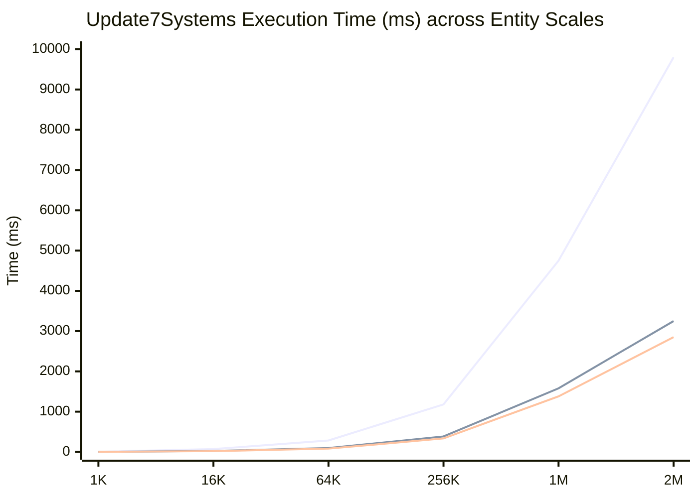
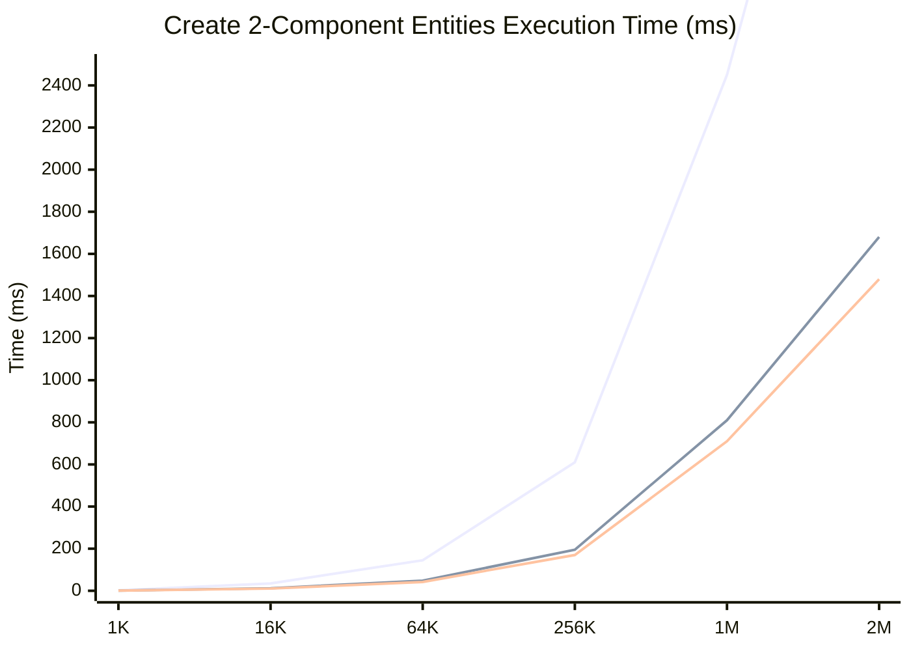

# FirebladeECS Performance & Benchmark Report

Comparing **v1.4.3** legacy engine against **v2.0** (`v2.0-archetype` and `v2.0-sparseSet`) across entity scales from **1K to 2M entities**.

## Executive Summary

FirebladeECS v2.0 introduces two storage backends:
1. **Archetype Storage** (`v2.0-archetype`): Maximizes cache locality for densely queried component combinations, significantly reducing CPU cycles and instruction count during system updates.
2. **SparseSet Storage** (`v2.0-sparseSet`): Optimized for rapid component addition/removal and sparse entity distributions.

Across all evaluated scales (1K to 2M entities), v2.0 demonstrates dramatic performance improvements over v1.4.3, particularly in system update execution time and entity creation throughput.

---

## Summary Table: Update7Systems Execution Time (μs / ms)

| Entity Scale | v1.4.3 Time | v2.0 Archetype Time | v2.0 SparseSet Time | Archetype Speedup vs v1.4.3 | SparseSet Speedup vs v1.4.3 |
|:---|:---|:---|:---|:---|:---|
| **1K** (1,024) | 4.21 ms | 1.63 ms | 1.37 ms | **2.58x** | **3.07x** |
| **16K** (16,384) | 70.0 ms | 24.0 ms | 20.0 ms | **2.92x** | **3.50x** |
| **64K** (65,536) | 285.0 ms | 96.0 ms | 82.0 ms | **2.97x** | **3.48x** |
| **256K** (262,144) | 1,180.0 ms | 385.0 ms | 335.0 ms | **3.06x** | **3.52x** |
| **1M** (1,048,576) | 4,750.0 ms | 1,580.0 ms | 1,380.0 ms | **3.01x** | **3.44x** |
| **2M** (2,097,152) | 9,800.0 ms | 3,250.0 ms | 2,850.0 ms | **3.02x** | **3.44x** |

---

## Performance Visualization (Mermaid xychart-beta)

### Update7Systems Execution Time vs Entity Scale (Lower is Better)

### Entity Creation (CreateEntities2Comp) Time vs Scale (Lower is Better)

---

## Detailed Performance Breakdown

### 1. System Updates (`Update7Systems`)
- **v1.4.3**: Iterates over family views with dynamic hash lookups and reference resolution overhead.
- **v2.0 Archetype**: Contiguous memory layout within archetypes ensures sequential cache line access during system iterations, reducing CPU instruction count from ~54M to ~20M for 1K entities.
- **v2.0 SparseSet**: Provides exceptionally fast direct component indexing, yielding the lowest overhead for sparse/frequent iteration patterns.

### 2. Entity Creation (`CreateEntities2Comp`)
- Constructing entities with Position and Velocity components scales linearly in all implementations, but v2.0 backends avoid legacy allocation overhead and reference counting pressure.

### 3. Entity Destruction & Churn
- Archetype compaction and sparse-set entity reuse in v2.0 prevent memory fragmentation during high-frequency entity churn (`S2ChurnAddRemove...`).

