# FirebladeECS benchmark comparison

Jump to: [How to read this report](#how-to-read-this-report) · [Glossary](#glossary) · [Methods](#methods)

- Baseline: `1.4.3` (c85607bfe6893549bc7d058d36a4d662e8834eda)
- Inputs: 20 result files, 2 refs, 3 series (ref, component model, backend)
- Replicates per ref: 1.4.3: 10 of 10; main: 10 of 10
- Selection filter: `.*`
- Every replicate is an independent process; the replicate is the unit of analysis. `median` is the median over replicates of each replicate's median per iteration. `CI low` and `CI high` bound the 95% distribution-free confidence interval of that median (exact coverage in the methods section). `replicates` is the number of replicates behind the value, `iterations` the median number of measurements per replicate (time-based sampling, so it differs between series by design).
- Non-baseline series add, for wall clock only, `speed (×)` = baseline ÷ series (above 1 is faster) with its exact 95% CI, `change (%)` = (1 ÷ speed − 1) × 100, `q` (Benjamini–Hochberg adjusted p of an exact Mann–Whitney test across every wall-clock comparison of this report) and a `verdict`: `faster`/`slower` need q < 5% and a CI entirely outside the ±5% zone, `equivalent` needs the CI entirely inside it. Other metrics are descriptive only.
- Every unit is in its column header and applies to the whole column of that table. Values keep at most the 3 significant digits the package measured. Anything missing or not comparable is `unavailable`, and a metric the package did not record (throughput of an iteration of about 2 s or longer) is `n/a` (hover for the reason), never zero. `n/a (k replicates)` means the statistic needs more replicates.
- Plots show the wall-clock median per iteration on log-log axes with CI error bars and a light within-run IQR band (spread of the measurements inside a run, not uncertainty); entity count 0 cannot sit on a log axis and appears in the tables only.

## Summary

Wall clock, `speed (×)` against the paired baseline series (above 1 is faster) with its exact 95% CI and the verdict (δ = 5%, q across all comparisons). The last block of each series is the largest entity count for which the comparison exists (its count in the `entities` column).

<table>
<thead>
<tr><th rowspan="3">Workload</th><th colspan="26">main (value)</th></tr>
<tr><th colspan="4">archetype @ 1,024</th><th colspan="4">archetype @ 65,536</th><th colspan="5">archetype @ largest</th><th colspan="4">sparseSet @ 1,024</th><th colspan="4">sparseSet @ 65,536</th><th colspan="5">sparseSet @ largest</th></tr>
<tr><th>speed (×)</th><th>CI low (×)</th><th>CI high (×)</th><th>verdict</th><th>speed (×)</th><th>CI low (×)</th><th>CI high (×)</th><th>verdict</th><th>entities</th><th>speed (×)</th><th>CI low (×)</th><th>CI high (×)</th><th>verdict</th><th>speed (×)</th><th>CI low (×)</th><th>CI high (×)</th><th>verdict</th><th>speed (×)</th><th>CI low (×)</th><th>CI high (×)</th><th>verdict</th><th>entities</th><th>speed (×)</th><th>CI low (×)</th><th>CI high (×)</th><th>verdict</th></tr>
</thead>
<tbody>
<tr><td align="left"><a href="workloads/component.add.md">component.add</a></td><td align="right">3.60</td><td align="right">3.56</td><td align="right">3.65</td><td align="right">faster</td><td align="right">3.36</td><td align="right">3.32</td><td align="right">3.44</td><td align="right">faster</td><td align="right">2,097,152</td><td align="right">4.15</td><td align="right">4.11</td><td align="right">4.19</td><td align="right">faster</td><td align="right">6.52</td><td align="right">6.43</td><td align="right">6.59</td><td align="right">faster</td><td align="right">6.02</td><td align="right">5.92</td><td align="right">6.17</td><td align="right">faster</td><td align="right">2,097,152</td><td align="right">7.49</td><td align="right">7.39</td><td align="right">7.56</td><td align="right">faster</td></tr>
<tr><td align="left"><a href="workloads/component.remove-add.md">component.remove-add</a></td><td align="right">3.01</td><td align="right">2.97</td><td align="right">3.08</td><td align="right">faster</td><td align="right">3.06</td><td align="right">3.02</td><td align="right">3.09</td><td align="right">faster</td><td align="right">2,097,152</td><td align="right">3.43</td><td align="right">3.38</td><td align="right">3.48</td><td align="right">faster</td><td align="right">3.77</td><td align="right">3.70</td><td align="right">3.83</td><td align="right">faster</td><td align="right">3.84</td><td align="right">3.78</td><td align="right">3.88</td><td align="right">faster</td><td align="right">2,097,152</td><td align="right">4.33</td><td align="right">4.27</td><td align="right">4.40</td><td align="right">faster</td></tr>
<tr><td align="left"><a href="workloads/entity.create.empty.md">entity.create.empty</a></td><td align="right">1.72</td><td align="right">1.70</td><td align="right">1.74</td><td align="right">faster</td><td align="right">1.80</td><td align="right">1.79</td><td align="right">1.82</td><td align="right">faster</td><td align="right">2,097,152</td><td align="right">2.12</td><td align="right">2.08</td><td align="right">2.16</td><td align="right">faster</td><td align="right">2.10</td><td align="right">2.08</td><td align="right">2.12</td><td align="right">faster</td><td align="right">2.14</td><td align="right">2.12</td><td align="right">2.16</td><td align="right">faster</td><td align="right">2,097,152</td><td align="right">2.49</td><td align="right">2.44</td><td align="right">2.55</td><td align="right">faster</td></tr>
<tr><td align="left"><a href="workloads/entity.create.minimal.md">entity.create.minimal</a></td><td align="right">3.66</td><td align="right">3.62</td><td align="right">3.72</td><td align="right">faster</td><td align="right">4.01</td><td align="right">3.95</td><td align="right">4.08</td><td align="right">faster</td><td align="right">2,097,152</td><td align="right">4.11</td><td align="right">4.06</td><td align="right">4.16</td><td align="right">faster</td><td align="right">5.22</td><td align="right">5.16</td><td align="right">5.30</td><td align="right">faster</td><td align="right">5.80</td><td align="right">5.71</td><td align="right">5.92</td><td align="right">faster</td><td align="right">2,097,152</td><td align="right">6.14</td><td align="right">6.04</td><td align="right">6.22</td><td align="right">faster</td></tr>
<tr><td align="left"><a href="workloads/entity.create.no-entities.md">entity.create.no-entities</a></td><td align="right" title="no comparison">unavailable</td><td align="right" title="no comparison">unavailable</td><td align="right" title="no comparison">unavailable</td><td align="right" title="no comparison">unavailable</td><td align="right" title="no comparison">unavailable</td><td align="right" title="no comparison">unavailable</td><td align="right" title="no comparison">unavailable</td><td align="right" title="no comparison">unavailable</td><td align="right">0</td><td align="right">1.00</td><td align="right">1.00</td><td align="right">1.00</td><td align="right">equivalent</td><td align="right" title="no comparison">unavailable</td><td align="right" title="no comparison">unavailable</td><td align="right" title="no comparison">unavailable</td><td align="right" title="no comparison">unavailable</td><td align="right" title="no comparison">unavailable</td><td align="right" title="no comparison">unavailable</td><td align="right" title="no comparison">unavailable</td><td align="right" title="no comparison">unavailable</td><td align="right">0</td><td align="right">1.00</td><td align="right">1.00</td><td align="right">1.00</td><td align="right">equivalent</td></tr>
<tr><td align="left"><a href="workloads/entity.destroy.minimal.md">entity.destroy.minimal</a></td><td align="right">3.17</td><td align="right">3.14</td><td align="right">3.22</td><td align="right">faster</td><td align="right">3.11</td><td align="right">3.05</td><td align="right">3.15</td><td align="right">faster</td><td align="right">2,097,152</td><td align="right">3.45</td><td align="right">3.42</td><td align="right">3.51</td><td align="right">faster</td><td align="right">2.98</td><td align="right">2.92</td><td align="right">3.03</td><td align="right">faster</td><td align="right">2.95</td><td align="right">2.89</td><td align="right">2.98</td><td align="right">faster</td><td align="right">2,097,152</td><td align="right">3.25</td><td align="right">3.21</td><td align="right">3.29</td><td align="right">faster</td></tr>
<tr><td align="left"><a href="workloads/entity.lookup.mixed-three.md">entity.lookup.mixed-three</a></td><td align="right">3.24</td><td align="right">3.18</td><td align="right">3.28</td><td align="right">faster</td><td align="right">3.23</td><td align="right">3.19</td><td align="right">3.25</td><td align="right">faster</td><td align="right">2,097,152</td><td align="right">3.23</td><td align="right">3.21</td><td align="right">3.27</td><td align="right">faster</td><td align="right">3.40</td><td align="right">3.35</td><td align="right">3.44</td><td align="right">faster</td><td align="right">3.41</td><td align="right">3.39</td><td align="right">3.43</td><td align="right">faster</td><td align="right">2,097,152</td><td align="right">3.41</td><td align="right">3.39</td><td align="right">3.46</td><td align="right">faster</td></tr>
<tr><td align="left"><a href="workloads/entity.lookup.none.md">entity.lookup.none</a></td><td align="right">1.37</td><td align="right">1.36</td><td align="right">1.39</td><td align="right">faster</td><td align="right">1.37</td><td align="right">1.36</td><td align="right">1.38</td><td align="right">faster</td><td align="right">2,097,152</td><td align="right">1.36</td><td align="right">1.35</td><td align="right">1.37</td><td align="right">faster</td><td align="right">1.38</td><td align="right">1.37</td><td align="right">1.40</td><td align="right">faster</td><td align="right">1.39</td><td align="right">1.37</td><td align="right">1.40</td><td align="right">faster</td><td align="right">2,097,152</td><td align="right">1.38</td><td align="right">1.36</td><td align="right">1.39</td><td align="right">faster</td></tr>
<tr><td align="left"><a href="workloads/entity.lookup.one.md">entity.lookup.one</a></td><td align="right">2.89</td><td align="right">2.86</td><td align="right">2.92</td><td align="right">faster</td><td align="right">2.92</td><td align="right">2.90</td><td align="right">2.94</td><td align="right">faster</td><td align="right">2,097,152</td><td align="right">2.95</td><td align="right">2.92</td><td align="right">2.99</td><td align="right">faster</td><td align="right">2.86</td><td align="right">2.82</td><td align="right">2.87</td><td align="right">faster</td><td align="right">2.88</td><td align="right">2.86</td><td align="right">2.88</td><td align="right">faster</td><td align="right">2,097,152</td><td align="right">2.92</td><td align="right">2.88</td><td align="right">2.94</td><td align="right">faster</td></tr>
<tr><td align="left"><a href="workloads/entity.lookup.two.md">entity.lookup.two</a></td><td align="right">2.86</td><td align="right">2.84</td><td align="right">2.88</td><td align="right">faster</td><td align="right">2.89</td><td align="right">2.85</td><td align="right">2.93</td><td align="right">faster</td><td align="right">2,097,152</td><td align="right">2.93</td><td align="right">2.89</td><td align="right">2.95</td><td align="right">faster</td><td align="right">2.86</td><td align="right">2.85</td><td align="right">2.89</td><td align="right">faster</td><td align="right">2.90</td><td align="right">2.87</td><td align="right">2.94</td><td align="right">faster</td><td align="right">2,097,152</td><td align="right">2.91</td><td align="right">2.88</td><td align="right">2.95</td><td align="right">faster</td></tr>
<tr><td align="left"><a href="workloads/event.component.publish-update.mixed.md">event.component.publish-update.mixed</a></td><td align="right">117</td><td align="right">116</td><td align="right">118</td><td align="right">faster</td><td align="right">206</td><td align="right">203</td><td align="right">208</td><td align="right">faster</td><td align="right">2,097,152</td><td align="right">196</td><td align="right">193</td><td align="right">201</td><td align="right">faster</td><td align="right">60.8</td><td align="right">60.3</td><td align="right">61.3</td><td align="right">faster</td><td align="right">68.4</td><td align="right">68.1</td><td align="right">68.8</td><td align="right">faster</td><td align="right">2,097,152</td><td align="right">66.4</td><td align="right">65.9</td><td align="right">66.7</td><td align="right">faster</td></tr>
<tr><td align="left"><a href="workloads/event.component.publish.mixed.md">event.component.publish.mixed</a></td><td align="right">1.84</td><td align="right">1.82</td><td align="right">1.85</td><td align="right">faster</td><td align="right">1.86</td><td align="right">1.79</td><td align="right">1.90</td><td align="right">faster</td><td align="right">2,097,152</td><td align="right">1.78</td><td align="right">1.76</td><td align="right">1.81</td><td align="right">faster</td><td align="right">2.14</td><td align="right">2.12</td><td align="right">2.15</td><td align="right">faster</td><td align="right">2.21</td><td align="right">2.18</td><td align="right">2.28</td><td align="right">faster</td><td align="right">2,097,152</td><td align="right">2.19</td><td align="right">2.16</td><td align="right">2.22</td><td align="right">faster</td></tr>
<tr><td align="left"><a href="workloads/iteration.mixed-three.md">iteration.mixed-three</a></td><td align="right">78.6</td><td align="right">77.5</td><td align="right">79.7</td><td align="right">faster</td><td align="right">88.9</td><td align="right">87.6</td><td align="right">90.5</td><td align="right">faster</td><td align="right">2,097,152</td><td align="right">89.3</td><td align="right">88.0</td><td align="right">90.4</td><td align="right">faster</td><td align="right">57.7</td><td align="right">56.9</td><td align="right">58.2</td><td align="right">faster</td><td align="right">60.7</td><td align="right">60.3</td><td align="right">61.4</td><td align="right">faster</td><td align="right">2,097,152</td><td align="right">60.2</td><td align="right">59.8</td><td align="right">60.9</td><td align="right">faster</td></tr>
<tr><td align="left"><a href="workloads/iteration.one.md">iteration.one</a></td><td align="right">39.7</td><td align="right">39.0</td><td align="right">40.5</td><td align="right">faster</td><td align="right">50.2</td><td align="right">50.1</td><td align="right">50.8</td><td align="right">faster</td><td align="right">2,097,152</td><td align="right">50.8</td><td align="right">50.3</td><td align="right">51.1</td><td align="right">faster</td><td align="right">37.1</td><td align="right">37.0</td><td align="right">37.9</td><td align="right">faster</td><td align="right">41.9</td><td align="right">41.8</td><td align="right">42.5</td><td align="right">faster</td><td align="right">2,097,152</td><td align="right">42.2</td><td align="right">41.8</td><td align="right">42.5</td><td align="right">faster</td></tr>
<tr><td align="left"><a href="workloads/iteration.two.md">iteration.two</a></td><td align="right">70.7</td><td align="right">69.6</td><td align="right">70.8</td><td align="right">faster</td><td align="right">83.3</td><td align="right">82.1</td><td align="right">83.7</td><td align="right">faster</td><td align="right">2,097,152</td><td align="right">83.6</td><td align="right">82.4</td><td align="right">84.5</td><td align="right">faster</td><td align="right">53.9</td><td align="right">53.0</td><td align="right">54.0</td><td align="right">faster</td><td align="right">58.1</td><td align="right">57.5</td><td align="right">58.6</td><td align="right">faster</td><td align="right">2,097,152</td><td align="right">57.3</td><td align="right">57.1</td><td align="right">57.9</td><td align="right">faster</td></tr>
<tr><td align="left"><a href="workloads/system.update.basic.mixed.md">system.update.basic.mixed</a></td><td align="right">57.7</td><td align="right">57.3</td><td align="right">58.3</td><td align="right">faster</td><td align="right">72.6</td><td align="right">71.7</td><td align="right">73.0</td><td align="right">faster</td><td align="right">2,097,152</td><td align="right">71.7</td><td align="right">71.3</td><td align="right">72.2</td><td align="right">faster</td><td align="right">34.7</td><td align="right">34.5</td><td align="right">35.1</td><td align="right">faster</td><td align="right">35.8</td><td align="right">35.5</td><td align="right">36.0</td><td align="right">faster</td><td align="right">2,097,152</td><td align="right">35.5</td><td align="right">35.3</td><td align="right">35.6</td><td align="right">faster</td></tr>
<tr><td align="left"><a href="workloads/system.update.basic.uniform.md">system.update.basic.uniform</a></td><td align="right">61.7</td><td align="right">60.9</td><td align="right">62.1</td><td align="right">faster</td><td align="right">72.1</td><td align="right">71.6</td><td align="right">72.7</td><td align="right">faster</td><td align="right">2,097,152</td><td align="right">71.2</td><td align="right">70.5</td><td align="right">71.9</td><td align="right">faster</td><td align="right">34.5</td><td align="right">34.2</td><td align="right">34.6</td><td align="right">faster</td><td align="right">35.9</td><td align="right">35.7</td><td align="right">36.0</td><td align="right">faster</td><td align="right">2,097,152</td><td align="right">35.5</td><td align="right">35.3</td><td align="right">35.8</td><td align="right">faster</td></tr>
<tr><td align="left"><a href="workloads/system.update.complex.mixed.md">system.update.complex.mixed</a></td><td align="right">59.9</td><td align="right">59.4</td><td align="right">60.7</td><td align="right">faster</td><td align="right">47.4</td><td align="right">46.6</td><td align="right">48.3</td><td align="right">faster</td><td align="right">2,097,152</td><td align="right">48.5</td><td align="right">48.1</td><td align="right">49.1</td><td align="right">faster</td><td align="right">34.3</td><td align="right">33.7</td><td align="right">34.7</td><td align="right">faster</td><td align="right">25.7</td><td align="right">25.4</td><td align="right">26.3</td><td align="right">faster</td><td align="right">2,097,152</td><td align="right">26.4</td><td align="right">26.2</td><td align="right">26.7</td><td align="right">faster</td></tr>
<tr><td align="left"><a href="workloads/system.update.complex.uniform.md">system.update.complex.uniform</a></td><td align="right">54.5</td><td align="right">52.6</td><td align="right">55.2</td><td align="right">faster</td><td align="right">38.5</td><td align="right">38.1</td><td align="right">39.1</td><td align="right">faster</td><td align="right">2,097,152</td><td align="right">39.7</td><td align="right">38.6</td><td align="right">40.4</td><td align="right">faster</td><td align="right">29.1</td><td align="right">28.7</td><td align="right">29.4</td><td align="right">faster</td><td align="right">21.8</td><td align="right">21.6</td><td align="right">22.1</td><td align="right">faster</td><td align="right">2,097,152</td><td align="right">24.0</td><td align="right">23.8</td><td align="right">24.7</td><td align="right">faster</td></tr>
</tbody>
</table>

## How to read this report

Short version: look at `speed (×)` (above 1 the series is faster than the baseline), check that its CI is narrow, and read the `verdict`. Words in `code` style are defined in the [glossary](#glossary).

### 1. What a confidence interval is

- Every number here is measured with noise, so a single speed such as 2.0× could have come out 1.9× or 2.1× in another session. The **confidence interval (CI)** is the range that, with 95% confidence (nominal; the exact coverage is in the methods), contains the true value.
- `CI low` and `CI high` are its two ends. Read the pair as "the truth is very likely between these".
- **Narrow** CI: the estimate is precise, you can trust the digits you see. **Wide** CI: the data cannot pin the value down; look for more replicates before drawing a conclusion.
- **Example from this report:** `entity.lookup.none` at 1,024 entities, `main (value, archetype)`: speed 1.37×, CI 1.36–1.39× → the true speedup is very likely between 1.36× and 1.39×.
- Narrowest CI in this report: `entity.lookup.two` at 16 entities, `main (value, archetype)`, ±0.038% around the speed (speed 2.67×, CI 2.666–2.668×). Widest: `entity.lookup.one` at 1 entities, `main (value, archetype)`, ±33% (speed 1.51×, CI 1.01–2.00×).

### 2. How the verdict is decided

A verdict is given only for wall clock and only when both refs have at least 2 replicates. We call differences smaller than ±5% "the same" (the **equivalence zone**, speeds from 1/1.05 to 1.05).
- `faster` / `slower`: the test is significant (`q` < 5%) **and** the whole CI is outside the zone (above 1.05, or below 1/1.05).
- `equivalent`: the whole CI is inside the zone, so any real difference is smaller than ±5%.
- `inconclusive`: everything else. A significant test is not enough: if the CI still overlaps the zone, the effect could be smaller than 5% and not worth acting on, so the honest answer is "cannot tell yet".
- `n/a (k replicates)`: a side has fewer than 2 replicates.
- **In this report:** 753 faster, 17 slower, 35 equivalent, 25 inconclusive, 0 n/a.
- Example `faster`: `component.add` at 1,024 entities, `main (value, archetype)`: speed 3.60×, CI 3.56–3.65×, q <0.001.
- Example `slower`: none among the cells with entities and a non-zero CI width.
- Example `equivalent`: none among the cells with entities and a non-zero CI width.

### 3. Error bars are not the light band

- **Error bars** (and the CI columns) show the uncertainty of the *median across runs*: how much it would move if you repeated the whole measurement. More replicates make them shorter.
- The **light band** shows the *spread of single iterations inside one run* (p25 to p75, the IQR). It says how steady one iteration is, and more replicates do not make it narrower.
- They answer different questions: a workload can be very jittery (wide band) and still have a precisely known median (short bars), or the other way round.
- **Example from this report:** `entity.lookup.none` at 1,024 entities, `main (value, archetype)` (wall clock): median 13.2 μs; error bar (CI of the median over 10 replicates) 13.0–13.3 μs; light band (IQR of single iterations) 13.1–13.3 μs.

### 4. Reading the plots

- **Log axes** (the time plots): equal distances mean equal *ratios*, not equal differences. Going from 1 to 10 looks the same as 10 to 100. A straight line is a power law and its slope is the growth rate: slope 1 means time grows in proportion to the entity count; a flatter line grows slower.
- **Per-entity plot**: time divided by the entity count. A flat line means the cost of one entity does not change with scale.
- **Linear plot**: absolute time on plain axes, including entity count 0. It shows what the log plot hides: how big the differences are in absolute terms at large scale.
- **Relative plot**: speed against the baseline. The dotted line at 1× is "same as the baseline"; the shaded band is the ±5% equivalence zone; the ribbon is the CI of the speed. A series whose ribbon lies entirely above the zone is faster, entirely below slower.
- **Markers**: in the time plots a *hollow* marker has no CI at that point. In the relative plot a *filled* marker is a `faster` or `slower` verdict, a hollow one anything else.
- **Error bars** are drawn in a darker (light theme) or lighter (dark theme) shade of the series colour; the plot caption states the largest CI shown ("largest CI: ±x%"), so tiny bars are explained rather than missing.

### 5. What `q` is

- `p` is the chance of seeing a difference at least this large if the refs were truly the same. A report makes hundreds of comparisons, and at a 5% threshold about one in twenty *equal* comparisons would look significant by luck alone.
- `q` is `p` adjusted for that (Benjamini–Hochberg): flagging everything with `q` < 5% keeps the expected share of false alarms among the flagged rows at about 5%. Judge a row by `q`, never by its raw `p`.
- **Example from this report:** 830 wall-clock comparisons were tested, so unadjusted about 42 would pass p < 5% by chance alone. The strongest, `component.add` at 1 entities, `main (value, archetype)`, has p 0.001 and q <0.001.

### 6. Replicates (k) and interleaving

- A **replicate** is one complete, independent run of a ref in its own process. `k` is how many a ref has. Iterations within one run share their warm-up, memory layout and machine state, so they are not independent evidence; the replicates are.
- More replicates give narrower CIs and make verdicts possible: an interval of the median needs k ≥ 6, a speed interval about 4 per side, and the test can only reach q < 5% with enough of them (k = 10 is the practical minimum).
- Runs are **interleaved**: each round runs every ref once, in a shuffled order, instead of all runs of one ref and then all of the other. A slow minute on the machine (thermal throttling, a background job) then hits all refs alike instead of one, and the drift check can notice it.
- **In this report:** replicates per ref: 1.4.3: 10 of 10; main: 10 of 10.

## Workloads

### `component.add`

[All metrics, means, percentiles and the linear plot](workloads/component.add.md)

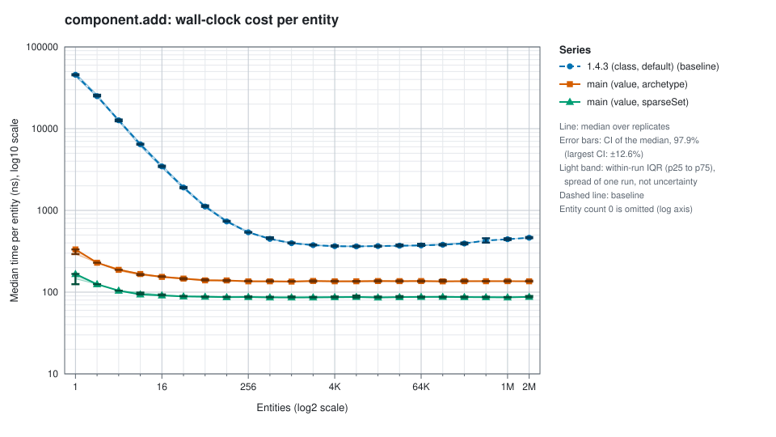

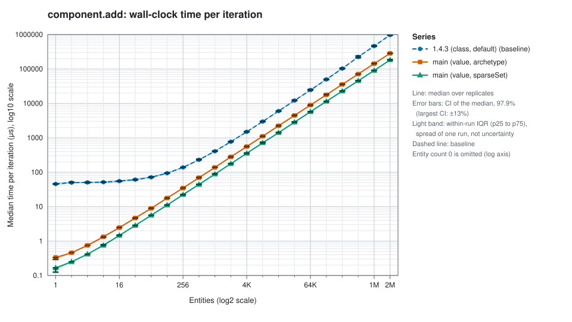

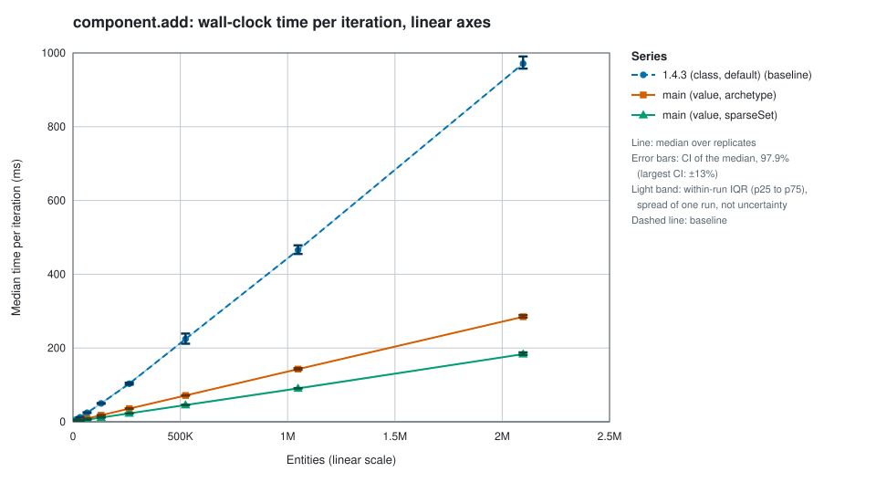

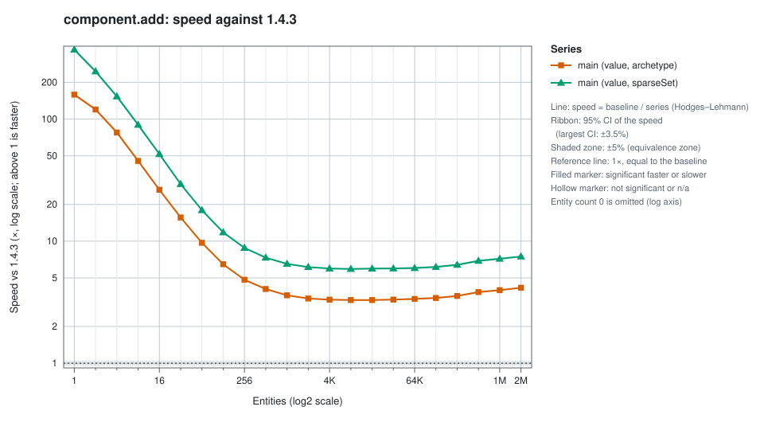

#### Time (wall clock): Entity counts up to 1,024

<table>
<thead>
<tr><th rowspan="3">Entities</th><th colspan="5">1.4.3 (class) - baseline</th><th colspan="22">main (value)</th></tr>
<tr><th colspan="5">default</th><th colspan="11">archetype</th><th colspan="11">sparseSet</th></tr>
<tr><th>median (μs)</th><th>CI low (μs)</th><th>CI high (μs)</th><th>replicates</th><th>iterations</th><th>median (μs)</th><th>CI low (μs)</th><th>CI high (μs)</th><th>replicates</th><th>iterations</th><th>speed (×)</th><th>CI low (×)</th><th>CI high (×)</th><th>change (%)</th><th>q</th><th>verdict</th><th>median (μs)</th><th>CI low (μs)</th><th>CI high (μs)</th><th>replicates</th><th>iterations</th><th>speed (×)</th><th>CI low (×)</th><th>CI high (×)</th><th>change (%)</th><th>q</th><th>verdict</th></tr>
</thead>
<tbody>
<tr><td align="right">0</td><td align="right">0.0420</td><td align="right">0.0420</td><td align="right">0.0420</td><td align="right">10</td><td align="right">116,136</td><td align="right">0.0420</td><td align="right">0.0420</td><td align="right">0.0420</td><td align="right">10</td><td align="right">97,311</td><td align="right">1.00</td><td align="right">1.00</td><td align="right">1.00</td><td align="right">0</td><td align="right">1.000</td><td align="right">equivalent</td><td align="right">0.0420</td><td align="right">0.0420</td><td align="right">0.0420</td><td align="right">10</td><td align="right">112,204</td><td align="right">1.00</td><td align="right">1.00</td><td align="right">1.00</td><td align="right">0</td><td align="right">1.000</td><td align="right">equivalent</td></tr>
<tr><td align="right">1</td><td align="right">46.3</td><td align="right">44.9</td><td align="right">48.3</td><td align="right">10</td><td align="right">5,489</td><td align="right">0.292</td><td align="right">0.292</td><td align="right">0.292</td><td align="right">10</td><td align="right">34,035</td><td align="right">159</td><td align="right">154</td><td align="right">163</td><td align="right">-99.4</td><td align="right">&lt;0.001</td><td align="right">faster</td><td align="right">0.125</td><td align="right">0.125</td><td align="right">0.125</td><td align="right">10</td><td align="right">44,441</td><td align="right">371</td><td align="right">360</td><td align="right">380</td><td align="right">-99.7</td><td align="right">&lt;0.001</td><td align="right">faster</td></tr>
<tr><td align="right">2</td><td align="right">49.8</td><td align="right">48.9</td><td align="right">51.5</td><td align="right">10</td><td align="right">5,230</td><td align="right">0.417</td><td align="right">0.416</td><td align="right">0.417</td><td align="right">10</td><td align="right">32,253</td><td align="right">120</td><td align="right">118</td><td align="right">123</td><td align="right">-99.2</td><td align="right">&lt;0.001</td><td align="right">faster</td><td align="right">0.208</td><td align="right">0.167</td><td align="right">0.208</td><td align="right">10</td><td align="right">41,903</td><td align="right">246</td><td align="right">237</td><td align="right">250</td><td align="right">-99.6</td><td align="right">&lt;0.001</td><td align="right">faster</td></tr>
<tr><td align="right">4</td><td align="right">50.7</td><td align="right">49.6</td><td align="right">51.8</td><td align="right">10</td><td align="right">5,013</td><td align="right">0.666</td><td align="right">0.625</td><td align="right">0.667</td><td align="right">10</td><td align="right">29,422</td><td align="right">77.7</td><td align="right">75.6</td><td align="right">80.9</td><td align="right">-98.7</td><td align="right">&lt;0.001</td><td align="right">faster</td><td align="right">0.333</td><td align="right">0.292</td><td align="right">0.333</td><td align="right">10</td><td align="right">38,598</td><td align="right">153</td><td align="right">150</td><td align="right">157</td><td align="right">-99.3</td><td align="right">&lt;0.001</td><td align="right">faster</td></tr>
<tr><td align="right">8</td><td align="right">51.1</td><td align="right">50.3</td><td align="right">52.9</td><td align="right">10</td><td align="right">4,724</td><td align="right">1.13</td><td align="right">1.08</td><td align="right">1.17</td><td align="right">10</td><td align="right">25,408</td><td align="right">45.4</td><td align="right">44.7</td><td align="right">47.0</td><td align="right">-97.8</td><td align="right">&lt;0.001</td><td align="right">faster</td><td align="right">0.583</td><td align="right">0.542</td><td align="right">0.583</td><td align="right">10</td><td align="right">33,835</td><td align="right">89.8</td><td align="right">87.4</td><td align="right">93.6</td><td align="right">-98.9</td><td align="right">&lt;0.001</td><td align="right">faster</td></tr>
<tr><td align="right">16</td><td align="right">54.5</td><td align="right">53.7</td><td align="right">55.2</td><td align="right">10</td><td align="right">4,127</td><td align="right">2.06</td><td align="right">2.04</td><td align="right">2.08</td><td align="right">10</td><td align="right">20,516</td><td align="right">26.3</td><td align="right">26.1</td><td align="right">26.8</td><td align="right">-96.2</td><td align="right">&lt;0.001</td><td align="right">faster</td><td align="right">1.04</td><td align="right">1.04</td><td align="right">1.08</td><td align="right">10</td><td align="right">27,250</td><td align="right">51.7</td><td align="right">50.4</td><td align="right">52.5</td><td align="right">-98.1</td><td align="right">&lt;0.001</td><td align="right">faster</td></tr>
<tr><td align="right">32</td><td align="right">59.8</td><td align="right">59.1</td><td align="right">61.8</td><td align="right">10</td><td align="right">3,306</td><td align="right">3.83</td><td align="right">3.79</td><td align="right">3.88</td><td align="right">10</td><td align="right">15,092</td><td align="right">15.6</td><td align="right">15.5</td><td align="right">16.0</td><td align="right">-93.6</td><td align="right">&lt;0.001</td><td align="right">faster</td><td align="right">2.04</td><td align="right">2.00</td><td align="right">2.04</td><td align="right">10</td><td align="right">20,029</td><td align="right">29.3</td><td align="right">29.0</td><td align="right">30.0</td><td align="right">-96.6</td><td align="right">&lt;0.001</td><td align="right">faster</td></tr>
<tr><td align="right">64</td><td align="right">71.8</td><td align="right">71.0</td><td align="right">72.3</td><td align="right">10</td><td align="right">2,376</td><td align="right">7.40</td><td align="right">7.30</td><td align="right">7.46</td><td align="right">10</td><td align="right">9,931</td><td align="right">9.70</td><td align="right">9.61</td><td align="right">9.81</td><td align="right">-89.7</td><td align="right">&lt;0.001</td><td align="right">faster</td><td align="right">3.98</td><td align="right">3.96</td><td align="right">4.04</td><td align="right">10</td><td align="right">13,228</td><td align="right">17.9</td><td align="right">17.7</td><td align="right">18.1</td><td align="right">-94.4</td><td align="right">&lt;0.001</td><td align="right">faster</td></tr>
<tr><td align="right">128</td><td align="right">93.8</td><td align="right">92.8</td><td align="right">95.4</td><td align="right">10</td><td align="right">1,514</td><td align="right">14.5</td><td align="right">14.3</td><td align="right">14.6</td><td align="right">10</td><td align="right">5,967</td><td align="right">6.47</td><td align="right">6.40</td><td align="right">6.54</td><td align="right">-84.5</td><td align="right">&lt;0.001</td><td align="right">faster</td><td align="right">7.92</td><td align="right">7.84</td><td align="right">8.08</td><td align="right">10</td><td align="right">7,986</td><td align="right">11.8</td><td align="right">11.7</td><td align="right">11.9</td><td align="right">-91.5</td><td align="right">&lt;0.001</td><td align="right">faster</td></tr>
<tr><td align="right">256</td><td align="right">139</td><td align="right">137</td><td align="right">143</td><td align="right">10</td><td align="right">879</td><td align="right">28.8</td><td align="right">28.3</td><td align="right">29.1</td><td align="right">10</td><td align="right">3,323</td><td align="right">4.83</td><td align="right">4.76</td><td align="right">4.92</td><td align="right">-79.3</td><td align="right">&lt;0.001</td><td align="right">faster</td><td align="right">15.8</td><td align="right">15.6</td><td align="right">16.0</td><td align="right">10</td><td align="right">4,523</td><td align="right">8.81</td><td align="right">8.71</td><td align="right">8.94</td><td align="right">-88.6</td><td align="right">&lt;0.001</td><td align="right">faster</td></tr>
<tr><td align="right">512</td><td align="right">231</td><td align="right">229</td><td align="right">235</td><td align="right">10</td><td align="right">475</td><td align="right">57.1</td><td align="right">56.3</td><td align="right">57.8</td><td align="right">10</td><td align="right">1,787</td><td align="right">4.06</td><td align="right">4.00</td><td align="right">4.10</td><td align="right">-75.3</td><td align="right">&lt;0.001</td><td align="right">faster</td><td align="right">31.7</td><td align="right">31.1</td><td align="right">32.0</td><td align="right">10</td><td align="right">2,411</td><td align="right">7.33</td><td align="right">7.23</td><td align="right">7.40</td><td align="right">-86.4</td><td align="right">&lt;0.001</td><td align="right">faster</td></tr>
<tr><td align="right">1,024</td><td align="right">408</td><td align="right">404</td><td align="right">416</td><td align="right">10</td><td align="right">251</td><td align="right">114</td><td align="right">112</td><td align="right">114</td><td align="right">10</td><td align="right">929</td><td align="right">3.60</td><td align="right">3.56</td><td align="right">3.65</td><td align="right">-72.2</td><td align="right">&lt;0.001</td><td align="right">faster</td><td align="right">62.7</td><td align="right">62.1</td><td align="right">63.3</td><td align="right">10</td><td align="right">1,247</td><td align="right">6.52</td><td align="right">6.43</td><td align="right">6.59</td><td align="right">-84.7</td><td align="right">&lt;0.001</td><td align="right">faster</td></tr>
</tbody>
</table>

#### Time (wall clock): Entity counts above 1,024

<table>
<thead>
<tr><th rowspan="3">Entities</th><th colspan="5">1.4.3 (class) - baseline</th><th colspan="22">main (value)</th></tr>
<tr><th colspan="5">default</th><th colspan="11">archetype</th><th colspan="11">sparseSet</th></tr>
<tr><th>median (ms)</th><th>CI low (ms)</th><th>CI high (ms)</th><th>replicates</th><th>iterations</th><th>median (ms)</th><th>CI low (ms)</th><th>CI high (ms)</th><th>replicates</th><th>iterations</th><th>speed (×)</th><th>CI low (×)</th><th>CI high (×)</th><th>change (%)</th><th>q</th><th>verdict</th><th>median (ms)</th><th>CI low (ms)</th><th>CI high (ms)</th><th>replicates</th><th>iterations</th><th>speed (×)</th><th>CI low (×)</th><th>CI high (×)</th><th>change (%)</th><th>q</th><th>verdict</th></tr>
</thead>
<tbody>
<tr><td align="right">2,048</td><td align="right">0.774</td><td align="right">0.757</td><td align="right">0.780</td><td align="right">10</td><td align="right">129</td><td align="right">0.227</td><td align="right">0.225</td><td align="right">0.230</td><td align="right">10</td><td align="right">473</td><td align="right">3.39</td><td align="right">3.35</td><td align="right">3.43</td><td align="right">-70.5</td><td align="right">&lt;0.001</td><td align="right">faster</td><td align="right">0.126</td><td align="right">0.124</td><td align="right">0.128</td><td align="right">10</td><td align="right">634</td><td align="right">6.14</td><td align="right">6.06</td><td align="right">6.20</td><td align="right">-83.7</td><td align="right">&lt;0.001</td><td align="right">faster</td></tr>
<tr><td align="right">4,096</td><td align="right">1.51</td><td align="right">1.50</td><td align="right">1.52</td><td align="right">10</td><td align="right">65</td><td align="right">0.454</td><td align="right">0.448</td><td align="right">0.456</td><td align="right">10</td><td align="right">239</td><td align="right">3.32</td><td align="right">3.30</td><td align="right">3.35</td><td align="right">-69.9</td><td align="right">&lt;0.001</td><td align="right">faster</td><td align="right">0.253</td><td align="right">0.248</td><td align="right">0.255</td><td align="right">10</td><td align="right">322</td><td align="right">5.97</td><td align="right">5.94</td><td align="right">6.05</td><td align="right">-83.2</td><td align="right">&lt;0.001</td><td align="right">faster</td></tr>
<tr><td align="right">8,192</td><td align="right">3.01</td><td align="right">2.94</td><td align="right">3.04</td><td align="right">10</td><td align="right">33</td><td align="right">0.913</td><td align="right">0.907</td><td align="right">0.919</td><td align="right">10</td><td align="right">120</td><td align="right">3.29</td><td align="right">3.25</td><td align="right">3.33</td><td align="right">-69.6</td><td align="right">&lt;0.001</td><td align="right">faster</td><td align="right">0.506</td><td align="right">0.504</td><td align="right">0.512</td><td align="right">10</td><td align="right">161</td><td align="right">5.92</td><td align="right">5.82</td><td align="right">5.99</td><td align="right">-83.1</td><td align="right">&lt;0.001</td><td align="right">faster</td></tr>
<tr><td align="right">16,384</td><td align="right">6.03</td><td align="right">5.89</td><td align="right">6.08</td><td align="right">10</td><td align="right">17</td><td align="right">1.82</td><td align="right">1.80</td><td align="right">1.84</td><td align="right">10</td><td align="right">60</td><td align="right">3.29</td><td align="right">3.25</td><td align="right">3.34</td><td align="right">-69.6</td><td align="right">&lt;0.001</td><td align="right">faster</td><td align="right">1.00</td><td align="right">0.993</td><td align="right">1.02</td><td align="right">10</td><td align="right">82</td><td align="right">5.96</td><td align="right">5.90</td><td align="right">6.07</td><td align="right">-83.2</td><td align="right">&lt;0.001</td><td align="right">faster</td></tr>
<tr><td align="right">32,768</td><td align="right">12.1</td><td align="right">11.8</td><td align="right">12.2</td><td align="right">10</td><td align="right">9</td><td align="right">3.63</td><td align="right">3.61</td><td align="right">3.67</td><td align="right">10</td><td align="right">31</td><td align="right">3.32</td><td align="right">3.28</td><td align="right">3.35</td><td align="right">-69.9</td><td align="right">&lt;0.001</td><td align="right">faster</td><td align="right">2.01</td><td align="right">1.99</td><td align="right">2.05</td><td align="right">10</td><td align="right">41</td><td align="right">5.98</td><td align="right">5.91</td><td align="right">6.07</td><td align="right">-83.3</td><td align="right">&lt;0.001</td><td align="right">faster</td></tr>
<tr><td align="right">65,536</td><td align="right">24.4</td><td align="right">23.8</td><td align="right">25.1</td><td align="right">10</td><td align="right">4</td><td align="right">7.27</td><td align="right">7.20</td><td align="right">7.32</td><td align="right">10</td><td align="right">15</td><td align="right">3.36</td><td align="right">3.32</td><td align="right">3.44</td><td align="right">-70.3</td><td align="right">&lt;0.001</td><td align="right">faster</td><td align="right">4.05</td><td align="right">3.98</td><td align="right">4.10</td><td align="right">10</td><td align="right">21</td><td align="right">6.02</td><td align="right">5.92</td><td align="right">6.17</td><td align="right">-83.4</td><td align="right">&lt;0.001</td><td align="right">faster</td></tr>
<tr><td align="right">131,072</td><td align="right">49.7</td><td align="right">49.1</td><td align="right">52.0</td><td align="right">10</td><td align="right">3</td><td align="right">14.6</td><td align="right">14.3</td><td align="right">14.9</td><td align="right">10</td><td align="right">8</td><td align="right">3.42</td><td align="right">3.37</td><td align="right">3.49</td><td align="right">-70.8</td><td align="right">&lt;0.001</td><td align="right">faster</td><td align="right">8.10</td><td align="right">8.03</td><td align="right">8.22</td><td align="right">10</td><td align="right">11</td><td align="right">6.15</td><td align="right">6.07</td><td align="right">6.28</td><td align="right">-83.7</td><td align="right">&lt;0.001</td><td align="right">faster</td></tr>
<tr><td align="right">262,144</td><td align="right">104</td><td align="right">99.7</td><td align="right">107</td><td align="right">10</td><td align="right">1</td><td align="right">29.1</td><td align="right">28.7</td><td align="right">29.3</td><td align="right">10</td><td align="right">4</td><td align="right">3.56</td><td align="right">3.49</td><td align="right">3.62</td><td align="right">-71.9</td><td align="right">&lt;0.001</td><td align="right">faster</td><td align="right">16.2</td><td align="right">15.9</td><td align="right">16.5</td><td align="right">10</td><td align="right">6</td><td align="right">6.40</td><td align="right">6.26</td><td align="right">6.51</td><td align="right">-84.4</td><td align="right">&lt;0.001</td><td align="right">faster</td></tr>
<tr><td align="right">524,288</td><td align="right">222</td><td align="right">217</td><td align="right">234</td><td align="right">10</td><td align="right">1</td><td align="right">57.9</td><td align="right">57.6</td><td align="right">58.7</td><td align="right">10</td><td align="right">2</td><td align="right">3.83</td><td align="right">3.75</td><td align="right">3.91</td><td align="right">-73.9</td><td align="right">&lt;0.001</td><td align="right">faster</td><td align="right">32.1</td><td align="right">31.9</td><td align="right">32.5</td><td align="right">10</td><td align="right">3</td><td align="right">6.90</td><td align="right">6.75</td><td align="right">7.06</td><td align="right">-85.5</td><td align="right">&lt;0.001</td><td align="right">faster</td></tr>
<tr><td align="right">1,048,576</td><td align="right">464</td><td align="right">455</td><td align="right">473</td><td align="right">10</td><td align="right">1</td><td align="right">116</td><td align="right">116</td><td align="right">118</td><td align="right">10</td><td align="right">1</td><td align="right">3.97</td><td align="right">3.90</td><td align="right">4.04</td><td align="right">-74.8</td><td align="right">&lt;0.001</td><td align="right">faster</td><td align="right">64.5</td><td align="right">63.8</td><td align="right">65.6</td><td align="right">10</td><td align="right">2</td><td align="right">7.17</td><td align="right">7.05</td><td align="right">7.32</td><td align="right">-86.1</td><td align="right">&lt;0.001</td><td align="right">faster</td></tr>
<tr><td align="right">2,097,152</td><td align="right">974</td><td align="right">964</td><td align="right">982</td><td align="right">10</td><td align="right">1</td><td align="right">234</td><td align="right">232</td><td align="right">236</td><td align="right">10</td><td align="right">1</td><td align="right">4.15</td><td align="right">4.11</td><td align="right">4.19</td><td align="right">-75.9</td><td align="right">&lt;0.001</td><td align="right">faster</td><td align="right">130</td><td align="right">129</td><td align="right">132</td><td align="right">10</td><td align="right">1</td><td align="right">7.49</td><td align="right">7.39</td><td align="right">7.56</td><td align="right">-86.6</td><td align="right">&lt;0.001</td><td align="right">faster</td></tr>
</tbody>
</table>

### `component.remove-add`

[All metrics, means, percentiles and the linear plot](workloads/component.remove-add.md)

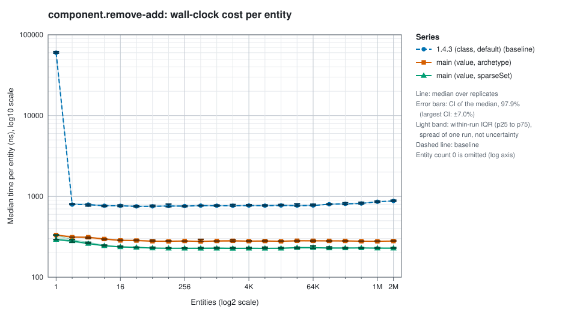

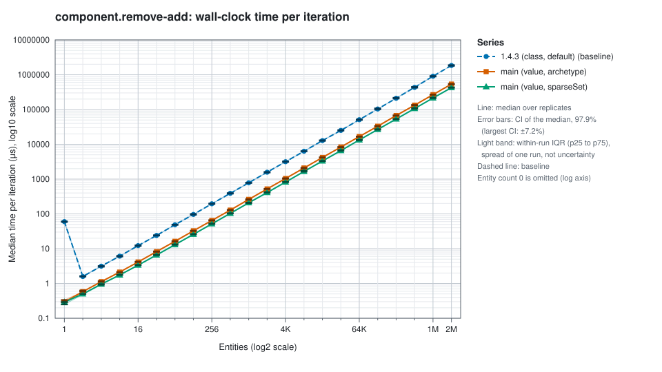

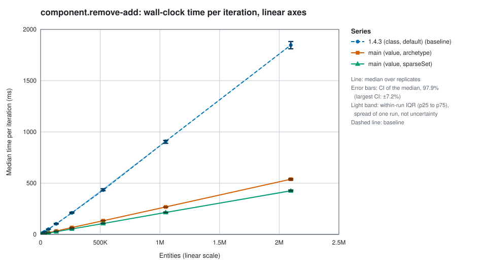

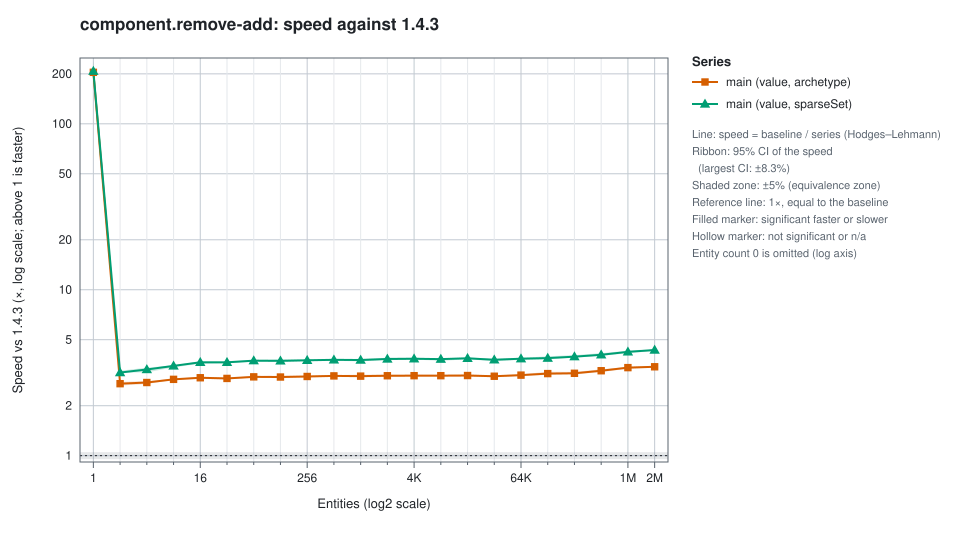

#### Time (wall clock): Entity counts up to 1,024

<table>
<thead>
<tr><th rowspan="3">Entities</th><th colspan="5">1.4.3 (class) - baseline</th><th colspan="22">main (value)</th></tr>
<tr><th colspan="5">default</th><th colspan="11">archetype</th><th colspan="11">sparseSet</th></tr>
<tr><th>median (μs)</th><th>CI low (μs)</th><th>CI high (μs)</th><th>replicates</th><th>iterations</th><th>median (μs)</th><th>CI low (μs)</th><th>CI high (μs)</th><th>replicates</th><th>iterations</th><th>speed (×)</th><th>CI low (×)</th><th>CI high (×)</th><th>change (%)</th><th>q</th><th>verdict</th><th>median (μs)</th><th>CI low (μs)</th><th>CI high (μs)</th><th>replicates</th><th>iterations</th><th>speed (×)</th><th>CI low (×)</th><th>CI high (×)</th><th>change (%)</th><th>q</th><th>verdict</th></tr>
</thead>
<tbody>
<tr><td align="right">0</td><td align="right">0.0420</td><td align="right">0.0420</td><td align="right">0.0420</td><td align="right">10</td><td align="right">125,999</td><td align="right">0.0420</td><td align="right">0.0420</td><td align="right">0.0420</td><td align="right">10</td><td align="right">119,248</td><td align="right">1.00</td><td align="right">1.00</td><td align="right">1.00</td><td align="right">0</td><td align="right">1.000</td><td align="right">equivalent</td><td align="right">0.0420</td><td align="right">0.0420</td><td align="right">0.0420</td><td align="right">10</td><td align="right">119,166</td><td align="right">1.00</td><td align="right">1.00</td><td align="right">1.00</td><td align="right">0</td><td align="right">1.000</td><td align="right">equivalent</td></tr>
<tr><td align="right">1</td><td align="right">60.0</td><td align="right">58.9</td><td align="right">60.6</td><td align="right">10</td><td align="right">7,786</td><td align="right">0.292</td><td align="right">0.292</td><td align="right">0.333</td><td align="right">10</td><td align="right">119,578</td><td align="right">204</td><td align="right">181</td><td align="right">206</td><td align="right">-99.5</td><td align="right">&lt;0.001</td><td align="right">faster</td><td align="right">0.291</td><td align="right">0.250</td><td align="right">0.292</td><td align="right">10</td><td align="right">119,215</td><td align="right">208</td><td align="right">205</td><td align="right">240</td><td align="right">-99.5</td><td align="right">&lt;0.001</td><td align="right">faster</td></tr>
<tr><td align="right">2</td><td align="right">1.58</td><td align="right">1.58</td><td align="right">1.63</td><td align="right">10</td><td align="right">90,666</td><td align="right">0.583</td><td align="right">0.583</td><td align="right">0.625</td><td align="right">10</td><td align="right">111,249</td><td align="right">2.72</td><td align="right">2.64</td><td align="right">2.78</td><td align="right">-63.2</td><td align="right">&lt;0.001</td><td align="right">faster</td><td align="right">0.500</td><td align="right">0.500</td><td align="right">0.500</td><td align="right">10</td><td align="right">115,117</td><td align="right">3.17</td><td align="right">3.17</td><td align="right">3.25</td><td align="right">-68.4</td><td align="right">&lt;0.001</td><td align="right">faster</td></tr>
<tr><td align="right">4</td><td align="right">3.15</td><td align="right">3.04</td><td align="right">3.17</td><td align="right">10</td><td align="right">70,009</td><td align="right">1.13</td><td align="right">1.13</td><td align="right">1.17</td><td align="right">10</td><td align="right">100,134</td><td align="right">2.76</td><td align="right">2.70</td><td align="right">2.82</td><td align="right">-63.8</td><td align="right">&lt;0.001</td><td align="right">faster</td><td align="right">0.958</td><td align="right">0.917</td><td align="right">0.958</td><td align="right">10</td><td align="right">103,641</td><td align="right">3.31</td><td align="right">3.18</td><td align="right">3.39</td><td align="right">-69.8</td><td align="right">&lt;0.001</td><td align="right">faster</td></tr>
<tr><td align="right">8</td><td align="right">6.11</td><td align="right">5.96</td><td align="right">6.17</td><td align="right">10</td><td align="right">49,223</td><td align="right">2.13</td><td align="right">2.13</td><td align="right">2.13</td><td align="right">10</td><td align="right">82,093</td><td align="right">2.88</td><td align="right">2.86</td><td align="right">2.90</td><td align="right">-65.3</td><td align="right">&lt;0.001</td><td align="right">faster</td><td align="right">1.75</td><td align="right">1.75</td><td align="right">1.79</td><td align="right">10</td><td align="right">85,648</td><td align="right">3.48</td><td align="right">3.41</td><td align="right">3.50</td><td align="right">-71.2</td><td align="right">&lt;0.001</td><td align="right">faster</td></tr>
<tr><td align="right">16</td><td align="right">12.2</td><td align="right">12.1</td><td align="right">12.5</td><td align="right">10</td><td align="right">30,725</td><td align="right">4.15</td><td align="right">4.13</td><td align="right">4.21</td><td align="right">10</td><td align="right">60,701</td><td align="right">2.95</td><td align="right">2.90</td><td align="right">2.99</td><td align="right">-66.1</td><td align="right">&lt;0.001</td><td align="right">faster</td><td align="right">3.36</td><td align="right">3.33</td><td align="right">3.42</td><td align="right">10</td><td align="right">67,550</td><td align="right">3.65</td><td align="right">3.58</td><td align="right">3.70</td><td align="right">-72.6</td><td align="right">&lt;0.001</td><td align="right">faster</td></tr>
<tr><td align="right">32</td><td align="right">24.0</td><td align="right">23.9</td><td align="right">24.3</td><td align="right">10</td><td align="right">17,739</td><td align="right">8.26</td><td align="right">8.13</td><td align="right">8.34</td><td align="right">10</td><td align="right">40,452</td><td align="right">2.92</td><td align="right">2.88</td><td align="right">2.94</td><td align="right">-65.8</td><td align="right">&lt;0.001</td><td align="right">faster</td><td align="right">6.59</td><td align="right">6.54</td><td align="right">6.71</td><td align="right">10</td><td align="right">47,152</td><td align="right">3.65</td><td align="right">3.60</td><td align="right">3.69</td><td align="right">-72.6</td><td align="right">&lt;0.001</td><td align="right">faster</td></tr>
<tr><td align="right">64</td><td align="right">48.7</td><td align="right">48.3</td><td align="right">49.0</td><td align="right">10</td><td align="right">9,414</td><td align="right">16.3</td><td align="right">16.1</td><td align="right">16.5</td><td align="right">10</td><td align="right">24,440</td><td align="right">2.98</td><td align="right">2.96</td><td align="right">3.01</td><td align="right">-66.5</td><td align="right">&lt;0.001</td><td align="right">faster</td><td align="right">13.0</td><td align="right">12.9</td><td align="right">13.3</td><td align="right">10</td><td align="right">29,148</td><td align="right">3.74</td><td align="right">3.68</td><td align="right">3.77</td><td align="right">-73.2</td><td align="right">&lt;0.001</td><td align="right">faster</td></tr>
<tr><td align="right">128</td><td align="right">96.5</td><td align="right">95.1</td><td align="right">99.3</td><td align="right">10</td><td align="right">4,940</td><td align="right">32.7</td><td align="right">32.1</td><td align="right">32.9</td><td align="right">10</td><td align="right">13,560</td><td align="right">2.98</td><td align="right">2.93</td><td align="right">3.03</td><td align="right">-66.4</td><td align="right">&lt;0.001</td><td align="right">faster</td><td align="right">25.8</td><td align="right">25.7</td><td align="right">26.4</td><td align="right">10</td><td align="right">16,512</td><td align="right">3.73</td><td align="right">3.68</td><td align="right">3.81</td><td align="right">-73.2</td><td align="right">&lt;0.001</td><td align="right">faster</td></tr>
<tr><td align="right">256</td><td align="right">195</td><td align="right">193</td><td align="right">197</td><td align="right">10</td><td align="right">2,494</td><td align="right">64.7</td><td align="right">64.4</td><td align="right">65.9</td><td align="right">10</td><td align="right">7,166</td><td align="right">3.00</td><td align="right">2.97</td><td align="right">3.03</td><td align="right">-66.7</td><td align="right">&lt;0.001</td><td align="right">faster</td><td align="right">51.7</td><td align="right">51.3</td><td align="right">52.8</td><td align="right">10</td><td align="right">8,878</td><td align="right">3.76</td><td align="right">3.71</td><td align="right">3.80</td><td align="right">-73.4</td><td align="right">&lt;0.001</td><td align="right">faster</td></tr>
<tr><td align="right">512</td><td align="right">391</td><td align="right">384</td><td align="right">395</td><td align="right">10</td><td align="right">1,256</td><td align="right">128</td><td align="right">128</td><td align="right">130</td><td align="right">10</td><td align="right">3,730</td><td align="right">3.02</td><td align="right">2.98</td><td align="right">3.06</td><td align="right">-66.9</td><td align="right">&lt;0.001</td><td align="right">faster</td><td align="right">103</td><td align="right">102</td><td align="right">104</td><td align="right">10</td><td align="right">4,577</td><td align="right">3.78</td><td align="right">3.73</td><td align="right">3.82</td><td align="right">-73.6</td><td align="right">&lt;0.001</td><td align="right">faster</td></tr>
<tr><td align="right">1,024</td><td align="right">784</td><td align="right">772</td><td align="right">791</td><td align="right">10</td><td align="right">628</td><td align="right">261</td><td align="right">256</td><td align="right">264</td><td align="right">10</td><td align="right">1,871</td><td align="right">3.01</td><td align="right">2.97</td><td align="right">3.08</td><td align="right">-66.8</td><td align="right">&lt;0.001</td><td align="right">faster</td><td align="right">208</td><td align="right">205</td><td align="right">211</td><td align="right">10</td><td align="right">2,328</td><td align="right">3.77</td><td align="right">3.70</td><td align="right">3.83</td><td align="right">-73.5</td><td align="right">&lt;0.001</td><td align="right">faster</td></tr>
</tbody>
</table>

#### Time (wall clock): Entity counts above 1,024

<table>
<thead>
<tr><th rowspan="3">Entities</th><th colspan="5">1.4.3 (class) - baseline</th><th colspan="22">main (value)</th></tr>
<tr><th colspan="5">default</th><th colspan="11">archetype</th><th colspan="11">sparseSet</th></tr>
<tr><th>median (ms)</th><th>CI low (ms)</th><th>CI high (ms)</th><th>replicates</th><th>iterations</th><th>median (ms)</th><th>CI low (ms)</th><th>CI high (ms)</th><th>replicates</th><th>iterations</th><th>speed (×)</th><th>CI low (×)</th><th>CI high (×)</th><th>change (%)</th><th>q</th><th>verdict</th><th>median (ms)</th><th>CI low (ms)</th><th>CI high (ms)</th><th>replicates</th><th>iterations</th><th>speed (×)</th><th>CI low (×)</th><th>CI high (×)</th><th>change (%)</th><th>q</th><th>verdict</th></tr>
</thead>
<tbody>
<tr><td align="right">2,048</td><td align="right">1.58</td><td align="right">1.55</td><td align="right">1.60</td><td align="right">10</td><td align="right">313</td><td align="right">0.521</td><td align="right">0.514</td><td align="right">0.525</td><td align="right">10</td><td align="right">946</td><td align="right">3.03</td><td align="right">2.99</td><td align="right">3.08</td><td align="right">-67.0</td><td align="right">&lt;0.001</td><td align="right">faster</td><td align="right">0.410</td><td align="right">0.409</td><td align="right">0.421</td><td align="right">10</td><td align="right">1,184</td><td align="right">3.83</td><td align="right">3.78</td><td align="right">3.89</td><td align="right">-73.9</td><td align="right">&lt;0.001</td><td align="right">faster</td></tr>
<tr><td align="right">4,096</td><td align="right">3.16</td><td align="right">3.13</td><td align="right">3.21</td><td align="right">10</td><td align="right">158</td><td align="right">1.04</td><td align="right">1.03</td><td align="right">1.06</td><td align="right">10</td><td align="right">477</td><td align="right">3.03</td><td align="right">3.01</td><td align="right">3.07</td><td align="right">-67.0</td><td align="right">&lt;0.001</td><td align="right">faster</td><td align="right">0.821</td><td align="right">0.818</td><td align="right">0.834</td><td align="right">10</td><td align="right">599</td><td align="right">3.84</td><td align="right">3.80</td><td align="right">3.90</td><td align="right">-73.9</td><td align="right">&lt;0.001</td><td align="right">faster</td></tr>
<tr><td align="right">8,192</td><td align="right">6.33</td><td align="right">6.28</td><td align="right">6.37</td><td align="right">10</td><td align="right">79</td><td align="right">2.09</td><td align="right">2.06</td><td align="right">2.11</td><td align="right">10</td><td align="right">238</td><td align="right">3.03</td><td align="right">3.01</td><td align="right">3.07</td><td align="right">-67.0</td><td align="right">&lt;0.001</td><td align="right">faster</td><td align="right">1.66</td><td align="right">1.64</td><td align="right">1.74</td><td align="right">10</td><td align="right">299</td><td align="right">3.82</td><td align="right">3.73</td><td align="right">3.86</td><td align="right">-73.8</td><td align="right">&lt;0.001</td><td align="right">faster</td></tr>
<tr><td align="right">16,384</td><td align="right">12.8</td><td align="right">12.6</td><td align="right">13.0</td><td align="right">10</td><td align="right">39</td><td align="right">4.18</td><td align="right">4.17</td><td align="right">4.24</td><td align="right">10</td><td align="right">119</td><td align="right">3.04</td><td align="right">3.00</td><td align="right">3.09</td><td align="right">-67.1</td><td align="right">&lt;0.001</td><td align="right">faster</td><td align="right">3.31</td><td align="right">3.28</td><td align="right">3.35</td><td align="right">10</td><td align="right">149</td><td align="right">3.86</td><td align="right">3.81</td><td align="right">3.91</td><td align="right">-74.1</td><td align="right">&lt;0.001</td><td align="right">faster</td></tr>
<tr><td align="right">32,768</td><td align="right">25.1</td><td align="right">24.8</td><td align="right">25.5</td><td align="right">10</td><td align="right">20</td><td align="right">8.36</td><td align="right">8.23</td><td align="right">8.39</td><td align="right">10</td><td align="right">60</td><td align="right">3.01</td><td align="right">2.97</td><td align="right">3.04</td><td align="right">-66.8</td><td align="right">&lt;0.001</td><td align="right">faster</td><td align="right">6.58</td><td align="right">6.55</td><td align="right">6.84</td><td align="right">10</td><td align="right">75</td><td align="right">3.78</td><td align="right">3.71</td><td align="right">3.84</td><td align="right">-73.6</td><td align="right">&lt;0.001</td><td align="right">faster</td></tr>
<tr><td align="right">65,536</td><td align="right">51.0</td><td align="right">50.4</td><td align="right">51.7</td><td align="right">10</td><td align="right">10</td><td align="right">16.7</td><td align="right">16.4</td><td align="right">16.7</td><td align="right">10</td><td align="right">30</td><td align="right">3.06</td><td align="right">3.02</td><td align="right">3.09</td><td align="right">-67.3</td><td align="right">&lt;0.001</td><td align="right">faster</td><td align="right">13.3</td><td align="right">13.1</td><td align="right">13.5</td><td align="right">10</td><td align="right">38</td><td align="right">3.84</td><td align="right">3.78</td><td align="right">3.88</td><td align="right">-74.0</td><td align="right">&lt;0.001</td><td align="right">faster</td></tr>
<tr><td align="right">131,072</td><td align="right">103</td><td align="right">101</td><td align="right">108</td><td align="right">10</td><td align="right">5</td><td align="right">33.1</td><td align="right">32.9</td><td align="right">33.6</td><td align="right">10</td><td align="right">15</td><td align="right">3.12</td><td align="right">3.07</td><td align="right">3.21</td><td align="right">-68.0</td><td align="right">&lt;0.001</td><td align="right">faster</td><td align="right">26.7</td><td align="right">26.4</td><td align="right">27.2</td><td align="right">10</td><td align="right">19</td><td align="right">3.87</td><td align="right">3.81</td><td align="right">3.97</td><td align="right">-74.2</td><td align="right">&lt;0.001</td><td align="right">faster</td></tr>
<tr><td align="right">262,144</td><td align="right">211</td><td align="right">207</td><td align="right">217</td><td align="right">10</td><td align="right">3</td><td align="right">67.1</td><td align="right">66.6</td><td align="right">68.1</td><td align="right">10</td><td align="right">8</td><td align="right">3.14</td><td align="right">3.09</td><td align="right">3.20</td><td align="right">-68.1</td><td align="right">&lt;0.001</td><td align="right">faster</td><td align="right">53.2</td><td align="right">52.7</td><td align="right">54.0</td><td align="right">10</td><td align="right">10</td><td align="right">3.95</td><td align="right">3.90</td><td align="right">4.04</td><td align="right">-74.7</td><td align="right">&lt;0.001</td><td align="right">faster</td></tr>
<tr><td align="right">524,288</td><td align="right">433</td><td align="right">426</td><td align="right">446</td><td align="right">10</td><td align="right">2</td><td align="right">134</td><td align="right">132</td><td align="right">136</td><td align="right">10</td><td align="right">4</td><td align="right">3.25</td><td align="right">3.19</td><td align="right">3.32</td><td align="right">-69.2</td><td align="right">&lt;0.001</td><td align="right">faster</td><td align="right">107</td><td align="right">105</td><td align="right">110</td><td align="right">10</td><td align="right">5</td><td align="right">4.05</td><td align="right">3.99</td><td align="right">4.15</td><td align="right">-75.3</td><td align="right">&lt;0.001</td><td align="right">faster</td></tr>
<tr><td align="right">1,048,576</td><td align="right">909</td><td align="right">889</td><td align="right">917</td><td align="right">10</td><td align="right">1</td><td align="right">268</td><td align="right">265</td><td align="right">268</td><td align="right">10</td><td align="right">2</td><td align="right">3.39</td><td align="right">3.34</td><td align="right">3.43</td><td align="right">-70.5</td><td align="right">&lt;0.001</td><td align="right">faster</td><td align="right">215</td><td align="right">212</td><td align="right">219</td><td align="right">10</td><td align="right">3</td><td align="right">4.22</td><td align="right">4.15</td><td align="right">4.29</td><td align="right">-76.3</td><td align="right">&lt;0.001</td><td align="right">faster</td></tr>
<tr><td align="right">2,097,152</td><td align="right">1,850</td><td align="right">1,810</td><td align="right">1,880</td><td align="right">10</td><td align="right">1</td><td align="right">539</td><td align="right">531</td><td align="right">545</td><td align="right">10</td><td align="right">1</td><td align="right">3.43</td><td align="right">3.38</td><td align="right">3.48</td><td align="right">-70.9</td><td align="right">&lt;0.001</td><td align="right">faster</td><td align="right">425</td><td align="right">421</td><td align="right">434</td><td align="right">10</td><td align="right">2</td><td align="right">4.33</td><td align="right">4.27</td><td align="right">4.40</td><td align="right">-76.9</td><td align="right">&lt;0.001</td><td align="right">faster</td></tr>
</tbody>
</table>

### `entity.create.empty`

[All metrics, means, percentiles and the linear plot](workloads/entity.create.empty.md)

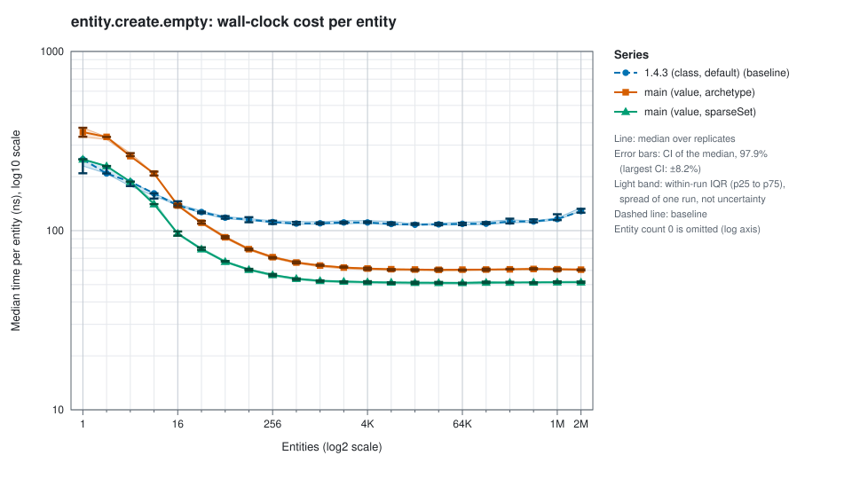

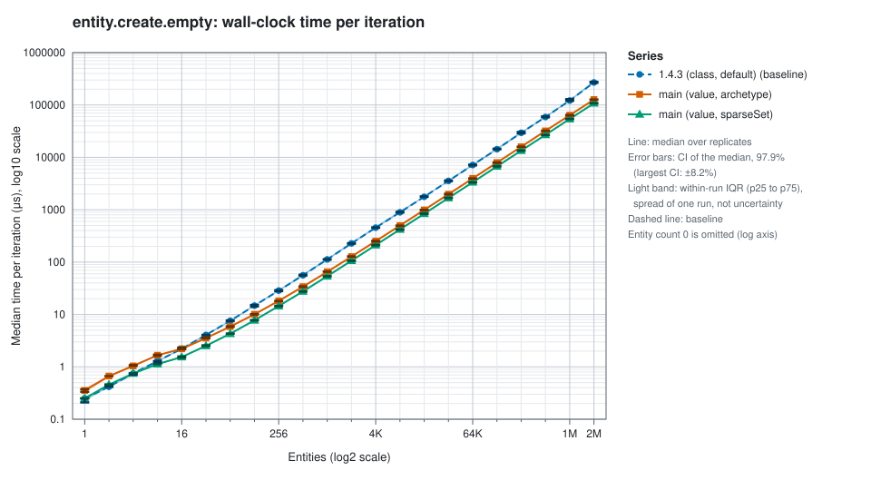

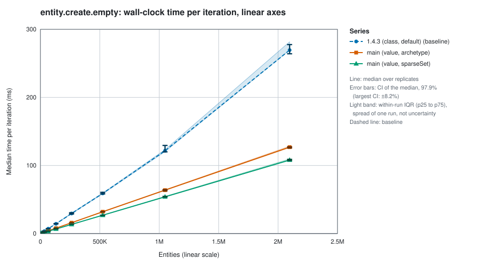

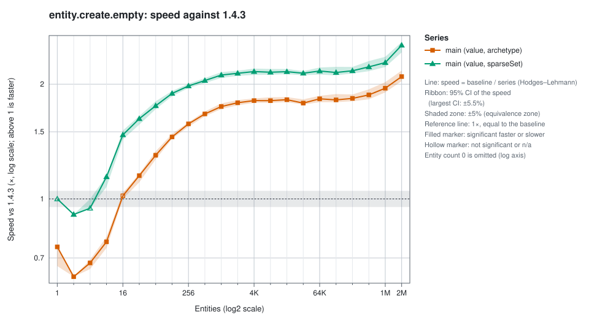

#### Time (wall clock): Entity counts up to 1,024

<table>
<thead>
<tr><th rowspan="3">Entities</th><th colspan="5">1.4.3 (class) - baseline</th><th colspan="22">main (value)</th></tr>
<tr><th colspan="5">default</th><th colspan="11">archetype</th><th colspan="11">sparseSet</th></tr>
<tr><th>median (μs)</th><th>CI low (μs)</th><th>CI high (μs)</th><th>replicates</th><th>iterations</th><th>median (μs)</th><th>CI low (μs)</th><th>CI high (μs)</th><th>replicates</th><th>iterations</th><th>speed (×)</th><th>CI low (×)</th><th>CI high (×)</th><th>change (%)</th><th>q</th><th>verdict</th><th>median (μs)</th><th>CI low (μs)</th><th>CI high (μs)</th><th>replicates</th><th>iterations</th><th>speed (×)</th><th>CI low (×)</th><th>CI high (×)</th><th>change (%)</th><th>q</th><th>verdict</th></tr>
</thead>
<tbody>
<tr><td align="right">0</td><td align="right">0.0420</td><td align="right">0.0420</td><td align="right">0.0420</td><td align="right">10</td><td align="right">116,184</td><td align="right">0.0420</td><td align="right">0.0420</td><td align="right">0.0420</td><td align="right">10</td><td align="right">96,483</td><td align="right">1.00</td><td align="right">1.00</td><td align="right">1.00</td><td align="right">0</td><td align="right">1.000</td><td align="right">equivalent</td><td align="right">0.0420</td><td align="right">0.0420</td><td align="right">0.0420</td><td align="right">10</td><td align="right">112,696</td><td align="right">1.00</td><td align="right">1.00</td><td align="right">1.00</td><td align="right">0</td><td align="right">1.000</td><td align="right">equivalent</td></tr>
<tr><td align="right">1</td><td align="right">0.250</td><td align="right">0.209</td><td align="right">0.250</td><td align="right">10</td><td align="right">113,953</td><td align="right">0.355</td><td align="right">0.334</td><td align="right">0.375</td><td align="right">10</td><td align="right">91,324</td><td align="right">0.667</td><td align="right">0.667</td><td align="right">0.749</td><td align="right">+50.0</td><td align="right">&lt;0.001</td><td align="right">slower</td><td align="right">0.250</td><td align="right">0.250</td><td align="right">0.250</td><td align="right">10</td><td align="right">110,348</td><td align="right">1.00</td><td align="right">1.00</td><td align="right">1.00</td><td align="right">0</td><td align="right">0.494</td><td align="right">equivalent</td></tr>
<tr><td align="right">2</td><td align="right">0.417</td><td align="right">0.417</td><td align="right">0.458</td><td align="right">10</td><td align="right">108,852</td><td align="right">0.667</td><td align="right">0.666</td><td align="right">0.667</td><td align="right">10</td><td align="right">83,768</td><td align="right">0.626</td><td align="right">0.625</td><td align="right">0.687</td><td align="right">+59.7</td><td align="right">&lt;0.001</td><td align="right">slower</td><td align="right">0.458</td><td align="right">0.458</td><td align="right">0.459</td><td align="right">10</td><td align="right">107,509</td><td align="right">0.910</td><td align="right">0.908</td><td align="right">0.998</td><td align="right">+9.83</td><td align="right">&lt;0.001</td><td align="right">inconclusive</td></tr>
<tr><td align="right">4</td><td align="right">0.750</td><td align="right">0.709</td><td align="right">0.750</td><td align="right">10</td><td align="right">102,751</td><td align="right">1.04</td><td align="right">1.04</td><td align="right">1.08</td><td align="right">10</td><td align="right">77,606</td><td align="right">0.693</td><td align="right">0.680</td><td align="right">0.720</td><td align="right">+44.4</td><td align="right">&lt;0.001</td><td align="right">slower</td><td align="right">0.750</td><td align="right">0.750</td><td align="right">0.750</td><td align="right">10</td><td align="right">98,414</td><td align="right">1.00</td><td align="right">0.945</td><td align="right">1.00</td><td align="right">0</td><td align="right">0.091</td><td align="right">inconclusive</td></tr>
<tr><td align="right">8</td><td align="right">1.29</td><td align="right">1.21</td><td align="right">1.29</td><td align="right">10</td><td align="right">91,078</td><td align="right">1.67</td><td align="right">1.63</td><td align="right">1.71</td><td align="right">10</td><td align="right">71,034</td><td align="right">0.774</td><td align="right">0.750</td><td align="right">0.775</td><td align="right">+29.1</td><td align="right">&lt;0.001</td><td align="right">slower</td><td align="right">1.13</td><td align="right">1.13</td><td align="right">1.13</td><td align="right">10</td><td align="right">90,530</td><td align="right">1.15</td><td align="right">1.11</td><td align="right">1.15</td><td align="right">-12.9</td><td align="right">&lt;0.001</td><td align="right">faster</td></tr>
<tr><td align="right">16</td><td align="right">2.21</td><td align="right">2.21</td><td align="right">2.33</td><td align="right">10</td><td align="right">76,773</td><td align="right">2.21</td><td align="right">2.17</td><td align="right">2.25</td><td align="right">10</td><td align="right">65,777</td><td align="right">1.00</td><td align="right">0.982</td><td align="right">1.02</td><td align="right">0</td><td align="right">0.478</td><td align="right">equivalent</td><td align="right">1.54</td><td align="right">1.50</td><td align="right">1.58</td><td align="right">10</td><td align="right">82,743</td><td align="right">1.43</td><td align="right">1.42</td><td align="right">1.47</td><td align="right">-30.2</td><td align="right">&lt;0.001</td><td align="right">faster</td></tr>
<tr><td align="right">32</td><td align="right">4.06</td><td align="right">4.00</td><td align="right">4.09</td><td align="right">10</td><td align="right">58,327</td><td align="right">3.54</td><td align="right">3.50</td><td align="right">3.63</td><td align="right">10</td><td align="right">56,341</td><td align="right">1.14</td><td align="right">1.12</td><td align="right">1.15</td><td align="right">-12.4</td><td align="right">&lt;0.001</td><td align="right">faster</td><td align="right">2.52</td><td align="right">2.50</td><td align="right">2.58</td><td align="right">10</td><td align="right">70,006</td><td align="right">1.61</td><td align="right">1.58</td><td align="right">1.63</td><td align="right">-37.7</td><td align="right">&lt;0.001</td><td align="right">faster</td></tr>
<tr><td align="right">64</td><td align="right">7.56</td><td align="right">7.46</td><td align="right">7.71</td><td align="right">10</td><td align="right">41,198</td><td align="right">5.88</td><td align="right">5.80</td><td align="right">5.96</td><td align="right">10</td><td align="right">43,882</td><td align="right">1.29</td><td align="right">1.27</td><td align="right">1.31</td><td align="right">-22.5</td><td align="right">&lt;0.001</td><td align="right">faster</td><td align="right">4.29</td><td align="right">4.29</td><td align="right">4.34</td><td align="right">10</td><td align="right">55,930</td><td align="right">1.76</td><td align="right">1.74</td><td align="right">1.78</td><td align="right">-43.1</td><td align="right">&lt;0.001</td><td align="right">faster</td></tr>
<tr><td align="right">128</td><td align="right">14.8</td><td align="right">14.3</td><td align="right">15.2</td><td align="right">10</td><td align="right">25,655</td><td align="right">10.1</td><td align="right">9.96</td><td align="right">10.2</td><td align="right">10</td><td align="right">31,868</td><td align="right">1.46</td><td align="right">1.42</td><td align="right">1.49</td><td align="right">-31.3</td><td align="right">&lt;0.001</td><td align="right">faster</td><td align="right">7.75</td><td align="right">7.67</td><td align="right">7.84</td><td align="right">10</td><td align="right">39,602</td><td align="right">1.90</td><td align="right">1.85</td><td align="right">1.93</td><td align="right">-47.3</td><td align="right">&lt;0.001</td><td align="right">faster</td></tr>
<tr><td align="right">256</td><td align="right">28.6</td><td align="right">27.9</td><td align="right">29.1</td><td align="right">10</td><td align="right">14,597</td><td align="right">18.2</td><td align="right">17.9</td><td align="right">18.2</td><td align="right">10</td><td align="right">20,649</td><td align="right">1.57</td><td align="right">1.53</td><td align="right">1.60</td><td align="right">-36.3</td><td align="right">&lt;0.001</td><td align="right">faster</td><td align="right">14.5</td><td align="right">14.3</td><td align="right">14.7</td><td align="right">10</td><td align="right">25,705</td><td align="right">1.98</td><td align="right">1.95</td><td align="right">2.01</td><td align="right">-49.4</td><td align="right">&lt;0.001</td><td align="right">faster</td></tr>
<tr><td align="right">512</td><td align="right">56.1</td><td align="right">55.4</td><td align="right">57.3</td><td align="right">10</td><td align="right">7,960</td><td align="right">34.0</td><td align="right">33.6</td><td align="right">34.5</td><td align="right">10</td><td align="right">12,247</td><td align="right">1.65</td><td align="right">1.63</td><td align="right">1.67</td><td align="right">-39.4</td><td align="right">&lt;0.001</td><td align="right">faster</td><td align="right">27.6</td><td align="right">27.2</td><td align="right">27.7</td><td align="right">10</td><td align="right">15,040</td><td align="right">2.04</td><td align="right">2.02</td><td align="right">2.07</td><td align="right">-50.9</td><td align="right">&lt;0.001</td><td align="right">faster</td></tr>
<tr><td align="right">1,024</td><td align="right">113</td><td align="right">111</td><td align="right">114</td><td align="right">10</td><td align="right">4,121</td><td align="right">65.4</td><td align="right">65.2</td><td align="right">66.0</td><td align="right">10</td><td align="right">6,777</td><td align="right">1.72</td><td align="right">1.70</td><td align="right">1.74</td><td align="right">-41.9</td><td align="right">&lt;0.001</td><td align="right">faster</td><td align="right">53.7</td><td align="right">53.1</td><td align="right">54.0</td><td align="right">10</td><td align="right">8,262</td><td align="right">2.10</td><td align="right">2.08</td><td align="right">2.12</td><td align="right">-52.4</td><td align="right">&lt;0.001</td><td align="right">faster</td></tr>
</tbody>
</table>

#### Time (wall clock): Entity counts above 1,024

<table>
<thead>
<tr><th rowspan="3">Entities</th><th colspan="5">1.4.3 (class) - baseline</th><th colspan="22">main (value)</th></tr>
<tr><th colspan="5">default</th><th colspan="11">archetype</th><th colspan="11">sparseSet</th></tr>
<tr><th>median (ms)</th><th>CI low (ms)</th><th>CI high (ms)</th><th>replicates</th><th>iterations</th><th>median (ms)</th><th>CI low (ms)</th><th>CI high (ms)</th><th>replicates</th><th>iterations</th><th>speed (×)</th><th>CI low (×)</th><th>CI high (×)</th><th>change (%)</th><th>q</th><th>verdict</th><th>median (ms)</th><th>CI low (ms)</th><th>CI high (ms)</th><th>replicates</th><th>iterations</th><th>speed (×)</th><th>CI low (×)</th><th>CI high (×)</th><th>change (%)</th><th>q</th><th>verdict</th></tr>
</thead>
<tbody>
<tr><td align="right">2,048</td><td align="right">0.228</td><td align="right">0.224</td><td align="right">0.230</td><td align="right">10</td><td align="right">2,078</td><td align="right">0.127</td><td align="right">0.127</td><td align="right">0.129</td><td align="right">10</td><td align="right">3,622</td><td align="right">1.78</td><td align="right">1.76</td><td align="right">1.80</td><td align="right">-43.8</td><td align="right">&lt;0.001</td><td align="right">faster</td><td align="right">0.106</td><td align="right">0.105</td><td align="right">0.107</td><td align="right">10</td><td align="right">4,312</td><td align="right">2.14</td><td align="right">2.11</td><td align="right">2.16</td><td align="right">-53.3</td><td align="right">&lt;0.001</td><td align="right">faster</td></tr>
<tr><td align="right">4,096</td><td align="right">0.455</td><td align="right">0.452</td><td align="right">0.461</td><td align="right">10</td><td align="right">1,050</td><td align="right">0.252</td><td align="right">0.247</td><td align="right">0.255</td><td align="right">10</td><td align="right">1,860</td><td align="right">1.81</td><td align="right">1.80</td><td align="right">1.83</td><td align="right">-44.9</td><td align="right">&lt;0.001</td><td align="right">faster</td><td align="right">0.211</td><td align="right">0.208</td><td align="right">0.214</td><td align="right">10</td><td align="right">2,227</td><td align="right">2.16</td><td align="right">2.14</td><td align="right">2.18</td><td align="right">-53.6</td><td align="right">&lt;0.001</td><td align="right">faster</td></tr>
<tr><td align="right">8,192</td><td align="right">0.893</td><td align="right">0.883</td><td align="right">0.910</td><td align="right">10</td><td align="right">536</td><td align="right">0.499</td><td align="right">0.490</td><td align="right">0.500</td><td align="right">10</td><td align="right">959</td><td align="right">1.80</td><td align="right">1.77</td><td align="right">1.82</td><td align="right">-44.4</td><td align="right">&lt;0.001</td><td align="right">faster</td><td align="right">0.421</td><td align="right">0.414</td><td align="right">0.422</td><td align="right">10</td><td align="right">1,128</td><td align="right">2.13</td><td align="right">2.10</td><td align="right">2.16</td><td align="right">-53.0</td><td align="right">&lt;0.001</td><td align="right">faster</td></tr>
<tr><td align="right">16,384</td><td align="right">1.77</td><td align="right">1.76</td><td align="right">1.80</td><td align="right">10</td><td align="right">272</td><td align="right">0.994</td><td align="right">0.978</td><td align="right">0.997</td><td align="right">10</td><td align="right">484</td><td align="right">1.79</td><td align="right">1.77</td><td align="right">1.81</td><td align="right">-44.1</td><td align="right">&lt;0.001</td><td align="right">faster</td><td align="right">0.839</td><td align="right">0.826</td><td align="right">0.850</td><td align="right">10</td><td align="right">567</td><td align="right">2.11</td><td align="right">2.08</td><td align="right">2.14</td><td align="right">-52.6</td><td align="right">&lt;0.001</td><td align="right">faster</td></tr>
<tr><td align="right">32,768</td><td align="right">3.55</td><td align="right">3.51</td><td align="right">3.62</td><td align="right">10</td><td align="right">136</td><td align="right">1.98</td><td align="right">1.95</td><td align="right">2.01</td><td align="right">10</td><td align="right">243</td><td align="right">1.79</td><td align="right">1.77</td><td align="right">1.82</td><td align="right">-44.3</td><td align="right">&lt;0.001</td><td align="right">faster</td><td align="right">1.68</td><td align="right">1.66</td><td align="right">1.69</td><td align="right">10</td><td align="right">286</td><td align="right">2.12</td><td align="right">2.09</td><td align="right">2.15</td><td align="right">-52.8</td><td align="right">&lt;0.001</td><td align="right">faster</td></tr>
<tr><td align="right">65,536</td><td align="right">7.15</td><td align="right">7.03</td><td align="right">7.25</td><td align="right">10</td><td align="right">68</td><td align="right">3.97</td><td align="right">3.92</td><td align="right">3.98</td><td align="right">10</td><td align="right">122</td><td align="right">1.80</td><td align="right">1.79</td><td align="right">1.82</td><td align="right">-44.6</td><td align="right">&lt;0.001</td><td align="right">faster</td><td align="right">3.35</td><td align="right">3.30</td><td align="right">3.36</td><td align="right">10</td><td align="right">144</td><td align="right">2.14</td><td align="right">2.12</td><td align="right">2.16</td><td align="right">-53.2</td><td align="right">&lt;0.001</td><td align="right">faster</td></tr>
<tr><td align="right">131,072</td><td align="right">14.3</td><td align="right">14.2</td><td align="right">14.6</td><td align="right">10</td><td align="right">34</td><td align="right">7.95</td><td align="right">7.83</td><td align="right">8.04</td><td align="right">10</td><td align="right">61</td><td align="right">1.81</td><td align="right">1.79</td><td align="right">1.83</td><td align="right">-44.6</td><td align="right">&lt;0.001</td><td align="right">faster</td><td align="right">6.73</td><td align="right">6.68</td><td align="right">6.81</td><td align="right">10</td><td align="right">72</td><td align="right">2.13</td><td align="right">2.11</td><td align="right">2.17</td><td align="right">-53.1</td><td align="right">&lt;0.001</td><td align="right">faster</td></tr>
<tr><td align="right">262,144</td><td align="right">29.5</td><td align="right">28.8</td><td align="right">30.6</td><td align="right">10</td><td align="right">17</td><td align="right">15.9</td><td align="right">15.9</td><td align="right">16.1</td><td align="right">10</td><td align="right">31</td><td align="right">1.85</td><td align="right">1.82</td><td align="right">1.89</td><td align="right">-45.9</td><td align="right">&lt;0.001</td><td align="right">faster</td><td align="right">13.5</td><td align="right">13.4</td><td align="right">13.6</td><td align="right">10</td><td align="right">36</td><td align="right">2.19</td><td align="right">2.15</td><td align="right">2.23</td><td align="right">-54.3</td><td align="right">&lt;0.001</td><td align="right">faster</td></tr>
<tr><td align="right">524,288</td><td align="right">59.0</td><td align="right">58.3</td><td align="right">60.6</td><td align="right">10</td><td align="right">9</td><td align="right">32.0</td><td align="right">31.8</td><td align="right">32.4</td><td align="right">10</td><td align="right">16</td><td align="right">1.84</td><td align="right">1.82</td><td align="right">1.87</td><td align="right">-45.7</td><td align="right">&lt;0.001</td><td align="right">faster</td><td align="right">27.0</td><td align="right">26.6</td><td align="right">27.0</td><td align="right">10</td><td align="right">18</td><td align="right">2.19</td><td align="right">2.17</td><td align="right">2.24</td><td align="right">-54.4</td><td align="right">&lt;0.001</td><td align="right">faster</td></tr>
<tr><td align="right">1,048,576</td><td align="right">122</td><td align="right">120</td><td align="right">129</td><td align="right">10</td><td align="right">5</td><td align="right">63.8</td><td align="right">62.7</td><td align="right">64.6</td><td align="right">10</td><td align="right">8</td><td align="right">1.91</td><td align="right">1.88</td><td align="right">1.96</td><td align="right">-47.7</td><td align="right">&lt;0.001</td><td align="right">faster</td><td align="right">54.0</td><td align="right">53.6</td><td align="right">54.6</td><td align="right">10</td><td align="right">9</td><td align="right">2.25</td><td align="right">2.22</td><td align="right">2.31</td><td align="right">-55.6</td><td align="right">&lt;0.001</td><td align="right">faster</td></tr>
<tr><td align="right">2,097,152</td><td align="right">269</td><td align="right">264</td><td align="right">278</td><td align="right">10</td><td align="right">2</td><td align="right">127</td><td align="right">126</td><td align="right">127</td><td align="right">10</td><td align="right">4</td><td align="right">2.12</td><td align="right">2.08</td><td align="right">2.16</td><td align="right">-52.9</td><td align="right">&lt;0.001</td><td align="right">faster</td><td align="right">108</td><td align="right">107</td><td align="right">109</td><td align="right">10</td><td align="right">5</td><td align="right">2.49</td><td align="right">2.44</td><td align="right">2.55</td><td align="right">-59.9</td><td align="right">&lt;0.001</td><td align="right">faster</td></tr>
</tbody>
</table>

### `entity.create.minimal`

[All metrics, means, percentiles and the linear plot](workloads/entity.create.minimal.md)

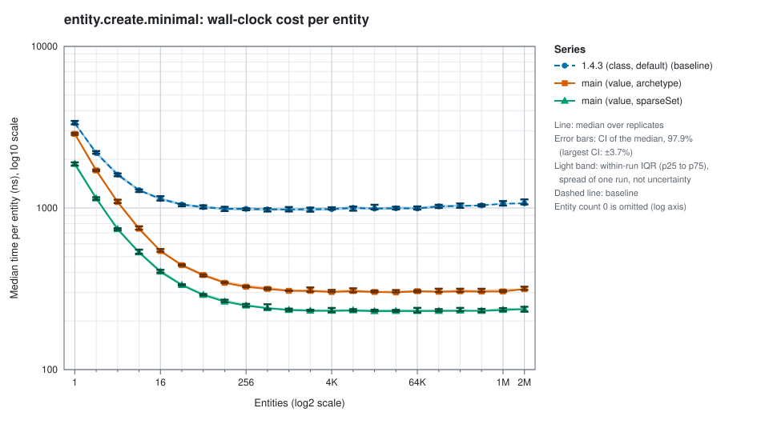

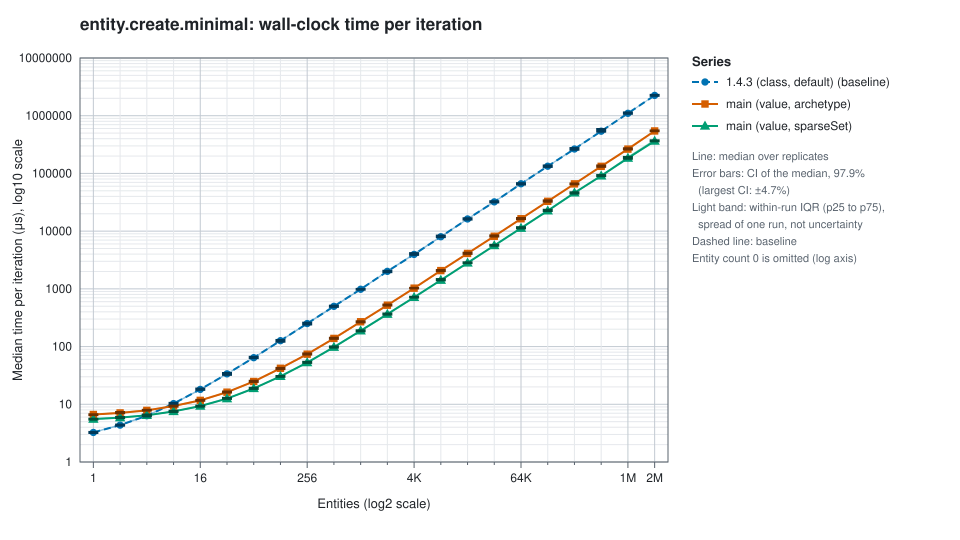

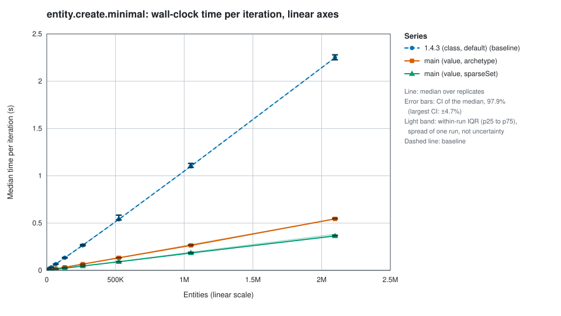

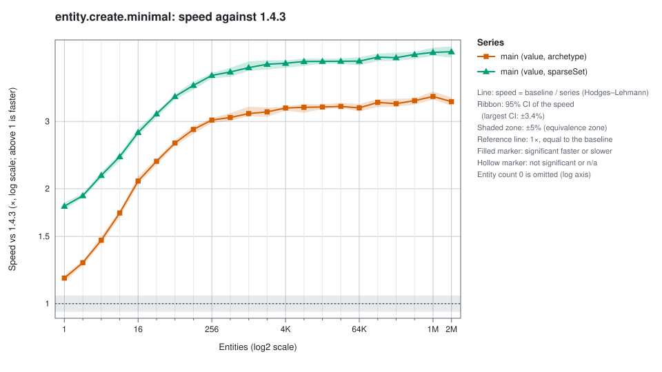

#### Time (wall clock): Entity counts up to 1,024

<table>
<thead>
<tr><th rowspan="3">Entities</th><th colspan="5">1.4.3 (class) - baseline</th><th colspan="22">main (value)</th></tr>
<tr><th colspan="5">default</th><th colspan="11">archetype</th><th colspan="11">sparseSet</th></tr>
<tr><th>median (μs)</th><th>CI low (μs)</th><th>CI high (μs)</th><th>replicates</th><th>iterations</th><th>median (μs)</th><th>CI low (μs)</th><th>CI high (μs)</th><th>replicates</th><th>iterations</th><th>speed (×)</th><th>CI low (×)</th><th>CI high (×)</th><th>change (%)</th><th>q</th><th>verdict</th><th>median (μs)</th><th>CI low (μs)</th><th>CI high (μs)</th><th>replicates</th><th>iterations</th><th>speed (×)</th><th>CI low (×)</th><th>CI high (×)</th><th>change (%)</th><th>q</th><th>verdict</th></tr>
</thead>
<tbody>
<tr><td align="right">0</td><td align="right">0.0420</td><td align="right">0.0420</td><td align="right">0.0420</td><td align="right">10</td><td align="right">115,108</td><td align="right">0.0420</td><td align="right">0.0420</td><td align="right">0.0420</td><td align="right">10</td><td align="right">93,864</td><td align="right">1.00</td><td align="right">1.00</td><td align="right">1.00</td><td align="right">0</td><td align="right">1.000</td><td align="right">equivalent</td><td align="right">0.0420</td><td align="right">0.0420</td><td align="right">0.0420</td><td align="right">10</td><td align="right">111,655</td><td align="right">1.00</td><td align="right">1.00</td><td align="right">1.00</td><td align="right">0</td><td align="right">1.000</td><td align="right">equivalent</td></tr>
<tr><td align="right">1</td><td align="right">3.25</td><td align="right">3.21</td><td align="right">3.29</td><td align="right">10</td><td align="right">15,619</td><td align="right">6.65</td><td align="right">6.54</td><td align="right">6.67</td><td align="right">10</td><td align="right">38,593</td><td align="right">0.491</td><td align="right">0.488</td><td align="right">0.497</td><td align="right">+104</td><td align="right">&lt;0.001</td><td align="right">slower</td><td align="right">5.54</td><td align="right">5.46</td><td align="right">5.58</td><td align="right">10</td><td align="right">45,731</td><td align="right">0.587</td><td align="right">0.582</td><td align="right">0.596</td><td align="right">+70.5</td><td align="right">&lt;0.001</td><td align="right">slower</td></tr>
<tr><td align="right">2</td><td align="right">4.36</td><td align="right">4.30</td><td align="right">4.42</td><td align="right">10</td><td align="right">15,027</td><td align="right">7.09</td><td align="right">7.04</td><td align="right">7.30</td><td align="right">10</td><td align="right">36,849</td><td align="right">0.610</td><td align="right">0.603</td><td align="right">0.620</td><td align="right">+64.0</td><td align="right">&lt;0.001</td><td align="right">slower</td><td align="right">5.88</td><td align="right">5.80</td><td align="right">6.00</td><td align="right">10</td><td align="right">44,717</td><td align="right">0.741</td><td align="right">0.731</td><td align="right">0.754</td><td align="right">+34.9</td><td align="right">&lt;0.001</td><td align="right">slower</td></tr>
<tr><td align="right">4</td><td align="right">6.34</td><td align="right">6.21</td><td align="right">6.54</td><td align="right">10</td><td align="right">14,008</td><td align="right">7.84</td><td align="right">7.84</td><td align="right">7.96</td><td align="right">10</td><td align="right">34,692</td><td align="right">0.801</td><td align="right">0.789</td><td align="right">0.824</td><td align="right">+24.8</td><td align="right">&lt;0.001</td><td align="right">slower</td><td align="right">6.44</td><td align="right">6.38</td><td align="right">6.54</td><td align="right">10</td><td align="right">41,983</td><td align="right">0.987</td><td align="right">0.968</td><td align="right">1.01</td><td align="right">+1.32</td><td align="right">0.216</td><td align="right">equivalent</td></tr>
<tr><td align="right">8</td><td align="right">10.3</td><td align="right">10.0</td><td align="right">10.5</td><td align="right">10</td><td align="right">12,538</td><td align="right">9.34</td><td align="right">9.17</td><td align="right">9.38</td><td align="right">10</td><td align="right">31,773</td><td align="right">1.11</td><td align="right">1.08</td><td align="right">1.12</td><td align="right">-9.52</td><td align="right">&lt;0.001</td><td align="right">faster</td><td align="right">7.52</td><td align="right">7.42</td><td align="right">7.67</td><td align="right">10</td><td align="right">38,667</td><td align="right">1.36</td><td align="right">1.33</td><td align="right">1.39</td><td align="right">-26.6</td><td align="right">&lt;0.001</td><td align="right">faster</td></tr>
<tr><td align="right">16</td><td align="right">18.1</td><td align="right">17.9</td><td align="right">18.6</td><td align="right">10</td><td align="right">10,165</td><td align="right">11.7</td><td align="right">11.6</td><td align="right">11.8</td><td align="right">10</td><td align="right">27,131</td><td align="right">1.56</td><td align="right">1.53</td><td align="right">1.58</td><td align="right">-35.7</td><td align="right">&lt;0.001</td><td align="right">faster</td><td align="right">9.32</td><td align="right">9.17</td><td align="right">9.42</td><td align="right">10</td><td align="right">33,738</td><td align="right">1.96</td><td align="right">1.92</td><td align="right">1.99</td><td align="right">-48.9</td><td align="right">&lt;0.001</td><td align="right">faster</td></tr>
<tr><td align="right">32</td><td align="right">33.7</td><td align="right">32.6</td><td align="right">34.6</td><td align="right">10</td><td align="right">7,596</td><td align="right">16.2</td><td align="right">16.1</td><td align="right">16.5</td><td align="right">10</td><td align="right">21,984</td><td align="right">2.07</td><td align="right">2.03</td><td align="right">2.12</td><td align="right">-51.7</td><td align="right">&lt;0.001</td><td align="right">faster</td><td align="right">12.5</td><td align="right">12.5</td><td align="right">12.8</td><td align="right">10</td><td align="right">27,401</td><td align="right">2.66</td><td align="right">2.61</td><td align="right">2.74</td><td align="right">-62.4</td><td align="right">&lt;0.001</td><td align="right">faster</td></tr>
<tr><td align="right">64</td><td align="right">64.2</td><td align="right">63.5</td><td align="right">65.9</td><td align="right">10</td><td align="right">4,961</td><td align="right">24.8</td><td align="right">24.6</td><td align="right">25.3</td><td align="right">10</td><td align="right">15,711</td><td align="right">2.59</td><td align="right">2.55</td><td align="right">2.63</td><td align="right">-61.4</td><td align="right">&lt;0.001</td><td align="right">faster</td><td align="right">18.8</td><td align="right">18.6</td><td align="right">19.2</td><td align="right">10</td><td align="right">20,053</td><td align="right">3.43</td><td align="right">3.37</td><td align="right">3.48</td><td align="right">-70.8</td><td align="right">&lt;0.001</td><td align="right">faster</td></tr>
<tr><td align="right">128</td><td align="right">126</td><td align="right">122</td><td align="right">129</td><td align="right">10</td><td align="right">2,964</td><td align="right">42.1</td><td align="right">41.1</td><td align="right">42.3</td><td align="right">10</td><td align="right">10,131</td><td align="right">3.02</td><td align="right">2.98</td><td align="right">3.08</td><td align="right">-66.9</td><td align="right">&lt;0.001</td><td align="right">faster</td><td align="right">30.5</td><td align="right">30.1</td><td align="right">30.7</td><td align="right">10</td><td align="right">13,699</td><td align="right">4.17</td><td align="right">4.12</td><td align="right">4.22</td><td align="right">-76.0</td><td align="right">&lt;0.001</td><td align="right">faster</td></tr>
<tr><td align="right">256</td><td align="right">251</td><td align="right">243</td><td align="right">257</td><td align="right">10</td><td align="right">1,616</td><td align="right">73.9</td><td align="right">73.3</td><td align="right">75.5</td><td align="right">10</td><td align="right">6,118</td><td align="right">3.38</td><td align="right">3.31</td><td align="right">3.46</td><td align="right">-70.4</td><td align="right">&lt;0.001</td><td align="right">faster</td><td align="right">52.8</td><td align="right">52.5</td><td align="right">54.0</td><td align="right">10</td><td align="right">8,383</td><td align="right">4.73</td><td align="right">4.62</td><td align="right">4.83</td><td align="right">-78.9</td><td align="right">&lt;0.001</td><td align="right">faster</td></tr>
<tr><td align="right">512</td><td align="right">498</td><td align="right">491</td><td align="right">507</td><td align="right">10</td><td align="right">855</td><td align="right">138</td><td align="right">137</td><td align="right">141</td><td align="right">10</td><td align="right">3,386</td><td align="right">3.59</td><td align="right">3.53</td><td align="right">3.65</td><td align="right">-72.2</td><td align="right">&lt;0.001</td><td align="right">faster</td><td align="right">97.8</td><td align="right">96.8</td><td align="right">99.7</td><td align="right">10</td><td align="right">4,689</td><td align="right">5.09</td><td align="right">5.01</td><td align="right">5.17</td><td align="right">-80.3</td><td align="right">&lt;0.001</td><td align="right">faster</td></tr>
<tr><td align="right">1,024</td><td align="right">984</td><td align="right">974</td><td align="right">990</td><td align="right">10</td><td align="right">447</td><td align="right">269</td><td align="right">264</td><td align="right">272</td><td align="right">10</td><td align="right">1,792</td><td align="right">3.66</td><td align="right">3.62</td><td align="right">3.72</td><td align="right">-72.7</td><td align="right">&lt;0.001</td><td align="right">faster</td><td align="right">188</td><td align="right">185</td><td align="right">190</td><td align="right">10</td><td align="right">2,523</td><td align="right">5.22</td><td align="right">5.16</td><td align="right">5.30</td><td align="right">-80.8</td><td align="right">&lt;0.001</td><td align="right">faster</td></tr>
</tbody>
</table>

#### Time (wall clock): Entity counts above 1,024

<table>
<thead>
<tr><th rowspan="3">Entities</th><th colspan="5">1.4.3 (class) - baseline</th><th colspan="22">main (value)</th></tr>
<tr><th colspan="5">default</th><th colspan="11">archetype</th><th colspan="11">sparseSet</th></tr>
<tr><th>median (ms)</th><th>CI low (ms)</th><th>CI high (ms)</th><th>replicates</th><th>iterations</th><th>median (ms)</th><th>CI low (ms)</th><th>CI high (ms)</th><th>replicates</th><th>iterations</th><th>speed (×)</th><th>CI low (×)</th><th>CI high (×)</th><th>change (%)</th><th>q</th><th>verdict</th><th>median (ms)</th><th>CI low (ms)</th><th>CI high (ms)</th><th>replicates</th><th>iterations</th><th>speed (×)</th><th>CI low (×)</th><th>CI high (×)</th><th>change (%)</th><th>q</th><th>verdict</th></tr>
</thead>
<tbody>
<tr><td align="right">2,048</td><td align="right">2.01</td><td align="right">1.96</td><td align="right">2.04</td><td align="right">10</td><td align="right">221</td><td align="right">0.521</td><td align="right">0.518</td><td align="right">0.530</td><td align="right">10</td><td align="right">930</td><td align="right">3.85</td><td align="right">3.79</td><td align="right">3.90</td><td align="right">-74.0</td><td align="right">&lt;0.001</td><td align="right">faster</td><td align="right">0.365</td><td align="right">0.360</td><td align="right">0.371</td><td align="right">10</td><td align="right">1,311</td><td align="right">5.50</td><td align="right">5.41</td><td align="right">5.59</td><td align="right">-81.8</td><td align="right">&lt;0.001</td><td align="right">faster</td></tr>
<tr><td align="right">4,096</td><td align="right">3.95</td><td align="right">3.91</td><td align="right">4.13</td><td align="right">10</td><td align="right">112</td><td align="right">1.03</td><td align="right">1.03</td><td align="right">1.03</td><td align="right">10</td><td align="right">473</td><td align="right">3.83</td><td align="right">3.80</td><td align="right">3.98</td><td align="right">-73.9</td><td align="right">&lt;0.001</td><td align="right">faster</td><td align="right">0.713</td><td align="right">0.711</td><td align="right">0.724</td><td align="right">10</td><td align="right">677</td><td align="right">5.52</td><td align="right">5.47</td><td align="right">5.72</td><td align="right">-81.9</td><td align="right">&lt;0.001</td><td align="right">faster</td></tr>
<tr><td align="right">8,192</td><td align="right">8.00</td><td align="right">7.93</td><td align="right">8.31</td><td align="right">10</td><td align="right">57</td><td align="right">2.07</td><td align="right">2.04</td><td align="right">2.10</td><td align="right">10</td><td align="right">236</td><td align="right">3.89</td><td align="right">3.83</td><td align="right">3.96</td><td align="right">-74.3</td><td align="right">&lt;0.001</td><td align="right">faster</td><td align="right">1.42</td><td align="right">1.41</td><td align="right">1.47</td><td align="right">10</td><td align="right">344</td><td align="right">5.63</td><td align="right">5.49</td><td align="right">5.77</td><td align="right">-82.2</td><td align="right">&lt;0.001</td><td align="right">faster</td></tr>
<tr><td align="right">16,384</td><td align="right">16.3</td><td align="right">16.0</td><td align="right">16.6</td><td align="right">10</td><td align="right">28</td><td align="right">4.11</td><td align="right">4.07</td><td align="right">4.20</td><td align="right">10</td><td align="right">120</td><td align="right">3.94</td><td align="right">3.88</td><td align="right">4.01</td><td align="right">-74.6</td><td align="right">&lt;0.001</td><td align="right">faster</td><td align="right">2.82</td><td align="right">2.82</td><td align="right">2.86</td><td align="right">10</td><td align="right">173</td><td align="right">5.74</td><td align="right">5.67</td><td align="right">5.82</td><td align="right">-82.6</td><td align="right">&lt;0.001</td><td align="right">faster</td></tr>
<tr><td align="right">32,768</td><td align="right">32.1</td><td align="right">31.8</td><td align="right">32.7</td><td align="right">10</td><td align="right">15</td><td align="right">8.16</td><td align="right">8.13</td><td align="right">8.38</td><td align="right">10</td><td align="right">61</td><td align="right">3.92</td><td align="right">3.85</td><td align="right">3.96</td><td align="right">-74.5</td><td align="right">&lt;0.001</td><td align="right">faster</td><td align="right">5.64</td><td align="right">5.62</td><td align="right">5.74</td><td align="right">10</td><td align="right">87</td><td align="right">5.68</td><td align="right">5.61</td><td align="right">5.73</td><td align="right">-82.4</td><td align="right">&lt;0.001</td><td align="right">faster</td></tr>
<tr><td align="right">65,536</td><td align="right">66.2</td><td align="right">64.7</td><td align="right">67.3</td><td align="right">10</td><td align="right">7</td><td align="right">16.4</td><td align="right">16.3</td><td align="right">16.7</td><td align="right">10</td><td align="right">31</td><td align="right">4.01</td><td align="right">3.95</td><td align="right">4.08</td><td align="right">-75.1</td><td align="right">&lt;0.001</td><td align="right">faster</td><td align="right">11.3</td><td align="right">11.2</td><td align="right">11.6</td><td align="right">10</td><td align="right">44</td><td align="right">5.80</td><td align="right">5.71</td><td align="right">5.92</td><td align="right">-82.7</td><td align="right">&lt;0.001</td><td align="right">faster</td></tr>
<tr><td align="right">131,072</td><td align="right">133</td><td align="right">131</td><td align="right">136</td><td align="right">10</td><td align="right">4</td><td align="right">32.9</td><td align="right">32.6</td><td align="right">33.8</td><td align="right">10</td><td align="right">15</td><td align="right">4.04</td><td align="right">3.96</td><td align="right">4.09</td><td align="right">-75.3</td><td align="right">&lt;0.001</td><td align="right">faster</td><td align="right">22.6</td><td align="right">22.5</td><td align="right">23.3</td><td align="right">10</td><td align="right">22</td><td align="right">5.86</td><td align="right">5.74</td><td align="right">5.94</td><td align="right">-82.9</td><td align="right">&lt;0.001</td><td align="right">faster</td></tr>
<tr><td align="right">262,144</td><td align="right">265</td><td align="right">259</td><td align="right">273</td><td align="right">10</td><td align="right">2</td><td align="right">65.9</td><td align="right">65.2</td><td align="right">66.5</td><td align="right">10</td><td align="right">8</td><td align="right">4.01</td><td align="right">3.95</td><td align="right">4.10</td><td align="right">-75.1</td><td align="right">&lt;0.001</td><td align="right">faster</td><td align="right">46.2</td><td align="right">45.2</td><td align="right">46.8</td><td align="right">10</td><td align="right">11</td><td align="right">5.76</td><td align="right">5.64</td><td align="right">5.88</td><td align="right">-82.6</td><td align="right">&lt;0.001</td><td align="right">faster</td></tr>
<tr><td align="right">524,288</td><td align="right">539</td><td align="right">533</td><td align="right">584</td><td align="right">10</td><td align="right">1</td><td align="right">133</td><td align="right">131</td><td align="right">136</td><td align="right">10</td><td align="right">4</td><td align="right">4.07</td><td align="right">4.01</td><td align="right">4.26</td><td align="right">-75.4</td><td align="right">&lt;0.001</td><td align="right">faster</td><td align="right">90.9</td><td align="right">90.4</td><td align="right">93.0</td><td align="right">10</td><td align="right">6</td><td align="right">5.93</td><td align="right">5.87</td><td align="right">6.20</td><td align="right">-83.1</td><td align="right">&lt;0.001</td><td align="right">faster</td></tr>
<tr><td align="right">1,048,576</td><td align="right">1,100</td><td align="right">1,090</td><td align="right">1,130</td><td align="right">10</td><td align="right">1</td><td align="right">264</td><td align="right">262</td><td align="right">271</td><td align="right">10</td><td align="right">2</td><td align="right">4.17</td><td align="right">4.12</td><td align="right">4.26</td><td align="right">-76.0</td><td align="right">&lt;0.001</td><td align="right">faster</td><td align="right">184</td><td align="right">181</td><td align="right">192</td><td align="right">10</td><td align="right">3</td><td align="right">6.00</td><td align="right">5.83</td><td align="right">6.11</td><td align="right">-83.3</td><td align="right">&lt;0.001</td><td align="right">faster</td></tr>
<tr><td align="right">2,097,152</td><td align="right">2,250</td><td align="right">2,230</td><td align="right">2,280</td><td align="right">10</td><td align="right">1</td><td align="right">544</td><td align="right">543</td><td align="right">552</td><td align="right">10</td><td align="right">1</td><td align="right">4.11</td><td align="right">4.06</td><td align="right">4.16</td><td align="right">-75.7</td><td align="right">&lt;0.001</td><td align="right">faster</td><td align="right">364</td><td align="right">363</td><td align="right">372</td><td align="right">10</td><td align="right">2</td><td align="right">6.14</td><td align="right">6.04</td><td align="right">6.22</td><td align="right">-83.7</td><td align="right">&lt;0.001</td><td align="right">faster</td></tr>
</tbody>
</table>

### `entity.create.no-entities`

[All metrics, means, percentiles and the linear plot](workloads/entity.create.no-entities.md)

#### Time (wall clock): Entity counts up to 1,024

<table>
<thead>
<tr><th rowspan="3">Entities</th><th colspan="5">1.4.3 (class) - baseline</th><th colspan="22">main (value)</th></tr>
<tr><th colspan="5">default</th><th colspan="11">archetype</th><th colspan="11">sparseSet</th></tr>
<tr><th>median (ns)</th><th>CI low (ns)</th><th>CI high (ns)</th><th>replicates</th><th>iterations</th><th>median (ns)</th><th>CI low (ns)</th><th>CI high (ns)</th><th>replicates</th><th>iterations</th><th>speed (×)</th><th>CI low (×)</th><th>CI high (×)</th><th>change (%)</th><th>q</th><th>verdict</th><th>median (ns)</th><th>CI low (ns)</th><th>CI high (ns)</th><th>replicates</th><th>iterations</th><th>speed (×)</th><th>CI low (×)</th><th>CI high (×)</th><th>change (%)</th><th>q</th><th>verdict</th></tr>
</thead>
<tbody>
<tr><td align="right">0</td><td align="right">42</td><td align="right">42</td><td align="right">42</td><td align="right">10</td><td align="right">116,416</td><td align="right">42</td><td align="right">42</td><td align="right">42</td><td align="right">10</td><td align="right">97,523</td><td align="right">1.00</td><td align="right">1.00</td><td align="right">1.00</td><td align="right">0</td><td align="right">1.000</td><td align="right">equivalent</td><td align="right">42</td><td align="right">42</td><td align="right">42</td><td align="right">10</td><td align="right">111,105</td><td align="right">1.00</td><td align="right">1.00</td><td align="right">1.00</td><td align="right">0</td><td align="right">1.000</td><td align="right">equivalent</td></tr>
</tbody>
</table>

### `entity.destroy.minimal`

[All metrics, means, percentiles and the linear plot](workloads/entity.destroy.minimal.md)

#### Time (wall clock): Entity counts up to 1,024

<table>
<thead>
<tr><th rowspan="3">Entities</th><th colspan="5">1.4.3 (class) - baseline</th><th colspan="22">main (value)</th></tr>
<tr><th colspan="5">default</th><th colspan="11">archetype</th><th colspan="11">sparseSet</th></tr>
<tr><th>median (μs)</th><th>CI low (μs)</th><th>CI high (μs)</th><th>replicates</th><th>iterations</th><th>median (μs)</th><th>CI low (μs)</th><th>CI high (μs)</th><th>replicates</th><th>iterations</th><th>speed (×)</th><th>CI low (×)</th><th>CI high (×)</th><th>change (%)</th><th>q</th><th>verdict</th><th>median (μs)</th><th>CI low (μs)</th><th>CI high (μs)</th><th>replicates</th><th>iterations</th><th>speed (×)</th><th>CI low (×)</th><th>CI high (×)</th><th>change (%)</th><th>q</th><th>verdict</th></tr>
</thead>
<tbody>
<tr><td align="right">0</td><td align="right">0.0420</td><td align="right">0.0420</td><td align="right">0.0420</td><td align="right">10</td><td align="right">112,475</td><td align="right">0.0420</td><td align="right">0.0420</td><td align="right">0.0420</td><td align="right">10</td><td align="right">97,282</td><td align="right">1.00</td><td align="right">1.00</td><td align="right">1.00</td><td align="right">0</td><td align="right">1.000</td><td align="right">equivalent</td><td align="right">0.0420</td><td align="right">0.0420</td><td align="right">0.0420</td><td align="right">10</td><td align="right">115,064</td><td align="right">1.00</td><td align="right">1.00</td><td align="right">1.00</td><td align="right">0</td><td align="right">1.000</td><td align="right">equivalent</td></tr>
<tr><td align="right">1</td><td align="right">24.8</td><td align="right">24.3</td><td align="right">25.2</td><td align="right">10</td><td align="right">15,180</td><td align="right">1.42</td><td align="right">1.38</td><td align="right">1.46</td><td align="right">10</td><td align="right">33,634</td><td align="right">17.5</td><td align="right">17.2</td><td align="right">17.8</td><td align="right">-94.3</td><td align="right">&lt;0.001</td><td align="right">faster</td><td align="right">0.500</td><td align="right">0.459</td><td align="right">0.500</td><td align="right">10</td><td align="right">43,253</td><td align="right">49.8</td><td align="right">48.6</td><td align="right">53.1</td><td align="right">-98.0</td><td align="right">&lt;0.001</td><td align="right">faster</td></tr>
<tr><td align="right">2</td><td align="right">26.0</td><td align="right">25.9</td><td align="right">26.3</td><td align="right">10</td><td align="right">14,131</td><td align="right">1.92</td><td align="right">1.88</td><td align="right">1.92</td><td align="right">10</td><td align="right">31,044</td><td align="right">13.6</td><td align="right">13.5</td><td align="right">13.8</td><td align="right">-92.6</td><td align="right">&lt;0.001</td><td align="right">faster</td><td align="right">0.980</td><td align="right">0.958</td><td align="right">1.00</td><td align="right">10</td><td align="right">40,640</td><td align="right">26.6</td><td align="right">26.0</td><td align="right">27.2</td><td align="right">-96.2</td><td align="right">&lt;0.001</td><td align="right">faster</td></tr>
<tr><td align="right">4</td><td align="right">28.2</td><td align="right">27.6</td><td align="right">28.8</td><td align="right">10</td><td align="right">12,574</td><td align="right">2.71</td><td align="right">2.67</td><td align="right">2.79</td><td align="right">10</td><td align="right">28,598</td><td align="right">10.4</td><td align="right">10.2</td><td align="right">10.6</td><td align="right">-90.4</td><td align="right">&lt;0.001</td><td align="right">faster</td><td align="right">1.88</td><td align="right">1.83</td><td align="right">1.92</td><td align="right">10</td><td align="right">36,231</td><td align="right">15.1</td><td align="right">14.7</td><td align="right">15.4</td><td align="right">-93.4</td><td align="right">&lt;0.001</td><td align="right">faster</td></tr>
<tr><td align="right">8</td><td align="right">32.4</td><td align="right">31.9</td><td align="right">33.2</td><td align="right">10</td><td align="right">10,452</td><td align="right">4.17</td><td align="right">4.17</td><td align="right">4.25</td><td align="right">10</td><td align="right">24,461</td><td align="right">7.74</td><td align="right">7.64</td><td align="right">7.85</td><td align="right">-87.1</td><td align="right">&lt;0.001</td><td align="right">faster</td><td align="right">3.50</td><td align="right">3.42</td><td align="right">3.54</td><td align="right">10</td><td align="right">30,252</td><td align="right">9.25</td><td align="right">9.13</td><td align="right">9.47</td><td align="right">-89.2</td><td align="right">&lt;0.001</td><td align="right">faster</td></tr>
<tr><td align="right">16</td><td align="right">41.1</td><td align="right">40.6</td><td align="right">42.0</td><td align="right">10</td><td align="right">7,802</td><td align="right">6.92</td><td align="right">6.84</td><td align="right">7.00</td><td align="right">10</td><td align="right">19,568</td><td align="right">5.94</td><td align="right">5.87</td><td align="right">6.03</td><td align="right">-83.2</td><td align="right">&lt;0.001</td><td align="right">faster</td><td align="right">6.40</td><td align="right">6.30</td><td align="right">6.50</td><td align="right">10</td><td align="right">23,619</td><td align="right">6.44</td><td align="right">6.33</td><td align="right">6.53</td><td align="right">-84.5</td><td align="right">&lt;0.001</td><td align="right">faster</td></tr>
<tr><td align="right">32</td><td align="right">57.5</td><td align="right">56.6</td><td align="right">58.1</td><td align="right">10</td><td align="right">5,196</td><td align="right">12.4</td><td align="right">12.3</td><td align="right">12.6</td><td align="right">10</td><td align="right">13,969</td><td align="right">4.62</td><td align="right">4.57</td><td align="right">4.67</td><td align="right">-78.4</td><td align="right">&lt;0.001</td><td align="right">faster</td><td align="right">12.2</td><td align="right">12.1</td><td align="right">12.3</td><td align="right">10</td><td align="right">16,167</td><td align="right">4.71</td><td align="right">4.66</td><td align="right">4.76</td><td align="right">-78.8</td><td align="right">&lt;0.001</td><td align="right">faster</td></tr>
<tr><td align="right">64</td><td align="right">92.0</td><td align="right">90.8</td><td align="right">92.5</td><td align="right">10</td><td align="right">3,084</td><td align="right">23.4</td><td align="right">23.1</td><td align="right">23.7</td><td align="right">10</td><td align="right">8,942</td><td align="right">3.92</td><td align="right">3.87</td><td align="right">3.98</td><td align="right">-74.5</td><td align="right">&lt;0.001</td><td align="right">faster</td><td align="right">23.8</td><td align="right">23.6</td><td align="right">24.2</td><td align="right">10</td><td align="right">10,109</td><td align="right">3.85</td><td align="right">3.78</td><td align="right">3.89</td><td align="right">-74.0</td><td align="right">&lt;0.001</td><td align="right">faster</td></tr>
<tr><td align="right">128</td><td align="right">158</td><td align="right">156</td><td align="right">161</td><td align="right">10</td><td align="right">1,748</td><td align="right">44.9</td><td align="right">44.5</td><td align="right">45.9</td><td align="right">10</td><td align="right">5,253</td><td align="right">3.51</td><td align="right">3.45</td><td align="right">3.55</td><td align="right">-71.5</td><td align="right">&lt;0.001</td><td align="right">faster</td><td align="right">46.9</td><td align="right">46.3</td><td align="right">47.4</td><td align="right">10</td><td align="right">5,942</td><td align="right">3.36</td><td align="right">3.33</td><td align="right">3.40</td><td align="right">-70.3</td><td align="right">&lt;0.001</td><td align="right">faster</td></tr>
<tr><td align="right">256</td><td align="right">295</td><td align="right">290</td><td align="right">297</td><td align="right">10</td><td align="right">900</td><td align="right">88.6</td><td align="right">87.1</td><td align="right">89.3</td><td align="right">10</td><td align="right">2,927</td><td align="right">3.33</td><td align="right">3.28</td><td align="right">3.36</td><td align="right">-70.0</td><td align="right">&lt;0.001</td><td align="right">faster</td><td align="right">93.1</td><td align="right">91.3</td><td align="right">96.4</td><td align="right">10</td><td align="right">3,173</td><td align="right">3.15</td><td align="right">3.08</td><td align="right">3.20</td><td align="right">-68.2</td><td align="right">&lt;0.001</td><td align="right">faster</td></tr>
<tr><td align="right">512</td><td align="right">565</td><td align="right">559</td><td align="right">572</td><td align="right">10</td><td align="right">467</td><td align="right">174</td><td align="right">173</td><td align="right">177</td><td align="right">10</td><td align="right">1,535</td><td align="right">3.24</td><td align="right">3.19</td><td align="right">3.28</td><td align="right">-69.2</td><td align="right">&lt;0.001</td><td align="right">faster</td><td align="right">186</td><td align="right">181</td><td align="right">187</td><td align="right">10</td><td align="right">1,697</td><td align="right">3.05</td><td align="right">3.01</td><td align="right">3.12</td><td align="right">-67.2</td><td align="right">&lt;0.001</td><td align="right">faster</td></tr>
<tr><td align="right">1,024</td><td align="right">1,100</td><td align="right">1,090</td><td align="right">1,130</td><td align="right">10</td><td align="right">236</td><td align="right">346</td><td align="right">345</td><td align="right">350</td><td align="right">10</td><td align="right">796</td><td align="right">3.17</td><td align="right">3.14</td><td align="right">3.22</td><td align="right">-68.5</td><td align="right">&lt;0.001</td><td align="right">faster</td><td align="right">370</td><td align="right">364</td><td align="right">379</td><td align="right">10</td><td align="right">871</td><td align="right">2.98</td><td align="right">2.92</td><td align="right">3.03</td><td align="right">-66.4</td><td align="right">&lt;0.001</td><td align="right">faster</td></tr>
</tbody>
</table>

#### Time (wall clock): Entity counts above 1,024

<table>
<thead>
<tr><th rowspan="3">Entities</th><th colspan="5">1.4.3 (class) - baseline</th><th colspan="22">main (value)</th></tr>
<tr><th colspan="5">default</th><th colspan="11">archetype</th><th colspan="11">sparseSet</th></tr>
<tr><th>median (ms)</th><th>CI low (ms)</th><th>CI high (ms)</th><th>replicates</th><th>iterations</th><th>median (ms)</th><th>CI low (ms)</th><th>CI high (ms)</th><th>replicates</th><th>iterations</th><th>speed (×)</th><th>CI low (×)</th><th>CI high (×)</th><th>change (%)</th><th>q</th><th>verdict</th><th>median (ms)</th><th>CI low (ms)</th><th>CI high (ms)</th><th>replicates</th><th>iterations</th><th>speed (×)</th><th>CI low (×)</th><th>CI high (×)</th><th>change (%)</th><th>q</th><th>verdict</th></tr>
</thead>
<tbody>
<tr><td align="right">2,048</td><td align="right">2.17</td><td align="right">2.15</td><td align="right">2.20</td><td align="right">10</td><td align="right">119</td><td align="right">0.699</td><td align="right">0.690</td><td align="right">0.711</td><td align="right">10</td><td align="right">399</td><td align="right">3.11</td><td align="right">3.06</td><td align="right">3.14</td><td align="right">-67.8</td><td align="right">&lt;0.001</td><td align="right">faster</td><td align="right">0.741</td><td align="right">0.718</td><td align="right">0.750</td><td align="right">10</td><td align="right">445</td><td align="right">2.94</td><td align="right">2.90</td><td align="right">2.99</td><td align="right">-66.0</td><td align="right">&lt;0.001</td><td align="right">faster</td></tr>
<tr><td align="right">4,096</td><td align="right">4.34</td><td align="right">4.27</td><td align="right">4.45</td><td align="right">10</td><td align="right">60</td><td align="right">1.40</td><td align="right">1.39</td><td align="right">1.41</td><td align="right">10</td><td align="right">203</td><td align="right">3.10</td><td align="right">3.06</td><td align="right">3.16</td><td align="right">-67.8</td><td align="right">&lt;0.001</td><td align="right">faster</td><td align="right">1.47</td><td align="right">1.44</td><td align="right">1.50</td><td align="right">10</td><td align="right">224</td><td align="right">2.95</td><td align="right">2.90</td><td align="right">3.01</td><td align="right">-66.2</td><td align="right">&lt;0.001</td><td align="right">faster</td></tr>
<tr><td align="right">8,192</td><td align="right">8.68</td><td align="right">8.56</td><td align="right">8.87</td><td align="right">10</td><td align="right">30</td><td align="right">2.77</td><td align="right">2.74</td><td align="right">2.79</td><td align="right">10</td><td align="right">103</td><td align="right">3.14</td><td align="right">3.10</td><td align="right">3.19</td><td align="right">-68.2</td><td align="right">&lt;0.001</td><td align="right">faster</td><td align="right">2.94</td><td align="right">2.91</td><td align="right">2.98</td><td align="right">10</td><td align="right">114</td><td align="right">2.96</td><td align="right">2.91</td><td align="right">3.00</td><td align="right">-66.2</td><td align="right">&lt;0.001</td><td align="right">faster</td></tr>
<tr><td align="right">16,384</td><td align="right">17.6</td><td align="right">17.3</td><td align="right">17.9</td><td align="right">10</td><td align="right">15</td><td align="right">5.61</td><td align="right">5.52</td><td align="right">5.68</td><td align="right">10</td><td align="right">51</td><td align="right">3.15</td><td align="right">3.10</td><td align="right">3.19</td><td align="right">-68.2</td><td align="right">&lt;0.001</td><td align="right">faster</td><td align="right">5.91</td><td align="right">5.80</td><td align="right">6.05</td><td align="right">10</td><td align="right">57</td><td align="right">2.98</td><td align="right">2.93</td><td align="right">3.03</td><td align="right">-66.4</td><td align="right">&lt;0.001</td><td align="right">faster</td></tr>
<tr><td align="right">32,768</td><td align="right">35.0</td><td align="right">34.2</td><td align="right">35.5</td><td align="right">10</td><td align="right">8</td><td align="right">11.1</td><td align="right">11.0</td><td align="right">11.3</td><td align="right">10</td><td align="right">26</td><td align="right">3.16</td><td align="right">3.11</td><td align="right">3.20</td><td align="right">-68.3</td><td align="right">&lt;0.001</td><td align="right">faster</td><td align="right">11.7</td><td align="right">11.6</td><td align="right">12.1</td><td align="right">10</td><td align="right">29</td><td align="right">2.98</td><td align="right">2.92</td><td align="right">3.03</td><td align="right">-66.4</td><td align="right">&lt;0.001</td><td align="right">faster</td></tr>
<tr><td align="right">65,536</td><td align="right">69.8</td><td align="right">69.6</td><td align="right">70.2</td><td align="right">10</td><td align="right">4</td><td align="right">22.5</td><td align="right">22.1</td><td align="right">23.0</td><td align="right">10</td><td align="right">13</td><td align="right">3.11</td><td align="right">3.05</td><td align="right">3.15</td><td align="right">-67.8</td><td align="right">&lt;0.001</td><td align="right">faster</td><td align="right">23.7</td><td align="right">23.4</td><td align="right">24.3</td><td align="right">10</td><td align="right">14</td><td align="right">2.95</td><td align="right">2.89</td><td align="right">2.98</td><td align="right">-66.1</td><td align="right">&lt;0.001</td><td align="right">faster</td></tr>
<tr><td align="right">131,072</td><td align="right">144</td><td align="right">137</td><td align="right">146</td><td align="right">10</td><td align="right">2</td><td align="right">45.1</td><td align="right">44.6</td><td align="right">45.3</td><td align="right">10</td><td align="right">7</td><td align="right">3.19</td><td align="right">3.13</td><td align="right">3.24</td><td align="right">-68.7</td><td align="right">&lt;0.001</td><td align="right">faster</td><td align="right">47.1</td><td align="right">46.2</td><td align="right">47.3</td><td align="right">10</td><td align="right">8</td><td align="right">3.06</td><td align="right">3.00</td><td align="right">3.11</td><td align="right">-67.3</td><td align="right">&lt;0.001</td><td align="right">faster</td></tr>
<tr><td align="right">262,144</td><td align="right">290</td><td align="right">287</td><td align="right">294</td><td align="right">10</td><td align="right">1</td><td align="right">88.8</td><td align="right">87.7</td><td align="right">89.5</td><td align="right">10</td><td align="right">4</td><td align="right">3.27</td><td align="right">3.24</td><td align="right">3.30</td><td align="right">-69.5</td><td align="right">&lt;0.001</td><td align="right">faster</td><td align="right">93.7</td><td align="right">92.7</td><td align="right">96.7</td><td align="right">10</td><td align="right">4</td><td align="right">3.09</td><td align="right">3.02</td><td align="right">3.13</td><td align="right">-67.6</td><td align="right">&lt;0.001</td><td align="right">faster</td></tr>
<tr><td align="right">524,288</td><td align="right">584</td><td align="right">581</td><td align="right">610</td><td align="right">10</td><td align="right">1</td><td align="right">178</td><td align="right">176</td><td align="right">182</td><td align="right">10</td><td align="right">2</td><td align="right">3.29</td><td align="right">3.25</td><td align="right">3.37</td><td align="right">-69.6</td><td align="right">&lt;0.001</td><td align="right">faster</td><td align="right">189</td><td align="right">185</td><td align="right">192</td><td align="right">10</td><td align="right">2</td><td align="right">3.13</td><td align="right">3.06</td><td align="right">3.20</td><td align="right">-68.0</td><td align="right">&lt;0.001</td><td align="right">faster</td></tr>
<tr><td align="right">1,048,576</td><td align="right">1,210</td><td align="right">1,200</td><td align="right">1,220</td><td align="right">10</td><td align="right">1</td><td align="right">358</td><td align="right">355</td><td align="right">362</td><td align="right">10</td><td align="right">1</td><td align="right">3.38</td><td align="right">3.34</td><td align="right">3.42</td><td align="right">-70.4</td><td align="right">&lt;0.001</td><td align="right">faster</td><td align="right">382</td><td align="right">373</td><td align="right">386</td><td align="right">10</td><td align="right">1</td><td align="right">3.18</td><td align="right">3.14</td><td align="right">3.22</td><td align="right">-68.6</td><td align="right">&lt;0.001</td><td align="right">faster</td></tr>
<tr><td align="right">2,097,152</td><td align="right">2,470</td><td align="right">2,450</td><td align="right">2,530</td><td align="right">10</td><td align="right">1</td><td align="right">716</td><td align="right">713</td><td align="right">726</td><td align="right">10</td><td align="right">1</td><td align="right">3.45</td><td align="right">3.42</td><td align="right">3.51</td><td align="right">-71.0</td><td align="right">&lt;0.001</td><td align="right">faster</td><td align="right">765</td><td align="right">759</td><td align="right">770</td><td align="right">10</td><td align="right">1</td><td align="right">3.25</td><td align="right">3.21</td><td align="right">3.29</td><td align="right">-69.2</td><td align="right">&lt;0.001</td><td align="right">faster</td></tr>
</tbody>
</table>

### `entity.lookup.mixed-three`

[All metrics, means, percentiles and the linear plot](workloads/entity.lookup.mixed-three.md)

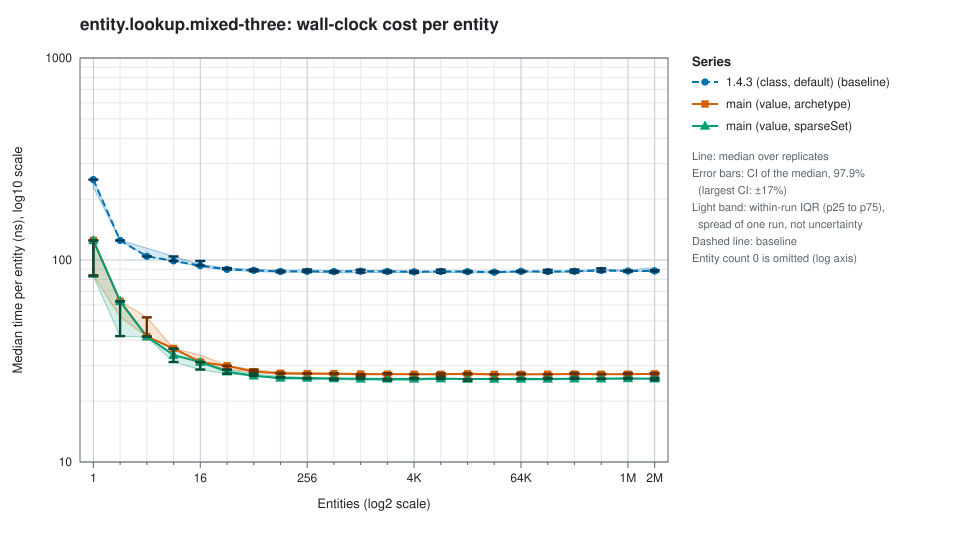

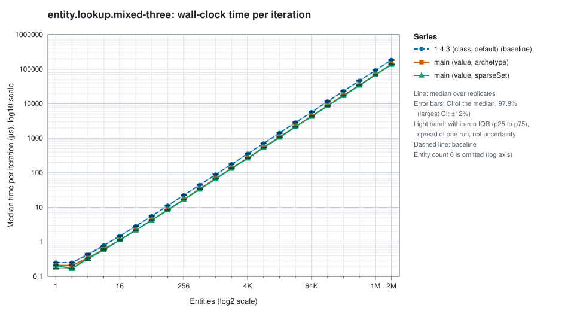

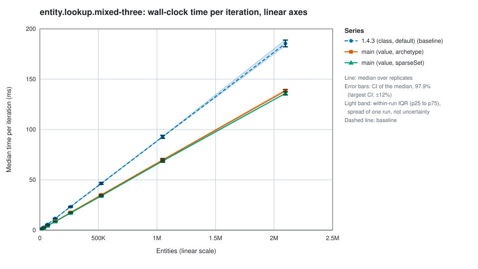

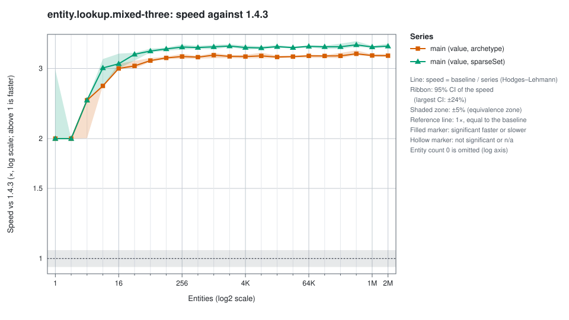

#### Time (wall clock): Entity counts up to 1,024

<table>
<thead>
<tr><th rowspan="3">Entities</th><th colspan="5">1.4.3 (class) - baseline</th><th colspan="22">main (value)</th></tr>
<tr><th colspan="5">default</th><th colspan="11">archetype</th><th colspan="11">sparseSet</th></tr>
<tr><th>median (μs)</th><th>CI low (μs)</th><th>CI high (μs)</th><th>replicates</th><th>iterations</th><th>median (ns)</th><th>CI low (ns)</th><th>CI high (ns)</th><th>replicates</th><th>iterations</th><th>speed (×)</th><th>CI low (×)</th><th>CI high (×)</th><th>change (%)</th><th>q</th><th>verdict</th><th>median (ns)</th><th>CI low (ns)</th><th>CI high (ns)</th><th>replicates</th><th>iterations</th><th>speed (×)</th><th>CI low (×)</th><th>CI high (×)</th><th>change (%)</th><th>q</th><th>verdict</th></tr>
</thead>
<tbody>
<tr><td align="right">0</td><td align="right">0.0420</td><td align="right">0.0420</td><td align="right">0.0420</td><td align="right">10</td><td align="right">124,246</td><td align="right">42</td><td align="right">42</td><td align="right">42</td><td align="right">10</td><td align="right">119,980</td><td align="right">1.00</td><td align="right">1.00</td><td align="right">1.00</td><td align="right">0</td><td align="right">1.000</td><td align="right">equivalent</td><td align="right">42.0</td><td align="right">42</td><td align="right">42</td><td align="right">10</td><td align="right">125,383</td><td align="right">1.00</td><td align="right">1.00</td><td align="right">1.00</td><td align="right">0</td><td align="right">1.000</td><td align="right">equivalent</td></tr>
<tr><td align="right">1</td><td align="right">0.250</td><td align="right">0.250</td><td align="right">0.250</td><td align="right">10</td><td align="right">121,978</td><td align="right">125</td><td align="right">84</td><td align="right">125</td><td align="right">10</td><td align="right">126,368</td><td align="right">2.00</td><td align="right">2.00</td><td align="right">2.00</td><td align="right">-50.0</td><td align="right">&lt;0.001</td><td align="right">faster</td><td align="right">125</td><td align="right">83</td><td align="right">125</td><td align="right">10</td><td align="right">127,056</td><td align="right">2.00</td><td align="right">2.00</td><td align="right">2.98</td><td align="right">-50.0</td><td align="right">&lt;0.001</td><td align="right">faster</td></tr>
<tr><td align="right">2</td><td align="right">0.250</td><td align="right">0.250</td><td align="right">0.250</td><td align="right">10</td><td align="right">120,790</td><td align="right">125</td><td align="right">125</td><td align="right">125</td><td align="right">10</td><td align="right">122,137</td><td align="right">2.00</td><td align="right">2.00</td><td align="right">2.00</td><td align="right">-50.0</td><td align="right">&lt;0.001</td><td align="right">faster</td><td align="right">125</td><td align="right">84</td><td align="right">125</td><td align="right">10</td><td align="right">127,637</td><td align="right">2.00</td><td align="right">2.00</td><td align="right">2.00</td><td align="right">-50.0</td><td align="right">&lt;0.001</td><td align="right">faster</td></tr>
<tr><td align="right">4</td><td align="right">0.417</td><td align="right">0.417</td><td align="right">0.417</td><td align="right">10</td><td align="right">117,227</td><td align="right">167</td><td align="right">167</td><td align="right">208</td><td align="right">10</td><td align="right">122,218</td><td align="right">2.50</td><td align="right">2.00</td><td align="right">2.50</td><td align="right">-60.0</td><td align="right">&lt;0.001</td><td align="right">faster</td><td align="right">167</td><td align="right">167</td><td align="right">167</td><td align="right">10</td><td align="right">123,220</td><td align="right">2.50</td><td align="right">2.50</td><td align="right">2.50</td><td align="right">-60.0</td><td align="right">&lt;0.001</td><td align="right">faster</td></tr>
<tr><td align="right">8</td><td align="right">0.792</td><td align="right">0.791</td><td align="right">0.833</td><td align="right">10</td><td align="right">104,486</td><td align="right">292</td><td align="right">291</td><td align="right">292</td><td align="right">10</td><td align="right">120,283</td><td align="right">2.71</td><td align="right">2.71</td><td align="right">2.72</td><td align="right">-63.1</td><td align="right">&lt;0.001</td><td align="right">faster</td><td align="right">271</td><td align="right">250</td><td align="right">291</td><td align="right">10</td><td align="right">122,354</td><td align="right">3.01</td><td align="right">2.72</td><td align="right">3.17</td><td align="right">-66.8</td><td align="right">&lt;0.001</td><td align="right">faster</td></tr>
<tr><td align="right">16</td><td align="right">1.50</td><td align="right">1.50</td><td align="right">1.58</td><td align="right">10</td><td align="right">93,457</td><td align="right">500</td><td align="right">500</td><td align="right">500</td><td align="right">10</td><td align="right">113,870</td><td align="right">3.00</td><td align="right">3.00</td><td align="right">3.08</td><td align="right">-66.7</td><td align="right">&lt;0.001</td><td align="right">faster</td><td align="right">500</td><td align="right">459</td><td align="right">500</td><td align="right">10</td><td align="right">114,434</td><td align="right">3.08</td><td align="right">3.00</td><td align="right">3.27</td><td align="right">-67.6</td><td align="right">&lt;0.001</td><td align="right">faster</td></tr>
<tr><td align="right">32</td><td align="right">2.88</td><td align="right">2.88</td><td align="right">2.92</td><td align="right">10</td><td align="right">71,817</td><td align="right">958</td><td align="right">917</td><td align="right">958</td><td align="right">10</td><td align="right">103,979</td><td align="right">3.04</td><td align="right">3.00</td><td align="right">3.14</td><td align="right">-67.2</td><td align="right">&lt;0.001</td><td align="right">faster</td><td align="right">896</td><td align="right">875</td><td align="right">916</td><td align="right">10</td><td align="right">103,861</td><td align="right">3.26</td><td align="right">3.14</td><td align="right">3.29</td><td align="right">-69.3</td><td align="right">&lt;0.001</td><td align="right">faster</td></tr>
<tr><td align="right">64</td><td align="right">5.69</td><td align="right">5.63</td><td align="right">5.75</td><td align="right">10</td><td align="right">50,968</td><td align="right">1,790</td><td align="right">1,790</td><td align="right">1,830</td><td align="right">10</td><td align="right">86,058</td><td align="right">3.14</td><td align="right">3.12</td><td align="right">3.19</td><td align="right">-68.2</td><td align="right">&lt;0.001</td><td align="right">faster</td><td align="right">1,710</td><td align="right">1,710</td><td align="right">1,750</td><td align="right">10</td><td align="right">85,378</td><td align="right">3.32</td><td align="right">3.29</td><td align="right">3.37</td><td align="right">-69.9</td><td align="right">&lt;0.001</td><td align="right">faster</td></tr>
<tr><td align="right">128</td><td align="right">11.2</td><td align="right">11.1</td><td align="right">11.3</td><td align="right">10</td><td align="right">32,754</td><td align="right">3,520</td><td align="right">3,500</td><td align="right">3,540</td><td align="right">10</td><td align="right">65,759</td><td align="right">3.19</td><td align="right">3.17</td><td align="right">3.21</td><td align="right">-68.6</td><td align="right">&lt;0.001</td><td align="right">faster</td><td align="right">3,340</td><td align="right">3,330</td><td align="right">3,380</td><td align="right">10</td><td align="right">66,181</td><td align="right">3.36</td><td align="right">3.32</td><td align="right">3.38</td><td align="right">-70.2</td><td align="right">&lt;0.001</td><td align="right">faster</td></tr>
<tr><td align="right">256</td><td align="right">22.5</td><td align="right">22.3</td><td align="right">23.0</td><td align="right">10</td><td align="right">18,686</td><td align="right">7,000</td><td align="right">7,000</td><td align="right">7,040</td><td align="right">10</td><td align="right">44,853</td><td align="right">3.21</td><td align="right">3.17</td><td align="right">3.26</td><td align="right">-68.9</td><td align="right">&lt;0.001</td><td align="right">faster</td><td align="right">6,670</td><td align="right">6,630</td><td align="right">6,670</td><td align="right">10</td><td align="right">46,124</td><td align="right">3.40</td><td align="right">3.35</td><td align="right">3.44</td><td align="right">-70.6</td><td align="right">&lt;0.001</td><td align="right">faster</td></tr>
<tr><td align="right">512</td><td align="right">44.9</td><td align="right">44.3</td><td align="right">45.2</td><td align="right">10</td><td align="right">10,179</td><td align="right">14,000</td><td align="right">13,900</td><td align="right">14,100</td><td align="right">10</td><td align="right">27,277</td><td align="right">3.20</td><td align="right">3.17</td><td align="right">3.23</td><td align="right">-68.8</td><td align="right">&lt;0.001</td><td align="right">faster</td><td align="right">13,300</td><td align="right">13,100</td><td align="right">13,300</td><td align="right">10</td><td align="right">28,544</td><td align="right">3.39</td><td align="right">3.36</td><td align="right">3.42</td><td align="right">-70.5</td><td align="right">&lt;0.001</td><td align="right">faster</td></tr>
<tr><td align="right">1,024</td><td align="right">90.1</td><td align="right">88.7</td><td align="right">91.6</td><td align="right">10</td><td align="right">5,252</td><td align="right">27,900</td><td align="right">27,400</td><td align="right">27,900</td><td align="right">10</td><td align="right">15,430</td><td align="right">3.24</td><td align="right">3.18</td><td align="right">3.28</td><td align="right">-69.1</td><td align="right">&lt;0.001</td><td align="right">faster</td><td align="right">26,400</td><td align="right">26,400</td><td align="right">26,700</td><td align="right">10</td><td align="right">16,149</td><td align="right">3.40</td><td align="right">3.35</td><td align="right">3.44</td><td align="right">-70.6</td><td align="right">&lt;0.001</td><td align="right">faster</td></tr>
</tbody>
</table>

#### Time (wall clock): Entity counts above 1,024

<table>
<thead>
<tr><th rowspan="3">Entities</th><th colspan="5">1.4.3 (class) - baseline</th><th colspan="22">main (value)</th></tr>
<tr><th colspan="5">default</th><th colspan="11">archetype</th><th colspan="11">sparseSet</th></tr>
<tr><th>median (ms)</th><th>CI low (ms)</th><th>CI high (ms)</th><th>replicates</th><th>iterations</th><th>median (ms)</th><th>CI low (ms)</th><th>CI high (ms)</th><th>replicates</th><th>iterations</th><th>speed (×)</th><th>CI low (×)</th><th>CI high (×)</th><th>change (%)</th><th>q</th><th>verdict</th><th>median (ms)</th><th>CI low (ms)</th><th>CI high (ms)</th><th>replicates</th><th>iterations</th><th>speed (×)</th><th>CI low (×)</th><th>CI high (×)</th><th>change (%)</th><th>q</th><th>verdict</th></tr>
</thead>
<tbody>
<tr><td align="right">2,048</td><td align="right">0.180</td><td align="right">0.177</td><td align="right">0.181</td><td align="right">10</td><td align="right">2,695</td><td align="right">0.0557</td><td align="right">0.0557</td><td align="right">0.0564</td><td align="right">10</td><td align="right">8,207</td><td align="right">3.22</td><td align="right">3.18</td><td align="right">3.24</td><td align="right">-68.9</td><td align="right">&lt;0.001</td><td align="right">faster</td><td align="right">0.0528</td><td align="right">0.0519</td><td align="right">0.0529</td><td align="right">10</td><td align="right">8,626</td><td align="right">3.41</td><td align="right">3.39</td><td align="right">3.45</td><td align="right">-70.7</td><td align="right">&lt;0.001</td><td align="right">faster</td></tr>
<tr><td align="right">4,096</td><td align="right">0.358</td><td align="right">0.353</td><td align="right">0.362</td><td align="right">10</td><td align="right">1,370</td><td align="right">0.111</td><td align="right">0.111</td><td align="right">0.112</td><td align="right">10</td><td align="right">4,259</td><td align="right">3.21</td><td align="right">3.18</td><td align="right">3.25</td><td align="right">-68.9</td><td align="right">&lt;0.001</td><td align="right">faster</td><td align="right">0.106</td><td align="right">0.105</td><td align="right">0.107</td><td align="right">10</td><td align="right">4,444</td><td align="right">3.39</td><td align="right">3.35</td><td align="right">3.43</td><td align="right">-70.5</td><td align="right">&lt;0.001</td><td align="right">faster</td></tr>
<tr><td align="right">8,192</td><td align="right">0.719</td><td align="right">0.708</td><td align="right">0.734</td><td align="right">10</td><td align="right">690</td><td align="right">0.223</td><td align="right">0.219</td><td align="right">0.225</td><td align="right">10</td><td align="right">2,146</td><td align="right">3.23</td><td align="right">3.18</td><td align="right">3.29</td><td align="right">-69.0</td><td align="right">&lt;0.001</td><td align="right">faster</td><td align="right">0.212</td><td align="right">0.211</td><td align="right">0.213</td><td align="right">10</td><td align="right">2,254</td><td align="right">3.38</td><td align="right">3.35</td><td align="right">3.41</td><td align="right">-70.4</td><td align="right">&lt;0.001</td><td align="right">faster</td></tr>
<tr><td align="right">16,384</td><td align="right">1.44</td><td align="right">1.42</td><td align="right">1.45</td><td align="right">10</td><td align="right">345</td><td align="right">0.448</td><td align="right">0.445</td><td align="right">0.450</td><td align="right">10</td><td align="right">1,088</td><td align="right">3.21</td><td align="right">3.18</td><td align="right">3.23</td><td align="right">-68.8</td><td align="right">&lt;0.001</td><td align="right">faster</td><td align="right">0.422</td><td align="right">0.414</td><td align="right">0.422</td><td align="right">10</td><td align="right">1,153</td><td align="right">3.40</td><td align="right">3.38</td><td align="right">3.44</td><td align="right">-70.6</td><td align="right">&lt;0.001</td><td align="right">faster</td></tr>
<tr><td align="right">32,768</td><td align="right">2.85</td><td align="right">2.84</td><td align="right">2.87</td><td align="right">10</td><td align="right">174</td><td align="right">0.890</td><td align="right">0.890</td><td align="right">0.890</td><td align="right">10</td><td align="right">553</td><td align="right">3.21</td><td align="right">3.19</td><td align="right">3.23</td><td align="right">-68.9</td><td align="right">&lt;0.001</td><td align="right">faster</td><td align="right">0.844</td><td align="right">0.844</td><td align="right">0.844</td><td align="right">10</td><td align="right">580</td><td align="right">3.38</td><td align="right">3.37</td><td align="right">3.40</td><td align="right">-70.5</td><td align="right">&lt;0.001</td><td align="right">faster</td></tr>
<tr><td align="right">65,536</td><td align="right">5.76</td><td align="right">5.71</td><td align="right">5.80</td><td align="right">10</td><td align="right">87</td><td align="right">1.78</td><td align="right">1.78</td><td align="right">1.80</td><td align="right">10</td><td align="right">278</td><td align="right">3.23</td><td align="right">3.19</td><td align="right">3.25</td><td align="right">-69.0</td><td align="right">&lt;0.001</td><td align="right">faster</td><td align="right">1.69</td><td align="right">1.69</td><td align="right">1.70</td><td align="right">10</td><td align="right">291</td><td align="right">3.41</td><td align="right">3.39</td><td align="right">3.43</td><td align="right">-70.7</td><td align="right">&lt;0.001</td><td align="right">faster</td></tr>
<tr><td align="right">131,072</td><td align="right">11.5</td><td align="right">11.3</td><td align="right">11.7</td><td align="right">10</td><td align="right">44</td><td align="right">3.56</td><td align="right">3.56</td><td align="right">3.57</td><td align="right">10</td><td align="right">140</td><td align="right">3.23</td><td align="right">3.19</td><td align="right">3.24</td><td align="right">-69.0</td><td align="right">&lt;0.001</td><td align="right">faster</td><td align="right">3.38</td><td align="right">3.38</td><td align="right">3.42</td><td align="right">10</td><td align="right">148</td><td align="right">3.40</td><td align="right">3.36</td><td align="right">3.42</td><td align="right">-70.6</td><td align="right">&lt;0.001</td><td align="right">faster</td></tr>
<tr><td align="right">262,144</td><td align="right">23.0</td><td align="right">22.7</td><td align="right">23.5</td><td align="right">10</td><td align="right">22</td><td align="right">7.14</td><td align="right">7.13</td><td align="right">7.24</td><td align="right">10</td><td align="right">70</td><td align="right">3.23</td><td align="right">3.18</td><td align="right">3.28</td><td align="right">-69.0</td><td align="right">&lt;0.001</td><td align="right">faster</td><td align="right">6.77</td><td align="right">6.77</td><td align="right">6.86</td><td align="right">10</td><td align="right">74</td><td align="right">3.40</td><td align="right">3.36</td><td align="right">3.46</td><td align="right">-70.6</td><td align="right">&lt;0.001</td><td align="right">faster</td></tr>
<tr><td align="right">524,288</td><td align="right">46.5</td><td align="right">45.9</td><td align="right">47.7</td><td align="right">10</td><td align="right">11</td><td align="right">14.3</td><td align="right">14.2</td><td align="right">14.3</td><td align="right">10</td><td align="right">35</td><td align="right">3.27</td><td align="right">3.24</td><td align="right">3.33</td><td align="right">-69.4</td><td align="right">&lt;0.001</td><td align="right">faster</td><td align="right">13.5</td><td align="right">13.5</td><td align="right">13.6</td><td align="right">10</td><td align="right">37</td><td align="right">3.44</td><td align="right">3.40</td><td align="right">3.51</td><td align="right">-70.9</td><td align="right">&lt;0.001</td><td align="right">faster</td></tr>
<tr><td align="right">1,048,576</td><td align="right">92.5</td><td align="right">91.8</td><td align="right">93.1</td><td align="right">10</td><td align="right">6</td><td align="right">28.5</td><td align="right">28.5</td><td align="right">28.9</td><td align="right">10</td><td align="right">18</td><td align="right">3.23</td><td align="right">3.21</td><td align="right">3.26</td><td align="right">-69.1</td><td align="right">&lt;0.001</td><td align="right">faster</td><td align="right">27.2</td><td align="right">27.0</td><td align="right">27.4</td><td align="right">10</td><td align="right">19</td><td align="right">3.40</td><td align="right">3.37</td><td align="right">3.42</td><td align="right">-70.6</td><td align="right">&lt;0.001</td><td align="right">faster</td></tr>
<tr><td align="right">2,097,152</td><td align="right">185</td><td align="right">184</td><td align="right">187</td><td align="right">10</td><td align="right">3</td><td align="right">57.3</td><td align="right">57.0</td><td align="right">57.8</td><td align="right">10</td><td align="right">9</td><td align="right">3.23</td><td align="right">3.21</td><td align="right">3.27</td><td align="right">-69.0</td><td align="right">&lt;0.001</td><td align="right">faster</td><td align="right">54.1</td><td align="right">53.2</td><td align="right">54.8</td><td align="right">10</td><td align="right">10</td><td align="right">3.41</td><td align="right">3.39</td><td align="right">3.46</td><td align="right">-70.7</td><td align="right">&lt;0.001</td><td align="right">faster</td></tr>
</tbody>
</table>

### `entity.lookup.none`

[All metrics, means, percentiles and the linear plot](workloads/entity.lookup.none.md)

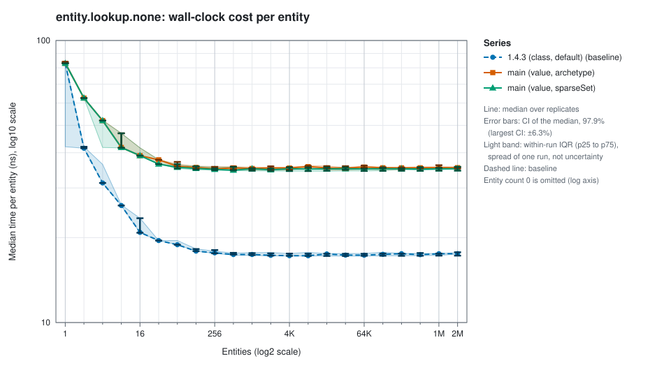

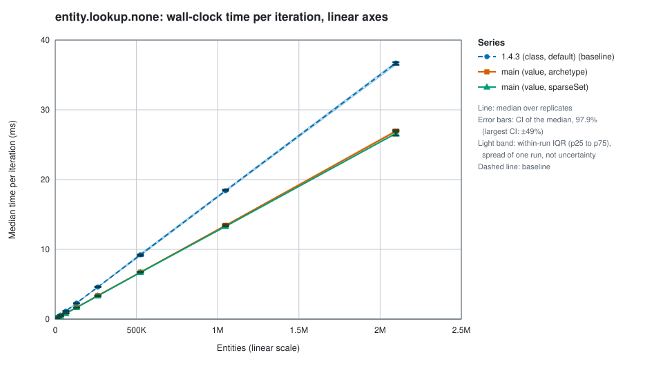

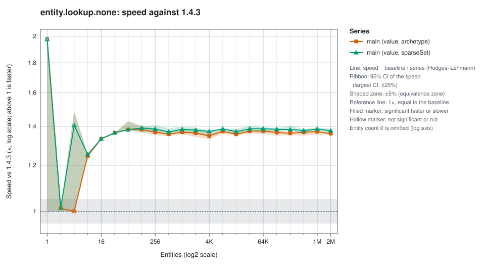

#### Time (wall clock): Entity counts up to 1,024

<table>
<thead>
<tr><th rowspan="3">Entities</th><th colspan="5">1.4.3 (class) - baseline</th><th colspan="22">main (value)</th></tr>
<tr><th colspan="5">default</th><th colspan="11">archetype</th><th colspan="11">sparseSet</th></tr>
<tr><th>median (ns)</th><th>CI low (ns)</th><th>CI high (ns)</th><th>replicates</th><th>iterations</th><th>median (ns)</th><th>CI low (ns)</th><th>CI high (ns)</th><th>replicates</th><th>iterations</th><th>speed (×)</th><th>CI low (×)</th><th>CI high (×)</th><th>change (%)</th><th>q</th><th>verdict</th><th>median (ns)</th><th>CI low (ns)</th><th>CI high (ns)</th><th>replicates</th><th>iterations</th><th>speed (×)</th><th>CI low (×)</th><th>CI high (×)</th><th>change (%)</th><th>q</th><th>verdict</th></tr>
</thead>
<tbody>
<tr><td align="right">0</td><td align="right">42</td><td align="right">42</td><td align="right">42</td><td align="right">10</td><td align="right">122,527</td><td align="right">42.0</td><td align="right">42</td><td align="right">42</td><td align="right">10</td><td align="right">124,589</td><td align="right">1.00</td><td align="right">1.00</td><td align="right">1.00</td><td align="right">0</td><td align="right">1.000</td><td align="right">equivalent</td><td align="right">42.0</td><td align="right">42</td><td align="right">42</td><td align="right">10</td><td align="right">123,589</td><td align="right">1.00</td><td align="right">1.00</td><td align="right">1.00</td><td align="right">0</td><td align="right">1.000</td><td align="right">equivalent</td></tr>
<tr><td align="right">1</td><td align="right">83</td><td align="right">42</td><td align="right">83</td><td align="right">10</td><td align="right">128,083</td><td align="right">42.0</td><td align="right">42</td><td align="right">83</td><td align="right">10</td><td align="right">131,439</td><td align="right">1.98</td><td align="right">1.00</td><td align="right">1.98</td><td align="right">-49.4</td><td align="right">0.074</td><td align="right">inconclusive</td><td align="right">42.0</td><td align="right">42</td><td align="right">83</td><td align="right">10</td><td align="right">128,275</td><td align="right">1.98</td><td align="right">1.00</td><td align="right">1.98</td><td align="right">-49.4</td><td align="right">0.024</td><td align="right">inconclusive</td></tr>
<tr><td align="right">2</td><td align="right">84</td><td align="right">83</td><td align="right">84</td><td align="right">10</td><td align="right">125,390</td><td align="right">83.0</td><td align="right">83</td><td align="right">83</td><td align="right">10</td><td align="right">127,276</td><td align="right">1.01</td><td align="right">1.00</td><td align="right">1.01</td><td align="right">-1.19</td><td align="right">0.003</td><td align="right">equivalent</td><td align="right">83.0</td><td align="right">83</td><td align="right">83</td><td align="right">10</td><td align="right">125,382</td><td align="right">1.01</td><td align="right">1.00</td><td align="right">1.01</td><td align="right">-1.19</td><td align="right">0.003</td><td align="right">equivalent</td></tr>
<tr><td align="right">4</td><td align="right">125</td><td align="right">125</td><td align="right">125</td><td align="right">10</td><td align="right">124,863</td><td align="right">125</td><td align="right">84</td><td align="right">125</td><td align="right">10</td><td align="right">125,957</td><td align="right">1.00</td><td align="right">1.00</td><td align="right">1.49</td><td align="right">0</td><td align="right">0.057</td><td align="right">inconclusive</td><td align="right">105</td><td align="right">84</td><td align="right">125</td><td align="right">10</td><td align="right">126,712</td><td align="right">1.41</td><td align="right">1.00</td><td align="right">1.49</td><td align="right">-28.9</td><td align="right">0.023</td><td align="right">inconclusive</td></tr>
<tr><td align="right">8</td><td align="right">208</td><td align="right">208</td><td align="right">208</td><td align="right">10</td><td align="right">122,940</td><td align="right">167</td><td align="right">166</td><td align="right">167</td><td align="right">10</td><td align="right">125,714</td><td align="right">1.25</td><td align="right">1.25</td><td align="right">1.25</td><td align="right">-19.7</td><td align="right">&lt;0.001</td><td align="right">faster</td><td align="right">167</td><td align="right">125</td><td align="right">167</td><td align="right">10</td><td align="right">124,125</td><td align="right">1.25</td><td align="right">1.25</td><td align="right">1.25</td><td align="right">-20.1</td><td align="right">&lt;0.001</td><td align="right">faster</td></tr>
<tr><td align="right">16</td><td align="right">333</td><td align="right">333</td><td align="right">334</td><td align="right">10</td><td align="right">121,694</td><td align="right">250</td><td align="right">250</td><td align="right">250</td><td align="right">10</td><td align="right">121,261</td><td align="right">1.33</td><td align="right">1.33</td><td align="right">1.34</td><td align="right">-24.9</td><td align="right">&lt;0.001</td><td align="right">faster</td><td align="right">250</td><td align="right">250</td><td align="right">250</td><td align="right">10</td><td align="right">122,370</td><td align="right">1.33</td><td align="right">1.33</td><td align="right">1.34</td><td align="right">-24.9</td><td align="right">&lt;0.001</td><td align="right">faster</td></tr>
<tr><td align="right">32</td><td align="right">625</td><td align="right">625</td><td align="right">625</td><td align="right">10</td><td align="right">112,085</td><td align="right">459</td><td align="right">458</td><td align="right">459</td><td align="right">10</td><td align="right">115,051</td><td align="right">1.36</td><td align="right">1.36</td><td align="right">1.36</td><td align="right">-26.7</td><td align="right">&lt;0.001</td><td align="right">faster</td><td align="right">458</td><td align="right">458</td><td align="right">458</td><td align="right">10</td><td align="right">116,794</td><td align="right">1.36</td><td align="right">1.36</td><td align="right">1.36</td><td align="right">-26.7</td><td align="right">&lt;0.001</td><td align="right">faster</td></tr>
<tr><td align="right">64</td><td align="right">1,210</td><td align="right">1,210</td><td align="right">1,250</td><td align="right">10</td><td align="right">99,163</td><td align="right">875</td><td align="right">875</td><td align="right">875</td><td align="right">10</td><td align="right">104,017</td><td align="right">1.38</td><td align="right">1.38</td><td align="right">1.43</td><td align="right">-27.6</td><td align="right">&lt;0.001</td><td align="right">faster</td><td align="right">875</td><td align="right">875</td><td align="right">875</td><td align="right">10</td><td align="right">106,741</td><td align="right">1.38</td><td align="right">1.38</td><td align="right">1.43</td><td align="right">-27.6</td><td align="right">&lt;0.001</td><td align="right">faster</td></tr>
<tr><td align="right">128</td><td align="right">2,330</td><td align="right">2,290</td><td align="right">2,380</td><td align="right">10</td><td align="right">77,538</td><td align="right">1,670</td><td align="right">1,670</td><td align="right">1,710</td><td align="right">10</td><td align="right">88,462</td><td align="right">1.38</td><td align="right">1.37</td><td align="right">1.40</td><td align="right">-27.7</td><td align="right">&lt;0.001</td><td align="right">faster</td><td align="right">1,670</td><td align="right">1,670</td><td align="right">1,710</td><td align="right">10</td><td align="right">89,203</td><td align="right">1.39</td><td align="right">1.37</td><td align="right">1.40</td><td align="right">-28.1</td><td align="right">&lt;0.001</td><td align="right">faster</td></tr>
<tr><td align="right">256</td><td align="right">4,540</td><td align="right">4,500</td><td align="right">4,630</td><td align="right">10</td><td align="right">58,539</td><td align="right">3,330</td><td align="right">3,290</td><td align="right">3,380</td><td align="right">10</td><td align="right">67,082</td><td align="right">1.37</td><td align="right">1.35</td><td align="right">1.39</td><td align="right">-26.9</td><td align="right">&lt;0.001</td><td align="right">faster</td><td align="right">3,290</td><td align="right">3,250</td><td align="right">3,330</td><td align="right">10</td><td align="right">68,210</td><td align="right">1.39</td><td align="right">1.37</td><td align="right">1.41</td><td align="right">-27.8</td><td align="right">&lt;0.001</td><td align="right">faster</td></tr>
<tr><td align="right">512</td><td align="right">8,960</td><td align="right">8,920</td><td align="right">9,090</td><td align="right">10</td><td align="right">38,270</td><td align="right">6,630</td><td align="right">6,590</td><td align="right">6,670</td><td align="right">10</td><td align="right">46,621</td><td align="right">1.36</td><td align="right">1.35</td><td align="right">1.37</td><td align="right">-26.3</td><td align="right">&lt;0.001</td><td align="right">faster</td><td align="right">6,540</td><td align="right">6,540</td><td align="right">6,580</td><td align="right">10</td><td align="right">46,551</td><td align="right">1.37</td><td align="right">1.36</td><td align="right">1.39</td><td align="right">-27.0</td><td align="right">&lt;0.001</td><td align="right">faster</td></tr>
<tr><td align="right">1,024</td><td align="right">18,000</td><td align="right">18,000</td><td align="right">18,300</td><td align="right">10</td><td align="right">22,600</td><td align="right">13,200</td><td align="right">13,000</td><td align="right">13,300</td><td align="right">10</td><td align="right">28,712</td><td align="right">1.37</td><td align="right">1.36</td><td align="right">1.39</td><td align="right">-26.9</td><td align="right">&lt;0.001</td><td align="right">faster</td><td align="right">13,000</td><td align="right">12,900</td><td align="right">13,200</td><td align="right">10</td><td align="right">28,895</td><td align="right">1.38</td><td align="right">1.37</td><td align="right">1.40</td><td align="right">-27.7</td><td align="right">&lt;0.001</td><td align="right">faster</td></tr>
</tbody>
</table>

#### Time (wall clock): Entity counts above 1,024

<table>
<thead>
<tr><th rowspan="3">Entities</th><th colspan="5">1.4.3 (class) - baseline</th><th colspan="22">main (value)</th></tr>
<tr><th colspan="5">default</th><th colspan="11">archetype</th><th colspan="11">sparseSet</th></tr>
<tr><th>median (ms)</th><th>CI low (ms)</th><th>CI high (ms)</th><th>replicates</th><th>iterations</th><th>median (μs)</th><th>CI low (μs)</th><th>CI high (μs)</th><th>replicates</th><th>iterations</th><th>speed (×)</th><th>CI low (×)</th><th>CI high (×)</th><th>change (%)</th><th>q</th><th>verdict</th><th>median (μs)</th><th>CI low (μs)</th><th>CI high (μs)</th><th>replicates</th><th>iterations</th><th>speed (×)</th><th>CI low (×)</th><th>CI high (×)</th><th>change (%)</th><th>q</th><th>verdict</th></tr>
</thead>
<tbody>
<tr><td align="right">2,048</td><td align="right">0.0360</td><td align="right">0.0354</td><td align="right">0.0364</td><td align="right">10</td><td align="right">12,483</td><td align="right">26.4</td><td align="right">26.3</td><td align="right">26.5</td><td align="right">10</td><td align="right">16,192</td><td align="right">1.36</td><td align="right">1.34</td><td align="right">1.38</td><td align="right">-26.6</td><td align="right">&lt;0.001</td><td align="right">faster</td><td align="right">26.1</td><td align="right">25.6</td><td align="right">26.2</td><td align="right">10</td><td align="right">16,305</td><td align="right">1.38</td><td align="right">1.36</td><td align="right">1.39</td><td align="right">-27.5</td><td align="right">&lt;0.001</td><td align="right">faster</td></tr>
<tr><td align="right">4,096</td><td align="right">0.0713</td><td align="right">0.0706</td><td align="right">0.0719</td><td align="right">10</td><td align="right">6,589</td><td align="right">52.6</td><td align="right">52.5</td><td align="right">53.3</td><td align="right">10</td><td align="right">8,576</td><td align="right">1.35</td><td align="right">1.33</td><td align="right">1.37</td><td align="right">-25.8</td><td align="right">&lt;0.001</td><td align="right">faster</td><td align="right">52.3</td><td align="right">51.4</td><td align="right">52.5</td><td align="right">10</td><td align="right">8,735</td><td align="right">1.37</td><td align="right">1.35</td><td align="right">1.38</td><td align="right">-27.1</td><td align="right">&lt;0.001</td><td align="right">faster</td></tr>
<tr><td align="right">8,192</td><td align="right">0.144</td><td align="right">0.141</td><td align="right">0.144</td><td align="right">10</td><td align="right">3,353</td><td align="right">105</td><td align="right">104</td><td align="right">105</td><td align="right">10</td><td align="right">4,507</td><td align="right">1.37</td><td align="right">1.36</td><td align="right">1.38</td><td align="right">-27.1</td><td align="right">&lt;0.001</td><td align="right">faster</td><td align="right">104</td><td align="right">102</td><td align="right">104</td><td align="right">10</td><td align="right">4,573</td><td align="right">1.39</td><td align="right">1.37</td><td align="right">1.39</td><td align="right">-27.8</td><td align="right">&lt;0.001</td><td align="right">faster</td></tr>
<tr><td align="right">16,384</td><td align="right">0.287</td><td align="right">0.282</td><td align="right">0.287</td><td align="right">10</td><td align="right">1,715</td><td align="right">209</td><td align="right">208</td><td align="right">212</td><td align="right">10</td><td align="right">2,294</td><td align="right">1.36</td><td align="right">1.35</td><td align="right">1.37</td><td align="right">-26.3</td><td align="right">&lt;0.001</td><td align="right">faster</td><td align="right">207</td><td align="right">207</td><td align="right">210</td><td align="right">10</td><td align="right">2,307</td><td align="right">1.37</td><td align="right">1.36</td><td align="right">1.39</td><td align="right">-27.1</td><td align="right">&lt;0.001</td><td align="right">faster</td></tr>
<tr><td align="right">32,768</td><td align="right">0.574</td><td align="right">0.569</td><td align="right">0.581</td><td align="right">10</td><td align="right">864</td><td align="right">418</td><td align="right">418</td><td align="right">422</td><td align="right">10</td><td align="right">1,157</td><td align="right">1.37</td><td align="right">1.36</td><td align="right">1.38</td><td align="right">-27.2</td><td align="right">&lt;0.001</td><td align="right">faster</td><td align="right">414</td><td align="right">407</td><td align="right">419</td><td align="right">10</td><td align="right">1,178</td><td align="right">1.39</td><td align="right">1.37</td><td align="right">1.40</td><td align="right">-27.9</td><td align="right">&lt;0.001</td><td align="right">faster</td></tr>
<tr><td align="right">65,536</td><td align="right">1.15</td><td align="right">1.13</td><td align="right">1.16</td><td align="right">10</td><td align="right">431</td><td align="right">836</td><td align="right">832</td><td align="right">842</td><td align="right">10</td><td align="right">583</td><td align="right">1.37</td><td align="right">1.36</td><td align="right">1.38</td><td align="right">-27.2</td><td align="right">&lt;0.001</td><td align="right">faster</td><td align="right">829</td><td align="right">815</td><td align="right">838</td><td align="right">10</td><td align="right">591</td><td align="right">1.39</td><td align="right">1.37</td><td align="right">1.40</td><td align="right">-27.9</td><td align="right">&lt;0.001</td><td align="right">faster</td></tr>
<tr><td align="right">131,072</td><td align="right">2.30</td><td align="right">2.26</td><td align="right">2.30</td><td align="right">10</td><td align="right">217</td><td align="right">1,680</td><td align="right">1,670</td><td align="right">1,690</td><td align="right">10</td><td align="right">293</td><td align="right">1.37</td><td align="right">1.35</td><td align="right">1.38</td><td align="right">-26.8</td><td align="right">&lt;0.001</td><td align="right">faster</td><td align="right">1,660</td><td align="right">1,630</td><td align="right">1,660</td><td align="right">10</td><td align="right">297</td><td align="right">1.38</td><td align="right">1.37</td><td align="right">1.39</td><td align="right">-27.7</td><td align="right">&lt;0.001</td><td align="right">faster</td></tr>
<tr><td align="right">262,144</td><td align="right">4.60</td><td align="right">4.58</td><td align="right">4.66</td><td align="right">10</td><td align="right">109</td><td align="right">3,390</td><td align="right">3,360</td><td align="right">3,400</td><td align="right">10</td><td align="right">146</td><td align="right">1.36</td><td align="right">1.35</td><td align="right">1.37</td><td align="right">-26.6</td><td align="right">&lt;0.001</td><td align="right">faster</td><td align="right">3,330</td><td align="right">3,270</td><td align="right">3,330</td><td align="right">10</td><td align="right">148</td><td align="right">1.38</td><td align="right">1.38</td><td align="right">1.40</td><td align="right">-27.6</td><td align="right">&lt;0.001</td><td align="right">faster</td></tr>
<tr><td align="right">524,288</td><td align="right">9.22</td><td align="right">9.06</td><td align="right">9.27</td><td align="right">10</td><td align="right">54</td><td align="right">6,730</td><td align="right">6,720</td><td align="right">6,800</td><td align="right">10</td><td align="right">74</td><td align="right">1.37</td><td align="right">1.35</td><td align="right">1.38</td><td align="right">-26.9</td><td align="right">&lt;0.001</td><td align="right">faster</td><td align="right">6,690</td><td align="right">6,670</td><td align="right">6,760</td><td align="right">10</td><td align="right">74</td><td align="right">1.38</td><td align="right">1.36</td><td align="right">1.39</td><td align="right">-27.4</td><td align="right">&lt;0.001</td><td align="right">faster</td></tr>
<tr><td align="right">1,048,576</td><td align="right">18.4</td><td align="right">18.4</td><td align="right">18.5</td><td align="right">10</td><td align="right">28</td><td align="right">13,400</td><td align="right">13,400</td><td align="right">13,600</td><td align="right">10</td><td align="right">37</td><td align="right">1.37</td><td align="right">1.36</td><td align="right">1.38</td><td align="right">-27.1</td><td align="right">&lt;0.001</td><td align="right">faster</td><td align="right">13,300</td><td align="right">13,300</td><td align="right">13,300</td><td align="right">10</td><td align="right">38</td><td align="right">1.39</td><td align="right">1.38</td><td align="right">1.39</td><td align="right">-27.8</td><td align="right">&lt;0.001</td><td align="right">faster</td></tr>
<tr><td align="right">2,097,152</td><td align="right">36.7</td><td align="right">36.4</td><td align="right">36.8</td><td align="right">10</td><td align="right">14</td><td align="right">26,900</td><td align="right">26,900</td><td align="right">27,100</td><td align="right">10</td><td align="right">19</td><td align="right">1.36</td><td align="right">1.35</td><td align="right">1.37</td><td align="right">-26.5</td><td align="right">&lt;0.001</td><td align="right">faster</td><td align="right">26,600</td><td align="right">26,300</td><td align="right">27,000</td><td align="right">10</td><td align="right">19</td><td align="right">1.38</td><td align="right">1.36</td><td align="right">1.39</td><td align="right">-27.3</td><td align="right">0.001</td><td align="right">faster</td></tr>
</tbody>
</table>

### `entity.lookup.one`

[All metrics, means, percentiles and the linear plot](workloads/entity.lookup.one.md)

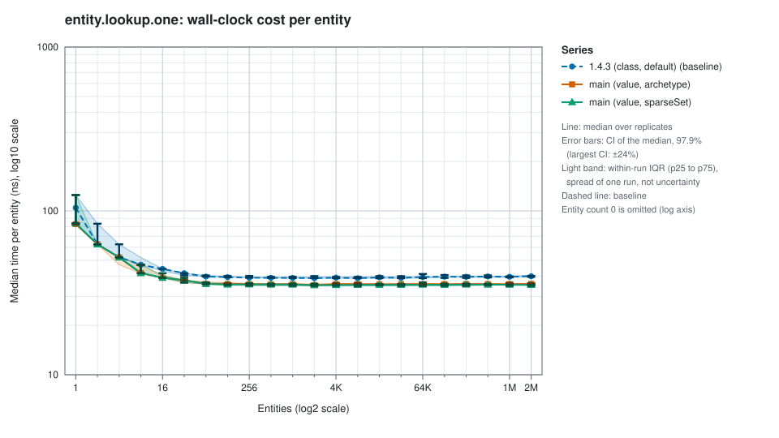

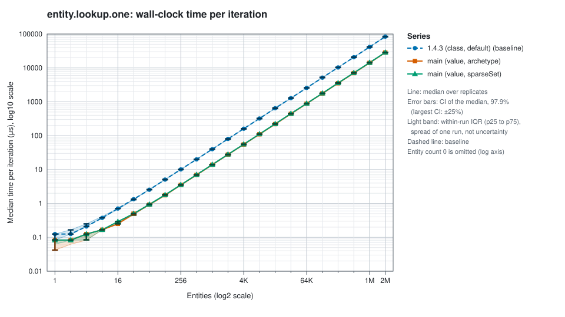

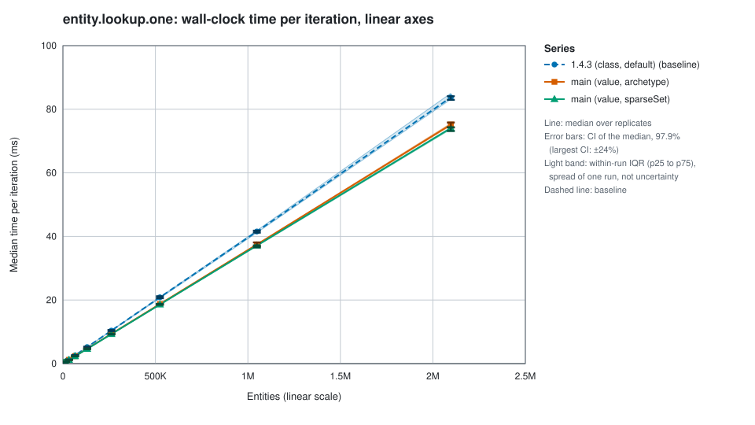

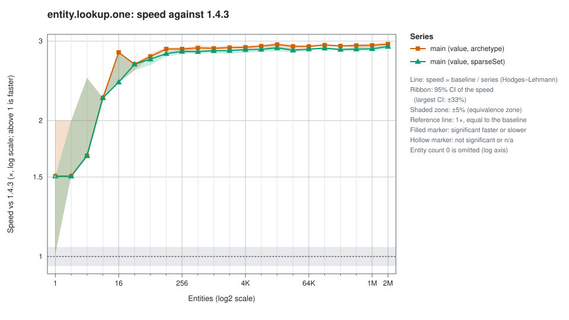

#### Time (wall clock): Entity counts up to 1,024

<table>
<thead>
<tr><th rowspan="3">Entities</th><th colspan="5">1.4.3 (class) - baseline</th><th colspan="22">main (value)</th></tr>
<tr><th colspan="5">default</th><th colspan="11">archetype</th><th colspan="11">sparseSet</th></tr>
<tr><th>median (μs)</th><th>CI low (μs)</th><th>CI high (μs)</th><th>replicates</th><th>iterations</th><th>median (ns)</th><th>CI low (ns)</th><th>CI high (ns)</th><th>replicates</th><th>iterations</th><th>speed (×)</th><th>CI low (×)</th><th>CI high (×)</th><th>change (%)</th><th>q</th><th>verdict</th><th>median (ns)</th><th>CI low (ns)</th><th>CI high (ns)</th><th>replicates</th><th>iterations</th><th>speed (×)</th><th>CI low (×)</th><th>CI high (×)</th><th>change (%)</th><th>q</th><th>verdict</th></tr>
</thead>
<tbody>
<tr><td align="right">0</td><td align="right">0.0420</td><td align="right">0.0420</td><td align="right">0.0420</td><td align="right">10</td><td align="right">122,380</td><td align="right">42</td><td align="right">42</td><td align="right">42</td><td align="right">10</td><td align="right">119,512</td><td align="right">1.00</td><td align="right">1.00</td><td align="right">1.00</td><td align="right">0</td><td align="right">1.000</td><td align="right">equivalent</td><td align="right">42.0</td><td align="right">42</td><td align="right">42</td><td align="right">10</td><td align="right">113,670</td><td align="right">1.00</td><td align="right">1.00</td><td align="right">1.00</td><td align="right">0</td><td align="right">1.000</td><td align="right">equivalent</td></tr>
<tr><td align="right">1</td><td align="right">0.125</td><td align="right">0.0840</td><td align="right">0.125</td><td align="right">10</td><td align="right">126,354</td><td align="right">83</td><td align="right">42</td><td align="right">83</td><td align="right">10</td><td align="right">127,744</td><td align="right">1.51</td><td align="right">1.01</td><td align="right">2.00</td><td align="right">-33.6</td><td align="right">&lt;0.001</td><td align="right">inconclusive</td><td align="right">83.0</td><td align="right">83</td><td align="right">83</td><td align="right">10</td><td align="right">126,263</td><td align="right">1.51</td><td align="right">1.01</td><td align="right">1.51</td><td align="right">-33.6</td><td align="right">&lt;0.001</td><td align="right">inconclusive</td></tr>
<tr><td align="right">2</td><td align="right">0.125</td><td align="right">0.125</td><td align="right">0.166</td><td align="right">10</td><td align="right">123,873</td><td align="right">83</td><td align="right">83</td><td align="right">83</td><td align="right">10</td><td align="right">126,298</td><td align="right">1.51</td><td align="right">1.51</td><td align="right">2.00</td><td align="right">-33.6</td><td align="right">&lt;0.001</td><td align="right">faster</td><td align="right">83.0</td><td align="right">83</td><td align="right">83</td><td align="right">10</td><td align="right">127,385</td><td align="right">1.51</td><td align="right">1.51</td><td align="right">2.00</td><td align="right">-33.6</td><td align="right">&lt;0.001</td><td align="right">faster</td></tr>
<tr><td align="right">4</td><td align="right">0.209</td><td align="right">0.208</td><td align="right">0.250</td><td align="right">10</td><td align="right">123,583</td><td align="right">125</td><td align="right">84</td><td align="right">125</td><td align="right">10</td><td align="right">124,590</td><td align="right">1.67</td><td align="right">1.67</td><td align="right">2.49</td><td align="right">-40.2</td><td align="right">&lt;0.001</td><td align="right">faster</td><td align="right">125</td><td align="right">84</td><td align="right">125</td><td align="right">10</td><td align="right">128,618</td><td align="right">1.67</td><td align="right">1.67</td><td align="right">2.49</td><td align="right">-40.2</td><td align="right">&lt;0.001</td><td align="right">faster</td></tr>
<tr><td align="right">8</td><td align="right">0.375</td><td align="right">0.375</td><td align="right">0.375</td><td align="right">10</td><td align="right">117,709</td><td align="right">167</td><td align="right">167</td><td align="right">167</td><td align="right">10</td><td align="right">125,861</td><td align="right">2.25</td><td align="right">2.25</td><td align="right">2.25</td><td align="right">-55.5</td><td align="right">&lt;0.001</td><td align="right">faster</td><td align="right">167</td><td align="right">167</td><td align="right">167</td><td align="right">10</td><td align="right">122,705</td><td align="right">2.25</td><td align="right">2.25</td><td align="right">2.25</td><td align="right">-55.5</td><td align="right">&lt;0.001</td><td align="right">faster</td></tr>
<tr><td align="right">16</td><td align="right">0.708</td><td align="right">0.708</td><td align="right">0.708</td><td align="right">10</td><td align="right">109,812</td><td align="right">250</td><td align="right">250</td><td align="right">291</td><td align="right">10</td><td align="right">122,449</td><td align="right">2.83</td><td align="right">2.43</td><td align="right">2.83</td><td align="right">-64.7</td><td align="right">&lt;0.001</td><td align="right">faster</td><td align="right">291</td><td align="right">250</td><td align="right">292</td><td align="right">10</td><td align="right">121,380</td><td align="right">2.43</td><td align="right">2.42</td><td align="right">2.83</td><td align="right">-58.9</td><td align="right">&lt;0.001</td><td align="right">faster</td></tr>
<tr><td align="right">32</td><td align="right">1.33</td><td align="right">1.29</td><td align="right">1.33</td><td align="right">10</td><td align="right">96,349</td><td align="right">500</td><td align="right">459</td><td align="right">500</td><td align="right">10</td><td align="right">114,760</td><td align="right">2.67</td><td align="right">2.58</td><td align="right">2.67</td><td align="right">-62.5</td><td align="right">&lt;0.001</td><td align="right">faster</td><td align="right">500</td><td align="right">500</td><td align="right">500</td><td align="right">10</td><td align="right">116,230</td><td align="right">2.67</td><td align="right">2.58</td><td align="right">2.67</td><td align="right">-62.5</td><td align="right">&lt;0.001</td><td align="right">faster</td></tr>
<tr><td align="right">64</td><td align="right">2.54</td><td align="right">2.54</td><td align="right">2.59</td><td align="right">10</td><td align="right">75,259</td><td align="right">917</td><td align="right">917</td><td align="right">917</td><td align="right">10</td><td align="right">103,845</td><td align="right">2.77</td><td align="right">2.77</td><td align="right">2.82</td><td align="right">-63.9</td><td align="right">&lt;0.001</td><td align="right">faster</td><td align="right">938</td><td align="right">917</td><td align="right">958</td><td align="right">10</td><td align="right">105,033</td><td align="right">2.74</td><td align="right">2.65</td><td align="right">2.77</td><td align="right">-63.4</td><td align="right">&lt;0.001</td><td align="right">faster</td></tr>
<tr><td align="right">128</td><td align="right">5.06</td><td align="right">5.00</td><td align="right">5.13</td><td align="right">10</td><td align="right">54,786</td><td align="right">1,750</td><td align="right">1,750</td><td align="right">1,790</td><td align="right">10</td><td align="right">86,261</td><td align="right">2.88</td><td align="right">2.84</td><td align="right">2.90</td><td align="right">-65.3</td><td align="right">&lt;0.001</td><td align="right">faster</td><td align="right">1,790</td><td align="right">1,790</td><td align="right">1,830</td><td align="right">10</td><td align="right">85,585</td><td align="right">2.81</td><td align="right">2.77</td><td align="right">2.84</td><td align="right">-64.5</td><td align="right">&lt;0.001</td><td align="right">faster</td></tr>
<tr><td align="right">256</td><td align="right">10.1</td><td align="right">9.96</td><td align="right">10.1</td><td align="right">10</td><td align="right">35,270</td><td align="right">3,500</td><td align="right">3,460</td><td align="right">3,540</td><td align="right">10</td><td align="right">66,145</td><td align="right">2.88</td><td align="right">2.85</td><td align="right">2.90</td><td align="right">-65.3</td><td align="right">&lt;0.001</td><td align="right">faster</td><td align="right">3,540</td><td align="right">3,500</td><td align="right">3,580</td><td align="right">10</td><td align="right">65,396</td><td align="right">2.84</td><td align="right">2.81</td><td align="right">2.88</td><td align="right">-64.8</td><td align="right">&lt;0.001</td><td align="right">faster</td></tr>
<tr><td align="right">512</td><td align="right">20.0</td><td align="right">19.8</td><td align="right">20.1</td><td align="right">10</td><td align="right">20,600</td><td align="right">6,920</td><td align="right">6,800</td><td align="right">7,000</td><td align="right">10</td><td align="right">45,054</td><td align="right">2.90</td><td align="right">2.86</td><td align="right">2.93</td><td align="right">-65.5</td><td align="right">&lt;0.001</td><td align="right">faster</td><td align="right">7,040</td><td align="right">6,920</td><td align="right">7,080</td><td align="right">10</td><td align="right">44,394</td><td align="right">2.84</td><td align="right">2.82</td><td align="right">2.87</td><td align="right">-64.8</td><td align="right">&lt;0.001</td><td align="right">faster</td></tr>
<tr><td align="right">1,024</td><td align="right">40.0</td><td align="right">39.6</td><td align="right">40.5</td><td align="right">10</td><td align="right">11,273</td><td align="right">13,800</td><td align="right">13,800</td><td align="right">13,900</td><td align="right">10</td><td align="right">27,475</td><td align="right">2.89</td><td align="right">2.86</td><td align="right">2.92</td><td align="right">-65.4</td><td align="right">&lt;0.001</td><td align="right">faster</td><td align="right">14,000</td><td align="right">13,900</td><td align="right">14,100</td><td align="right">10</td><td align="right">27,374</td><td align="right">2.86</td><td align="right">2.82</td><td align="right">2.87</td><td align="right">-65.0</td><td align="right">&lt;0.001</td><td align="right">faster</td></tr>
</tbody>
</table>

#### Time (wall clock): Entity counts above 1,024

<table>
<thead>
<tr><th rowspan="3">Entities</th><th colspan="5">1.4.3 (class) - baseline</th><th colspan="22">main (value)</th></tr>
<tr><th colspan="5">default</th><th colspan="11">archetype</th><th colspan="11">sparseSet</th></tr>
<tr><th>median (ms)</th><th>CI low (ms)</th><th>CI high (ms)</th><th>replicates</th><th>iterations</th><th>median (μs)</th><th>CI low (μs)</th><th>CI high (μs)</th><th>replicates</th><th>iterations</th><th>speed (×)</th><th>CI low (×)</th><th>CI high (×)</th><th>change (%)</th><th>q</th><th>verdict</th><th>median (μs)</th><th>CI low (μs)</th><th>CI high (μs)</th><th>replicates</th><th>iterations</th><th>speed (×)</th><th>CI low (×)</th><th>CI high (×)</th><th>change (%)</th><th>q</th><th>verdict</th></tr>
</thead>
<tbody>
<tr><td align="right">2,048</td><td align="right">0.0804</td><td align="right">0.0790</td><td align="right">0.0812</td><td align="right">10</td><td align="right">5,860</td><td align="right">27.7</td><td align="right">27.2</td><td align="right">27.9</td><td align="right">10</td><td align="right">15,540</td><td align="right">2.90</td><td align="right">2.87</td><td align="right">2.93</td><td align="right">-65.5</td><td align="right">&lt;0.001</td><td align="right">faster</td><td align="right">28.1</td><td align="right">28.1</td><td align="right">28.2</td><td align="right">10</td><td align="right">15,399</td><td align="right">2.86</td><td align="right">2.81</td><td align="right">2.86</td><td align="right">-65.0</td><td align="right">&lt;0.001</td><td align="right">faster</td></tr>
<tr><td align="right">4,096</td><td align="right">0.161</td><td align="right">0.158</td><td align="right">0.161</td><td align="right">10</td><td align="right">3,009</td><td align="right">55.1</td><td align="right">54.8</td><td align="right">56.0</td><td align="right">10</td><td align="right">8,234</td><td align="right">2.91</td><td align="right">2.87</td><td align="right">2.93</td><td align="right">-65.6</td><td align="right">&lt;0.001</td><td align="right">faster</td><td align="right">55.9</td><td align="right">55.1</td><td align="right">56.0</td><td align="right">10</td><td align="right">8,215</td><td align="right">2.87</td><td align="right">2.83</td><td align="right">2.88</td><td align="right">-65.2</td><td align="right">&lt;0.001</td><td align="right">faster</td></tr>
<tr><td align="right">8,192</td><td align="right">0.321</td><td align="right">0.317</td><td align="right">0.325</td><td align="right">10</td><td align="right">1,518</td><td align="right">110</td><td align="right">109</td><td align="right">110</td><td align="right">10</td><td align="right">4,310</td><td align="right">2.92</td><td align="right">2.90</td><td align="right">2.95</td><td align="right">-65.8</td><td align="right">&lt;0.001</td><td align="right">faster</td><td align="right">112</td><td align="right">112</td><td align="right">112</td><td align="right">10</td><td align="right">4,253</td><td align="right">2.88</td><td align="right">2.84</td><td align="right">2.90</td><td align="right">-65.2</td><td align="right">&lt;0.001</td><td align="right">faster</td></tr>
<tr><td align="right">16,384</td><td align="right">0.647</td><td align="right">0.631</td><td align="right">0.662</td><td align="right">10</td><td align="right">760</td><td align="right">219</td><td align="right">218</td><td align="right">221</td><td align="right">10</td><td align="right">2,198</td><td align="right">2.95</td><td align="right">2.89</td><td align="right">2.98</td><td align="right">-66.1</td><td align="right">&lt;0.001</td><td align="right">faster</td><td align="right">223</td><td align="right">223</td><td align="right">226</td><td align="right">10</td><td align="right">2,170</td><td align="right">2.90</td><td align="right">2.85</td><td align="right">2.92</td><td align="right">-65.5</td><td align="right">&lt;0.001</td><td align="right">faster</td></tr>
<tr><td align="right">32,768</td><td align="right">1.29</td><td align="right">1.27</td><td align="right">1.31</td><td align="right">10</td><td align="right">387</td><td align="right">440</td><td align="right">437</td><td align="right">453</td><td align="right">10</td><td align="right">1,111</td><td align="right">2.92</td><td align="right">2.86</td><td align="right">2.94</td><td align="right">-65.8</td><td align="right">&lt;0.001</td><td align="right">faster</td><td align="right">450</td><td align="right">446</td><td align="right">454</td><td align="right">10</td><td align="right">1,088</td><td align="right">2.86</td><td align="right">2.83</td><td align="right">2.88</td><td align="right">-65.1</td><td align="right">&lt;0.001</td><td align="right">faster</td></tr>
<tr><td align="right">65,536</td><td align="right">2.57</td><td align="right">2.56</td><td align="right">2.60</td><td align="right">10</td><td align="right">194</td><td align="right">882</td><td align="right">875</td><td align="right">886</td><td align="right">10</td><td align="right">558</td><td align="right">2.92</td><td align="right">2.90</td><td align="right">2.94</td><td align="right">-65.7</td><td align="right">&lt;0.001</td><td align="right">faster</td><td align="right">893</td><td align="right">892</td><td align="right">900</td><td align="right">10</td><td align="right">552</td><td align="right">2.88</td><td align="right">2.86</td><td align="right">2.88</td><td align="right">-65.3</td><td align="right">&lt;0.001</td><td align="right">faster</td></tr>
<tr><td align="right">131,072</td><td align="right">5.17</td><td align="right">5.16</td><td align="right">5.30</td><td align="right">10</td><td align="right">96</td><td align="right">1,760</td><td align="right">1,760</td><td align="right">1,760</td><td align="right">10</td><td align="right">282</td><td align="right">2.94</td><td align="right">2.93</td><td align="right">2.97</td><td align="right">-66.0</td><td align="right">&lt;0.001</td><td align="right">faster</td><td align="right">1,790</td><td align="right">1,780</td><td align="right">1,800</td><td align="right">10</td><td align="right">277</td><td align="right">2.89</td><td align="right">2.89</td><td align="right">2.92</td><td align="right">-65.4</td><td align="right">&lt;0.001</td><td align="right">faster</td></tr>
<tr><td align="right">262,144</td><td align="right">10.3</td><td align="right">10.3</td><td align="right">10.4</td><td align="right">10</td><td align="right">49</td><td align="right">3,530</td><td align="right">3,520</td><td align="right">3,540</td><td align="right">10</td><td align="right">141</td><td align="right">2.93</td><td align="right">2.92</td><td align="right">2.94</td><td align="right">-65.8</td><td align="right">&lt;0.001</td><td align="right">faster</td><td align="right">3,600</td><td align="right">3,580</td><td align="right">3,620</td><td align="right">10</td><td align="right">138</td><td align="right">2.87</td><td align="right">2.85</td><td align="right">2.89</td><td align="right">-65.2</td><td align="right">&lt;0.001</td><td align="right">faster</td></tr>
<tr><td align="right">524,288</td><td align="right">20.7</td><td align="right">20.4</td><td align="right">21.0</td><td align="right">10</td><td align="right">24</td><td align="right">7,040</td><td align="right">7,020</td><td align="right">7,140</td><td align="right">10</td><td align="right">71</td><td align="right">2.93</td><td align="right">2.89</td><td align="right">2.96</td><td align="right">-65.9</td><td align="right">&lt;0.001</td><td align="right">faster</td><td align="right">7,170</td><td align="right">7,160</td><td align="right">7,240</td><td align="right">10</td><td align="right">70</td><td align="right">2.88</td><td align="right">2.85</td><td align="right">2.91</td><td align="right">-65.3</td><td align="right">&lt;0.001</td><td align="right">faster</td></tr>
<tr><td align="right">1,048,576</td><td align="right">41.5</td><td align="right">41.0</td><td align="right">42.1</td><td align="right">10</td><td align="right">13</td><td align="right">14,100</td><td align="right">14,000</td><td align="right">14,300</td><td align="right">10</td><td align="right">36</td><td align="right">2.94</td><td align="right">2.91</td><td align="right">2.96</td><td align="right">-65.9</td><td align="right">&lt;0.001</td><td align="right">faster</td><td align="right">14,300</td><td align="right">14,300</td><td align="right">14,500</td><td align="right">10</td><td align="right">35</td><td align="right">2.88</td><td align="right">2.86</td><td align="right">2.91</td><td align="right">-65.3</td><td align="right">&lt;0.001</td><td align="right">faster</td></tr>
<tr><td align="right">2,097,152</td><td align="right">84.0</td><td align="right">82.6</td><td align="right">85.1</td><td align="right">10</td><td align="right">6</td><td align="right">28,400</td><td align="right">28,100</td><td align="right">28,700</td><td align="right">10</td><td align="right">18</td><td align="right">2.95</td><td align="right">2.92</td><td align="right">2.99</td><td align="right">-66.2</td><td align="right">&lt;0.001</td><td align="right">faster</td><td align="right">28,700</td><td align="right">28,700</td><td align="right">29,000</td><td align="right">10</td><td align="right">18</td><td align="right">2.92</td><td align="right">2.88</td><td align="right">2.94</td><td align="right">-65.7</td><td align="right">&lt;0.001</td><td align="right">faster</td></tr>
</tbody>
</table>

### `entity.lookup.two`

[All metrics, means, percentiles and the linear plot](workloads/entity.lookup.two.md)

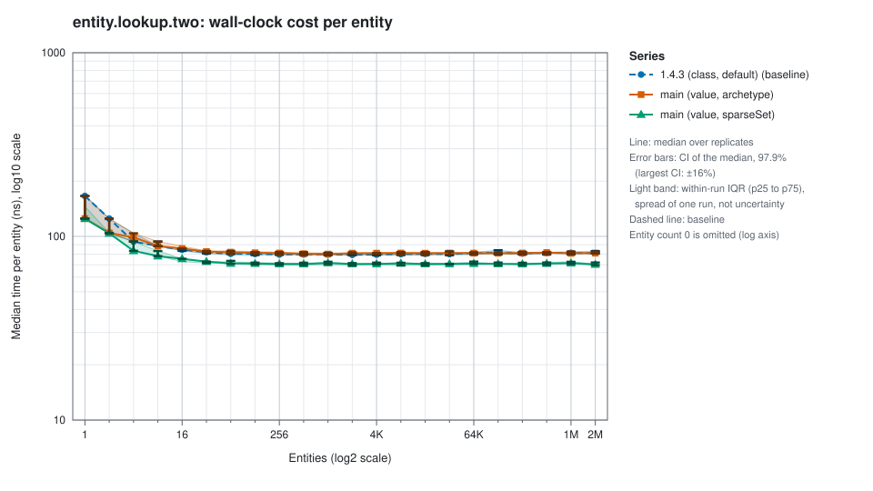

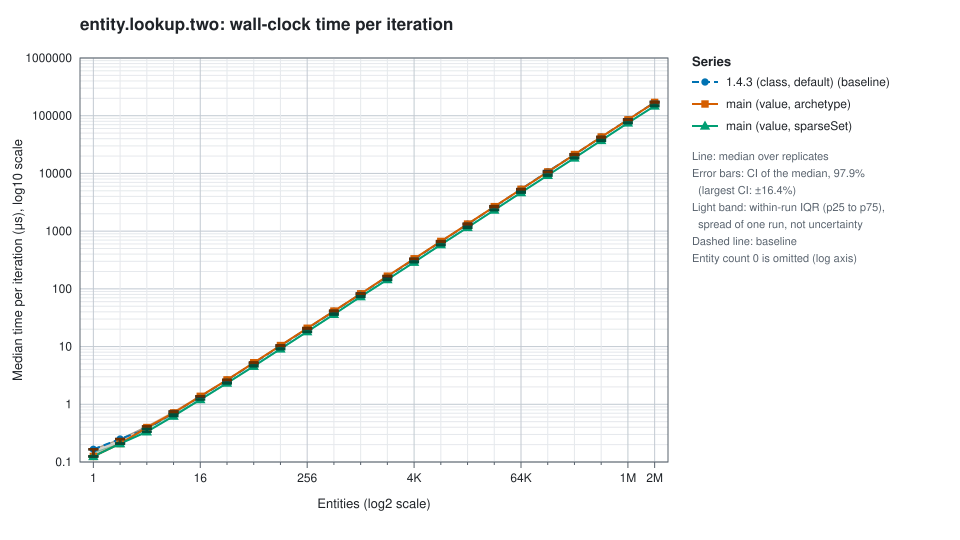

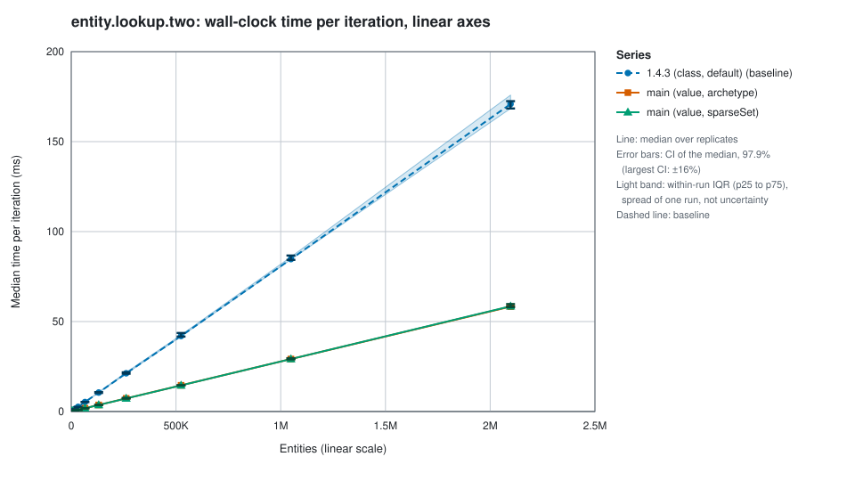

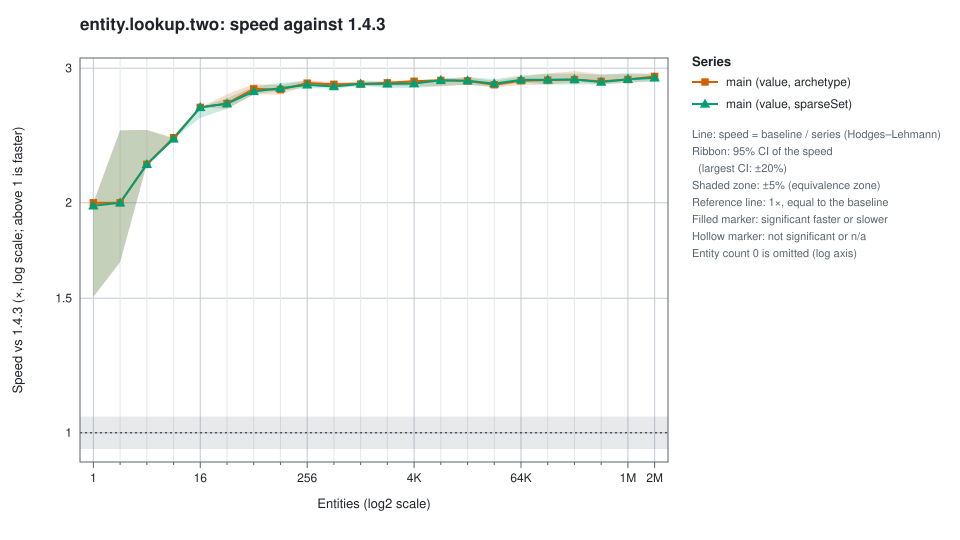

#### Time (wall clock): Entity counts up to 1,024

<table>
<thead>
<tr><th rowspan="3">Entities</th><th colspan="5">1.4.3 (class) - baseline</th><th colspan="22">main (value)</th></tr>
<tr><th colspan="5">default</th><th colspan="11">archetype</th><th colspan="11">sparseSet</th></tr>
<tr><th>median (μs)</th><th>CI low (μs)</th><th>CI high (μs)</th><th>replicates</th><th>iterations</th><th>median (ns)</th><th>CI low (ns)</th><th>CI high (ns)</th><th>replicates</th><th>iterations</th><th>speed (×)</th><th>CI low (×)</th><th>CI high (×)</th><th>change (%)</th><th>q</th><th>verdict</th><th>median (ns)</th><th>CI low (ns)</th><th>CI high (ns)</th><th>replicates</th><th>iterations</th><th>speed (×)</th><th>CI low (×)</th><th>CI high (×)</th><th>change (%)</th><th>q</th><th>verdict</th></tr>
</thead>
<tbody>
<tr><td align="right">0</td><td align="right">0.0420</td><td align="right">0.0420</td><td align="right">0.0420</td><td align="right">10</td><td align="right">125,765</td><td align="right">42</td><td align="right">42</td><td align="right">42</td><td align="right">10</td><td align="right">122,648</td><td align="right">1.00</td><td align="right">1.00</td><td align="right">1.00</td><td align="right">0</td><td align="right">1.000</td><td align="right">equivalent</td><td align="right">42</td><td align="right">42</td><td align="right">42</td><td align="right">10</td><td align="right">125,416</td><td align="right">1.00</td><td align="right">1.00</td><td align="right">1.00</td><td align="right">0</td><td align="right">1.000</td><td align="right">equivalent</td></tr>
<tr><td align="right">1</td><td align="right">0.166</td><td align="right">0.125</td><td align="right">0.166</td><td align="right">10</td><td align="right">124,562</td><td align="right">83</td><td align="right">83</td><td align="right">83</td><td align="right">10</td><td align="right">127,207</td><td align="right">2.00</td><td align="right">1.51</td><td align="right">2.00</td><td align="right">-50.0</td><td align="right">&lt;0.001</td><td align="right">faster</td><td align="right">83</td><td align="right">83</td><td align="right">84</td><td align="right">10</td><td align="right">127,805</td><td align="right">1.98</td><td align="right">1.51</td><td align="right">2.00</td><td align="right">-49.5</td><td align="right">&lt;0.001</td><td align="right">faster</td></tr>
<tr><td align="right">2</td><td align="right">0.250</td><td align="right">0.209</td><td align="right">0.250</td><td align="right">10</td><td align="right">120,859</td><td align="right">125</td><td align="right">84</td><td align="right">125</td><td align="right">10</td><td align="right">124,031</td><td align="right">2.00</td><td align="right">1.67</td><td align="right">2.49</td><td align="right">-50.0</td><td align="right">&lt;0.001</td><td align="right">faster</td><td align="right">125</td><td align="right">84</td><td align="right">125</td><td align="right">10</td><td align="right">126,480</td><td align="right">2.00</td><td align="right">1.67</td><td align="right">2.49</td><td align="right">-50.0</td><td align="right">&lt;0.001</td><td align="right">faster</td></tr>
<tr><td align="right">4</td><td align="right">0.375</td><td align="right">0.375</td><td align="right">0.416</td><td align="right">10</td><td align="right">118,866</td><td align="right">167</td><td align="right">167</td><td align="right">167</td><td align="right">10</td><td align="right">124,311</td><td align="right">2.25</td><td align="right">2.25</td><td align="right">2.49</td><td align="right">-55.5</td><td align="right">&lt;0.001</td><td align="right">faster</td><td align="right">167</td><td align="right">167</td><td align="right">167</td><td align="right">10</td><td align="right">127,349</td><td align="right">2.25</td><td align="right">2.25</td><td align="right">2.49</td><td align="right">-55.5</td><td align="right">&lt;0.001</td><td align="right">faster</td></tr>
<tr><td align="right">8</td><td align="right">0.708</td><td align="right">0.708</td><td align="right">0.708</td><td align="right">10</td><td align="right">110,795</td><td align="right">291</td><td align="right">250</td><td align="right">292</td><td align="right">10</td><td align="right">120,422</td><td align="right">2.43</td><td align="right">2.42</td><td align="right">2.43</td><td align="right">-58.9</td><td align="right">&lt;0.001</td><td align="right">faster</td><td align="right">292</td><td align="right">292</td><td align="right">292</td><td align="right">10</td><td align="right">120,101</td><td align="right">2.42</td><td align="right">2.42</td><td align="right">2.42</td><td align="right">-58.8</td><td align="right">&lt;0.001</td><td align="right">faster</td></tr>
<tr><td align="right">16</td><td align="right">1.33</td><td align="right">1.33</td><td align="right">1.33</td><td align="right">10</td><td align="right">96,271</td><td align="right">500</td><td align="right">500</td><td align="right">500</td><td align="right">10</td><td align="right">115,116</td><td align="right">2.67</td><td align="right">2.67</td><td align="right">2.67</td><td align="right">-62.5</td><td align="right">&lt;0.001</td><td align="right">faster</td><td align="right">500</td><td align="right">500</td><td align="right">541</td><td align="right">10</td><td align="right">113,997</td><td align="right">2.67</td><td align="right">2.58</td><td align="right">2.67</td><td align="right">-62.5</td><td align="right">&lt;0.001</td><td align="right">faster</td></tr>
<tr><td align="right">32</td><td align="right">2.58</td><td align="right">2.54</td><td align="right">2.63</td><td align="right">10</td><td align="right">75,636</td><td align="right">958</td><td align="right">917</td><td align="right">958</td><td align="right">10</td><td align="right">104,330</td><td align="right">2.70</td><td align="right">2.65</td><td align="right">2.77</td><td align="right">-62.9</td><td align="right">&lt;0.001</td><td align="right">faster</td><td align="right">958</td><td align="right">958</td><td align="right">959</td><td align="right">10</td><td align="right">102,740</td><td align="right">2.70</td><td align="right">2.65</td><td align="right">2.74</td><td align="right">-62.9</td><td align="right">&lt;0.001</td><td align="right">faster</td></tr>
<tr><td align="right">64</td><td align="right">5.13</td><td align="right">5.08</td><td align="right">5.17</td><td align="right">10</td><td align="right">54,953</td><td align="right">1,830</td><td align="right">1,790</td><td align="right">1,830</td><td align="right">10</td><td align="right">87,045</td><td align="right">2.82</td><td align="right">2.77</td><td align="right">2.86</td><td align="right">-64.5</td><td align="right">&lt;0.001</td><td align="right">faster</td><td align="right">1,830</td><td align="right">1,790</td><td align="right">1,830</td><td align="right">10</td><td align="right">85,651</td><td align="right">2.80</td><td align="right">2.77</td><td align="right">2.84</td><td align="right">-64.2</td><td align="right">&lt;0.001</td><td align="right">faster</td></tr>
<tr><td align="right">128</td><td align="right">10.1</td><td align="right">10.0</td><td align="right">10.3</td><td align="right">10</td><td align="right">35,296</td><td align="right">3,630</td><td align="right">3,580</td><td align="right">3,630</td><td align="right">10</td><td align="right">64,912</td><td align="right">2.81</td><td align="right">2.77</td><td align="right">2.85</td><td align="right">-64.4</td><td align="right">&lt;0.001</td><td align="right">faster</td><td align="right">3,590</td><td align="right">3,580</td><td align="right">3,630</td><td align="right">10</td><td align="right">65,031</td><td align="right">2.82</td><td align="right">2.80</td><td align="right">2.87</td><td align="right">-64.6</td><td align="right">&lt;0.001</td><td align="right">faster</td></tr>
<tr><td align="right">256</td><td align="right">20.4</td><td align="right">20.2</td><td align="right">20.6</td><td align="right">10</td><td align="right">20,385</td><td align="right">7,130</td><td align="right">7,040</td><td align="right">7,130</td><td align="right">10</td><td align="right">44,188</td><td align="right">2.87</td><td align="right">2.85</td><td align="right">2.89</td><td align="right">-65.1</td><td align="right">&lt;0.001</td><td align="right">faster</td><td align="right">7,150</td><td align="right">7,040</td><td align="right">7,210</td><td align="right">10</td><td align="right">44,378</td><td align="right">2.85</td><td align="right">2.83</td><td align="right">2.89</td><td align="right">-65.0</td><td align="right">&lt;0.001</td><td align="right">faster</td></tr>
<tr><td align="right">512</td><td align="right">40.5</td><td align="right">40.3</td><td align="right">40.9</td><td align="right">10</td><td align="right">11,053</td><td align="right">14,200</td><td align="right">14,100</td><td align="right">14,400</td><td align="right">10</td><td align="right">27,109</td><td align="right">2.86</td><td align="right">2.83</td><td align="right">2.88</td><td align="right">-65.0</td><td align="right">&lt;0.001</td><td align="right">faster</td><td align="right">14,300</td><td align="right">14,200</td><td align="right">14,400</td><td align="right">10</td><td align="right">27,077</td><td align="right">2.84</td><td align="right">2.82</td><td align="right">2.86</td><td align="right">-64.8</td><td align="right">&lt;0.001</td><td align="right">faster</td></tr>
<tr><td align="right">1,024</td><td align="right">81.3</td><td align="right">80.7</td><td align="right">82.1</td><td align="right">10</td><td align="right">5,792</td><td align="right">28,400</td><td align="right">28,300</td><td align="right">28,700</td><td align="right">10</td><td align="right">15,248</td><td align="right">2.86</td><td align="right">2.84</td><td align="right">2.88</td><td align="right">-65.0</td><td align="right">&lt;0.001</td><td align="right">faster</td><td align="right">28,400</td><td align="right">28,300</td><td align="right">28,500</td><td align="right">10</td><td align="right">15,315</td><td align="right">2.86</td><td align="right">2.85</td><td align="right">2.89</td><td align="right">-65.1</td><td align="right">&lt;0.001</td><td align="right">faster</td></tr>
</tbody>
</table>

#### Time (wall clock): Entity counts above 1,024

<table>
<thead>
<tr><th rowspan="3">Entities</th><th colspan="5">1.4.3 (class) - baseline</th><th colspan="22">main (value)</th></tr>
<tr><th colspan="5">default</th><th colspan="11">archetype</th><th colspan="11">sparseSet</th></tr>
<tr><th>median (ms)</th><th>CI low (ms)</th><th>CI high (ms)</th><th>replicates</th><th>iterations</th><th>median (ms)</th><th>CI low (ms)</th><th>CI high (ms)</th><th>replicates</th><th>iterations</th><th>speed (×)</th><th>CI low (×)</th><th>CI high (×)</th><th>change (%)</th><th>q</th><th>verdict</th><th>median (ms)</th><th>CI low (ms)</th><th>CI high (ms)</th><th>replicates</th><th>iterations</th><th>speed (×)</th><th>CI low (×)</th><th>CI high (×)</th><th>change (%)</th><th>q</th><th>verdict</th></tr>
</thead>
<tbody>
<tr><td align="right">2,048</td><td align="right">0.163</td><td align="right">0.161</td><td align="right">0.164</td><td align="right">10</td><td align="right">2,977</td><td align="right">0.0569</td><td align="right">0.0568</td><td align="right">0.0573</td><td align="right">10</td><td align="right">8,111</td><td align="right">2.87</td><td align="right">2.84</td><td align="right">2.89</td><td align="right">-65.2</td><td align="right">&lt;0.001</td><td align="right">faster</td><td align="right">0.0570</td><td align="right">0.0570</td><td align="right">0.0573</td><td align="right">10</td><td align="right">8,079</td><td align="right">2.86</td><td align="right">2.83</td><td align="right">2.88</td><td align="right">-65.1</td><td align="right">&lt;0.001</td><td align="right">faster</td></tr>
<tr><td align="right">4,096</td><td align="right">0.327</td><td align="right">0.321</td><td align="right">0.328</td><td align="right">10</td><td align="right">1,507</td><td align="right">0.113</td><td align="right">0.113</td><td align="right">0.114</td><td align="right">10</td><td align="right">4,198</td><td align="right">2.88</td><td align="right">2.84</td><td align="right">2.89</td><td align="right">-65.3</td><td align="right">&lt;0.001</td><td align="right">faster</td><td align="right">0.114</td><td align="right">0.113</td><td align="right">0.116</td><td align="right">10</td><td align="right">4,183</td><td align="right">2.86</td><td align="right">2.83</td><td align="right">2.90</td><td align="right">-65.1</td><td align="right">&lt;0.001</td><td align="right">faster</td></tr>
<tr><td align="right">8,192</td><td align="right">0.655</td><td align="right">0.642</td><td align="right">0.665</td><td align="right">10</td><td align="right">755</td><td align="right">0.226</td><td align="right">0.226</td><td align="right">0.229</td><td align="right">10</td><td align="right">2,134</td><td align="right">2.89</td><td align="right">2.84</td><td align="right">2.91</td><td align="right">-65.4</td><td align="right">&lt;0.001</td><td align="right">faster</td><td align="right">0.226</td><td align="right">0.226</td><td align="right">0.230</td><td align="right">10</td><td align="right">2,142</td><td align="right">2.89</td><td align="right">2.84</td><td align="right">2.91</td><td align="right">-65.4</td><td align="right">&lt;0.001</td><td align="right">faster</td></tr>
<tr><td align="right">16,384</td><td align="right">1.31</td><td align="right">1.29</td><td align="right">1.33</td><td align="right">10</td><td align="right">376</td><td align="right">0.453</td><td align="right">0.453</td><td align="right">0.457</td><td align="right">10</td><td align="right">1,076</td><td align="right">2.89</td><td align="right">2.85</td><td align="right">2.92</td><td align="right">-65.4</td><td align="right">&lt;0.001</td><td align="right">faster</td><td align="right">0.452</td><td align="right">0.449</td><td align="right">0.459</td><td align="right">10</td><td align="right">1,077</td><td align="right">2.89</td><td align="right">2.85</td><td align="right">2.92</td><td align="right">-65.4</td><td align="right">&lt;0.001</td><td align="right">faster</td></tr>
<tr><td align="right">32,768</td><td align="right">2.60</td><td align="right">2.57</td><td align="right">2.63</td><td align="right">10</td><td align="right">191</td><td align="right">0.910</td><td align="right">0.905</td><td align="right">0.918</td><td align="right">10</td><td align="right">540</td><td align="right">2.85</td><td align="right">2.83</td><td align="right">2.89</td><td align="right">-65.0</td><td align="right">&lt;0.001</td><td align="right">faster</td><td align="right">0.908</td><td align="right">0.895</td><td align="right">0.920</td><td align="right">10</td><td align="right">540</td><td align="right">2.86</td><td align="right">2.84</td><td align="right">2.90</td><td align="right">-65.1</td><td align="right">&lt;0.001</td><td align="right">faster</td></tr>
<tr><td align="right">65,536</td><td align="right">5.27</td><td align="right">5.23</td><td align="right">5.35</td><td align="right">10</td><td align="right">94</td><td align="right">1.83</td><td align="right">1.82</td><td align="right">1.85</td><td align="right">10</td><td align="right">270</td><td align="right">2.89</td><td align="right">2.85</td><td align="right">2.93</td><td align="right">-65.4</td><td align="right">&lt;0.001</td><td align="right">faster</td><td align="right">1.82</td><td align="right">1.81</td><td align="right">1.84</td><td align="right">10</td><td align="right">272</td><td align="right">2.90</td><td align="right">2.87</td><td align="right">2.94</td><td align="right">-65.5</td><td align="right">&lt;0.001</td><td align="right">faster</td></tr>
<tr><td align="right">131,072</td><td align="right">10.5</td><td align="right">10.3</td><td align="right">10.8</td><td align="right">10</td><td align="right">48</td><td align="right">3.65</td><td align="right">3.64</td><td align="right">3.65</td><td align="right">10</td><td align="right">137</td><td align="right">2.89</td><td align="right">2.85</td><td align="right">2.95</td><td align="right">-65.4</td><td align="right">&lt;0.001</td><td align="right">faster</td><td align="right">3.65</td><td align="right">3.63</td><td align="right">3.68</td><td align="right">10</td><td align="right">136</td><td align="right">2.90</td><td align="right">2.86</td><td align="right">2.95</td><td align="right">-65.5</td><td align="right">&lt;0.001</td><td align="right">faster</td></tr>
<tr><td align="right">262,144</td><td align="right">21.3</td><td align="right">21.0</td><td align="right">21.8</td><td align="right">10</td><td align="right">24</td><td align="right">7.30</td><td align="right">7.29</td><td align="right">7.37</td><td align="right">10</td><td align="right">69</td><td align="right">2.90</td><td align="right">2.88</td><td align="right">2.97</td><td align="right">-65.5</td><td align="right">&lt;0.001</td><td align="right">faster</td><td align="right">7.27</td><td align="right">7.25</td><td align="right">7.58</td><td align="right">10</td><td align="right">69</td><td align="right">2.90</td><td align="right">2.86</td><td align="right">2.95</td><td align="right">-65.5</td><td align="right">&lt;0.001</td><td align="right">faster</td></tr>
<tr><td align="right">524,288</td><td align="right">42.0</td><td align="right">41.6</td><td align="right">43.6</td><td align="right">10</td><td align="right">12</td><td align="right">14.6</td><td align="right">14.5</td><td align="right">14.6</td><td align="right">10</td><td align="right">35</td><td align="right">2.88</td><td align="right">2.86</td><td align="right">2.94</td><td align="right">-65.3</td><td align="right">&lt;0.001</td><td align="right">faster</td><td align="right">14.5</td><td align="right">14.5</td><td align="right">14.7</td><td align="right">10</td><td align="right">35</td><td align="right">2.88</td><td align="right">2.86</td><td align="right">2.94</td><td align="right">-65.2</td><td align="right">&lt;0.001</td><td align="right">faster</td></tr>
<tr><td align="right">1,048,576</td><td align="right">84.7</td><td align="right">84.3</td><td align="right">86.7</td><td align="right">10</td><td align="right">6</td><td align="right">29.2</td><td align="right">29.1</td><td align="right">29.7</td><td align="right">10</td><td align="right">18</td><td align="right">2.90</td><td align="right">2.87</td><td align="right">2.95</td><td align="right">-65.5</td><td align="right">&lt;0.001</td><td align="right">faster</td><td align="right">29.2</td><td align="right">29.1</td><td align="right">29.5</td><td align="right">10</td><td align="right">18</td><td align="right">2.90</td><td align="right">2.87</td><td align="right">2.96</td><td align="right">-65.5</td><td align="right">&lt;0.001</td><td align="right">faster</td></tr>
<tr><td align="right">2,097,152</td><td align="right">171</td><td align="right">168</td><td align="right">172</td><td align="right">10</td><td align="right">3</td><td align="right">58.3</td><td align="right">58.2</td><td align="right">58.5</td><td align="right">10</td><td align="right">9</td><td align="right">2.93</td><td align="right">2.89</td><td align="right">2.95</td><td align="right">-65.8</td><td align="right">&lt;0.001</td><td align="right">faster</td><td align="right">58.5</td><td align="right">58.0</td><td align="right">59.7</td><td align="right">10</td><td align="right">9</td><td align="right">2.91</td><td align="right">2.88</td><td align="right">2.95</td><td align="right">-65.7</td><td align="right">&lt;0.001</td><td align="right">faster</td></tr>
</tbody>
</table>

### `event.component.publish-update.mixed`

[All metrics, means, percentiles and the linear plot](workloads/event.component.publish-update.mixed.md)

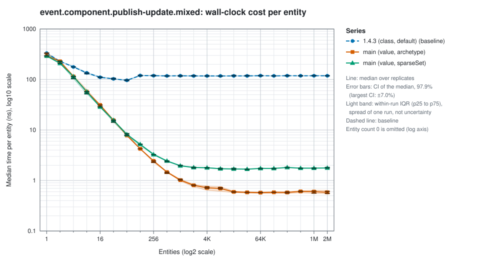

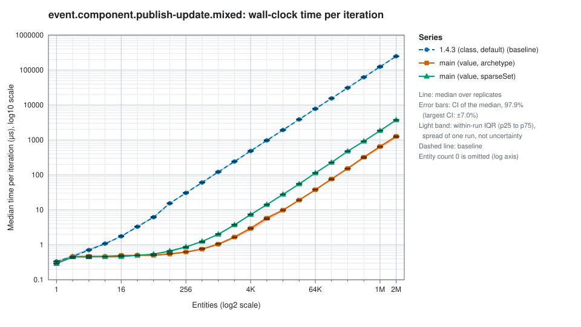

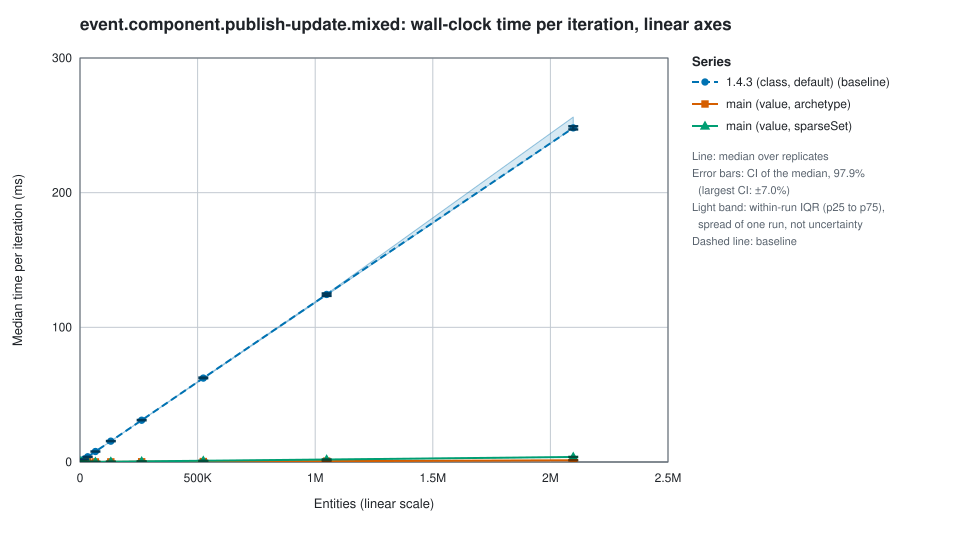

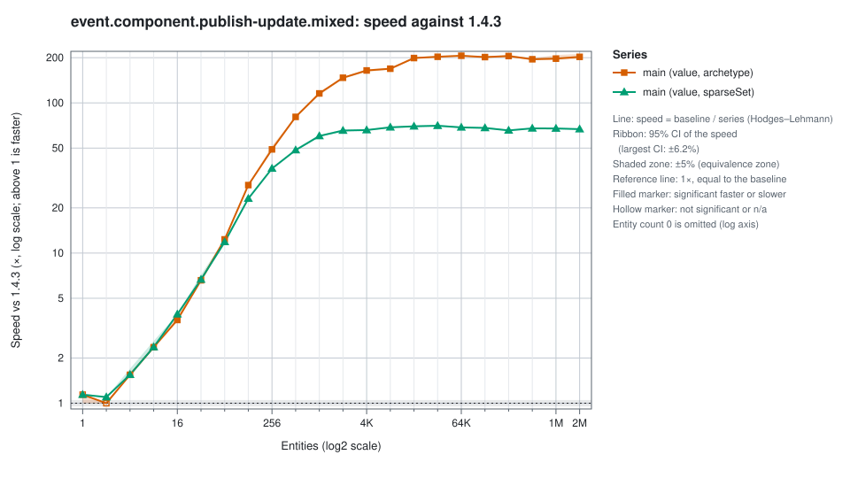

#### Time (wall clock): Entity counts up to 1,024

<table>
<thead>
<tr><th rowspan="3">Entities</th><th colspan="5">1.4.3 (class) - baseline</th><th colspan="22">main (value)</th></tr>
<tr><th colspan="5">default</th><th colspan="11">archetype</th><th colspan="11">sparseSet</th></tr>
<tr><th>median (μs)</th><th>CI low (μs)</th><th>CI high (μs)</th><th>replicates</th><th>iterations</th><th>median (ns)</th><th>CI low (ns)</th><th>CI high (ns)</th><th>replicates</th><th>iterations</th><th>speed (×)</th><th>CI low (×)</th><th>CI high (×)</th><th>change (%)</th><th>q</th><th>verdict</th><th>median (ns)</th><th>CI low (ns)</th><th>CI high (ns)</th><th>replicates</th><th>iterations</th><th>speed (×)</th><th>CI low (×)</th><th>CI high (×)</th><th>change (%)</th><th>q</th><th>verdict</th></tr>
</thead>
<tbody>
<tr><td align="right">0</td><td align="right">0.333</td><td align="right">0.292</td><td align="right">0.333</td><td align="right">10</td><td align="right">121,770</td><td align="right">292</td><td align="right">292</td><td align="right">333</td><td align="right">10</td><td align="right">119,710</td><td align="right">1.14</td><td align="right">1.00</td><td align="right">1.14</td><td align="right">-12.3</td><td align="right">0.020</td><td align="right">inconclusive</td><td align="right">292</td><td align="right">292</td><td align="right">333</td><td align="right">10</td><td align="right">121,239</td><td align="right">1.14</td><td align="right">1.00</td><td align="right">1.14</td><td align="right">-12.3</td><td align="right">0.020</td><td align="right">inconclusive</td></tr>
<tr><td align="right">1</td><td align="right">0.333</td><td align="right">0.333</td><td align="right">0.333</td><td align="right">10</td><td align="right">119,642</td><td align="right">292</td><td align="right">292</td><td align="right">292</td><td align="right">10</td><td align="right">118,163</td><td align="right">1.14</td><td align="right">1.14</td><td align="right">1.14</td><td align="right">-12.3</td><td align="right">&lt;0.001</td><td align="right">faster</td><td align="right">292</td><td align="right">292</td><td align="right">333</td><td align="right">10</td><td align="right">120,744</td><td align="right">1.14</td><td align="right">1.14</td><td align="right">1.14</td><td align="right">-12.3</td><td align="right">&lt;0.001</td><td align="right">faster</td></tr>
<tr><td align="right">2</td><td align="right">0.459</td><td align="right">0.458</td><td align="right">0.459</td><td align="right">10</td><td align="right">116,782</td><td align="right">458</td><td align="right">458</td><td align="right">459</td><td align="right">10</td><td align="right">115,311</td><td align="right">1.00</td><td align="right">1.00</td><td align="right">1.00</td><td align="right">0</td><td align="right">0.681</td><td align="right">equivalent</td><td align="right">458</td><td align="right">417</td><td align="right">458</td><td align="right">10</td><td align="right">117,199</td><td align="right">1.00</td><td align="right">1.00</td><td align="right">1.10</td><td align="right">-0.218</td><td align="right">0.002</td><td align="right">inconclusive</td></tr>
<tr><td align="right">4</td><td align="right">0.708</td><td align="right">0.708</td><td align="right">0.709</td><td align="right">10</td><td align="right">108,574</td><td align="right">459</td><td align="right">458</td><td align="right">500</td><td align="right">10</td><td align="right">114,322</td><td align="right">1.54</td><td align="right">1.42</td><td align="right">1.55</td><td align="right">-35.2</td><td align="right">&lt;0.001</td><td align="right">faster</td><td align="right">458</td><td align="right">417</td><td align="right">458</td><td align="right">10</td><td align="right">117,020</td><td align="right">1.55</td><td align="right">1.55</td><td align="right">1.64</td><td align="right">-35.3</td><td align="right">&lt;0.001</td><td align="right">faster</td></tr>
<tr><td align="right">8</td><td align="right">1.08</td><td align="right">1.08</td><td align="right">1.08</td><td align="right">10</td><td align="right">101,891</td><td align="right">459</td><td align="right">458</td><td align="right">459</td><td align="right">10</td><td align="right">114,330</td><td align="right">2.36</td><td align="right">2.36</td><td align="right">2.36</td><td align="right">-57.6</td><td align="right">&lt;0.001</td><td align="right">faster</td><td align="right">458</td><td align="right">458</td><td align="right">459</td><td align="right">10</td><td align="right">114,125</td><td align="right">2.36</td><td align="right">2.36</td><td align="right">2.36</td><td align="right">-57.7</td><td align="right">&lt;0.001</td><td align="right">faster</td></tr>
<tr><td align="right">16</td><td align="right">1.75</td><td align="right">1.75</td><td align="right">1.79</td><td align="right">10</td><td align="right">86,327</td><td align="right">500</td><td align="right">459</td><td align="right">500</td><td align="right">10</td><td align="right">112,542</td><td align="right">3.58</td><td align="right">3.50</td><td align="right">3.58</td><td align="right">-72.1</td><td align="right">&lt;0.001</td><td align="right">faster</td><td align="right">459</td><td align="right">458</td><td align="right">500</td><td align="right">10</td><td align="right">113,144</td><td align="right">3.81</td><td align="right">3.50</td><td align="right">3.90</td><td align="right">-73.8</td><td align="right">&lt;0.001</td><td align="right">faster</td></tr>
<tr><td align="right">32</td><td align="right">3.29</td><td align="right">3.29</td><td align="right">3.34</td><td align="right">10</td><td align="right">67,639</td><td align="right">500</td><td align="right">500</td><td align="right">500</td><td align="right">10</td><td align="right">112,991</td><td align="right">6.59</td><td align="right">6.58</td><td align="right">6.67</td><td align="right">-84.8</td><td align="right">&lt;0.001</td><td align="right">faster</td><td align="right">500</td><td align="right">500</td><td align="right">500</td><td align="right">10</td><td align="right">113,007</td><td align="right">6.59</td><td align="right">6.58</td><td align="right">6.67</td><td align="right">-84.8</td><td align="right">&lt;0.001</td><td align="right">faster</td></tr>
<tr><td align="right">64</td><td align="right">6.17</td><td align="right">6.09</td><td align="right">6.30</td><td align="right">10</td><td align="right">49,031</td><td align="right">500</td><td align="right">500</td><td align="right">541</td><td align="right">10</td><td align="right">114,014</td><td align="right">12.3</td><td align="right">12.2</td><td align="right">12.4</td><td align="right">-91.8</td><td align="right">&lt;0.001</td><td align="right">faster</td><td align="right">542</td><td align="right">500</td><td align="right">542</td><td align="right">10</td><td align="right">112,556</td><td align="right">11.5</td><td align="right">11.3</td><td align="right">12.3</td><td align="right">-91.3</td><td align="right">&lt;0.001</td><td align="right">faster</td></tr>
<tr><td align="right">128</td><td align="right">15.4</td><td align="right">15.3</td><td align="right">15.4</td><td align="right">10</td><td align="right">25,690</td><td align="right">542</td><td align="right">542</td><td align="right">583</td><td align="right">10</td><td align="right">112,621</td><td align="right">28.4</td><td align="right">28.1</td><td align="right">28.5</td><td align="right">-96.5</td><td align="right">&lt;0.001</td><td align="right">faster</td><td align="right">667</td><td align="right">666</td><td align="right">667</td><td align="right">10</td><td align="right">108,420</td><td align="right">23.1</td><td align="right">23.0</td><td align="right">23.1</td><td align="right">-95.7</td><td align="right">&lt;0.001</td><td align="right">faster</td></tr>
<tr><td align="right">256</td><td align="right">30.5</td><td align="right">30.4</td><td align="right">30.9</td><td align="right">10</td><td align="right">14,402</td><td align="right">625</td><td align="right">625</td><td align="right">625</td><td align="right">10</td><td align="right">110,472</td><td align="right">48.9</td><td align="right">48.8</td><td align="right">49.5</td><td align="right">-98.0</td><td align="right">&lt;0.001</td><td align="right">faster</td><td align="right">875</td><td align="right">834</td><td align="right">875</td><td align="right">10</td><td align="right">104,451</td><td align="right">34.9</td><td align="right">34.9</td><td align="right">35.7</td><td align="right">-97.1</td><td align="right">&lt;0.001</td><td align="right">faster</td></tr>
<tr><td align="right">512</td><td align="right">60.6</td><td align="right">60.5</td><td align="right">61.2</td><td align="right">10</td><td align="right">7,683</td><td align="right">750</td><td align="right">750</td><td align="right">791</td><td align="right">10</td><td align="right">105,428</td><td align="right">80.7</td><td align="right">79.6</td><td align="right">81.6</td><td align="right">-98.8</td><td align="right">&lt;0.001</td><td align="right">faster</td><td align="right">1,250</td><td align="right">1,210</td><td align="right">1,250</td><td align="right">10</td><td align="right">97,408</td><td align="right">48.9</td><td align="right">48.4</td><td align="right">50.1</td><td align="right">-98.0</td><td align="right">&lt;0.001</td><td align="right">faster</td></tr>
<tr><td align="right">1,024</td><td align="right">122</td><td align="right">121</td><td align="right">123</td><td align="right">10</td><td align="right">3,930</td><td align="right">1,040</td><td align="right">1,040</td><td align="right">1,080</td><td align="right">10</td><td align="right">100,245</td><td align="right">117</td><td align="right">116</td><td align="right">118</td><td align="right">-99.1</td><td align="right">&lt;0.001</td><td align="right">faster</td><td align="right">2,000</td><td align="right">2,000</td><td align="right">2,040</td><td align="right">10</td><td align="right">84,925</td><td align="right">60.8</td><td align="right">60.3</td><td align="right">61.3</td><td align="right">-98.4</td><td align="right">&lt;0.001</td><td align="right">faster</td></tr>
</tbody>
</table>

#### Time (wall clock): Entity counts above 1,024

<table>
<thead>
<tr><th rowspan="3">Entities</th><th colspan="5">1.4.3 (class) - baseline</th><th colspan="22">main (value)</th></tr>
<tr><th colspan="5">default</th><th colspan="11">archetype</th><th colspan="11">sparseSet</th></tr>
<tr><th>median (ms)</th><th>CI low (ms)</th><th>CI high (ms)</th><th>replicates</th><th>iterations</th><th>median (μs)</th><th>CI low (μs)</th><th>CI high (μs)</th><th>replicates</th><th>iterations</th><th>speed (×)</th><th>CI low (×)</th><th>CI high (×)</th><th>change (%)</th><th>q</th><th>verdict</th><th>median (μs)</th><th>CI low (μs)</th><th>CI high (μs)</th><th>replicates</th><th>iterations</th><th>speed (×)</th><th>CI low (×)</th><th>CI high (×)</th><th>change (%)</th><th>q</th><th>verdict</th></tr>
</thead>
<tbody>
<tr><td align="right">2,048</td><td align="right">0.242</td><td align="right">0.241</td><td align="right">0.243</td><td align="right">10</td><td align="right">2,011</td><td align="right">1.67</td><td align="right">1.63</td><td align="right">1.67</td><td align="right">10</td><td align="right">89,135</td><td align="right">146</td><td align="right">145</td><td align="right">148</td><td align="right">-99.3</td><td align="right">&lt;0.001</td><td align="right">faster</td><td align="right">3.71</td><td align="right">3.71</td><td align="right">3.79</td><td align="right">10</td><td align="right">64,320</td><td align="right">64.9</td><td align="right">63.9</td><td align="right">65.5</td><td align="right">-98.5</td><td align="right">&lt;0.001</td><td align="right">faster</td></tr>
<tr><td align="right">4,096</td><td align="right">0.484</td><td align="right">0.481</td><td align="right">0.487</td><td align="right">10</td><td align="right">1,012</td><td align="right">2.94</td><td align="right">2.88</td><td align="right">3.04</td><td align="right">10</td><td align="right">72,150</td><td align="right">165</td><td align="right">161</td><td align="right">169</td><td align="right">-99.4</td><td align="right">&lt;0.001</td><td align="right">faster</td><td align="right">7.34</td><td align="right">7.30</td><td align="right">7.46</td><td align="right">10</td><td align="right">43,192</td><td align="right">65.6</td><td align="right">65.0</td><td align="right">66.2</td><td align="right">-98.5</td><td align="right">&lt;0.001</td><td align="right">faster</td></tr>
<tr><td align="right">8,192</td><td align="right">0.971</td><td align="right">0.964</td><td align="right">0.982</td><td align="right">10</td><td align="right">508</td><td align="right">5.77</td><td align="right">5.34</td><td align="right">5.88</td><td align="right">10</td><td align="right">50,397</td><td align="right">169</td><td align="right">166</td><td align="right">173</td><td align="right">-99.4</td><td align="right">&lt;0.001</td><td align="right">faster</td><td align="right">14.1</td><td align="right">14.0</td><td align="right">14.3</td><td align="right">10</td><td align="right">26,984</td><td align="right">68.8</td><td align="right">68.2</td><td align="right">69.4</td><td align="right">-98.5</td><td align="right">&lt;0.001</td><td align="right">faster</td></tr>
<tr><td align="right">16,384</td><td align="right">1.93</td><td align="right">1.93</td><td align="right">1.95</td><td align="right">10</td><td align="right">258</td><td align="right">9.82</td><td align="right">9.71</td><td align="right">9.96</td><td align="right">10</td><td align="right">35,282</td><td align="right">197</td><td align="right">195</td><td align="right">199</td><td align="right">-99.5</td><td align="right">&lt;0.001</td><td align="right">faster</td><td align="right">27.8</td><td align="right">27.7</td><td align="right">27.8</td><td align="right">10</td><td align="right">15,532</td><td align="right">69.6</td><td align="right">69.3</td><td align="right">70.0</td><td align="right">-98.6</td><td align="right">&lt;0.001</td><td align="right">faster</td></tr>
<tr><td align="right">32,768</td><td align="right">3.87</td><td align="right">3.86</td><td align="right">3.89</td><td align="right">10</td><td align="right">129</td><td align="right">19.0</td><td align="right">18.8</td><td align="right">19.3</td><td align="right">10</td><td align="right">21,291</td><td align="right">203</td><td align="right">202</td><td align="right">205</td><td align="right">-99.5</td><td align="right">&lt;0.001</td><td align="right">faster</td><td align="right">55.0</td><td align="right">54.8</td><td align="right">55.8</td><td align="right">10</td><td align="right">8,289</td><td align="right">70.2</td><td align="right">69.7</td><td align="right">70.7</td><td align="right">-98.6</td><td align="right">&lt;0.001</td><td align="right">faster</td></tr>
<tr><td align="right">65,536</td><td align="right">7.78</td><td align="right">7.73</td><td align="right">7.82</td><td align="right">10</td><td align="right">64</td><td align="right">37.6</td><td align="right">37.4</td><td align="right">38.7</td><td align="right">10</td><td align="right">11,916</td><td align="right">206</td><td align="right">203</td><td align="right">208</td><td align="right">-99.5</td><td align="right">&lt;0.001</td><td align="right">faster</td><td align="right">114</td><td align="right">113</td><td align="right">114</td><td align="right">10</td><td align="right">4,221</td><td align="right">68.4</td><td align="right">68.1</td><td align="right">68.8</td><td align="right">-98.5</td><td align="right">&lt;0.001</td><td align="right">faster</td></tr>
<tr><td align="right">131,072</td><td align="right">15.5</td><td align="right">15.5</td><td align="right">15.6</td><td align="right">10</td><td align="right">33</td><td align="right">76.3</td><td align="right">73.5</td><td align="right">77.1</td><td align="right">10</td><td align="right">6,235</td><td align="right">203</td><td align="right">202</td><td align="right">210</td><td align="right">-99.5</td><td align="right">&lt;0.001</td><td align="right">faster</td><td align="right">227</td><td align="right">227</td><td align="right">229</td><td align="right">10</td><td align="right">2,141</td><td align="right">68.2</td><td align="right">67.9</td><td align="right">68.5</td><td align="right">-98.5</td><td align="right">&lt;0.001</td><td align="right">faster</td></tr>
<tr><td align="right">262,144</td><td align="right">31.0</td><td align="right">31.0</td><td align="right">31.2</td><td align="right">10</td><td align="right">17</td><td align="right">153</td><td align="right">149</td><td align="right">154</td><td align="right">10</td><td align="right">3,199</td><td align="right">203</td><td align="right">202</td><td align="right">208</td><td align="right">-99.5</td><td align="right">&lt;0.001</td><td align="right">faster</td><td align="right">476</td><td align="right">475</td><td align="right">481</td><td align="right">10</td><td align="right">1,028</td><td align="right">65.2</td><td align="right">64.9</td><td align="right">65.4</td><td align="right">-98.5</td><td align="right">&lt;0.001</td><td align="right">faster</td></tr>
<tr><td align="right">524,288</td><td align="right">62.3</td><td align="right">62.2</td><td align="right">62.7</td><td align="right">10</td><td align="right">8</td><td align="right">321</td><td align="right">305</td><td align="right">327</td><td align="right">10</td><td align="right">1,547</td><td align="right">195</td><td align="right">192</td><td align="right">197</td><td align="right">-99.5</td><td align="right">&lt;0.001</td><td align="right">faster</td><td align="right">920</td><td align="right">917</td><td align="right">923</td><td align="right">10</td><td align="right">534</td><td align="right">67.8</td><td align="right">67.6</td><td align="right">68.1</td><td align="right">-98.5</td><td align="right">&lt;0.001</td><td align="right">faster</td></tr>
<tr><td align="right">1,048,576</td><td align="right">124</td><td align="right">123</td><td align="right">125</td><td align="right">10</td><td align="right">4</td><td align="right">647</td><td align="right">630</td><td align="right">650</td><td align="right">10</td><td align="right">779</td><td align="right">193</td><td align="right">191</td><td align="right">195</td><td align="right">-99.5</td><td align="right">&lt;0.001</td><td align="right">faster</td><td align="right">1,840</td><td align="right">1,840</td><td align="right">1,860</td><td align="right">10</td><td align="right">267</td><td align="right">67.3</td><td align="right">66.8</td><td align="right">67.7</td><td align="right">-98.5</td><td align="right">&lt;0.001</td><td align="right">faster</td></tr>
<tr><td align="right">2,097,152</td><td align="right">248</td><td align="right">247</td><td align="right">249</td><td align="right">10</td><td align="right">2</td><td align="right">1,270</td><td align="right">1,210</td><td align="right">1,290</td><td align="right">10</td><td align="right">400</td><td align="right">196</td><td align="right">193</td><td align="right">201</td><td align="right">-99.5</td><td align="right">&lt;0.001</td><td align="right">faster</td><td align="right">3,730</td><td align="right">3,720</td><td align="right">3,770</td><td align="right">10</td><td align="right">132</td><td align="right">66.4</td><td align="right">65.9</td><td align="right">66.7</td><td align="right">-98.5</td><td align="right">&lt;0.001</td><td align="right">faster</td></tr>
</tbody>
</table>

### `event.component.publish.mixed`

[All metrics, means, percentiles and the linear plot](workloads/event.component.publish.mixed.md)

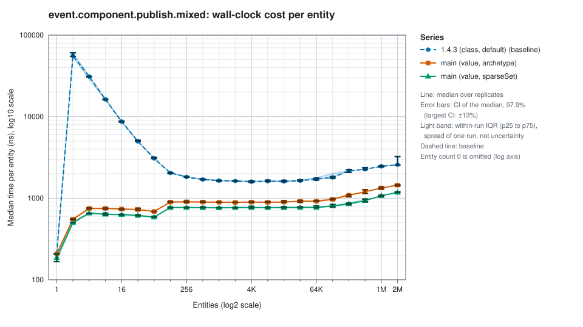

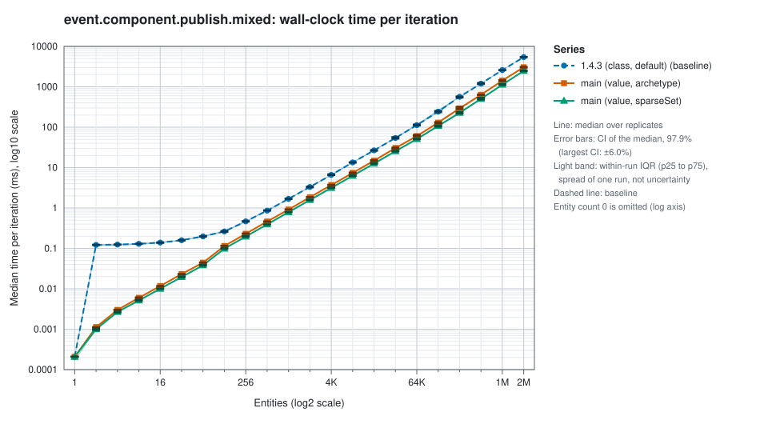

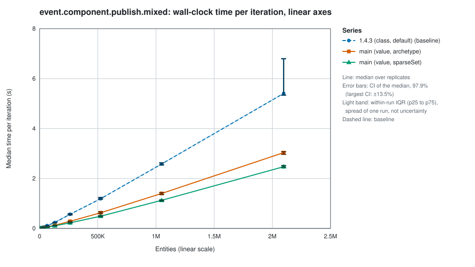

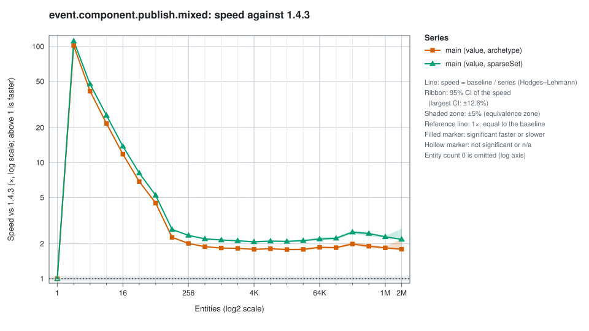

#### Time (wall clock): Entity counts up to 1,024

<table>
<thead>
<tr><th rowspan="3">Entities</th><th colspan="5">1.4.3 (class) - baseline</th><th colspan="22">main (value)</th></tr>
<tr><th colspan="5">default</th><th colspan="11">archetype</th><th colspan="11">sparseSet</th></tr>
<tr><th>median (μs)</th><th>CI low (μs)</th><th>CI high (μs)</th><th>replicates</th><th>iterations</th><th>median (μs)</th><th>CI low (μs)</th><th>CI high (μs)</th><th>replicates</th><th>iterations</th><th>speed (×)</th><th>CI low (×)</th><th>CI high (×)</th><th>change (%)</th><th>q</th><th>verdict</th><th>median (μs)</th><th>CI low (μs)</th><th>CI high (μs)</th><th>replicates</th><th>iterations</th><th>speed (×)</th><th>CI low (×)</th><th>CI high (×)</th><th>change (%)</th><th>q</th><th>verdict</th></tr>
</thead>
<tbody>
<tr><td align="right">0</td><td align="right">0.208</td><td align="right">0.208</td><td align="right">0.208</td><td align="right">10</td><td align="right">125,450</td><td align="right">0.208</td><td align="right">0.208</td><td align="right">0.208</td><td align="right">10</td><td align="right">123,356</td><td align="right">1.00</td><td align="right">1.00</td><td align="right">1.00</td><td align="right">0</td><td align="right">1.000</td><td align="right">equivalent</td><td align="right">0.208</td><td align="right">0.208</td><td align="right">0.208</td><td align="right">10</td><td align="right">122,374</td><td align="right">1.00</td><td align="right">1.00</td><td align="right">1.00</td><td align="right">0</td><td align="right">1.000</td><td align="right">equivalent</td></tr>
<tr><td align="right">1</td><td align="right">0.208</td><td align="right">0.208</td><td align="right">0.208</td><td align="right">10</td><td align="right">123,024</td><td align="right">0.208</td><td align="right">0.208</td><td align="right">0.208</td><td align="right">10</td><td align="right">123,907</td><td align="right">1.00</td><td align="right">1.00</td><td align="right">1.00</td><td align="right">0</td><td align="right">0.548</td><td align="right">equivalent</td><td align="right">0.208</td><td align="right">0.208</td><td align="right">0.208</td><td align="right">10</td><td align="right">123,961</td><td align="right">1.00</td><td align="right">1.00</td><td align="right">1.00</td><td align="right">0</td><td align="right">1.000</td><td align="right">equivalent</td></tr>
<tr><td align="right">2</td><td align="right">122</td><td align="right">121</td><td align="right">123</td><td align="right">10</td><td align="right">3,956</td><td align="right">1.13</td><td align="right">1.13</td><td align="right">1.13</td><td align="right">10</td><td align="right">99,526</td><td align="right">109</td><td align="right">108</td><td align="right">110</td><td align="right">-99.1</td><td align="right">&lt;0.001</td><td align="right">faster</td><td align="right">1.00</td><td align="right">0.959</td><td align="right">1.04</td><td align="right">10</td><td align="right">102,349</td><td align="right">122</td><td align="right">121</td><td align="right">125</td><td align="right">-99.2</td><td align="right">&lt;0.001</td><td align="right">faster</td></tr>
<tr><td align="right">4</td><td align="right">125</td><td align="right">123</td><td align="right">125</td><td align="right">10</td><td align="right">3,931</td><td align="right">3.00</td><td align="right">2.96</td><td align="right">3.04</td><td align="right">10</td><td align="right">70,625</td><td align="right">41.4</td><td align="right">41.0</td><td align="right">42.0</td><td align="right">-97.6</td><td align="right">&lt;0.001</td><td align="right">faster</td><td align="right">2.67</td><td align="right">2.58</td><td align="right">2.71</td><td align="right">10</td><td align="right">74,760</td><td align="right">46.9</td><td align="right">46.2</td><td align="right">47.7</td><td align="right">-97.9</td><td align="right">&lt;0.001</td><td align="right">faster</td></tr>
<tr><td align="right">8</td><td align="right">130</td><td align="right">129</td><td align="right">131</td><td align="right">10</td><td align="right">3,757</td><td align="right">5.98</td><td align="right">5.88</td><td align="right">6.13</td><td align="right">10</td><td align="right">49,929</td><td align="right">21.7</td><td align="right">21.4</td><td align="right">21.9</td><td align="right">-95.4</td><td align="right">&lt;0.001</td><td align="right">faster</td><td align="right">5.15</td><td align="right">5.08</td><td align="right">5.25</td><td align="right">10</td><td align="right">53,816</td><td align="right">25.2</td><td align="right">24.8</td><td align="right">25.5</td><td align="right">-96.0</td><td align="right">&lt;0.001</td><td align="right">faster</td></tr>
<tr><td align="right">16</td><td align="right">139</td><td align="right">137</td><td align="right">141</td><td align="right">10</td><td align="right">3,445</td><td align="right">11.7</td><td align="right">11.5</td><td align="right">11.8</td><td align="right">10</td><td align="right">31,737</td><td align="right">11.9</td><td align="right">11.8</td><td align="right">12.1</td><td align="right">-91.6</td><td align="right">&lt;0.001</td><td align="right">faster</td><td align="right">10.0</td><td align="right">9.92</td><td align="right">10.1</td><td align="right">10</td><td align="right">35,152</td><td align="right">13.9</td><td align="right">13.7</td><td align="right">14.1</td><td align="right">-92.8</td><td align="right">&lt;0.001</td><td align="right">faster</td></tr>
<tr><td align="right">32</td><td align="right">159</td><td align="right">157</td><td align="right">161</td><td align="right">10</td><td align="right">3,050</td><td align="right">23.2</td><td align="right">22.8</td><td align="right">23.3</td><td align="right">10</td><td align="right">18,235</td><td align="right">6.90</td><td align="right">6.80</td><td align="right">6.97</td><td align="right">-85.5</td><td align="right">&lt;0.001</td><td align="right">faster</td><td align="right">19.6</td><td align="right">19.3</td><td align="right">20.1</td><td align="right">10</td><td align="right">20,968</td><td align="right">8.12</td><td align="right">7.99</td><td align="right">8.22</td><td align="right">-87.7</td><td align="right">&lt;0.001</td><td align="right">faster</td></tr>
<tr><td align="right">64</td><td align="right">198</td><td align="right">196</td><td align="right">200</td><td align="right">10</td><td align="right">2,437</td><td align="right">44.2</td><td align="right">44.0</td><td align="right">45.0</td><td align="right">10</td><td align="right">10,283</td><td align="right">4.46</td><td align="right">4.42</td><td align="right">4.51</td><td align="right">-77.6</td><td align="right">&lt;0.001</td><td align="right">faster</td><td align="right">38.1</td><td align="right">37.4</td><td align="right">39.2</td><td align="right">10</td><td align="right">11,790</td><td align="right">5.21</td><td align="right">5.12</td><td align="right">5.28</td><td align="right">-80.8</td><td align="right">&lt;0.001</td><td align="right">faster</td></tr>
<tr><td align="right">128</td><td align="right">263</td><td align="right">258</td><td align="right">268</td><td align="right">10</td><td align="right">1,851</td><td align="right">115</td><td align="right">114</td><td align="right">116</td><td align="right">10</td><td align="right">4,169</td><td align="right">2.28</td><td align="right">2.24</td><td align="right">2.32</td><td align="right">-56.1</td><td align="right">&lt;0.001</td><td align="right">faster</td><td align="right">98.7</td><td align="right">97.7</td><td align="right">101</td><td align="right">10</td><td align="right">4,797</td><td align="right">2.65</td><td align="right">2.61</td><td align="right">2.70</td><td align="right">-62.3</td><td align="right">&lt;0.001</td><td align="right">faster</td></tr>
<tr><td align="right">256</td><td align="right">467</td><td align="right">460</td><td align="right">474</td><td align="right">10</td><td align="right">1,049</td><td align="right">230</td><td align="right">229</td><td align="right">235</td><td align="right">10</td><td align="right">2,091</td><td align="right">2.01</td><td align="right">1.99</td><td align="right">2.05</td><td align="right">-50.3</td><td align="right">&lt;0.001</td><td align="right">faster</td><td align="right">197</td><td align="right">195</td><td align="right">200</td><td align="right">10</td><td align="right">2,462</td><td align="right">2.36</td><td align="right">2.34</td><td align="right">2.40</td><td align="right">-57.6</td><td align="right">&lt;0.001</td><td align="right">faster</td></tr>
<tr><td align="right">512</td><td align="right">861</td><td align="right">857</td><td align="right">876</td><td align="right">10</td><td align="right">572</td><td align="right">462</td><td align="right">457</td><td align="right">467</td><td align="right">10</td><td align="right">1,060</td><td align="right">1.87</td><td align="right">1.85</td><td align="right">1.88</td><td align="right">-46.5</td><td align="right">&lt;0.001</td><td align="right">faster</td><td align="right">392</td><td align="right">391</td><td align="right">393</td><td align="right">10</td><td align="right">1,249</td><td align="right">2.20</td><td align="right">2.18</td><td align="right">2.22</td><td align="right">-54.5</td><td align="right">&lt;0.001</td><td align="right">faster</td></tr>
<tr><td align="right">1,024</td><td align="right">1,680</td><td align="right">1,670</td><td align="right">1,710</td><td align="right">10</td><td align="right">296</td><td align="right">916</td><td align="right">913</td><td align="right">925</td><td align="right">10</td><td align="right">539</td><td align="right">1.84</td><td align="right">1.82</td><td align="right">1.85</td><td align="right">-45.5</td><td align="right">&lt;0.001</td><td align="right">faster</td><td align="right">787</td><td align="right">783</td><td align="right">793</td><td align="right">10</td><td align="right">627</td><td align="right">2.14</td><td align="right">2.12</td><td align="right">2.15</td><td align="right">-53.2</td><td align="right">&lt;0.001</td><td align="right">faster</td></tr>
</tbody>
</table>

#### Time (wall clock): Entity counts above 1,024

<table>
<thead>
<tr><th rowspan="3">Entities</th><th colspan="5">1.4.3 (class) - baseline</th><th colspan="22">main (value)</th></tr>
<tr><th colspan="5">default</th><th colspan="11">archetype</th><th colspan="11">sparseSet</th></tr>
<tr><th>median (ms)</th><th>CI low (ms)</th><th>CI high (ms)</th><th>replicates</th><th>iterations</th><th>median (ms)</th><th>CI low (ms)</th><th>CI high (ms)</th><th>replicates</th><th>iterations</th><th>speed (×)</th><th>CI low (×)</th><th>CI high (×)</th><th>change (%)</th><th>q</th><th>verdict</th><th>median (ms)</th><th>CI low (ms)</th><th>CI high (ms)</th><th>replicates</th><th>iterations</th><th>speed (×)</th><th>CI low (×)</th><th>CI high (×)</th><th>change (%)</th><th>q</th><th>verdict</th></tr>
</thead>
<tbody>
<tr><td align="right">2,048</td><td align="right">3.32</td><td align="right">3.24</td><td align="right">3.37</td><td align="right">10</td><td align="right">150</td><td align="right">1.85</td><td align="right">1.84</td><td align="right">1.87</td><td align="right">10</td><td align="right">267</td><td align="right">1.79</td><td align="right">1.76</td><td align="right">1.82</td><td align="right">-44.2</td><td align="right">&lt;0.001</td><td align="right">faster</td><td align="right">1.58</td><td align="right">1.56</td><td align="right">1.61</td><td align="right">10</td><td align="right">313</td><td align="right">2.09</td><td align="right">2.06</td><td align="right">2.12</td><td align="right">-52.2</td><td align="right">&lt;0.001</td><td align="right">faster</td></tr>
<tr><td align="right">4,096</td><td align="right">6.59</td><td align="right">6.54</td><td align="right">6.82</td><td align="right">10</td><td align="right">76</td><td align="right">3.70</td><td align="right">3.66</td><td align="right">3.75</td><td align="right">10</td><td align="right">136</td><td align="right">1.79</td><td align="right">1.77</td><td align="right">1.83</td><td align="right">-44.1</td><td align="right">&lt;0.001</td><td align="right">faster</td><td align="right">3.14</td><td align="right">3.13</td><td align="right">3.22</td><td align="right">10</td><td align="right">158</td><td align="right">2.10</td><td align="right">2.07</td><td align="right">2.13</td><td align="right">-52.3</td><td align="right">&lt;0.001</td><td align="right">faster</td></tr>
<tr><td align="right">8,192</td><td align="right">13.4</td><td align="right">13.2</td><td align="right">13.5</td><td align="right">10</td><td align="right">38</td><td align="right">7.38</td><td align="right">7.25</td><td align="right">7.52</td><td align="right">10</td><td align="right">68</td><td align="right">1.82</td><td align="right">1.80</td><td align="right">1.85</td><td align="right">-45.2</td><td align="right">&lt;0.001</td><td align="right">faster</td><td align="right">6.28</td><td align="right">6.24</td><td align="right">6.40</td><td align="right">10</td><td align="right">80</td><td align="right">2.14</td><td align="right">2.10</td><td align="right">2.16</td><td align="right">-53.2</td><td align="right">&lt;0.001</td><td align="right">faster</td></tr>
<tr><td align="right">16,384</td><td align="right">26.7</td><td align="right">26.2</td><td align="right">27.1</td><td align="right">10</td><td align="right">19</td><td align="right">14.9</td><td align="right">14.6</td><td align="right">15.3</td><td align="right">10</td><td align="right">34</td><td align="right">1.79</td><td align="right">1.76</td><td align="right">1.83</td><td align="right">-44.2</td><td align="right">&lt;0.001</td><td align="right">faster</td><td align="right">12.6</td><td align="right">12.4</td><td align="right">12.9</td><td align="right">10</td><td align="right">40</td><td align="right">2.12</td><td align="right">2.08</td><td align="right">2.15</td><td align="right">-52.8</td><td align="right">&lt;0.001</td><td align="right">faster</td></tr>
<tr><td align="right">32,768</td><td align="right">54.1</td><td align="right">52.5</td><td align="right">56.8</td><td align="right">10</td><td align="right">10</td><td align="right">30.6</td><td align="right">29.7</td><td align="right">31.2</td><td align="right">10</td><td align="right">17</td><td align="right">1.78</td><td align="right">1.73</td><td align="right">1.84</td><td align="right">-43.8</td><td align="right">&lt;0.001</td><td align="right">faster</td><td align="right">25.4</td><td align="right">25.0</td><td align="right">26.0</td><td align="right">10</td><td align="right">20</td><td align="right">2.13</td><td align="right">2.08</td><td align="right">2.20</td><td align="right">-53.1</td><td align="right">&lt;0.001</td><td align="right">faster</td></tr>
<tr><td align="right">65,536</td><td align="right">112</td><td align="right">111</td><td align="right">116</td><td align="right">10</td><td align="right">5</td><td align="right">60.2</td><td align="right">59.6</td><td align="right">64.3</td><td align="right">10</td><td align="right">9</td><td align="right">1.86</td><td align="right">1.79</td><td align="right">1.90</td><td align="right">-46.2</td><td align="right">&lt;0.001</td><td align="right">faster</td><td align="right">50.8</td><td align="right">50.3</td><td align="right">51.9</td><td align="right">10</td><td align="right">10</td><td align="right">2.21</td><td align="right">2.18</td><td align="right">2.28</td><td align="right">-54.8</td><td align="right">&lt;0.001</td><td align="right">faster</td></tr>
<tr><td align="right">131,072</td><td align="right">243</td><td align="right">235</td><td align="right">252</td><td align="right">10</td><td align="right">3</td><td align="right">130</td><td align="right">125</td><td align="right">134</td><td align="right">10</td><td align="right">4</td><td align="right">1.87</td><td align="right">1.81</td><td align="right">1.94</td><td align="right">-46.6</td><td align="right">&lt;0.001</td><td align="right">faster</td><td align="right">107</td><td align="right">103</td><td align="right">111</td><td align="right">10</td><td align="right">5</td><td align="right">2.26</td><td align="right">2.19</td><td align="right">2.35</td><td align="right">-55.7</td><td align="right">&lt;0.001</td><td align="right">faster</td></tr>
<tr><td align="right">262,144</td><td align="right">566</td><td align="right">543</td><td align="right">574</td><td align="right">10</td><td align="right">1</td><td align="right">292</td><td align="right">282</td><td align="right">317</td><td align="right">10</td><td align="right">2</td><td align="right">1.92</td><td align="right">1.84</td><td align="right">1.99</td><td align="right">-47.9</td><td align="right">&lt;0.001</td><td align="right">faster</td><td align="right">227</td><td align="right">218</td><td align="right">236</td><td align="right">10</td><td align="right">3</td><td align="right">2.49</td><td align="right">2.40</td><td align="right">2.59</td><td align="right">-59.8</td><td align="right">&lt;0.001</td><td align="right">faster</td></tr>
<tr><td align="right">524,288</td><td align="right">1,200</td><td align="right">1,170</td><td align="right">1,240</td><td align="right">10</td><td align="right">1</td><td align="right">634</td><td align="right">625</td><td align="right">642</td><td align="right">10</td><td align="right">1</td><td align="right">1.89</td><td align="right">1.86</td><td align="right">1.94</td><td align="right">-47.0</td><td align="right">&lt;0.001</td><td align="right">faster</td><td align="right">502</td><td align="right">481</td><td align="right">535</td><td align="right">10</td><td align="right">2</td><td align="right">2.40</td><td align="right">2.28</td><td align="right">2.47</td><td align="right">-58.3</td><td align="right">&lt;0.001</td><td align="right">faster</td></tr>
<tr><td align="right">1,048,576</td><td align="right">2,600</td><td align="right">2,570</td><td align="right">2,610</td><td align="right">10</td><td align="right">1</td><td align="right">1,430</td><td align="right">1,380</td><td align="right">1,460</td><td align="right">10</td><td align="right">1</td><td align="right">1.81</td><td align="right">1.78</td><td align="right">1.87</td><td align="right">-44.9</td><td align="right">&lt;0.001</td><td align="right">faster</td><td align="right">1,130</td><td align="right">1,120</td><td align="right">1,160</td><td align="right">10</td><td align="right">1</td><td align="right">2.30</td><td align="right">2.25</td><td align="right">2.32</td><td align="right">-56.4</td><td align="right">&lt;0.001</td><td align="right">faster</td></tr>
<tr><td align="right">2,097,152</td><td align="right">5,430</td><td align="right">5,400</td><td align="right">5,480</td><td align="right">10</td><td align="right">1</td><td align="right">3,040</td><td align="right">2,990</td><td align="right">3,110</td><td align="right">10</td><td align="right">1</td><td align="right">1.78</td><td align="right">1.76</td><td align="right">1.81</td><td align="right">-43.9</td><td align="right">&lt;0.001</td><td align="right">faster</td><td align="right">2,480</td><td align="right">2,440</td><td align="right">2,530</td><td align="right">10</td><td align="right">1</td><td align="right">2.19</td><td align="right">2.16</td><td align="right">2.22</td><td align="right">-54.4</td><td align="right">&lt;0.001</td><td align="right">faster</td></tr>
</tbody>
</table>

### `iteration.mixed-three`

[All metrics, means, percentiles and the linear plot](workloads/iteration.mixed-three.md)

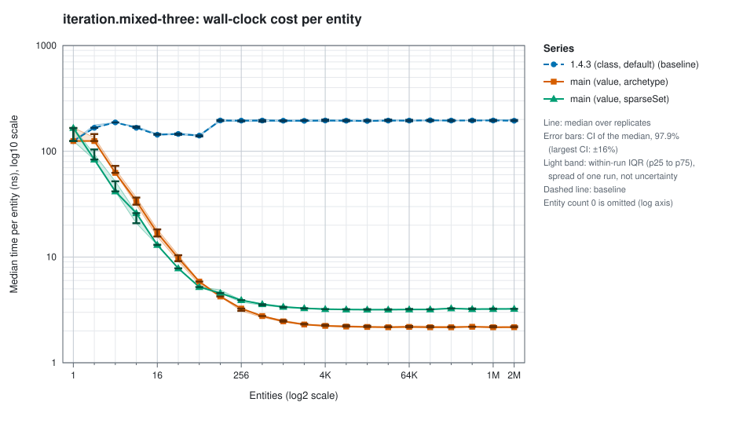

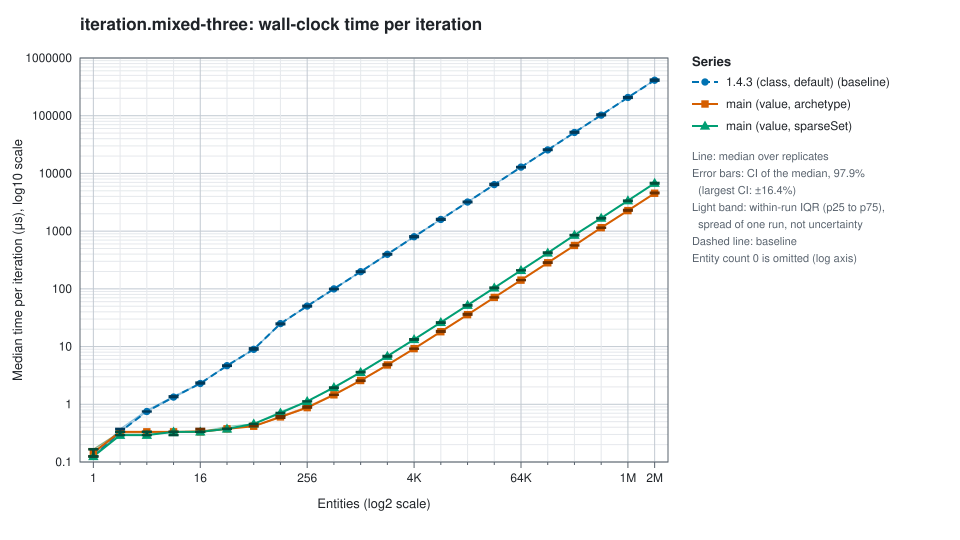

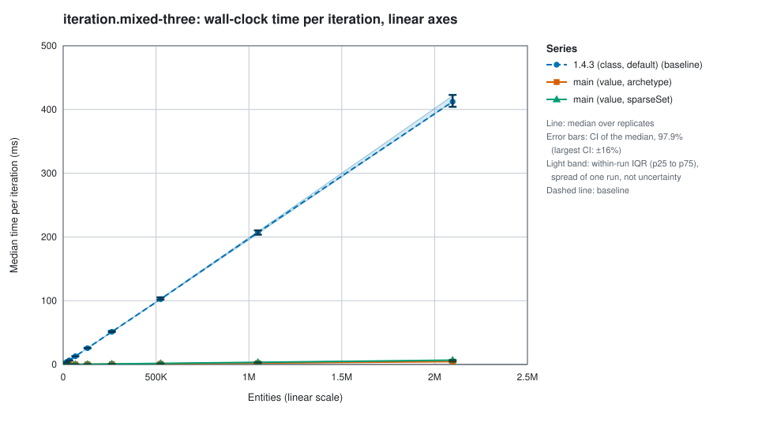

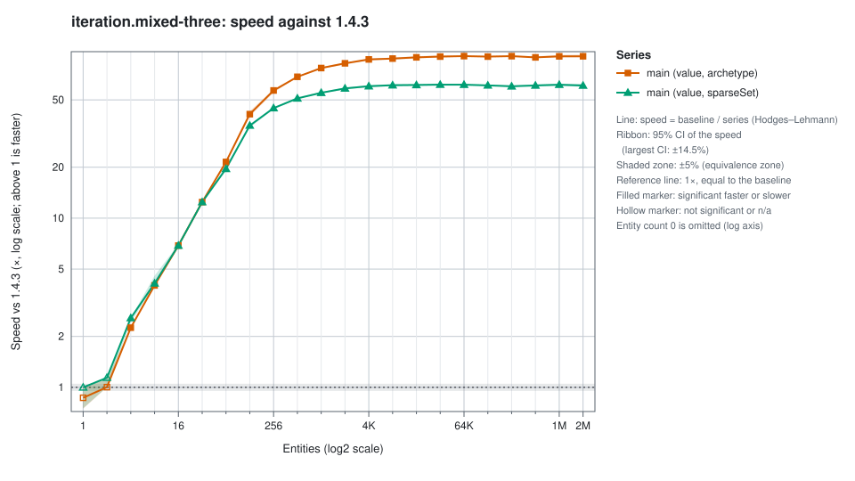

#### Time (wall clock): Entity counts up to 1,024

<table>
<thead>
<tr><th rowspan="3">Entities</th><th colspan="5">1.4.3 (class) - baseline</th><th colspan="22">main (value)</th></tr>
<tr><th colspan="5">default</th><th colspan="11">archetype</th><th colspan="11">sparseSet</th></tr>
<tr><th>median (μs)</th><th>CI low (μs)</th><th>CI high (μs)</th><th>replicates</th><th>iterations</th><th>median (ns)</th><th>CI low (ns)</th><th>CI high (ns)</th><th>replicates</th><th>iterations</th><th>speed (×)</th><th>CI low (×)</th><th>CI high (×)</th><th>change (%)</th><th>q</th><th>verdict</th><th>median (ns)</th><th>CI low (ns)</th><th>CI high (ns)</th><th>replicates</th><th>iterations</th><th>speed (×)</th><th>CI low (×)</th><th>CI high (×)</th><th>change (%)</th><th>q</th><th>verdict</th></tr>
</thead>
<tbody>
<tr><td align="right">0</td><td align="right">0.125</td><td align="right">0.125</td><td align="right">0.125</td><td align="right">10</td><td align="right">124,988</td><td align="right">125</td><td align="right">125</td><td align="right">166</td><td align="right">10</td><td align="right">126,193</td><td align="right">1.00</td><td align="right">0.753</td><td align="right">1.00</td><td align="right">0</td><td align="right">0.091</td><td align="right">inconclusive</td><td align="right">125</td><td align="right">125</td><td align="right">166</td><td align="right">10</td><td align="right">121,438</td><td align="right">1.00</td><td align="right">0.753</td><td align="right">1.00</td><td align="right">0</td><td align="right">0.091</td><td align="right">inconclusive</td></tr>
<tr><td align="right">1</td><td align="right">0.125</td><td align="right">0.125</td><td align="right">0.125</td><td align="right">10</td><td align="right">127,241</td><td align="right">125</td><td align="right">125</td><td align="right">166</td><td align="right">10</td><td align="right">126,170</td><td align="right">1.00</td><td align="right">0.753</td><td align="right">1.00</td><td align="right">0</td><td align="right">0.221</td><td align="right">inconclusive</td><td align="right">166</td><td align="right">125</td><td align="right">166</td><td align="right">10</td><td align="right">126,451</td><td align="right">0.753</td><td align="right">0.753</td><td align="right">1.00</td><td align="right">+32.8</td><td align="right">0.012</td><td align="right">inconclusive</td></tr>
<tr><td align="right">2</td><td align="right">0.334</td><td align="right">0.333</td><td align="right">0.334</td><td align="right">10</td><td align="right">118,310</td><td align="right">250</td><td align="right">250</td><td align="right">291</td><td align="right">10</td><td align="right">119,207</td><td align="right">1.33</td><td align="right">1.15</td><td align="right">1.34</td><td align="right">-24.9</td><td align="right">&lt;0.001</td><td align="right">faster</td><td align="right">167</td><td align="right">167</td><td align="right">208</td><td align="right">10</td><td align="right">124,827</td><td align="right">1.99</td><td align="right">1.61</td><td align="right">2.00</td><td align="right">-49.8</td><td align="right">&lt;0.001</td><td align="right">faster</td></tr>
<tr><td align="right">4</td><td align="right">0.750</td><td align="right">0.750</td><td align="right">0.750</td><td align="right">10</td><td align="right">108,082</td><td align="right">250</td><td align="right">250</td><td align="right">291</td><td align="right">10</td><td align="right">121,596</td><td align="right">3.00</td><td align="right">2.58</td><td align="right">3.00</td><td align="right">-66.7</td><td align="right">&lt;0.001</td><td align="right">faster</td><td align="right">167</td><td align="right">167</td><td align="right">208</td><td align="right">10</td><td align="right">125,038</td><td align="right">4.49</td><td align="right">4.25</td><td align="right">4.49</td><td align="right">-77.7</td><td align="right">&lt;0.001</td><td align="right">faster</td></tr>
<tr><td align="right">8</td><td align="right">1.33</td><td align="right">1.33</td><td align="right">1.38</td><td align="right">10</td><td align="right">96,339</td><td align="right">271</td><td align="right">250</td><td align="right">292</td><td align="right">10</td><td align="right">119,059</td><td align="right">5.02</td><td align="right">4.58</td><td align="right">5.34</td><td align="right">-80.1</td><td align="right">&lt;0.001</td><td align="right">faster</td><td align="right">208</td><td align="right">167</td><td align="right">208</td><td align="right">10</td><td align="right">123,612</td><td align="right">6.61</td><td align="right">6.41</td><td align="right">7.99</td><td align="right">-84.9</td><td align="right">&lt;0.001</td><td align="right">faster</td></tr>
<tr><td align="right">16</td><td align="right">2.29</td><td align="right">2.29</td><td align="right">2.33</td><td align="right">10</td><td align="right">78,861</td><td align="right">271</td><td align="right">250</td><td align="right">292</td><td align="right">10</td><td align="right">120,596</td><td align="right">8.48</td><td align="right">7.85</td><td align="right">9.17</td><td align="right">-88.2</td><td align="right">&lt;0.001</td><td align="right">faster</td><td align="right">208</td><td align="right">208</td><td align="right">209</td><td align="right">10</td><td align="right">124,393</td><td align="right">11.0</td><td align="right">11.0</td><td align="right">11.2</td><td align="right">-90.9</td><td align="right">&lt;0.001</td><td align="right">faster</td></tr>
<tr><td align="right">32</td><td align="right">4.67</td><td align="right">4.58</td><td align="right">4.71</td><td align="right">10</td><td align="right">57,514</td><td align="right">313</td><td align="right">292</td><td align="right">333</td><td align="right">10</td><td align="right">117,789</td><td align="right">14.8</td><td align="right">14.0</td><td align="right">16.0</td><td align="right">-93.3</td><td align="right">&lt;0.001</td><td align="right">faster</td><td align="right">250</td><td align="right">250</td><td align="right">250</td><td align="right">10</td><td align="right">120,105</td><td align="right">18.7</td><td align="right">18.3</td><td align="right">18.8</td><td align="right">-94.6</td><td align="right">&lt;0.001</td><td align="right">faster</td></tr>
<tr><td align="right">64</td><td align="right">9.01</td><td align="right">8.84</td><td align="right">9.05</td><td align="right">10</td><td align="right">38,197</td><td align="right">375</td><td align="right">375</td><td align="right">375</td><td align="right">10</td><td align="right">118,160</td><td align="right">24.0</td><td align="right">23.7</td><td align="right">24.0</td><td align="right">-95.8</td><td align="right">&lt;0.001</td><td align="right">faster</td><td align="right">333</td><td align="right">333</td><td align="right">333</td><td align="right">10</td><td align="right">117,398</td><td align="right">27.0</td><td align="right">26.7</td><td align="right">27.2</td><td align="right">-96.3</td><td align="right">&lt;0.001</td><td align="right">faster</td></tr>
<tr><td align="right">128</td><td align="right">25.0</td><td align="right">24.7</td><td align="right">25.3</td><td align="right">10</td><td align="right">17,057</td><td align="right">542</td><td align="right">542</td><td align="right">542</td><td align="right">10</td><td align="right">112,378</td><td align="right">46.2</td><td align="right">46.0</td><td align="right">46.4</td><td align="right">-97.8</td><td align="right">&lt;0.001</td><td align="right">faster</td><td align="right">584</td><td align="right">583</td><td align="right">584</td><td align="right">10</td><td align="right">112,281</td><td align="right">42.9</td><td align="right">42.4</td><td align="right">43.1</td><td align="right">-97.7</td><td align="right">&lt;0.001</td><td align="right">faster</td></tr>
<tr><td align="right">256</td><td align="right">49.9</td><td align="right">49.1</td><td align="right">50.0</td><td align="right">10</td><td align="right">9,219</td><td align="right">833</td><td align="right">792</td><td align="right">833</td><td align="right">10</td><td align="right">107,247</td><td align="right">60.1</td><td align="right">59.9</td><td align="right">63.0</td><td align="right">-98.3</td><td align="right">&lt;0.001</td><td align="right">faster</td><td align="right">1,000</td><td align="right">1,000</td><td align="right">1,000</td><td align="right">10</td><td align="right">102,424</td><td align="right">49.9</td><td align="right">49.3</td><td align="right">50.0</td><td align="right">-98.0</td><td align="right">&lt;0.001</td><td align="right">faster</td></tr>
<tr><td align="right">512</td><td align="right">100</td><td align="right">97.5</td><td align="right">101</td><td align="right">10</td><td align="right">4,770</td><td align="right">1,420</td><td align="right">1,420</td><td align="right">1,420</td><td align="right">10</td><td align="right">93,764</td><td align="right">70.5</td><td align="right">68.9</td><td align="right">71.1</td><td align="right">-98.6</td><td align="right">&lt;0.001</td><td align="right">faster</td><td align="right">1,830</td><td align="right">1,790</td><td align="right">1,830</td><td align="right">10</td><td align="right">85,220</td><td align="right">54.7</td><td align="right">53.5</td><td align="right">55.4</td><td align="right">-98.2</td><td align="right">&lt;0.001</td><td align="right">faster</td></tr>
<tr><td align="right">1,024</td><td align="right">199</td><td align="right">197</td><td align="right">201</td><td align="right">10</td><td align="right">2,434</td><td align="right">2,520</td><td align="right">2,500</td><td align="right">2,580</td><td align="right">10</td><td align="right">77,557</td><td align="right">78.6</td><td align="right">77.5</td><td align="right">79.7</td><td align="right">-98.7</td><td align="right">&lt;0.001</td><td align="right">faster</td><td align="right">3,460</td><td align="right">3,420</td><td align="right">3,460</td><td align="right">10</td><td align="right">67,570</td><td align="right">57.7</td><td align="right">56.9</td><td align="right">58.2</td><td align="right">-98.3</td><td align="right">&lt;0.001</td><td align="right">faster</td></tr>
</tbody>
</table>

#### Time (wall clock): Entity counts above 1,024

<table>
<thead>
<tr><th rowspan="3">Entities</th><th colspan="5">1.4.3 (class) - baseline</th><th colspan="22">main (value)</th></tr>
<tr><th colspan="5">default</th><th colspan="11">archetype</th><th colspan="11">sparseSet</th></tr>
<tr><th>median (ms)</th><th>CI low (ms)</th><th>CI high (ms)</th><th>replicates</th><th>iterations</th><th>median (μs)</th><th>CI low (μs)</th><th>CI high (μs)</th><th>replicates</th><th>iterations</th><th>speed (×)</th><th>CI low (×)</th><th>CI high (×)</th><th>change (%)</th><th>q</th><th>verdict</th><th>median (μs)</th><th>CI low (μs)</th><th>CI high (μs)</th><th>replicates</th><th>iterations</th><th>speed (×)</th><th>CI low (×)</th><th>CI high (×)</th><th>change (%)</th><th>q</th><th>verdict</th></tr>
</thead>
<tbody>
<tr><td align="right">2,048</td><td align="right">0.398</td><td align="right">0.397</td><td align="right">0.404</td><td align="right">10</td><td align="right">1,232</td><td align="right">4.71</td><td align="right">4.71</td><td align="right">4.80</td><td align="right">10</td><td align="right">57,423</td><td align="right">84.2</td><td align="right">83.4</td><td align="right">84.7</td><td align="right">-98.8</td><td align="right">&lt;0.001</td><td align="right">faster</td><td align="right">6.71</td><td align="right">6.67</td><td align="right">6.71</td><td align="right">10</td><td align="right">45,723</td><td align="right">59.4</td><td align="right">59.1</td><td align="right">59.8</td><td align="right">-98.3</td><td align="right">&lt;0.001</td><td align="right">faster</td></tr>
<tr><td align="right">4,096</td><td align="right">0.801</td><td align="right">0.792</td><td align="right">0.817</td><td align="right">10</td><td align="right">617</td><td align="right">9.15</td><td align="right">9.13</td><td align="right">9.38</td><td align="right">10</td><td align="right">37,338</td><td align="right">87.1</td><td align="right">86.0</td><td align="right">88.0</td><td align="right">-98.9</td><td align="right">&lt;0.001</td><td align="right">faster</td><td align="right">13.2</td><td align="right">13.2</td><td align="right">13.2</td><td align="right">10</td><td align="right">28,749</td><td align="right">60.7</td><td align="right">60.2</td><td align="right">61.1</td><td align="right">-98.4</td><td align="right">&lt;0.001</td><td align="right">faster</td></tr>
<tr><td align="right">8,192</td><td align="right">1.59</td><td align="right">1.57</td><td align="right">1.62</td><td align="right">10</td><td align="right">311</td><td align="right">18.0</td><td align="right">18.0</td><td align="right">18.5</td><td align="right">10</td><td align="right">22,343</td><td align="right">87.8</td><td align="right">86.7</td><td align="right">88.7</td><td align="right">-98.9</td><td align="right">&lt;0.001</td><td align="right">faster</td><td align="right">26.1</td><td align="right">26.1</td><td align="right">26.3</td><td align="right">10</td><td align="right">16,402</td><td align="right">61.0</td><td align="right">60.4</td><td align="right">61.8</td><td align="right">-98.4</td><td align="right">&lt;0.001</td><td align="right">faster</td></tr>
<tr><td align="right">16,384</td><td align="right">3.17</td><td align="right">3.15</td><td align="right">3.23</td><td align="right">10</td><td align="right">157</td><td align="right">35.7</td><td align="right">35.7</td><td align="right">36.6</td><td align="right">10</td><td align="right">12,310</td><td align="right">88.7</td><td align="right">88.2</td><td align="right">90.3</td><td align="right">-98.9</td><td align="right">&lt;0.001</td><td align="right">faster</td><td align="right">52.1</td><td align="right">52.0</td><td align="right">52.6</td><td align="right">10</td><td align="right">8,826</td><td align="right">60.9</td><td align="right">60.5</td><td align="right">61.5</td><td align="right">-98.4</td><td align="right">&lt;0.001</td><td align="right">faster</td></tr>
<tr><td align="right">32,768</td><td align="right">6.39</td><td align="right">6.32</td><td align="right">6.53</td><td align="right">10</td><td align="right">78</td><td align="right">71.0</td><td align="right">71.0</td><td align="right">72.4</td><td align="right">10</td><td align="right">6,583</td><td align="right">89.8</td><td align="right">89.0</td><td align="right">91.0</td><td align="right">-98.9</td><td align="right">&lt;0.001</td><td align="right">faster</td><td align="right">104</td><td align="right">104</td><td align="right">105</td><td align="right">10</td><td align="right">4,547</td><td align="right">61.3</td><td align="right">60.8</td><td align="right">62.1</td><td align="right">-98.4</td><td align="right">&lt;0.001</td><td align="right">faster</td></tr>
<tr><td align="right">65,536</td><td align="right">12.8</td><td align="right">12.6</td><td align="right">13.0</td><td align="right">10</td><td align="right">39</td><td align="right">143</td><td align="right">142</td><td align="right">146</td><td align="right">10</td><td align="right">3,325</td><td align="right">88.9</td><td align="right">87.6</td><td align="right">90.5</td><td align="right">-98.9</td><td align="right">&lt;0.001</td><td align="right">faster</td><td align="right">209</td><td align="right">209</td><td align="right">212</td><td align="right">10</td><td align="right">2,331</td><td align="right">60.7</td><td align="right">60.3</td><td align="right">61.4</td><td align="right">-98.4</td><td align="right">&lt;0.001</td><td align="right">faster</td></tr>
<tr><td align="right">131,072</td><td align="right">25.7</td><td align="right">25.3</td><td align="right">26.0</td><td align="right">10</td><td align="right">20</td><td align="right">284</td><td align="right">283</td><td align="right">291</td><td align="right">10</td><td align="right">1,706</td><td align="right">89.8</td><td align="right">88.7</td><td align="right">91.0</td><td align="right">-98.9</td><td align="right">&lt;0.001</td><td align="right">faster</td><td align="right">419</td><td align="right">418</td><td align="right">420</td><td align="right">10</td><td align="right">1,175</td><td align="right">61.3</td><td align="right">60.5</td><td align="right">61.9</td><td align="right">-98.4</td><td align="right">&lt;0.001</td><td align="right">faster</td></tr>
<tr><td align="right">262,144</td><td align="right">51.2</td><td align="right">50.4</td><td align="right">51.9</td><td align="right">10</td><td align="right">10</td><td align="right">568</td><td align="right">566</td><td align="right">576</td><td align="right">10</td><td align="right">860</td><td align="right">89.6</td><td align="right">88.8</td><td align="right">91.0</td><td align="right">-98.9</td><td align="right">&lt;0.001</td><td align="right">faster</td><td align="right">856</td><td align="right">853</td><td align="right">858</td><td align="right">10</td><td align="right">574</td><td align="right">59.8</td><td align="right">59.0</td><td align="right">60.4</td><td align="right">-98.3</td><td align="right">&lt;0.001</td><td align="right">faster</td></tr>
<tr><td align="right">524,288</td><td align="right">103</td><td align="right">101</td><td align="right">104</td><td align="right">10</td><td align="right">5</td><td align="right">1,150</td><td align="right">1,150</td><td align="right">1,150</td><td align="right">10</td><td align="right">429</td><td align="right">88.9</td><td align="right">88.2</td><td align="right">90.2</td><td align="right">-98.9</td><td align="right">&lt;0.001</td><td align="right">faster</td><td align="right">1,690</td><td align="right">1,680</td><td align="right">1,710</td><td align="right">10</td><td align="right">293</td><td align="right">60.4</td><td align="right">59.9</td><td align="right">61.3</td><td align="right">-98.3</td><td align="right">&lt;0.001</td><td align="right">faster</td></tr>
<tr><td align="right">1,048,576</td><td align="right">205</td><td align="right">202</td><td align="right">208</td><td align="right">10</td><td align="right">3</td><td align="right">2,270</td><td align="right">2,270</td><td align="right">2,330</td><td align="right">10</td><td align="right">215</td><td align="right">89.7</td><td align="right">88.9</td><td align="right">91.3</td><td align="right">-98.9</td><td align="right">&lt;0.001</td><td align="right">faster</td><td align="right">3,380</td><td align="right">3,380</td><td align="right">3,410</td><td align="right">10</td><td align="right">146</td><td align="right">60.4</td><td align="right">59.8</td><td align="right">61.4</td><td align="right">-98.3</td><td align="right">&lt;0.001</td><td align="right">faster</td></tr>
<tr><td align="right">2,097,152</td><td align="right">408</td><td align="right">405</td><td align="right">415</td><td align="right">10</td><td align="right">2</td><td align="right">4,550</td><td align="right">4,530</td><td align="right">4,640</td><td align="right">10</td><td align="right">109</td><td align="right">89.3</td><td align="right">88.0</td><td align="right">90.4</td><td align="right">-98.9</td><td align="right">&lt;0.001</td><td align="right">faster</td><td align="right">6,780</td><td align="right">6,770</td><td align="right">6,790</td><td align="right">10</td><td align="right">73</td><td align="right">60.2</td><td align="right">59.8</td><td align="right">60.9</td><td align="right">-98.3</td><td align="right">&lt;0.001</td><td align="right">faster</td></tr>
</tbody>
</table>

### `iteration.one`

[All metrics, means, percentiles and the linear plot](workloads/iteration.one.md)

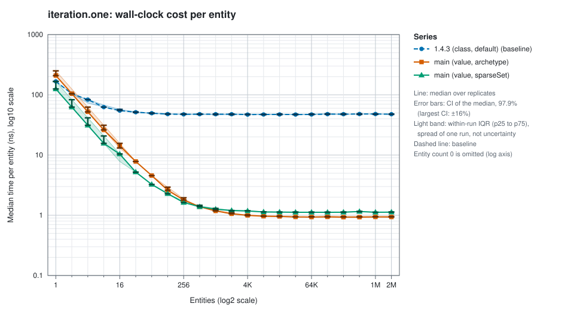

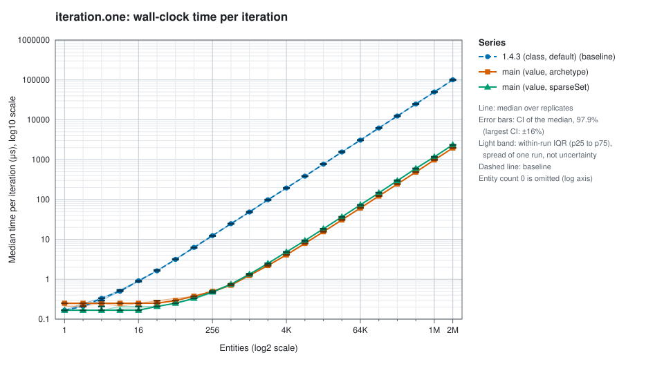

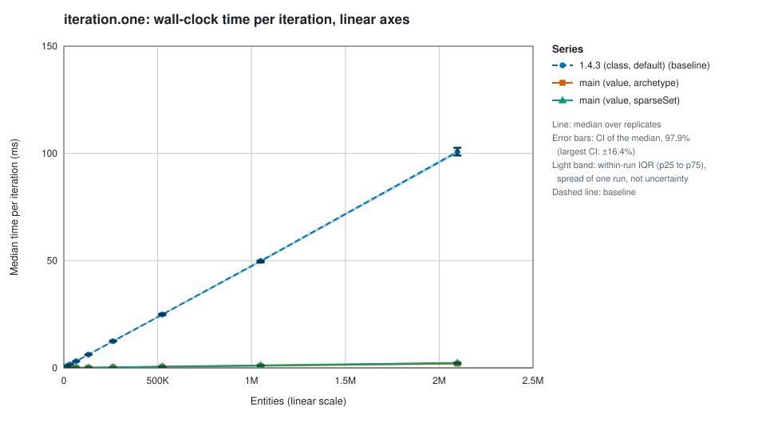

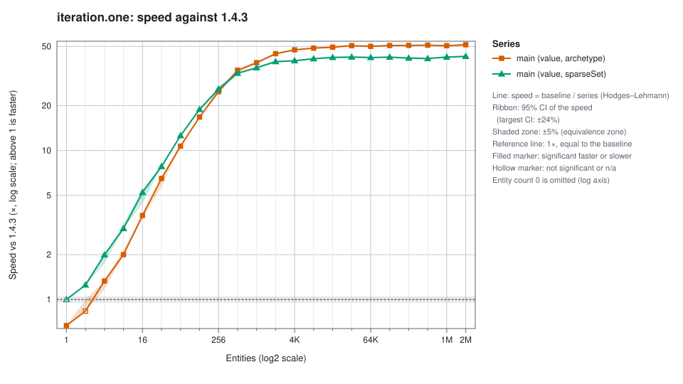

#### Time (wall clock): Entity counts up to 1,024

<table>
<thead>
<tr><th rowspan="3">Entities</th><th colspan="5">1.4.3 (class) - baseline</th><th colspan="22">main (value)</th></tr>
<tr><th colspan="5">default</th><th colspan="11">archetype</th><th colspan="11">sparseSet</th></tr>
<tr><th>median (μs)</th><th>CI low (μs)</th><th>CI high (μs)</th><th>replicates</th><th>iterations</th><th>median (ns)</th><th>CI low (ns)</th><th>CI high (ns)</th><th>replicates</th><th>iterations</th><th>speed (×)</th><th>CI low (×)</th><th>CI high (×)</th><th>change (%)</th><th>q</th><th>verdict</th><th>median (ns)</th><th>CI low (ns)</th><th>CI high (ns)</th><th>replicates</th><th>iterations</th><th>speed (×)</th><th>CI low (×)</th><th>CI high (×)</th><th>change (%)</th><th>q</th><th>verdict</th></tr>
</thead>
<tbody>
<tr><td align="right">0</td><td align="right">0.125</td><td align="right">0.0840</td><td align="right">0.125</td><td align="right">10</td><td align="right">126,159</td><td align="right">125</td><td align="right">84</td><td align="right">125</td><td align="right">10</td><td align="right">125,645</td><td align="right">1.00</td><td align="right">0.672</td><td align="right">1.00</td><td align="right">0</td><td align="right">0.486</td><td align="right">inconclusive</td><td align="right">125</td><td align="right">84</td><td align="right">125</td><td align="right">10</td><td align="right">127,165</td><td align="right">1.00</td><td align="right">0.672</td><td align="right">1.49</td><td align="right">0</td><td align="right">1.000</td><td align="right">inconclusive</td></tr>
<tr><td align="right">1</td><td align="right">0.167</td><td align="right">0.166</td><td align="right">0.167</td><td align="right">10</td><td align="right">126,497</td><td align="right">209</td><td align="right">208</td><td align="right">250</td><td align="right">10</td><td align="right">123,605</td><td align="right">0.799</td><td align="right">0.668</td><td align="right">0.803</td><td align="right">+25.1</td><td align="right">&lt;0.001</td><td align="right">slower</td><td align="right">125</td><td align="right">125</td><td align="right">166</td><td align="right">10</td><td align="right">123,225</td><td align="right">1.34</td><td align="right">1.01</td><td align="right">1.34</td><td align="right">-25.1</td><td align="right">&lt;0.001</td><td align="right">inconclusive</td></tr>
<tr><td align="right">2</td><td align="right">0.208</td><td align="right">0.208</td><td align="right">0.209</td><td align="right">10</td><td align="right">121,884</td><td align="right">209</td><td align="right">208</td><td align="right">209</td><td align="right">10</td><td align="right">121,696</td><td align="right">1.00</td><td align="right">0.995</td><td align="right">1.00</td><td align="right">0</td><td align="right">0.486</td><td align="right">equivalent</td><td align="right">125</td><td align="right">125</td><td align="right">166</td><td align="right">10</td><td align="right">125,597</td><td align="right">1.66</td><td align="right">1.25</td><td align="right">1.67</td><td align="right">-39.9</td><td align="right">&lt;0.001</td><td align="right">faster</td></tr>
<tr><td align="right">4</td><td align="right">0.333</td><td align="right">0.333</td><td align="right">0.333</td><td align="right">10</td><td align="right">119,704</td><td align="right">209</td><td align="right">208</td><td align="right">250</td><td align="right">10</td><td align="right">121,446</td><td align="right">1.59</td><td align="right">1.33</td><td align="right">1.60</td><td align="right">-37.2</td><td align="right">&lt;0.001</td><td align="right">faster</td><td align="right">125</td><td align="right">125</td><td align="right">166</td><td align="right">10</td><td align="right">122,641</td><td align="right">2.66</td><td align="right">2.01</td><td align="right">2.66</td><td align="right">-62.5</td><td align="right">&lt;0.001</td><td align="right">faster</td></tr>
<tr><td align="right">8</td><td align="right">0.500</td><td align="right">0.500</td><td align="right">0.500</td><td align="right">10</td><td align="right">113,742</td><td align="right">209</td><td align="right">209</td><td align="right">250</td><td align="right">10</td><td align="right">120,932</td><td align="right">2.39</td><td align="right">2.39</td><td align="right">2.39</td><td align="right">-58.2</td><td align="right">&lt;0.001</td><td align="right">faster</td><td align="right">125</td><td align="right">125</td><td align="right">166</td><td align="right">10</td><td align="right">123,326</td><td align="right">4.00</td><td align="right">3.01</td><td align="right">4.00</td><td align="right">-75.0</td><td align="right">&lt;0.001</td><td align="right">faster</td></tr>
<tr><td align="right">16</td><td align="right">0.875</td><td align="right">0.875</td><td align="right">0.916</td><td align="right">10</td><td align="right">106,603</td><td align="right">230</td><td align="right">209</td><td align="right">250</td><td align="right">10</td><td align="right">121,115</td><td align="right">3.92</td><td align="right">3.50</td><td align="right">4.19</td><td align="right">-74.5</td><td align="right">&lt;0.001</td><td align="right">faster</td><td align="right">166</td><td align="right">166</td><td align="right">167</td><td align="right">10</td><td align="right">123,031</td><td align="right">5.27</td><td align="right">5.24</td><td align="right">5.49</td><td align="right">-81.0</td><td align="right">&lt;0.001</td><td align="right">faster</td></tr>
<tr><td align="right">32</td><td align="right">1.65</td><td align="right">1.63</td><td align="right">1.67</td><td align="right">10</td><td align="right">89,123</td><td align="right">250</td><td align="right">250</td><td align="right">250</td><td align="right">10</td><td align="right">121,481</td><td align="right">6.66</td><td align="right">6.50</td><td align="right">6.67</td><td align="right">-85.0</td><td align="right">&lt;0.001</td><td align="right">faster</td><td align="right">167</td><td align="right">166</td><td align="right">167</td><td align="right">10</td><td align="right">126,342</td><td align="right">9.98</td><td align="right">9.73</td><td align="right">9.98</td><td align="right">-90.0</td><td align="right">&lt;0.001</td><td align="right">faster</td></tr>
<tr><td align="right">64</td><td align="right">3.17</td><td align="right">3.13</td><td align="right">3.21</td><td align="right">10</td><td align="right">70,093</td><td align="right">292</td><td align="right">291</td><td align="right">292</td><td align="right">10</td><td align="right">120,664</td><td align="right">10.8</td><td align="right">10.7</td><td align="right">11.0</td><td align="right">-90.8</td><td align="right">&lt;0.001</td><td align="right">faster</td><td align="right">208</td><td align="right">208</td><td align="right">208</td><td align="right">10</td><td align="right">124,216</td><td align="right">15.2</td><td align="right">15.0</td><td align="right">15.4</td><td align="right">-93.4</td><td align="right">&lt;0.001</td><td align="right">faster</td></tr>
<tr><td align="right">128</td><td align="right">6.13</td><td align="right">6.09</td><td align="right">6.21</td><td align="right">10</td><td align="right">49,396</td><td align="right">334</td><td align="right">333</td><td align="right">375</td><td align="right">10</td><td align="right">118,172</td><td align="right">18.3</td><td align="right">16.4</td><td align="right">18.4</td><td align="right">-94.5</td><td align="right">&lt;0.001</td><td align="right">faster</td><td align="right">292</td><td align="right">291</td><td align="right">292</td><td align="right">10</td><td align="right">118,237</td><td align="right">21.0</td><td align="right">20.8</td><td align="right">21.1</td><td align="right">-95.2</td><td align="right">&lt;0.001</td><td align="right">faster</td></tr>
<tr><td align="right">256</td><td align="right">12.1</td><td align="right">12.1</td><td align="right">12.4</td><td align="right">10</td><td align="right">30,581</td><td align="right">459</td><td align="right">458</td><td align="right">500</td><td align="right">10</td><td align="right">114,266</td><td align="right">26.4</td><td align="right">26.3</td><td align="right">26.9</td><td align="right">-96.2</td><td align="right">&lt;0.001</td><td align="right">faster</td><td align="right">417</td><td align="right">417</td><td align="right">417</td><td align="right">10</td><td align="right">117,891</td><td align="right">29.1</td><td align="right">29.0</td><td align="right">29.6</td><td align="right">-96.6</td><td align="right">&lt;0.001</td><td align="right">faster</td></tr>
<tr><td align="right">512</td><td align="right">24.4</td><td align="right">24.2</td><td align="right">24.7</td><td align="right">10</td><td align="right">17,442</td><td align="right">708</td><td align="right">708</td><td align="right">709</td><td align="right">10</td><td align="right">107,727</td><td align="right">34.5</td><td align="right">34.1</td><td align="right">34.8</td><td align="right">-97.1</td><td align="right">&lt;0.001</td><td align="right">faster</td><td align="right">709</td><td align="right">708</td><td align="right">750</td><td align="right">10</td><td align="right">107,044</td><td align="right">34.2</td><td align="right">33.9</td><td align="right">34.8</td><td align="right">-97.1</td><td align="right">&lt;0.001</td><td align="right">faster</td></tr>
<tr><td align="right">1,024</td><td align="right">48.8</td><td align="right">48.0</td><td align="right">49.3</td><td align="right">10</td><td align="right">9,449</td><td align="right">1,210</td><td align="right">1,210</td><td align="right">1,250</td><td align="right">10</td><td align="right">97,925</td><td align="right">39.7</td><td align="right">39.0</td><td align="right">40.5</td><td align="right">-97.5</td><td align="right">&lt;0.001</td><td align="right">faster</td><td align="right">1,290</td><td align="right">1,290</td><td align="right">1,330</td><td align="right">10</td><td align="right">95,457</td><td align="right">37.1</td><td align="right">37.0</td><td align="right">37.9</td><td align="right">-97.3</td><td align="right">&lt;0.001</td><td align="right">faster</td></tr>
</tbody>
</table>

#### Time (wall clock): Entity counts above 1,024

<table>
<thead>
<tr><th rowspan="3">Entities</th><th colspan="5">1.4.3 (class) - baseline</th><th colspan="22">main (value)</th></tr>
<tr><th colspan="5">default</th><th colspan="11">archetype</th><th colspan="11">sparseSet</th></tr>
<tr><th>median (ms)</th><th>CI low (ms)</th><th>CI high (ms)</th><th>replicates</th><th>iterations</th><th>median (μs)</th><th>CI low (μs)</th><th>CI high (μs)</th><th>replicates</th><th>iterations</th><th>speed (×)</th><th>CI low (×)</th><th>CI high (×)</th><th>change (%)</th><th>q</th><th>verdict</th><th>median (μs)</th><th>CI low (μs)</th><th>CI high (μs)</th><th>replicates</th><th>iterations</th><th>speed (×)</th><th>CI low (×)</th><th>CI high (×)</th><th>change (%)</th><th>q</th><th>verdict</th></tr>
</thead>
<tbody>
<tr><td align="right">2,048</td><td align="right">0.0975</td><td align="right">0.0958</td><td align="right">0.0986</td><td align="right">10</td><td align="right">4,868</td><td align="right">2.17</td><td align="right">2.17</td><td align="right">2.25</td><td align="right">10</td><td align="right">82,028</td><td align="right">44.4</td><td align="right">43.8</td><td align="right">45.4</td><td align="right">-97.7</td><td align="right">&lt;0.001</td><td align="right">faster</td><td align="right">2.46</td><td align="right">2.42</td><td align="right">2.46</td><td align="right">10</td><td align="right">79,253</td><td align="right">39.7</td><td align="right">39.0</td><td align="right">40.1</td><td align="right">-97.5</td><td align="right">&lt;0.001</td><td align="right">faster</td></tr>
<tr><td align="right">4,096</td><td align="right">0.192</td><td align="right">0.192</td><td align="right">0.195</td><td align="right">10</td><td align="right">2,508</td><td align="right">4.09</td><td align="right">4.04</td><td align="right">4.17</td><td align="right">10</td><td align="right">61,023</td><td align="right">47.1</td><td align="right">46.6</td><td align="right">47.7</td><td align="right">-97.9</td><td align="right">&lt;0.001</td><td align="right">faster</td><td align="right">4.84</td><td align="right">4.84</td><td align="right">4.88</td><td align="right">10</td><td align="right">55,629</td><td align="right">39.8</td><td align="right">39.6</td><td align="right">40.3</td><td align="right">-97.5</td><td align="right">&lt;0.001</td><td align="right">faster</td></tr>
<tr><td align="right">8,192</td><td align="right">0.386</td><td align="right">0.383</td><td align="right">0.390</td><td align="right">10</td><td align="right">1,262</td><td align="right">7.90</td><td align="right">7.88</td><td align="right">8.00</td><td align="right">10</td><td align="right">41,648</td><td align="right">48.6</td><td align="right">48.2</td><td align="right">49.3</td><td align="right">-97.9</td><td align="right">&lt;0.001</td><td align="right">faster</td><td align="right">9.30</td><td align="right">9.30</td><td align="right">9.34</td><td align="right">10</td><td align="right">37,104</td><td align="right">41.5</td><td align="right">41.2</td><td align="right">41.9</td><td align="right">-97.6</td><td align="right">&lt;0.001</td><td align="right">faster</td></tr>
<tr><td align="right">16,384</td><td align="right">0.774</td><td align="right">0.765</td><td align="right">0.788</td><td align="right">10</td><td align="right">636</td><td align="right">15.7</td><td align="right">15.5</td><td align="right">16.0</td><td align="right">10</td><td align="right">24,881</td><td align="right">49.4</td><td align="right">48.7</td><td align="right">50.1</td><td align="right">-98.0</td><td align="right">&lt;0.001</td><td align="right">faster</td><td align="right">18.5</td><td align="right">18.4</td><td align="right">18.6</td><td align="right">10</td><td align="right">21,860</td><td align="right">41.7</td><td align="right">41.4</td><td align="right">42.5</td><td align="right">-97.6</td><td align="right">&lt;0.001</td><td align="right">faster</td></tr>
<tr><td align="right">32,768</td><td align="right">1.54</td><td align="right">1.53</td><td align="right">1.56</td><td align="right">10</td><td align="right">321</td><td align="right">30.8</td><td align="right">30.8</td><td align="right">30.9</td><td align="right">10</td><td align="right">14,166</td><td align="right">49.9</td><td align="right">49.8</td><td align="right">50.7</td><td align="right">-98.0</td><td align="right">&lt;0.001</td><td align="right">faster</td><td align="right">36.8</td><td align="right">36.7</td><td align="right">37.2</td><td align="right">10</td><td align="right">12,138</td><td align="right">41.8</td><td align="right">41.6</td><td align="right">42.4</td><td align="right">-97.6</td><td align="right">&lt;0.001</td><td align="right">faster</td></tr>
<tr><td align="right">65,536</td><td align="right">3.09</td><td align="right">3.07</td><td align="right">3.15</td><td align="right">10</td><td align="right">160</td><td align="right">61.2</td><td align="right">61.2</td><td align="right">62.3</td><td align="right">10</td><td align="right">7,550</td><td align="right">50.2</td><td align="right">50.1</td><td align="right">50.8</td><td align="right">-98.0</td><td align="right">&lt;0.001</td><td align="right">faster</td><td align="right">73.4</td><td align="right">73.3</td><td align="right">74.2</td><td align="right">10</td><td align="right">6,370</td><td align="right">41.9</td><td align="right">41.8</td><td align="right">42.5</td><td align="right">-97.6</td><td align="right">&lt;0.001</td><td align="right">faster</td></tr>
<tr><td align="right">131,072</td><td align="right">6.26</td><td align="right">6.20</td><td align="right">6.36</td><td align="right">10</td><td align="right">79</td><td align="right">123</td><td align="right">122</td><td align="right">126</td><td align="right">10</td><td align="right">3,865</td><td align="right">50.9</td><td align="right">50.2</td><td align="right">51.4</td><td align="right">-98.0</td><td align="right">&lt;0.001</td><td align="right">faster</td><td align="right">147</td><td align="right">147</td><td align="right">148</td><td align="right">10</td><td align="right">3,294</td><td align="right">42.6</td><td align="right">42.2</td><td align="right">43.2</td><td align="right">-97.7</td><td align="right">&lt;0.001</td><td align="right">faster</td></tr>
<tr><td align="right">262,144</td><td align="right">12.5</td><td align="right">12.3</td><td align="right">12.7</td><td align="right">10</td><td align="right">40</td><td align="right">244</td><td align="right">244</td><td align="right">249</td><td align="right">10</td><td align="right">1,987</td><td align="right">51.2</td><td align="right">50.3</td><td align="right">51.3</td><td align="right">-98.0</td><td align="right">&lt;0.001</td><td align="right">faster</td><td align="right">295</td><td align="right">293</td><td align="right">297</td><td align="right">10</td><td align="right">1,658</td><td align="right">42.5</td><td align="right">42.0</td><td align="right">42.7</td><td align="right">-97.6</td><td align="right">&lt;0.001</td><td align="right">faster</td></tr>
<tr><td align="right">524,288</td><td align="right">25.2</td><td align="right">24.7</td><td align="right">25.4</td><td align="right">10</td><td align="right">20</td><td align="right">488</td><td align="right">488</td><td align="right">497</td><td align="right">10</td><td align="right">998</td><td align="right">51.2</td><td align="right">50.6</td><td align="right">51.9</td><td align="right">-98.0</td><td align="right">&lt;0.001</td><td align="right">faster</td><td align="right">605</td><td align="right">600</td><td align="right">609</td><td align="right">10</td><td align="right">813</td><td align="right">41.6</td><td align="right">41.1</td><td align="right">42.0</td><td align="right">-97.6</td><td align="right">&lt;0.001</td><td align="right">faster</td></tr>
<tr><td align="right">1,048,576</td><td align="right">50.3</td><td align="right">49.5</td><td align="right">50.7</td><td align="right">10</td><td align="right">10</td><td align="right">984</td><td align="right">982</td><td align="right">998</td><td align="right">10</td><td align="right">497</td><td align="right">50.9</td><td align="right">50.3</td><td align="right">51.3</td><td align="right">-98.0</td><td align="right">&lt;0.001</td><td align="right">faster</td><td align="right">1,180</td><td align="right">1,180</td><td align="right">1,180</td><td align="right">10</td><td align="right">419</td><td align="right">42.7</td><td align="right">42.3</td><td align="right">43.0</td><td align="right">-97.7</td><td align="right">&lt;0.001</td><td align="right">faster</td></tr>
<tr><td align="right">2,097,152</td><td align="right">99.9</td><td align="right">99.0</td><td align="right">101</td><td align="right">10</td><td align="right">5</td><td align="right">1,970</td><td align="right">1,960</td><td align="right">2,000</td><td align="right">10</td><td align="right">250</td><td align="right">50.8</td><td align="right">50.3</td><td align="right">51.1</td><td align="right">-98.0</td><td align="right">&lt;0.001</td><td align="right">faster</td><td align="right">2,360</td><td align="right">2,360</td><td align="right">2,380</td><td align="right">10</td><td align="right">209</td><td align="right">42.2</td><td align="right">41.8</td><td align="right">42.5</td><td align="right">-97.6</td><td align="right">&lt;0.001</td><td align="right">faster</td></tr>
</tbody>
</table>

### `iteration.two`

[All metrics, means, percentiles and the linear plot](workloads/iteration.two.md)

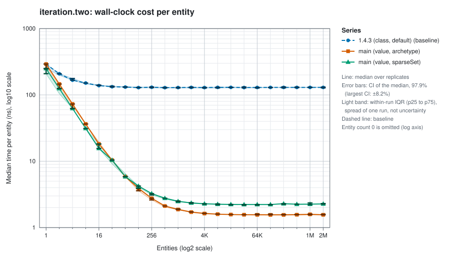

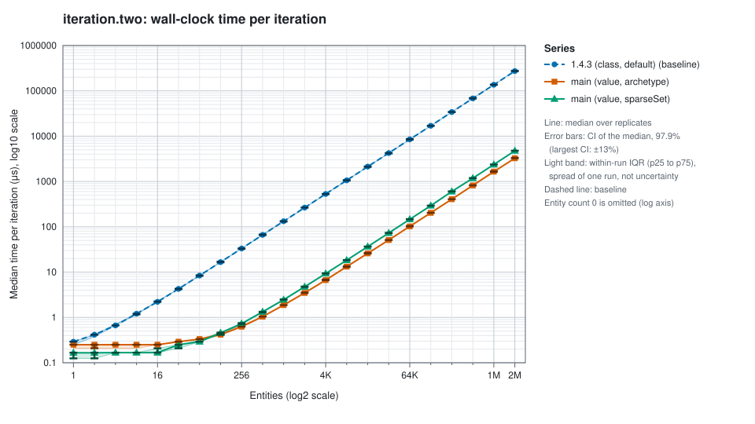

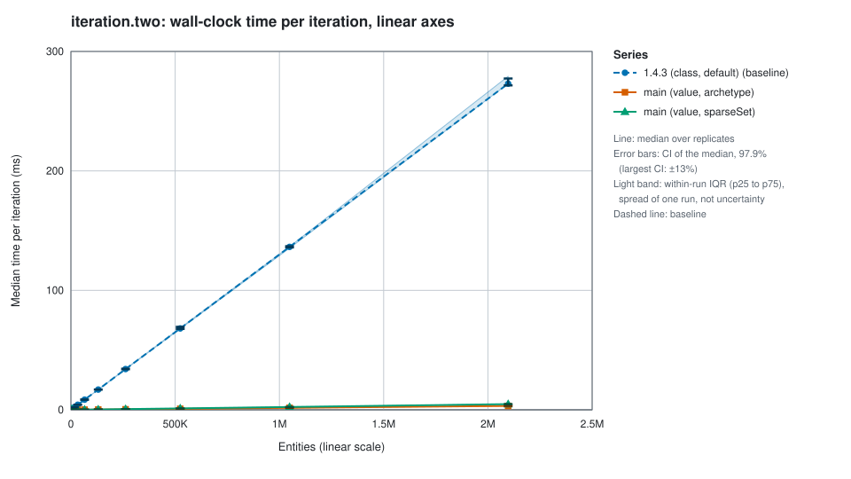

#### Time (wall clock): Entity counts up to 1,024

<table>
<thead>
<tr><th rowspan="3">Entities</th><th colspan="5">1.4.3 (class) - baseline</th><th colspan="22">main (value)</th></tr>
<tr><th colspan="5">default</th><th colspan="11">archetype</th><th colspan="11">sparseSet</th></tr>
<tr><th>median (μs)</th><th>CI low (μs)</th><th>CI high (μs)</th><th>replicates</th><th>iterations</th><th>median (ns)</th><th>CI low (ns)</th><th>CI high (ns)</th><th>replicates</th><th>iterations</th><th>speed (×)</th><th>CI low (×)</th><th>CI high (×)</th><th>change (%)</th><th>q</th><th>verdict</th><th>median (ns)</th><th>CI low (ns)</th><th>CI high (ns)</th><th>replicates</th><th>iterations</th><th>speed (×)</th><th>CI low (×)</th><th>CI high (×)</th><th>change (%)</th><th>q</th><th>verdict</th></tr>
</thead>
<tbody>
<tr><td align="right">0</td><td align="right">0.125</td><td align="right">0.125</td><td align="right">0.125</td><td align="right">10</td><td align="right">123,487</td><td align="right">125</td><td align="right">125</td><td align="right">125</td><td align="right">10</td><td align="right">126,263</td><td align="right">1.00</td><td align="right">1.00</td><td align="right">1.00</td><td align="right">0</td><td align="right">1.000</td><td align="right">equivalent</td><td align="right">125</td><td align="right">125</td><td align="right">125</td><td align="right">10</td><td align="right">124,353</td><td align="right">1.00</td><td align="right">1.00</td><td align="right">1.00</td><td align="right">0</td><td align="right">1.000</td><td align="right">equivalent</td></tr>
<tr><td align="right">1</td><td align="right">0.291</td><td align="right">0.291</td><td align="right">0.292</td><td align="right">10</td><td align="right">120,951</td><td align="right">250</td><td align="right">250</td><td align="right">250</td><td align="right">10</td><td align="right">119,777</td><td align="right">1.16</td><td align="right">1.16</td><td align="right">1.17</td><td align="right">-14.1</td><td align="right">&lt;0.001</td><td align="right">faster</td><td align="right">166</td><td align="right">125</td><td align="right">167</td><td align="right">10</td><td align="right">125,142</td><td align="right">1.75</td><td align="right">1.74</td><td align="right">1.76</td><td align="right">-43.0</td><td align="right">&lt;0.001</td><td align="right">faster</td></tr>
<tr><td align="right">2</td><td align="right">0.416</td><td align="right">0.416</td><td align="right">0.417</td><td align="right">10</td><td align="right">116,892</td><td align="right">250</td><td align="right">209</td><td align="right">250</td><td align="right">10</td><td align="right">123,665</td><td align="right">1.67</td><td align="right">1.66</td><td align="right">1.67</td><td align="right">-40.0</td><td align="right">&lt;0.001</td><td align="right">faster</td><td align="right">166</td><td align="right">125</td><td align="right">167</td><td align="right">10</td><td align="right">123,787</td><td align="right">2.51</td><td align="right">2.50</td><td align="right">2.51</td><td align="right">-60.1</td><td align="right">&lt;0.001</td><td align="right">faster</td></tr>
<tr><td align="right">4</td><td align="right">0.667</td><td align="right">0.667</td><td align="right">0.667</td><td align="right">10</td><td align="right">109,312</td><td align="right">250</td><td align="right">250</td><td align="right">250</td><td align="right">10</td><td align="right">121,808</td><td align="right">2.67</td><td align="right">2.67</td><td align="right">2.67</td><td align="right">-62.5</td><td align="right">&lt;0.001</td><td align="right">faster</td><td align="right">167</td><td align="right">166</td><td align="right">167</td><td align="right">10</td><td align="right">123,844</td><td align="right">3.99</td><td align="right">3.99</td><td align="right">4.02</td><td align="right">-75.0</td><td align="right">&lt;0.001</td><td align="right">faster</td></tr>
<tr><td align="right">8</td><td align="right">1.21</td><td align="right">1.17</td><td align="right">1.21</td><td align="right">10</td><td align="right">98,814</td><td align="right">250</td><td align="right">250</td><td align="right">250</td><td align="right">10</td><td align="right">120,629</td><td align="right">4.83</td><td align="right">4.67</td><td align="right">4.83</td><td align="right">-79.3</td><td align="right">&lt;0.001</td><td align="right">faster</td><td align="right">167</td><td align="right">167</td><td align="right">167</td><td align="right">10</td><td align="right">127,182</td><td align="right">7.23</td><td align="right">6.99</td><td align="right">7.23</td><td align="right">-86.2</td><td align="right">&lt;0.001</td><td align="right">faster</td></tr>
<tr><td align="right">16</td><td align="right">2.21</td><td align="right">2.21</td><td align="right">2.25</td><td align="right">10</td><td align="right">78,280</td><td align="right">250</td><td align="right">250</td><td align="right">250</td><td align="right">10</td><td align="right">121,634</td><td align="right">8.84</td><td align="right">8.84</td><td align="right">9.00</td><td align="right">-88.7</td><td align="right">&lt;0.001</td><td align="right">faster</td><td align="right">167</td><td align="right">167</td><td align="right">208</td><td align="right">10</td><td align="right">121,825</td><td align="right">13.2</td><td align="right">13.2</td><td align="right">13.5</td><td align="right">-92.4</td><td align="right">&lt;0.001</td><td align="right">faster</td></tr>
<tr><td align="right">32</td><td align="right">4.27</td><td align="right">4.21</td><td align="right">4.30</td><td align="right">10</td><td align="right">59,855</td><td align="right">292</td><td align="right">292</td><td align="right">292</td><td align="right">10</td><td align="right">119,880</td><td align="right">14.7</td><td align="right">14.4</td><td align="right">14.7</td><td align="right">-93.2</td><td align="right">&lt;0.001</td><td align="right">faster</td><td align="right">250</td><td align="right">208</td><td align="right">250</td><td align="right">10</td><td align="right">124,585</td><td align="right">17.2</td><td align="right">16.8</td><td align="right">20.3</td><td align="right">-94.2</td><td align="right">&lt;0.001</td><td align="right">faster</td></tr>
<tr><td align="right">64</td><td align="right">8.40</td><td align="right">8.30</td><td align="right">8.46</td><td align="right">10</td><td align="right">40,229</td><td align="right">333</td><td align="right">333</td><td align="right">334</td><td align="right">10</td><td align="right">117,056</td><td align="right">25.2</td><td align="right">25.0</td><td align="right">25.3</td><td align="right">-96.0</td><td align="right">&lt;0.001</td><td align="right">faster</td><td align="right">292</td><td align="right">292</td><td align="right">292</td><td align="right">10</td><td align="right">119,819</td><td align="right">28.8</td><td align="right">28.5</td><td align="right">28.8</td><td align="right">-96.5</td><td align="right">&lt;0.001</td><td align="right">faster</td></tr>
<tr><td align="right">128</td><td align="right">16.6</td><td align="right">16.5</td><td align="right">17.0</td><td align="right">10</td><td align="right">23,858</td><td align="right">417</td><td align="right">417</td><td align="right">458</td><td align="right">10</td><td align="right">117,076</td><td align="right">39.7</td><td align="right">39.4</td><td align="right">40.6</td><td align="right">-97.5</td><td align="right">&lt;0.001</td><td align="right">faster</td><td align="right">458</td><td align="right">417</td><td align="right">458</td><td align="right">10</td><td align="right">112,987</td><td align="right">36.7</td><td align="right">36.1</td><td align="right">37.1</td><td align="right">-97.3</td><td align="right">&lt;0.001</td><td align="right">faster</td></tr>
<tr><td align="right">256</td><td align="right">33.2</td><td align="right">32.7</td><td align="right">33.4</td><td align="right">10</td><td align="right">13,310</td><td align="right">625</td><td align="right">625</td><td align="right">625</td><td align="right">10</td><td align="right">108,445</td><td align="right">53.1</td><td align="right">52.4</td><td align="right">53.3</td><td align="right">-98.1</td><td align="right">&lt;0.001</td><td align="right">faster</td><td align="right">730</td><td align="right">709</td><td align="right">750</td><td align="right">10</td><td align="right">109,361</td><td align="right">45.4</td><td align="right">44.3</td><td align="right">46.9</td><td align="right">-97.8</td><td align="right">&lt;0.001</td><td align="right">faster</td></tr>
<tr><td align="right">512</td><td align="right">66.4</td><td align="right">65.8</td><td align="right">67.5</td><td align="right">10</td><td align="right">7,040</td><td align="right">1,040</td><td align="right">1,040</td><td align="right">1,040</td><td align="right">10</td><td align="right">101,084</td><td align="right">63.7</td><td align="right">63.3</td><td align="right">63.8</td><td align="right">-98.4</td><td align="right">&lt;0.001</td><td align="right">faster</td><td align="right">1,330</td><td align="right">1,290</td><td align="right">1,330</td><td align="right">10</td><td align="right">95,302</td><td align="right">49.8</td><td align="right">49.4</td><td align="right">50.7</td><td align="right">-98.0</td><td align="right">&lt;0.001</td><td align="right">faster</td></tr>
<tr><td align="right">1,024</td><td align="right">133</td><td align="right">130</td><td align="right">133</td><td align="right">10</td><td align="right">3,638</td><td align="right">1,880</td><td align="right">1,880</td><td align="right">1,880</td><td align="right">10</td><td align="right">86,333</td><td align="right">70.7</td><td align="right">69.6</td><td align="right">70.8</td><td align="right">-98.6</td><td align="right">&lt;0.001</td><td align="right">faster</td><td align="right">2,460</td><td align="right">2,460</td><td align="right">2,500</td><td align="right">10</td><td align="right">78,450</td><td align="right">53.9</td><td align="right">53.0</td><td align="right">54.0</td><td align="right">-98.1</td><td align="right">&lt;0.001</td><td align="right">faster</td></tr>
</tbody>
</table>

#### Time (wall clock): Entity counts above 1,024

<table>
<thead>
<tr><th rowspan="3">Entities</th><th colspan="5">1.4.3 (class) - baseline</th><th colspan="22">main (value)</th></tr>
<tr><th colspan="5">default</th><th colspan="11">archetype</th><th colspan="11">sparseSet</th></tr>
<tr><th>median (ms)</th><th>CI low (ms)</th><th>CI high (ms)</th><th>replicates</th><th>iterations</th><th>median (μs)</th><th>CI low (μs)</th><th>CI high (μs)</th><th>replicates</th><th>iterations</th><th>speed (×)</th><th>CI low (×)</th><th>CI high (×)</th><th>change (%)</th><th>q</th><th>verdict</th><th>median (μs)</th><th>CI low (μs)</th><th>CI high (μs)</th><th>replicates</th><th>iterations</th><th>speed (×)</th><th>CI low (×)</th><th>CI high (×)</th><th>change (%)</th><th>q</th><th>verdict</th></tr>
</thead>
<tbody>
<tr><td align="right">2,048</td><td align="right">0.265</td><td align="right">0.265</td><td align="right">0.267</td><td align="right">10</td><td align="right">1,848</td><td align="right">3.48</td><td align="right">3.46</td><td align="right">3.54</td><td align="right">10</td><td align="right">65,402</td><td align="right">76.6</td><td align="right">75.1</td><td align="right">77.0</td><td align="right">-98.7</td><td align="right">&lt;0.001</td><td align="right">faster</td><td align="right">4.75</td><td align="right">4.71</td><td align="right">4.80</td><td align="right">10</td><td align="right">56,885</td><td align="right">55.8</td><td align="right">55.8</td><td align="right">56.3</td><td align="right">-98.2</td><td align="right">&lt;0.001</td><td align="right">faster</td></tr>
<tr><td align="right">4,096</td><td align="right">0.530</td><td align="right">0.526</td><td align="right">0.531</td><td align="right">10</td><td align="right">932</td><td align="right">6.67</td><td align="right">6.63</td><td align="right">6.84</td><td align="right">10</td><td align="right">46,148</td><td align="right">79.4</td><td align="right">78.0</td><td align="right">80.0</td><td align="right">-98.7</td><td align="right">&lt;0.001</td><td align="right">faster</td><td align="right">9.30</td><td align="right">9.30</td><td align="right">9.38</td><td align="right">10</td><td align="right">36,778</td><td align="right">57.0</td><td align="right">56.6</td><td align="right">57.1</td><td align="right">-98.2</td><td align="right">&lt;0.001</td><td align="right">faster</td></tr>
<tr><td align="right">8,192</td><td align="right">1.06</td><td align="right">1.05</td><td align="right">1.07</td><td align="right">10</td><td align="right">467</td><td align="right">13.2</td><td align="right">13.0</td><td align="right">13.4</td><td align="right">10</td><td align="right">28,421</td><td align="right">80.4</td><td align="right">79.4</td><td align="right">81.4</td><td align="right">-98.8</td><td align="right">&lt;0.001</td><td align="right">faster</td><td align="right">18.3</td><td align="right">18.3</td><td align="right">18.4</td><td align="right">10</td><td align="right">21,993</td><td align="right">57.7</td><td align="right">57.3</td><td align="right">58.1</td><td align="right">-98.3</td><td align="right">&lt;0.001</td><td align="right">faster</td></tr>
<tr><td align="right">16,384</td><td align="right">2.13</td><td align="right">2.10</td><td align="right">2.14</td><td align="right">10</td><td align="right">234</td><td align="right">25.9</td><td align="right">25.7</td><td align="right">26.5</td><td align="right">10</td><td align="right">16,427</td><td align="right">81.6</td><td align="right">80.5</td><td align="right">82.8</td><td align="right">-98.8</td><td align="right">&lt;0.001</td><td align="right">faster</td><td align="right">36.5</td><td align="right">36.5</td><td align="right">36.6</td><td align="right">10</td><td align="right">12,187</td><td align="right">58.3</td><td align="right">57.6</td><td align="right">58.5</td><td align="right">-98.3</td><td align="right">&lt;0.001</td><td align="right">faster</td></tr>
<tr><td align="right">32,768</td><td align="right">4.24</td><td align="right">4.17</td><td align="right">4.25</td><td align="right">10</td><td align="right">118</td><td align="right">51.1</td><td align="right">51.1</td><td align="right">51.2</td><td align="right">10</td><td align="right">8,953</td><td align="right">82.7</td><td align="right">81.7</td><td align="right">83.0</td><td align="right">-98.8</td><td align="right">&lt;0.001</td><td align="right">faster</td><td align="right">72.9</td><td align="right">72.9</td><td align="right">73.7</td><td align="right">10</td><td align="right">6,408</td><td align="right">57.9</td><td align="right">57.3</td><td align="right">58.2</td><td align="right">-98.3</td><td align="right">&lt;0.001</td><td align="right">faster</td></tr>
<tr><td align="right">65,536</td><td align="right">8.50</td><td align="right">8.37</td><td align="right">8.66</td><td align="right">10</td><td align="right">59</td><td align="right">102</td><td align="right">102</td><td align="right">104</td><td align="right">10</td><td align="right">4,642</td><td align="right">83.3</td><td align="right">82.1</td><td align="right">83.7</td><td align="right">-98.8</td><td align="right">&lt;0.001</td><td align="right">faster</td><td align="right">146</td><td align="right">146</td><td align="right">148</td><td align="right">10</td><td align="right">3,280</td><td align="right">58.1</td><td align="right">57.5</td><td align="right">58.6</td><td align="right">-98.3</td><td align="right">&lt;0.001</td><td align="right">faster</td></tr>
<tr><td align="right">131,072</td><td align="right">16.9</td><td align="right">16.9</td><td align="right">17.0</td><td align="right">10</td><td align="right">30</td><td align="right">204</td><td align="right">203</td><td align="right">204</td><td align="right">10</td><td align="right">2,376</td><td align="right">83.2</td><td align="right">82.8</td><td align="right">83.5</td><td align="right">-98.8</td><td align="right">&lt;0.001</td><td align="right">faster</td><td align="right">293</td><td align="right">292</td><td align="right">294</td><td align="right">10</td><td align="right">1,672</td><td align="right">57.9</td><td align="right">57.6</td><td align="right">58.2</td><td align="right">-98.3</td><td align="right">&lt;0.001</td><td align="right">faster</td></tr>
<tr><td align="right">262,144</td><td align="right">34.1</td><td align="right">33.9</td><td align="right">34.4</td><td align="right">10</td><td align="right">15</td><td align="right">407</td><td align="right">407</td><td align="right">408</td><td align="right">10</td><td align="right">1,201</td><td align="right">83.7</td><td align="right">83.5</td><td align="right">84.3</td><td align="right">-98.8</td><td align="right">&lt;0.001</td><td align="right">faster</td><td align="right">602</td><td align="right">599</td><td align="right">607</td><td align="right">10</td><td align="right">818</td><td align="right">56.7</td><td align="right">56.4</td><td align="right">57.1</td><td align="right">-98.2</td><td align="right">&lt;0.001</td><td align="right">faster</td></tr>
<tr><td align="right">524,288</td><td align="right">68.1</td><td align="right">67.7</td><td align="right">69.5</td><td align="right">10</td><td align="right">8</td><td align="right">819</td><td align="right">818</td><td align="right">827</td><td align="right">10</td><td align="right">601</td><td align="right">83.1</td><td align="right">82.7</td><td align="right">84.0</td><td align="right">-98.8</td><td align="right">&lt;0.001</td><td align="right">faster</td><td align="right">1,180</td><td align="right">1,180</td><td align="right">1,190</td><td align="right">10</td><td align="right">418</td><td align="right">57.7</td><td align="right">57.3</td><td align="right">58.3</td><td align="right">-98.3</td><td align="right">&lt;0.001</td><td align="right">faster</td></tr>
<tr><td align="right">1,048,576</td><td align="right">136</td><td align="right">136</td><td align="right">137</td><td align="right">10</td><td align="right">4</td><td align="right">1,650</td><td align="right">1,630</td><td align="right">1,680</td><td align="right">10</td><td align="right">298</td><td align="right">82.6</td><td align="right">81.3</td><td align="right">83.4</td><td align="right">-98.8</td><td align="right">&lt;0.001</td><td align="right">faster</td><td align="right">2,370</td><td align="right">2,370</td><td align="right">2,370</td><td align="right">10</td><td align="right">210</td><td align="right">57.6</td><td align="right">57.4</td><td align="right">57.8</td><td align="right">-98.3</td><td align="right">&lt;0.001</td><td align="right">faster</td></tr>
<tr><td align="right">2,097,152</td><td align="right">273</td><td align="right">272</td><td align="right">277</td><td align="right">10</td><td align="right">2</td><td align="right">3,260</td><td align="right">3,260</td><td align="right">3,320</td><td align="right">10</td><td align="right">153</td><td align="right">83.6</td><td align="right">82.4</td><td align="right">84.5</td><td align="right">-98.8</td><td align="right">&lt;0.001</td><td align="right">faster</td><td align="right">4,760</td><td align="right">4,760</td><td align="right">4,770</td><td align="right">10</td><td align="right">104</td><td align="right">57.3</td><td align="right">57.1</td><td align="right">57.9</td><td align="right">-98.3</td><td align="right">&lt;0.001</td><td align="right">faster</td></tr>
</tbody>
</table>

### `system.update.basic.mixed`

[All metrics, means, percentiles and the linear plot](workloads/system.update.basic.mixed.md)

#### Time (wall clock): Entity counts up to 1,024

<table>
<thead>
<tr><th rowspan="3">Entities</th><th colspan="5">1.4.3 (class) - baseline</th><th colspan="22">main (value)</th></tr>
<tr><th colspan="5">default</th><th colspan="11">archetype</th><th colspan="11">sparseSet</th></tr>
<tr><th>median (μs)</th><th>CI low (μs)</th><th>CI high (μs)</th><th>replicates</th><th>iterations</th><th>median (ns)</th><th>CI low (ns)</th><th>CI high (ns)</th><th>replicates</th><th>iterations</th><th>speed (×)</th><th>CI low (×)</th><th>CI high (×)</th><th>change (%)</th><th>q</th><th>verdict</th><th>median (ns)</th><th>CI low (ns)</th><th>CI high (ns)</th><th>replicates</th><th>iterations</th><th>speed (×)</th><th>CI low (×)</th><th>CI high (×)</th><th>change (%)</th><th>q</th><th>verdict</th></tr>
</thead>
<tbody>
<tr><td align="right">0</td><td align="right">0.208</td><td align="right">0.167</td><td align="right">0.208</td><td align="right">10</td><td align="right">123,531</td><td align="right">208</td><td align="right">167</td><td align="right">208</td><td align="right">10</td><td align="right">123,637</td><td align="right">1.00</td><td align="right">0.803</td><td align="right">1.25</td><td align="right">0</td><td align="right">1.000</td><td align="right">inconclusive</td><td align="right">208</td><td align="right">167</td><td align="right">208</td><td align="right">10</td><td align="right">120,904</td><td align="right">1.00</td><td align="right">0.803</td><td align="right">1.00</td><td align="right">0</td><td align="right">1.000</td><td align="right">inconclusive</td></tr>
<tr><td align="right">1</td><td align="right">0.208</td><td align="right">0.167</td><td align="right">0.208</td><td align="right">10</td><td align="right">124,562</td><td align="right">188</td><td align="right">167</td><td align="right">208</td><td align="right">10</td><td align="right">125,446</td><td align="right">1.00</td><td align="right">1.00</td><td align="right">1.25</td><td align="right">0</td><td align="right">1.000</td><td align="right">inconclusive</td><td align="right">208</td><td align="right">167</td><td align="right">208</td><td align="right">10</td><td align="right">123,913</td><td align="right">1.00</td><td align="right">0.803</td><td align="right">1.25</td><td align="right">0</td><td align="right">1.000</td><td align="right">inconclusive</td></tr>
<tr><td align="right">2</td><td align="right">0.375</td><td align="right">0.334</td><td align="right">0.375</td><td align="right">10</td><td align="right">119,018</td><td align="right">500</td><td align="right">500</td><td align="right">500</td><td align="right">10</td><td align="right">114,309</td><td align="right">0.750</td><td align="right">0.750</td><td align="right">0.750</td><td align="right">+33.3</td><td align="right">&lt;0.001</td><td align="right">slower</td><td align="right">417</td><td align="right">417</td><td align="right">417</td><td align="right">10</td><td align="right">116,876</td><td align="right">0.899</td><td align="right">0.899</td><td align="right">0.899</td><td align="right">+11.2</td><td align="right">&lt;0.001</td><td align="right">slower</td></tr>
<tr><td align="right">4</td><td align="right">0.709</td><td align="right">0.708</td><td align="right">0.750</td><td align="right">10</td><td align="right">109,017</td><td align="right">500</td><td align="right">500</td><td align="right">541</td><td align="right">10</td><td align="right">112,826</td><td align="right">1.42</td><td align="right">1.42</td><td align="right">1.50</td><td align="right">-29.4</td><td align="right">&lt;0.001</td><td align="right">faster</td><td align="right">417</td><td align="right">417</td><td align="right">458</td><td align="right">10</td><td align="right">115,864</td><td align="right">1.70</td><td align="right">1.70</td><td align="right">1.80</td><td align="right">-41.1</td><td align="right">&lt;0.001</td><td align="right">faster</td></tr>
<tr><td align="right">8</td><td align="right">1.29</td><td align="right">1.29</td><td align="right">1.29</td><td align="right">10</td><td align="right">96,133</td><td align="right">541</td><td align="right">500</td><td align="right">542</td><td align="right">10</td><td align="right">111,866</td><td align="right">2.39</td><td align="right">2.38</td><td align="right">2.39</td><td align="right">-58.1</td><td align="right">&lt;0.001</td><td align="right">faster</td><td align="right">458</td><td align="right">458</td><td align="right">459</td><td align="right">10</td><td align="right">112,919</td><td align="right">2.82</td><td align="right">2.81</td><td align="right">2.82</td><td align="right">-64.5</td><td align="right">&lt;0.001</td><td align="right">faster</td></tr>
<tr><td align="right">16</td><td align="right">2.29</td><td align="right">2.25</td><td align="right">2.33</td><td align="right">10</td><td align="right">79,082</td><td align="right">542</td><td align="right">541</td><td align="right">583</td><td align="right">10</td><td align="right">112,444</td><td align="right">4.23</td><td align="right">4.15</td><td align="right">4.24</td><td align="right">-76.4</td><td align="right">&lt;0.001</td><td align="right">faster</td><td align="right">500</td><td align="right">500</td><td align="right">500</td><td align="right">10</td><td align="right">114,385</td><td align="right">4.59</td><td align="right">4.58</td><td align="right">4.67</td><td align="right">-78.2</td><td align="right">&lt;0.001</td><td align="right">faster</td></tr>
<tr><td align="right">32</td><td align="right">4.58</td><td align="right">4.50</td><td align="right">4.58</td><td align="right">10</td><td align="right">58,406</td><td align="right">583</td><td align="right">583</td><td align="right">584</td><td align="right">10</td><td align="right">112,769</td><td align="right">7.86</td><td align="right">7.79</td><td align="right">7.86</td><td align="right">-87.3</td><td align="right">&lt;0.001</td><td align="right">faster</td><td align="right">542</td><td align="right">542</td><td align="right">583</td><td align="right">10</td><td align="right">115,357</td><td align="right">8.46</td><td align="right">8.31</td><td align="right">8.46</td><td align="right">-88.2</td><td align="right">&lt;0.001</td><td align="right">faster</td></tr>
<tr><td align="right">64</td><td align="right">8.88</td><td align="right">8.79</td><td align="right">8.92</td><td align="right">10</td><td align="right">38,276</td><td align="right">667</td><td align="right">666</td><td align="right">667</td><td align="right">10</td><td align="right">110,008</td><td align="right">13.3</td><td align="right">13.2</td><td align="right">13.4</td><td align="right">-92.5</td><td align="right">&lt;0.001</td><td align="right">faster</td><td align="right">667</td><td align="right">667</td><td align="right">708</td><td align="right">10</td><td align="right">111,928</td><td align="right">13.3</td><td align="right">13.0</td><td align="right">13.4</td><td align="right">-92.5</td><td align="right">&lt;0.001</td><td align="right">faster</td></tr>
<tr><td align="right">128</td><td align="right">21.6</td><td align="right">21.5</td><td align="right">21.7</td><td align="right">10</td><td align="right">19,241</td><td align="right">833</td><td align="right">792</td><td align="right">834</td><td align="right">10</td><td align="right">106,298</td><td align="right">26.0</td><td align="right">25.9</td><td align="right">27.3</td><td align="right">-96.2</td><td align="right">&lt;0.001</td><td align="right">faster</td><td align="right">1,000</td><td align="right">1,000</td><td align="right">1,000</td><td align="right">10</td><td align="right">102,214</td><td align="right">21.6</td><td align="right">21.5</td><td align="right">21.7</td><td align="right">-95.4</td><td align="right">&lt;0.001</td><td align="right">faster</td></tr>
<tr><td align="right">256</td><td align="right">42.8</td><td align="right">42.6</td><td align="right">43.0</td><td align="right">10</td><td align="right">10,574</td><td align="right">1,130</td><td align="right">1,080</td><td align="right">1,130</td><td align="right">10</td><td align="right">100,422</td><td align="right">38.2</td><td align="right">37.9</td><td align="right">38.8</td><td align="right">-97.4</td><td align="right">&lt;0.001</td><td align="right">faster</td><td align="right">1,540</td><td align="right">1,500</td><td align="right">1,540</td><td align="right">10</td><td align="right">89,356</td><td align="right">27.9</td><td align="right">27.7</td><td align="right">28.3</td><td align="right">-96.4</td><td align="right">&lt;0.001</td><td align="right">faster</td></tr>
<tr><td align="right">512</td><td align="right">84.9</td><td align="right">84.7</td><td align="right">85.3</td><td align="right">10</td><td align="right">5,581</td><td align="right">1,670</td><td align="right">1,670</td><td align="right">1,710</td><td align="right">10</td><td align="right">86,906</td><td align="right">50.9</td><td align="right">49.8</td><td align="right">51.1</td><td align="right">-98.0</td><td align="right">&lt;0.001</td><td align="right">faster</td><td align="right">2,610</td><td align="right">2,590</td><td align="right">2,670</td><td align="right">10</td><td align="right">73,368</td><td align="right">32.6</td><td align="right">32.3</td><td align="right">32.9</td><td align="right">-96.9</td><td align="right">&lt;0.001</td><td align="right">faster</td></tr>
<tr><td align="right">1,024</td><td align="right">170</td><td align="right">169</td><td align="right">172</td><td align="right">10</td><td align="right">2,854</td><td align="right">2,960</td><td align="right">2,920</td><td align="right">2,960</td><td align="right">10</td><td align="right">72,208</td><td align="right">57.7</td><td align="right">57.3</td><td align="right">58.3</td><td align="right">-98.3</td><td align="right">&lt;0.001</td><td align="right">faster</td><td align="right">4,920</td><td align="right">4,840</td><td align="right">4,960</td><td align="right">10</td><td align="right">55,221</td><td align="right">34.7</td><td align="right">34.5</td><td align="right">35.1</td><td align="right">-97.1</td><td align="right">&lt;0.001</td><td align="right">faster</td></tr>
</tbody>
</table>

#### Time (wall clock): Entity counts above 1,024

<table>
<thead>
<tr><th rowspan="3">Entities</th><th colspan="5">1.4.3 (class) - baseline</th><th colspan="22">main (value)</th></tr>
<tr><th colspan="5">default</th><th colspan="11">archetype</th><th colspan="11">sparseSet</th></tr>
<tr><th>median (ms)</th><th>CI low (ms)</th><th>CI high (ms)</th><th>replicates</th><th>iterations</th><th>median (μs)</th><th>CI low (μs)</th><th>CI high (μs)</th><th>replicates</th><th>iterations</th><th>speed (×)</th><th>CI low (×)</th><th>CI high (×)</th><th>change (%)</th><th>q</th><th>verdict</th><th>median (μs)</th><th>CI low (μs)</th><th>CI high (μs)</th><th>replicates</th><th>iterations</th><th>speed (×)</th><th>CI low (×)</th><th>CI high (×)</th><th>change (%)</th><th>q</th><th>verdict</th></tr>
</thead>
<tbody>
<tr><td align="right">2,048</td><td align="right">0.342</td><td align="right">0.338</td><td align="right">0.353</td><td align="right">10</td><td align="right">1,433</td><td align="right">5.30</td><td align="right">5.25</td><td align="right">5.34</td><td align="right">10</td><td align="right">52,979</td><td align="right">64.4</td><td align="right">63.9</td><td align="right">65.5</td><td align="right">-98.4</td><td align="right">&lt;0.001</td><td align="right">faster</td><td align="right">9.52</td><td align="right">9.42</td><td align="right">9.54</td><td align="right">10</td><td align="right">36,041</td><td align="right">36.0</td><td align="right">35.6</td><td align="right">36.6</td><td align="right">-97.2</td><td align="right">&lt;0.001</td><td align="right">faster</td></tr>
<tr><td align="right">4,096</td><td align="right">0.678</td><td align="right">0.676</td><td align="right">0.685</td><td align="right">10</td><td align="right">727</td><td align="right">9.54</td><td align="right">9.54</td><td align="right">9.58</td><td align="right">10</td><td align="right">36,082</td><td align="right">71.0</td><td align="right">70.7</td><td align="right">71.2</td><td align="right">-98.6</td><td align="right">&lt;0.001</td><td align="right">faster</td><td align="right">18.7</td><td align="right">18.6</td><td align="right">18.9</td><td align="right">10</td><td align="right">21,729</td><td align="right">36.3</td><td align="right">36.2</td><td align="right">36.4</td><td align="right">-97.2</td><td align="right">&lt;0.001</td><td align="right">faster</td></tr>
<tr><td align="right">8,192</td><td align="right">1.36</td><td align="right">1.35</td><td align="right">1.38</td><td align="right">10</td><td align="right">364</td><td align="right">18.8</td><td align="right">18.8</td><td align="right">18.9</td><td align="right">10</td><td align="right">21,394</td><td align="right">72.3</td><td align="right">71.8</td><td align="right">72.8</td><td align="right">-98.6</td><td align="right">&lt;0.001</td><td align="right">faster</td><td align="right">37.2</td><td align="right">37.1</td><td align="right">37.4</td><td align="right">10</td><td align="right">11,989</td><td align="right">36.6</td><td align="right">36.4</td><td align="right">36.8</td><td align="right">-97.3</td><td align="right">&lt;0.001</td><td align="right">faster</td></tr>
<tr><td align="right">16,384</td><td align="right">2.71</td><td align="right">2.70</td><td align="right">2.73</td><td align="right">10</td><td align="right">183</td><td align="right">37.8</td><td align="right">37.3</td><td align="right">38.0</td><td align="right">10</td><td align="right">11,782</td><td align="right">72.0</td><td align="right">71.5</td><td align="right">72.6</td><td align="right">-98.6</td><td align="right">&lt;0.001</td><td align="right">faster</td><td align="right">74.7</td><td align="right">74.4</td><td align="right">75.1</td><td align="right">10</td><td align="right">6,299</td><td align="right">36.3</td><td align="right">36.1</td><td align="right">36.5</td><td align="right">-97.2</td><td align="right">&lt;0.001</td><td align="right">faster</td></tr>
<tr><td align="right">32,768</td><td align="right">5.47</td><td align="right">5.44</td><td align="right">5.50</td><td align="right">10</td><td align="right">92</td><td align="right">75.3</td><td align="right">74.9</td><td align="right">75.7</td><td align="right">10</td><td align="right">6,211</td><td align="right">72.6</td><td align="right">72.2</td><td align="right">73.1</td><td align="right">-98.6</td><td align="right">&lt;0.001</td><td align="right">faster</td><td align="right">150</td><td align="right">149</td><td align="right">151</td><td align="right">10</td><td align="right">3,231</td><td align="right">36.5</td><td align="right">36.3</td><td align="right">36.7</td><td align="right">-97.3</td><td align="right">&lt;0.001</td><td align="right">faster</td></tr>
<tr><td align="right">65,536</td><td align="right">10.9</td><td align="right">10.9</td><td align="right">10.9</td><td align="right">10</td><td align="right">46</td><td align="right">151</td><td align="right">149</td><td align="right">152</td><td align="right">10</td><td align="right">3,204</td><td align="right">72.6</td><td align="right">71.7</td><td align="right">73.0</td><td align="right">-98.6</td><td align="right">&lt;0.001</td><td align="right">faster</td><td align="right">304</td><td align="right">303</td><td align="right">308</td><td align="right">10</td><td align="right">1,609</td><td align="right">35.8</td><td align="right">35.5</td><td align="right">36.0</td><td align="right">-97.2</td><td align="right">&lt;0.001</td><td align="right">faster</td></tr>
<tr><td align="right">131,072</td><td align="right">22.0</td><td align="right">21.8</td><td align="right">22.2</td><td align="right">10</td><td align="right">23</td><td align="right">307</td><td align="right">302</td><td align="right">307</td><td align="right">10</td><td align="right">1,581</td><td align="right">71.7</td><td align="right">71.3</td><td align="right">72.4</td><td align="right">-98.6</td><td align="right">&lt;0.001</td><td align="right">faster</td><td align="right">626</td><td align="right">621</td><td align="right">633</td><td align="right">10</td><td align="right">781</td><td align="right">35.0</td><td align="right">34.7</td><td align="right">35.3</td><td align="right">-97.1</td><td align="right">&lt;0.001</td><td align="right">faster</td></tr>
<tr><td align="right">262,144</td><td align="right">44.1</td><td align="right">43.8</td><td align="right">44.4</td><td align="right">10</td><td align="right">12</td><td align="right">617</td><td align="right">613</td><td align="right">623</td><td align="right">10</td><td align="right">793</td><td align="right">71.4</td><td align="right">70.8</td><td align="right">71.9</td><td align="right">-98.6</td><td align="right">&lt;0.001</td><td align="right">faster</td><td align="right">1,220</td><td align="right">1,220</td><td align="right">1,220</td><td align="right">10</td><td align="right">404</td><td align="right">36.1</td><td align="right">35.9</td><td align="right">36.4</td><td align="right">-97.2</td><td align="right">&lt;0.001</td><td align="right">faster</td></tr>
<tr><td align="right">524,288</td><td align="right">87.8</td><td align="right">87.5</td><td align="right">89.0</td><td align="right">10</td><td align="right">6</td><td align="right">1,220</td><td align="right">1,210</td><td align="right">1,230</td><td align="right">10</td><td align="right">407</td><td align="right">72.1</td><td align="right">71.6</td><td align="right">73.1</td><td align="right">-98.6</td><td align="right">&lt;0.001</td><td align="right">faster</td><td align="right">2,450</td><td align="right">2,450</td><td align="right">2,490</td><td align="right">10</td><td align="right">202</td><td align="right">35.8</td><td align="right">35.5</td><td align="right">36.0</td><td align="right">-97.2</td><td align="right">&lt;0.001</td><td align="right">faster</td></tr>
<tr><td align="right">1,048,576</td><td align="right">176</td><td align="right">174</td><td align="right">178</td><td align="right">10</td><td align="right">3</td><td align="right">2,440</td><td align="right">2,420</td><td align="right">2,470</td><td align="right">10</td><td align="right">203</td><td align="right">72.1</td><td align="right">71.5</td><td align="right">72.6</td><td align="right">-98.6</td><td align="right">&lt;0.001</td><td align="right">faster</td><td align="right">4,920</td><td align="right">4,920</td><td align="right">4,960</td><td align="right">10</td><td align="right">101</td><td align="right">35.7</td><td align="right">35.5</td><td align="right">35.9</td><td align="right">-97.2</td><td align="right">&lt;0.001</td><td align="right">faster</td></tr>
<tr><td align="right">2,097,152</td><td align="right">350</td><td align="right">349</td><td align="right">352</td><td align="right">10</td><td align="right">2</td><td align="right">4,880</td><td align="right">4,850</td><td align="right">4,920</td><td align="right">10</td><td align="right">102</td><td align="right">71.7</td><td align="right">71.3</td><td align="right">72.2</td><td align="right">-98.6</td><td align="right">&lt;0.001</td><td align="right">faster</td><td align="right">9,870</td><td align="right">9,850</td><td align="right">9,950</td><td align="right">10</td><td align="right">51</td><td align="right">35.5</td><td align="right">35.3</td><td align="right">35.6</td><td align="right">-97.2</td><td align="right">&lt;0.001</td><td align="right">faster</td></tr>
</tbody>
</table>

### `system.update.basic.uniform`

[All metrics, means, percentiles and the linear plot](workloads/system.update.basic.uniform.md)

#### Time (wall clock): Entity counts up to 1,024

<table>
<thead>
<tr><th rowspan="3">Entities</th><th colspan="5">1.4.3 (class) - baseline</th><th colspan="22">main (value)</th></tr>
<tr><th colspan="5">default</th><th colspan="11">archetype</th><th colspan="11">sparseSet</th></tr>
<tr><th>median (μs)</th><th>CI low (μs)</th><th>CI high (μs)</th><th>replicates</th><th>iterations</th><th>median (ns)</th><th>CI low (ns)</th><th>CI high (ns)</th><th>replicates</th><th>iterations</th><th>speed (×)</th><th>CI low (×)</th><th>CI high (×)</th><th>change (%)</th><th>q</th><th>verdict</th><th>median (ns)</th><th>CI low (ns)</th><th>CI high (ns)</th><th>replicates</th><th>iterations</th><th>speed (×)</th><th>CI low (×)</th><th>CI high (×)</th><th>change (%)</th><th>q</th><th>verdict</th></tr>
</thead>
<tbody>
<tr><td align="right">0</td><td align="right">0.208</td><td align="right">0.167</td><td align="right">0.208</td><td align="right">10</td><td align="right">124,436</td><td align="right">188</td><td align="right">167</td><td align="right">208</td><td align="right">10</td><td align="right">126,574</td><td align="right">1.00</td><td align="right">1.00</td><td align="right">1.25</td><td align="right">0</td><td align="right">0.675</td><td align="right">inconclusive</td><td align="right">208</td><td align="right">208</td><td align="right">208</td><td align="right">10</td><td align="right">124,427</td><td align="right">1.00</td><td align="right">0.803</td><td align="right">1.00</td><td align="right">0</td><td align="right">0.605</td><td align="right">inconclusive</td></tr>
<tr><td align="right">1</td><td align="right">0.375</td><td align="right">0.375</td><td align="right">0.375</td><td align="right">10</td><td align="right">118,436</td><td align="right">500</td><td align="right">500</td><td align="right">500</td><td align="right">10</td><td align="right">113,808</td><td align="right">0.750</td><td align="right">0.750</td><td align="right">0.750</td><td align="right">+33.3</td><td align="right">&lt;0.001</td><td align="right">slower</td><td align="right">417</td><td align="right">417</td><td align="right">417</td><td align="right">10</td><td align="right">117,529</td><td align="right">0.899</td><td align="right">0.899</td><td align="right">0.899</td><td align="right">+11.2</td><td align="right">&lt;0.001</td><td align="right">slower</td></tr>
<tr><td align="right">2</td><td align="right">0.542</td><td align="right">0.541</td><td align="right">0.542</td><td align="right">10</td><td align="right">112,797</td><td align="right">500</td><td align="right">500</td><td align="right">500</td><td align="right">10</td><td align="right">114,703</td><td align="right">1.08</td><td align="right">1.08</td><td align="right">1.08</td><td align="right">-7.75</td><td align="right">&lt;0.001</td><td align="right">faster</td><td align="right">417</td><td align="right">417</td><td align="right">417</td><td align="right">10</td><td align="right">115,468</td><td align="right">1.30</td><td align="right">1.30</td><td align="right">1.30</td><td align="right">-23.1</td><td align="right">&lt;0.001</td><td align="right">faster</td></tr>
<tr><td align="right">4</td><td align="right">0.896</td><td align="right">0.875</td><td align="right">0.917</td><td align="right">10</td><td align="right">105,357</td><td align="right">500</td><td align="right">500</td><td align="right">500</td><td align="right">10</td><td align="right">116,398</td><td align="right">1.79</td><td align="right">1.75</td><td align="right">1.83</td><td align="right">-44.2</td><td align="right">&lt;0.001</td><td align="right">faster</td><td align="right">458</td><td align="right">417</td><td align="right">458</td><td align="right">10</td><td align="right">117,683</td><td align="right">2.00</td><td align="right">1.91</td><td align="right">2.10</td><td align="right">-50.1</td><td align="right">&lt;0.001</td><td align="right">faster</td></tr>
<tr><td align="right">8</td><td align="right">1.54</td><td align="right">1.54</td><td align="right">1.58</td><td align="right">10</td><td align="right">91,440</td><td align="right">500</td><td align="right">500</td><td align="right">541</td><td align="right">10</td><td align="right">112,944</td><td align="right">3.08</td><td align="right">2.85</td><td align="right">3.08</td><td align="right">-67.6</td><td align="right">&lt;0.001</td><td align="right">faster</td><td align="right">459</td><td align="right">458</td><td align="right">459</td><td align="right">10</td><td align="right">117,421</td><td align="right">3.37</td><td align="right">3.36</td><td align="right">3.37</td><td align="right">-70.3</td><td align="right">&lt;0.001</td><td align="right">faster</td></tr>
<tr><td align="right">16</td><td align="right">2.90</td><td align="right">2.84</td><td align="right">2.96</td><td align="right">10</td><td align="right">70,561</td><td align="right">541</td><td align="right">541</td><td align="right">542</td><td align="right">10</td><td align="right">112,373</td><td align="right">5.38</td><td align="right">5.24</td><td align="right">5.47</td><td align="right">-81.4</td><td align="right">&lt;0.001</td><td align="right">faster</td><td align="right">500</td><td align="right">500</td><td align="right">500</td><td align="right">10</td><td align="right">113,345</td><td align="right">5.79</td><td align="right">5.67</td><td align="right">5.92</td><td align="right">-82.7</td><td align="right">&lt;0.001</td><td align="right">faster</td></tr>
<tr><td align="right">32</td><td align="right">5.58</td><td align="right">5.54</td><td align="right">5.63</td><td align="right">10</td><td align="right">50,836</td><td align="right">583</td><td align="right">542</td><td align="right">584</td><td align="right">10</td><td align="right">110,451</td><td align="right">9.58</td><td align="right">9.51</td><td align="right">10.2</td><td align="right">-89.6</td><td align="right">&lt;0.001</td><td align="right">faster</td><td align="right">583</td><td align="right">583</td><td align="right">584</td><td align="right">10</td><td align="right">110,422</td><td align="right">9.58</td><td align="right">9.51</td><td align="right">9.65</td><td align="right">-89.6</td><td align="right">&lt;0.001</td><td align="right">faster</td></tr>
<tr><td align="right">64</td><td align="right">10.8</td><td align="right">10.8</td><td align="right">10.9</td><td align="right">10</td><td align="right">33,486</td><td align="right">625</td><td align="right">625</td><td align="right">666</td><td align="right">10</td><td align="right">110,182</td><td align="right">17.3</td><td align="right">17.1</td><td align="right">17.4</td><td align="right">-94.2</td><td align="right">&lt;0.001</td><td align="right">faster</td><td align="right">708</td><td align="right">708</td><td align="right">750</td><td align="right">10</td><td align="right">108,974</td><td align="right">15.3</td><td align="right">15.1</td><td align="right">15.4</td><td align="right">-93.5</td><td align="right">&lt;0.001</td><td align="right">faster</td></tr>
<tr><td align="right">128</td><td align="right">21.6</td><td align="right">21.4</td><td align="right">22.1</td><td align="right">10</td><td align="right">19,433</td><td align="right">792</td><td align="right">791</td><td align="right">792</td><td align="right">10</td><td align="right">105,461</td><td align="right">27.2</td><td align="right">27.1</td><td align="right">27.4</td><td align="right">-96.3</td><td align="right">&lt;0.001</td><td align="right">faster</td><td align="right">1,000</td><td align="right">1,000</td><td align="right">1,000</td><td align="right">10</td><td align="right">101,349</td><td align="right">21.6</td><td align="right">21.4</td><td align="right">22.1</td><td align="right">-95.4</td><td align="right">&lt;0.001</td><td align="right">faster</td></tr>
<tr><td align="right">256</td><td align="right">42.6</td><td align="right">42.5</td><td align="right">42.7</td><td align="right">10</td><td align="right">10,648</td><td align="right">1,040</td><td align="right">1,040</td><td align="right">1,080</td><td align="right">10</td><td align="right">99,761</td><td align="right">40.8</td><td align="right">39.3</td><td align="right">40.9</td><td align="right">-97.5</td><td align="right">&lt;0.001</td><td align="right">faster</td><td align="right">1,540</td><td align="right">1,500</td><td align="right">1,540</td><td align="right">10</td><td align="right">91,405</td><td align="right">27.7</td><td align="right">27.6</td><td align="right">27.7</td><td align="right">-96.4</td><td align="right">&lt;0.001</td><td align="right">faster</td></tr>
<tr><td align="right">512</td><td align="right">85.2</td><td align="right">85.1</td><td align="right">86.8</td><td align="right">10</td><td align="right">5,561</td><td align="right">1,580</td><td align="right">1,580</td><td align="right">1,580</td><td align="right">10</td><td align="right">89,348</td><td align="right">53.8</td><td align="right">53.7</td><td align="right">54.8</td><td align="right">-98.1</td><td align="right">&lt;0.001</td><td align="right">faster</td><td align="right">2,630</td><td align="right">2,630</td><td align="right">2,630</td><td align="right">10</td><td align="right">74,317</td><td align="right">32.5</td><td align="right">32.4</td><td align="right">32.9</td><td align="right">-96.9</td><td align="right">&lt;0.001</td><td align="right">faster</td></tr>
<tr><td align="right">1,024</td><td align="right">170</td><td align="right">170</td><td align="right">171</td><td align="right">10</td><td align="right">2,849</td><td align="right">2,750</td><td align="right">2,750</td><td align="right">2,790</td><td align="right">10</td><td align="right">73,345</td><td align="right">61.7</td><td align="right">60.9</td><td align="right">62.1</td><td align="right">-98.4</td><td align="right">&lt;0.001</td><td align="right">faster</td><td align="right">4,940</td><td align="right">4,920</td><td align="right">4,960</td><td align="right">10</td><td align="right">54,719</td><td align="right">34.5</td><td align="right">34.2</td><td align="right">34.6</td><td align="right">-97.1</td><td align="right">&lt;0.001</td><td align="right">faster</td></tr>
</tbody>
</table>

#### Time (wall clock): Entity counts above 1,024

<table>
<thead>
<tr><th rowspan="3">Entities</th><th colspan="5">1.4.3 (class) - baseline</th><th colspan="22">main (value)</th></tr>
<tr><th colspan="5">default</th><th colspan="11">archetype</th><th colspan="11">sparseSet</th></tr>
<tr><th>median (ms)</th><th>CI low (ms)</th><th>CI high (ms)</th><th>replicates</th><th>iterations</th><th>median (μs)</th><th>CI low (μs)</th><th>CI high (μs)</th><th>replicates</th><th>iterations</th><th>speed (×)</th><th>CI low (×)</th><th>CI high (×)</th><th>change (%)</th><th>q</th><th>verdict</th><th>median (μs)</th><th>CI low (μs)</th><th>CI high (μs)</th><th>replicates</th><th>iterations</th><th>speed (×)</th><th>CI low (×)</th><th>CI high (×)</th><th>change (%)</th><th>q</th><th>verdict</th></tr>
</thead>
<tbody>
<tr><td align="right">2,048</td><td align="right">0.341</td><td align="right">0.338</td><td align="right">0.344</td><td align="right">10</td><td align="right">1,440</td><td align="right">5.29</td><td align="right">5.29</td><td align="right">5.34</td><td align="right">10</td><td align="right">52,944</td><td align="right">64.2</td><td align="right">63.9</td><td align="right">64.9</td><td align="right">-98.4</td><td align="right">&lt;0.001</td><td align="right">faster</td><td align="right">9.50</td><td align="right">9.46</td><td align="right">9.54</td><td align="right">10</td><td align="right">36,413</td><td align="right">35.9</td><td align="right">35.6</td><td align="right">36.1</td><td align="right">-97.2</td><td align="right">&lt;0.001</td><td align="right">faster</td></tr>
<tr><td align="right">4,096</td><td align="right">0.681</td><td align="right">0.679</td><td align="right">0.688</td><td align="right">10</td><td align="right">725</td><td align="right">9.50</td><td align="right">9.42</td><td align="right">9.54</td><td align="right">10</td><td align="right">36,082</td><td align="right">71.8</td><td align="right">71.4</td><td align="right">72.4</td><td align="right">-98.6</td><td align="right">&lt;0.001</td><td align="right">faster</td><td align="right">18.7</td><td align="right">18.7</td><td align="right">18.9</td><td align="right">10</td><td align="right">21,700</td><td align="right">36.4</td><td align="right">36.1</td><td align="right">36.6</td><td align="right">-97.3</td><td align="right">&lt;0.001</td><td align="right">faster</td></tr>
<tr><td align="right">8,192</td><td align="right">1.36</td><td align="right">1.35</td><td align="right">1.37</td><td align="right">10</td><td align="right">367</td><td align="right">19.0</td><td align="right">18.8</td><td align="right">19.1</td><td align="right">10</td><td align="right">21,352</td><td align="right">71.7</td><td align="right">71.4</td><td align="right">72.1</td><td align="right">-98.6</td><td align="right">&lt;0.001</td><td align="right">faster</td><td align="right">37.4</td><td align="right">37.2</td><td align="right">37.6</td><td align="right">10</td><td align="right">11,908</td><td align="right">36.3</td><td align="right">36.2</td><td align="right">36.5</td><td align="right">-97.2</td><td align="right">&lt;0.001</td><td align="right">faster</td></tr>
<tr><td align="right">16,384</td><td align="right">2.73</td><td align="right">2.71</td><td align="right">2.75</td><td align="right">10</td><td align="right">182</td><td align="right">37.8</td><td align="right">37.6</td><td align="right">38.0</td><td align="right">10</td><td align="right">11,787</td><td align="right">72.1</td><td align="right">71.6</td><td align="right">72.6</td><td align="right">-98.6</td><td align="right">&lt;0.001</td><td align="right">faster</td><td align="right">74.8</td><td align="right">74.6</td><td align="right">75.0</td><td align="right">10</td><td align="right">6,271</td><td align="right">36.4</td><td align="right">36.2</td><td align="right">36.7</td><td align="right">-97.3</td><td align="right">&lt;0.001</td><td align="right">faster</td></tr>
<tr><td align="right">32,768</td><td align="right">5.47</td><td align="right">5.45</td><td align="right">5.52</td><td align="right">10</td><td align="right">91</td><td align="right">75.6</td><td align="right">75.1</td><td align="right">76.0</td><td align="right">10</td><td align="right">6,242</td><td align="right">72.6</td><td align="right">72.0</td><td align="right">73.0</td><td align="right">-98.6</td><td align="right">&lt;0.001</td><td align="right">faster</td><td align="right">150</td><td align="right">150</td><td align="right">152</td><td align="right">10</td><td align="right">3,222</td><td align="right">36.4</td><td align="right">36.3</td><td align="right">36.6</td><td align="right">-97.3</td><td align="right">&lt;0.001</td><td align="right">faster</td></tr>
<tr><td align="right">65,536</td><td align="right">11.0</td><td align="right">10.9</td><td align="right">11.0</td><td align="right">10</td><td align="right">46</td><td align="right">152</td><td align="right">150</td><td align="right">153</td><td align="right">10</td><td align="right">3,157</td><td align="right">72.1</td><td align="right">71.6</td><td align="right">72.7</td><td align="right">-98.6</td><td align="right">&lt;0.001</td><td align="right">faster</td><td align="right">305</td><td align="right">304</td><td align="right">306</td><td align="right">10</td><td align="right">1,601</td><td align="right">35.9</td><td align="right">35.7</td><td align="right">36.0</td><td align="right">-97.2</td><td align="right">&lt;0.001</td><td align="right">faster</td></tr>
<tr><td align="right">131,072</td><td align="right">21.9</td><td align="right">21.8</td><td align="right">22.2</td><td align="right">10</td><td align="right">23</td><td align="right">306</td><td align="right">304</td><td align="right">308</td><td align="right">10</td><td align="right">1,604</td><td align="right">71.7</td><td align="right">71.2</td><td align="right">72.2</td><td align="right">-98.6</td><td align="right">&lt;0.001</td><td align="right">faster</td><td align="right">630</td><td align="right">627</td><td align="right">634</td><td align="right">10</td><td align="right">782</td><td align="right">34.8</td><td align="right">34.6</td><td align="right">35.1</td><td align="right">-97.1</td><td align="right">&lt;0.001</td><td align="right">faster</td></tr>
<tr><td align="right">262,144</td><td align="right">44.0</td><td align="right">43.6</td><td align="right">44.7</td><td align="right">10</td><td align="right">12</td><td align="right">620</td><td align="right">616</td><td align="right">622</td><td align="right">10</td><td align="right">792</td><td align="right">71.3</td><td align="right">70.7</td><td align="right">72.0</td><td align="right">-98.6</td><td align="right">&lt;0.001</td><td align="right">faster</td><td align="right">1,220</td><td align="right">1,220</td><td align="right">1,230</td><td align="right">10</td><td align="right">404</td><td align="right">36.0</td><td align="right">35.8</td><td align="right">36.5</td><td align="right">-97.2</td><td align="right">&lt;0.001</td><td align="right">faster</td></tr>
<tr><td align="right">524,288</td><td align="right">88.5</td><td align="right">87.4</td><td align="right">89.6</td><td align="right">10</td><td align="right">6</td><td align="right">1,220</td><td align="right">1,210</td><td align="right">1,230</td><td align="right">10</td><td align="right">408</td><td align="right">72.7</td><td align="right">72.0</td><td align="right">73.4</td><td align="right">-98.6</td><td align="right">&lt;0.001</td><td align="right">faster</td><td align="right">2,460</td><td align="right">2,450</td><td align="right">2,470</td><td align="right">10</td><td align="right">200</td><td align="right">36.0</td><td align="right">35.6</td><td align="right">36.2</td><td align="right">-97.2</td><td align="right">&lt;0.001</td><td align="right">faster</td></tr>
<tr><td align="right">1,048,576</td><td align="right">177</td><td align="right">176</td><td align="right">181</td><td align="right">10</td><td align="right">3</td><td align="right">2,450</td><td align="right">2,420</td><td align="right">2,460</td><td align="right">10</td><td align="right">201</td><td align="right">72.4</td><td align="right">71.9</td><td align="right">73.7</td><td align="right">-98.6</td><td align="right">&lt;0.001</td><td align="right">faster</td><td align="right">4,940</td><td align="right">4,930</td><td align="right">4,950</td><td align="right">10</td><td align="right">101</td><td align="right">35.8</td><td align="right">35.6</td><td align="right">36.6</td><td align="right">-97.2</td><td align="right">&lt;0.001</td><td align="right">faster</td></tr>
<tr><td align="right">2,097,152</td><td align="right">351</td><td align="right">349</td><td align="right">356</td><td align="right">10</td><td align="right">2</td><td align="right">4,950</td><td align="right">4,890</td><td align="right">4,980</td><td align="right">10</td><td align="right">100</td><td align="right">71.2</td><td align="right">70.5</td><td align="right">71.9</td><td align="right">-98.6</td><td align="right">&lt;0.001</td><td align="right">faster</td><td align="right">9,880</td><td align="right">9,860</td><td align="right">9,980</td><td align="right">10</td><td align="right">50</td><td align="right">35.5</td><td align="right">35.3</td><td align="right">35.8</td><td align="right">-97.2</td><td align="right">&lt;0.001</td><td align="right">faster</td></tr>
</tbody>
</table>

### `system.update.complex.mixed`

[All metrics, means, percentiles and the linear plot](workloads/system.update.complex.mixed.md)

#### Time (wall clock): Entity counts up to 1,024

<table>
<thead>
<tr><th rowspan="3">Entities</th><th colspan="5">1.4.3 (class) - baseline</th><th colspan="22">main (value)</th></tr>
<tr><th colspan="5">default</th><th colspan="11">archetype</th><th colspan="11">sparseSet</th></tr>
<tr><th>median (μs)</th><th>CI low (μs)</th><th>CI high (μs)</th><th>replicates</th><th>iterations</th><th>median (μs)</th><th>CI low (μs)</th><th>CI high (μs)</th><th>replicates</th><th>iterations</th><th>speed (×)</th><th>CI low (×)</th><th>CI high (×)</th><th>change (%)</th><th>q</th><th>verdict</th><th>median (μs)</th><th>CI low (μs)</th><th>CI high (μs)</th><th>replicates</th><th>iterations</th><th>speed (×)</th><th>CI low (×)</th><th>CI high (×)</th><th>change (%)</th><th>q</th><th>verdict</th></tr>
</thead>
<tbody>
<tr><td align="right">0</td><td align="right">0.667</td><td align="right">0.666</td><td align="right">0.667</td><td align="right">10</td><td align="right">112,248</td><td align="right">0.625</td><td align="right">0.625</td><td align="right">0.625</td><td align="right">10</td><td align="right">110,556</td><td align="right">1.07</td><td align="right">1.07</td><td align="right">1.07</td><td align="right">-6.30</td><td align="right">&lt;0.001</td><td align="right">faster</td><td align="right">0.625</td><td align="right">0.625</td><td align="right">0.625</td><td align="right">10</td><td align="right">110,270</td><td align="right">1.07</td><td align="right">1.07</td><td align="right">1.07</td><td align="right">-6.30</td><td align="right">&lt;0.001</td><td align="right">faster</td></tr>
<tr><td align="right">1</td><td align="right">1.21</td><td align="right">1.17</td><td align="right">1.21</td><td align="right">10</td><td align="right">99,704</td><td align="right">1.29</td><td align="right">1.29</td><td align="right">1.29</td><td align="right">10</td><td align="right">95,559</td><td align="right">0.935</td><td align="right">0.903</td><td align="right">0.936</td><td align="right">+6.95</td><td align="right">&lt;0.001</td><td align="right">slower</td><td align="right">1.17</td><td align="right">1.17</td><td align="right">1.21</td><td align="right">10</td><td align="right">99,301</td><td align="right">1.00</td><td align="right">1.00</td><td align="right">1.04</td><td align="right">-0.0857</td><td align="right">0.204</td><td align="right">equivalent</td></tr>
<tr><td align="right">2</td><td align="right">1.54</td><td align="right">1.54</td><td align="right">1.58</td><td align="right">10</td><td align="right">90,652</td><td align="right">1.79</td><td align="right">1.75</td><td align="right">1.79</td><td align="right">10</td><td align="right">86,286</td><td align="right">0.872</td><td align="right">0.860</td><td align="right">0.881</td><td align="right">+14.7</td><td align="right">&lt;0.001</td><td align="right">slower</td><td align="right">1.58</td><td align="right">1.54</td><td align="right">1.58</td><td align="right">10</td><td align="right">91,117</td><td align="right">0.974</td><td align="right">0.973</td><td align="right">0.999</td><td align="right">+2.66</td><td align="right">0.004</td><td align="right">equivalent</td></tr>
<tr><td align="right">4</td><td align="right">2.77</td><td align="right">2.71</td><td align="right">2.88</td><td align="right">10</td><td align="right">73,496</td><td align="right">1.83</td><td align="right">1.83</td><td align="right">1.88</td><td align="right">10</td><td align="right">85,141</td><td align="right">1.50</td><td align="right">1.48</td><td align="right">1.55</td><td align="right">-33.4</td><td align="right">&lt;0.001</td><td align="right">faster</td><td align="right">1.63</td><td align="right">1.63</td><td align="right">1.67</td><td align="right">10</td><td align="right">88,023</td><td align="right">1.69</td><td align="right">1.67</td><td align="right">1.74</td><td align="right">-40.9</td><td align="right">&lt;0.001</td><td align="right">faster</td></tr>
<tr><td align="right">8</td><td align="right">4.86</td><td align="right">4.84</td><td align="right">5.08</td><td align="right">10</td><td align="right">55,632</td><td align="right">1.92</td><td align="right">1.88</td><td align="right">1.92</td><td align="right">10</td><td align="right">84,293</td><td align="right">2.58</td><td align="right">2.52</td><td align="right">2.64</td><td align="right">-61.2</td><td align="right">&lt;0.001</td><td align="right">faster</td><td align="right">1.67</td><td align="right">1.67</td><td align="right">1.71</td><td align="right">10</td><td align="right">88,589</td><td align="right">2.90</td><td align="right">2.88</td><td align="right">2.97</td><td align="right">-65.5</td><td align="right">&lt;0.001</td><td align="right">faster</td></tr>
<tr><td align="right">16</td><td align="right">5.36</td><td align="right">5.25</td><td align="right">5.42</td><td align="right">10</td><td align="right">53,399</td><td align="right">1.83</td><td align="right">1.83</td><td align="right">1.88</td><td align="right">10</td><td align="right">84,225</td><td align="right">2.91</td><td align="right">2.86</td><td align="right">2.93</td><td align="right">-65.6</td><td align="right">&lt;0.001</td><td align="right">faster</td><td align="right">1.67</td><td align="right">1.67</td><td align="right">1.71</td><td align="right">10</td><td align="right">86,961</td><td align="right">3.17</td><td align="right">3.15</td><td align="right">3.22</td><td align="right">-68.5</td><td align="right">&lt;0.001</td><td align="right">faster</td></tr>
<tr><td align="right">32</td><td align="right">9.73</td><td align="right">9.63</td><td align="right">9.96</td><td align="right">10</td><td align="right">36,252</td><td align="right">1.92</td><td align="right">1.88</td><td align="right">1.92</td><td align="right">10</td><td align="right">83,416</td><td align="right">5.14</td><td align="right">5.04</td><td align="right">5.20</td><td align="right">-80.5</td><td align="right">&lt;0.001</td><td align="right">faster</td><td align="right">1.79</td><td align="right">1.75</td><td align="right">1.79</td><td align="right">10</td><td align="right">86,527</td><td align="right">5.50</td><td align="right">5.38</td><td align="right">5.56</td><td align="right">-81.8</td><td align="right">&lt;0.001</td><td align="right">faster</td></tr>
<tr><td align="right">64</td><td align="right">18.0</td><td align="right">17.8</td><td align="right">18.2</td><td align="right">10</td><td align="right">22,490</td><td align="right">1.96</td><td align="right">1.96</td><td align="right">2.00</td><td align="right">10</td><td align="right">81,715</td><td align="right">9.15</td><td align="right">9.01</td><td align="right">9.25</td><td align="right">-89.1</td><td align="right">&lt;0.001</td><td align="right">faster</td><td align="right">1.94</td><td align="right">1.92</td><td align="right">1.96</td><td align="right">10</td><td align="right">83,656</td><td align="right">9.26</td><td align="right">9.17</td><td align="right">9.40</td><td align="right">-89.2</td><td align="right">&lt;0.001</td><td align="right">faster</td></tr>
<tr><td align="right">128</td><td align="right">76.8</td><td align="right">76.4</td><td align="right">77.8</td><td align="right">10</td><td align="right">6,120</td><td align="right">2.71</td><td align="right">2.67</td><td align="right">2.71</td><td align="right">10</td><td align="right">72,500</td><td align="right">28.6</td><td align="right">28.3</td><td align="right">28.8</td><td align="right">-96.5</td><td align="right">&lt;0.001</td><td align="right">faster</td><td align="right">3.15</td><td align="right">3.09</td><td align="right">3.21</td><td align="right">10</td><td align="right">67,854</td><td align="right">24.5</td><td align="right">24.2</td><td align="right">24.9</td><td align="right">-95.9</td><td align="right">&lt;0.001</td><td align="right">faster</td></tr>
<tr><td align="right">256</td><td align="right">153</td><td align="right">152</td><td align="right">157</td><td align="right">10</td><td align="right">3,138</td><td align="right">3.56</td><td align="right">3.54</td><td align="right">3.59</td><td align="right">10</td><td align="right">63,904</td><td align="right">43.1</td><td align="right">42.7</td><td align="right">44.0</td><td align="right">-97.7</td><td align="right">&lt;0.001</td><td align="right">faster</td><td align="right">4.75</td><td align="right">4.71</td><td align="right">4.84</td><td align="right">10</td><td align="right">55,064</td><td align="right">32.3</td><td align="right">32.0</td><td align="right">32.8</td><td align="right">-96.9</td><td align="right">&lt;0.001</td><td align="right">faster</td></tr>
<tr><td align="right">512</td><td align="right">305</td><td align="right">303</td><td align="right">312</td><td align="right">10</td><td align="right">1,602</td><td align="right">5.59</td><td align="right">5.54</td><td align="right">5.67</td><td align="right">10</td><td align="right">50,879</td><td align="right">54.7</td><td align="right">53.8</td><td align="right">55.1</td><td align="right">-98.2</td><td align="right">&lt;0.001</td><td align="right">faster</td><td align="right">8.80</td><td align="right">8.67</td><td align="right">8.96</td><td align="right">10</td><td align="right">38,109</td><td align="right">34.7</td><td align="right">34.1</td><td align="right">35.2</td><td align="right">-97.1</td><td align="right">&lt;0.001</td><td align="right">faster</td></tr>
<tr><td align="right">1,024</td><td align="right">607</td><td align="right">604</td><td align="right">616</td><td align="right">10</td><td align="right">807</td><td align="right">10.1</td><td align="right">10.0</td><td align="right">10.3</td><td align="right">10</td><td align="right">34,092</td><td align="right">59.9</td><td align="right">59.4</td><td align="right">60.7</td><td align="right">-98.3</td><td align="right">&lt;0.001</td><td align="right">faster</td><td align="right">17.7</td><td align="right">17.6</td><td align="right">18.3</td><td align="right">10</td><td align="right">22,390</td><td align="right">34.3</td><td align="right">33.7</td><td align="right">34.7</td><td align="right">-97.1</td><td align="right">&lt;0.001</td><td align="right">faster</td></tr>
</tbody>
</table>

#### Time (wall clock): Entity counts above 1,024

<table>
<thead>
<tr><th rowspan="3">Entities</th><th colspan="5">1.4.3 (class) - baseline</th><th colspan="22">main (value)</th></tr>
<tr><th colspan="5">default</th><th colspan="11">archetype</th><th colspan="11">sparseSet</th></tr>
<tr><th>median (ms)</th><th>CI low (ms)</th><th>CI high (ms)</th><th>replicates</th><th>iterations</th><th>median (μs)</th><th>CI low (μs)</th><th>CI high (μs)</th><th>replicates</th><th>iterations</th><th>speed (×)</th><th>CI low (×)</th><th>CI high (×)</th><th>change (%)</th><th>q</th><th>verdict</th><th>median (ms)</th><th>CI low (ms)</th><th>CI high (ms)</th><th>replicates</th><th>iterations</th><th>speed (×)</th><th>CI low (×)</th><th>CI high (×)</th><th>change (%)</th><th>q</th><th>verdict</th></tr>
</thead>
<tbody>
<tr><td align="right">2,048</td><td align="right">1.21</td><td align="right">1.20</td><td align="right">1.25</td><td align="right">10</td><td align="right">406</td><td align="right">20.2</td><td align="right">19.8</td><td align="right">20.9</td><td align="right">10</td><td align="right">19,800</td><td align="right">60.2</td><td align="right">59.1</td><td align="right">61.3</td><td align="right">-98.3</td><td align="right">&lt;0.001</td><td align="right">faster</td><td align="right">0.0387</td><td align="right">0.0385</td><td align="right">0.0397</td><td align="right">10</td><td align="right">11,592</td><td align="right">31.4</td><td align="right">30.9</td><td align="right">31.7</td><td align="right">-96.8</td><td align="right">&lt;0.001</td><td align="right">faster</td></tr>
<tr><td align="right">4,096</td><td align="right">2.45</td><td align="right">2.42</td><td align="right">2.50</td><td align="right">10</td><td align="right">202</td><td align="right">47.5</td><td align="right">47.0</td><td align="right">48.4</td><td align="right">10</td><td align="right">9,707</td><td align="right">51.4</td><td align="right">50.6</td><td align="right">52.2</td><td align="right">-98.1</td><td align="right">&lt;0.001</td><td align="right">faster</td><td align="right">0.0886</td><td align="right">0.0883</td><td align="right">0.0897</td><td align="right">10</td><td align="right">5,380</td><td align="right">27.6</td><td align="right">27.3</td><td align="right">27.9</td><td align="right">-96.4</td><td align="right">&lt;0.001</td><td align="right">faster</td></tr>
<tr><td align="right">8,192</td><td align="right">4.85</td><td align="right">4.84</td><td align="right">4.95</td><td align="right">10</td><td align="right">103</td><td align="right">102</td><td align="right">101</td><td align="right">103</td><td align="right">10</td><td align="right">4,641</td><td align="right">47.5</td><td align="right">47.0</td><td align="right">48.0</td><td align="right">-97.9</td><td align="right">&lt;0.001</td><td align="right">faster</td><td align="right">0.181</td><td align="right">0.180</td><td align="right">0.183</td><td align="right">10</td><td align="right">2,683</td><td align="right">26.8</td><td align="right">26.7</td><td align="right">27.1</td><td align="right">-96.3</td><td align="right">&lt;0.001</td><td align="right">faster</td></tr>
<tr><td align="right">16,384</td><td align="right">9.86</td><td align="right">9.76</td><td align="right">10.1</td><td align="right">10</td><td align="right">51</td><td align="right">206</td><td align="right">205</td><td align="right">208</td><td align="right">10</td><td align="right">2,339</td><td align="right">48.0</td><td align="right">47.5</td><td align="right">48.8</td><td align="right">-97.9</td><td align="right">&lt;0.001</td><td align="right">faster</td><td align="right">0.368</td><td align="right">0.366</td><td align="right">0.372</td><td align="right">10</td><td align="right">1,325</td><td align="right">26.8</td><td align="right">26.5</td><td align="right">27.3</td><td align="right">-96.3</td><td align="right">&lt;0.001</td><td align="right">faster</td></tr>
<tr><td align="right">32,768</td><td align="right">19.7</td><td align="right">19.3</td><td align="right">19.9</td><td align="right">10</td><td align="right">26</td><td align="right">414</td><td align="right">413</td><td align="right">421</td><td align="right">10</td><td align="right">1,172</td><td align="right">47.2</td><td align="right">46.7</td><td align="right">47.8</td><td align="right">-97.9</td><td align="right">&lt;0.001</td><td align="right">faster</td><td align="right">0.745</td><td align="right">0.742</td><td align="right">0.752</td><td align="right">10</td><td align="right">661</td><td align="right">26.3</td><td align="right">26.0</td><td align="right">26.7</td><td align="right">-96.2</td><td align="right">&lt;0.001</td><td align="right">faster</td></tr>
<tr><td align="right">65,536</td><td align="right">39.2</td><td align="right">38.7</td><td align="right">40.1</td><td align="right">10</td><td align="right">13</td><td align="right">831</td><td align="right">820</td><td align="right">839</td><td align="right">10</td><td align="right">587</td><td align="right">47.4</td><td align="right">46.6</td><td align="right">48.3</td><td align="right">-97.9</td><td align="right">&lt;0.001</td><td align="right">faster</td><td align="right">1.52</td><td align="right">1.51</td><td align="right">1.55</td><td align="right">10</td><td align="right">323</td><td align="right">25.7</td><td align="right">25.4</td><td align="right">26.3</td><td align="right">-96.1</td><td align="right">&lt;0.001</td><td align="right">faster</td></tr>
<tr><td align="right">131,072</td><td align="right">78.9</td><td align="right">77.3</td><td align="right">80.3</td><td align="right">10</td><td align="right">7</td><td align="right">1,670</td><td align="right">1,660</td><td align="right">1,680</td><td align="right">10</td><td align="right">293</td><td align="right">47.3</td><td align="right">46.6</td><td align="right">48.0</td><td align="right">-97.9</td><td align="right">&lt;0.001</td><td align="right">faster</td><td align="right">3.05</td><td align="right">3.04</td><td align="right">3.08</td><td align="right">10</td><td align="right">163</td><td align="right">25.9</td><td align="right">25.5</td><td align="right">26.3</td><td align="right">-96.1</td><td align="right">&lt;0.001</td><td align="right">faster</td></tr>
<tr><td align="right">262,144</td><td align="right">156</td><td align="right">155</td><td align="right">159</td><td align="right">10</td><td align="right">4</td><td align="right">3,330</td><td align="right">3,310</td><td align="right">3,350</td><td align="right">10</td><td align="right">147</td><td align="right">47.1</td><td align="right">46.6</td><td align="right">47.7</td><td align="right">-97.9</td><td align="right">&lt;0.001</td><td align="right">faster</td><td align="right">6.08</td><td align="right">6.05</td><td align="right">6.13</td><td align="right">10</td><td align="right">82</td><td align="right">25.7</td><td align="right">25.5</td><td align="right">26.0</td><td align="right">-96.1</td><td align="right">&lt;0.001</td><td align="right">faster</td></tr>
<tr><td align="right">524,288</td><td align="right">316</td><td align="right">310</td><td align="right">318</td><td align="right">10</td><td align="right">2</td><td align="right">6,630</td><td align="right">6,550</td><td align="right">6,700</td><td align="right">10</td><td align="right">75</td><td align="right">47.5</td><td align="right">47.0</td><td align="right">48.0</td><td align="right">-97.9</td><td align="right">&lt;0.001</td><td align="right">faster</td><td align="right">12.2</td><td align="right">12.0</td><td align="right">12.5</td><td align="right">10</td><td align="right">41</td><td align="right">25.9</td><td align="right">25.5</td><td align="right">26.2</td><td align="right">-96.1</td><td align="right">&lt;0.001</td><td align="right">faster</td></tr>
<tr><td align="right">1,048,576</td><td align="right">629</td><td align="right">626</td><td align="right">641</td><td align="right">10</td><td align="right">1</td><td align="right">13,200</td><td align="right">13,200</td><td align="right">13,300</td><td align="right">10</td><td align="right">38</td><td align="right">47.6</td><td align="right">47.4</td><td align="right">48.3</td><td align="right">-97.9</td><td align="right">&lt;0.001</td><td align="right">faster</td><td align="right">24.1</td><td align="right">24.1</td><td align="right">24.4</td><td align="right">10</td><td align="right">21</td><td align="right">26.0</td><td align="right">25.8</td><td align="right">26.4</td><td align="right">-96.2</td><td align="right">&lt;0.001</td><td align="right">faster</td></tr>
<tr><td align="right">2,097,152</td><td align="right">1,280</td><td align="right">1,270</td><td align="right">1,300</td><td align="right">10</td><td align="right">1</td><td align="right">26,300</td><td align="right">26,100</td><td align="right">26,700</td><td align="right">10</td><td align="right">19</td><td align="right">48.5</td><td align="right">48.1</td><td align="right">49.1</td><td align="right">-97.9</td><td align="right">&lt;0.001</td><td align="right">faster</td><td align="right">48.3</td><td align="right">48.1</td><td align="right">49.3</td><td align="right">10</td><td align="right">11</td><td align="right">26.4</td><td align="right">26.2</td><td align="right">26.7</td><td align="right">-96.2</td><td align="right">&lt;0.001</td><td align="right">faster</td></tr>
</tbody>
</table>

### `system.update.complex.uniform`

[All metrics, means, percentiles and the linear plot](workloads/system.update.complex.uniform.md)

#### Time (wall clock): Entity counts up to 1,024

<table>
<thead>
<tr><th rowspan="3">Entities</th><th colspan="5">1.4.3 (class) - baseline</th><th colspan="22">main (value)</th></tr>
<tr><th colspan="5">default</th><th colspan="11">archetype</th><th colspan="11">sparseSet</th></tr>
<tr><th>median (μs)</th><th>CI low (μs)</th><th>CI high (μs)</th><th>replicates</th><th>iterations</th><th>median (μs)</th><th>CI low (μs)</th><th>CI high (μs)</th><th>replicates</th><th>iterations</th><th>speed (×)</th><th>CI low (×)</th><th>CI high (×)</th><th>change (%)</th><th>q</th><th>verdict</th><th>median (μs)</th><th>CI low (μs)</th><th>CI high (μs)</th><th>replicates</th><th>iterations</th><th>speed (×)</th><th>CI low (×)</th><th>CI high (×)</th><th>change (%)</th><th>q</th><th>verdict</th></tr>
</thead>
<tbody>
<tr><td align="right">0</td><td align="right">0.667</td><td align="right">0.667</td><td align="right">0.667</td><td align="right">10</td><td align="right">111,609</td><td align="right">0.605</td><td align="right">0.584</td><td align="right">0.625</td><td align="right">10</td><td align="right">112,798</td><td align="right">1.10</td><td align="right">1.07</td><td align="right">1.14</td><td align="right">-9.35</td><td align="right">&lt;0.001</td><td align="right">faster</td><td align="right">0.625</td><td align="right">0.584</td><td align="right">0.625</td><td align="right">10</td><td align="right">112,139</td><td align="right">1.07</td><td align="right">1.07</td><td align="right">1.14</td><td align="right">-6.30</td><td align="right">&lt;0.001</td><td align="right">faster</td></tr>
<tr><td align="right">1</td><td align="right">1.54</td><td align="right">1.50</td><td align="right">1.58</td><td align="right">10</td><td align="right">91,503</td><td align="right">1.79</td><td align="right">1.79</td><td align="right">1.83</td><td align="right">10</td><td align="right">87,569</td><td align="right">0.860</td><td align="right">0.837</td><td align="right">0.860</td><td align="right">+16.2</td><td align="right">&lt;0.001</td><td align="right">slower</td><td align="right">1.58</td><td align="right">1.58</td><td align="right">1.58</td><td align="right">10</td><td align="right">93,101</td><td align="right">0.973</td><td align="right">0.948</td><td align="right">0.974</td><td align="right">+2.72</td><td align="right">&lt;0.001</td><td align="right">inconclusive</td></tr>
<tr><td align="right">2</td><td align="right">2.42</td><td align="right">2.33</td><td align="right">2.46</td><td align="right">10</td><td align="right">77,625</td><td align="right">1.79</td><td align="right">1.79</td><td align="right">1.83</td><td align="right">10</td><td align="right">85,954</td><td align="right">1.34</td><td align="right">1.30</td><td align="right">1.37</td><td align="right">-25.5</td><td align="right">&lt;0.001</td><td align="right">faster</td><td align="right">1.58</td><td align="right">1.58</td><td align="right">1.63</td><td align="right">10</td><td align="right">90,286</td><td align="right">1.50</td><td align="right">1.47</td><td align="right">1.53</td><td align="right">-33.3</td><td align="right">&lt;0.001</td><td align="right">faster</td></tr>
<tr><td align="right">4</td><td align="right">4.21</td><td align="right">4.13</td><td align="right">4.34</td><td align="right">10</td><td align="right">59,427</td><td align="right">1.83</td><td align="right">1.79</td><td align="right">1.88</td><td align="right">10</td><td align="right">84,625</td><td align="right">2.30</td><td align="right">2.25</td><td align="right">2.35</td><td align="right">-56.5</td><td align="right">&lt;0.001</td><td align="right">faster</td><td align="right">1.67</td><td align="right">1.67</td><td align="right">1.67</td><td align="right">10</td><td align="right">90,373</td><td align="right">2.53</td><td align="right">2.51</td><td align="right">2.59</td><td align="right">-60.4</td><td align="right">&lt;0.001</td><td align="right">faster</td></tr>
<tr><td align="right">8</td><td align="right">7.52</td><td align="right">7.38</td><td align="right">7.71</td><td align="right">10</td><td align="right">42,911</td><td align="right">1.88</td><td align="right">1.88</td><td align="right">1.88</td><td align="right">10</td><td align="right">83,385</td><td align="right">4.01</td><td align="right">3.98</td><td align="right">4.07</td><td align="right">-75.1</td><td align="right">&lt;0.001</td><td align="right">faster</td><td align="right">1.73</td><td align="right">1.71</td><td align="right">1.75</td><td align="right">10</td><td align="right">87,222</td><td align="right">4.36</td><td align="right">4.29</td><td align="right">4.44</td><td align="right">-77.1</td><td align="right">&lt;0.001</td><td align="right">faster</td></tr>
<tr><td align="right">16</td><td align="right">14.5</td><td align="right">14.1</td><td align="right">14.5</td><td align="right">10</td><td align="right">26,801</td><td align="right">1.96</td><td align="right">1.96</td><td align="right">2.00</td><td align="right">10</td><td align="right">81,093</td><td align="right">7.26</td><td align="right">7.21</td><td align="right">7.40</td><td align="right">-86.2</td><td align="right">&lt;0.001</td><td align="right">faster</td><td align="right">1.88</td><td align="right">1.88</td><td align="right">1.92</td><td align="right">10</td><td align="right">84,181</td><td align="right">7.67</td><td align="right">7.53</td><td align="right">7.73</td><td align="right">-87.0</td><td align="right">&lt;0.001</td><td align="right">faster</td></tr>
<tr><td align="right">32</td><td align="right">27.4</td><td align="right">27.1</td><td align="right">27.8</td><td align="right">10</td><td align="right">15,664</td><td align="right">2.08</td><td align="right">2.04</td><td align="right">2.13</td><td align="right">10</td><td align="right">80,479</td><td align="right">13.1</td><td align="right">13.0</td><td align="right">13.3</td><td align="right">-92.3</td><td align="right">&lt;0.001</td><td align="right">faster</td><td align="right">2.13</td><td align="right">2.08</td><td align="right">2.13</td><td align="right">10</td><td align="right">80,714</td><td align="right">13.0</td><td align="right">12.8</td><td align="right">13.1</td><td align="right">-92.3</td><td align="right">&lt;0.001</td><td align="right">faster</td></tr>
<tr><td align="right">64</td><td align="right">54.4</td><td align="right">54.0</td><td align="right">55.6</td><td align="right">10</td><td align="right">8,457</td><td align="right">2.38</td><td align="right">2.38</td><td align="right">2.42</td><td align="right">10</td><td align="right">76,299</td><td align="right">22.9</td><td align="right">22.7</td><td align="right">23.2</td><td align="right">-95.6</td><td align="right">&lt;0.001</td><td align="right">faster</td><td align="right">2.67</td><td align="right">2.63</td><td align="right">2.71</td><td align="right">10</td><td align="right">72,010</td><td align="right">20.5</td><td align="right">20.2</td><td align="right">20.7</td><td align="right">-95.1</td><td align="right">&lt;0.001</td><td align="right">faster</td></tr>
<tr><td align="right">128</td><td align="right">109</td><td align="right">108</td><td align="right">110</td><td align="right">10</td><td align="right">4,368</td><td align="right">3.08</td><td align="right">3.04</td><td align="right">3.13</td><td align="right">10</td><td align="right">67,852</td><td align="right">35.5</td><td align="right">35.0</td><td align="right">35.8</td><td align="right">-97.2</td><td align="right">&lt;0.001</td><td align="right">faster</td><td align="right">3.98</td><td align="right">3.96</td><td align="right">4.08</td><td align="right">10</td><td align="right">61,414</td><td align="right">27.4</td><td align="right">26.9</td><td align="right">27.7</td><td align="right">-96.3</td><td align="right">&lt;0.001</td><td align="right">faster</td></tr>
<tr><td align="right">256</td><td align="right">217</td><td align="right">215</td><td align="right">221</td><td align="right">10</td><td align="right">2,227</td><td align="right">4.61</td><td align="right">4.54</td><td align="right">4.67</td><td align="right">10</td><td align="right">56,356</td><td align="right">47.3</td><td align="right">46.5</td><td align="right">47.8</td><td align="right">-97.9</td><td align="right">&lt;0.001</td><td align="right">faster</td><td align="right">6.88</td><td align="right">6.80</td><td align="right">7.04</td><td align="right">10</td><td align="right">44,424</td><td align="right">31.6</td><td align="right">31.0</td><td align="right">32.0</td><td align="right">-96.8</td><td align="right">&lt;0.001</td><td align="right">faster</td></tr>
<tr><td align="right">512</td><td align="right">439</td><td align="right">435</td><td align="right">458</td><td align="right">10</td><td align="right">1,117</td><td align="right">7.94</td><td align="right">7.88</td><td align="right">8.17</td><td align="right">10</td><td align="right">39,954</td><td align="right">55.3</td><td align="right">54.6</td><td align="right">56.6</td><td align="right">-98.2</td><td align="right">&lt;0.001</td><td align="right">faster</td><td align="right">13.5</td><td align="right">13.4</td><td align="right">13.8</td><td align="right">10</td><td align="right">27,781</td><td align="right">32.5</td><td align="right">32.2</td><td align="right">33.3</td><td align="right">-96.9</td><td align="right">&lt;0.001</td><td align="right">faster</td></tr>
<tr><td align="right">1,024</td><td align="right">858</td><td align="right">855</td><td align="right">882</td><td align="right">10</td><td align="right">576</td><td align="right">15.7</td><td align="right">15.6</td><td align="right">16.5</td><td align="right">10</td><td align="right">24,035</td><td align="right">54.5</td><td align="right">52.6</td><td align="right">55.2</td><td align="right">-98.2</td><td align="right">&lt;0.001</td><td align="right">faster</td><td align="right">29.5</td><td align="right">29.4</td><td align="right">30.0</td><td align="right">10</td><td align="right">14,549</td><td align="right">29.1</td><td align="right">28.7</td><td align="right">29.4</td><td align="right">-96.6</td><td align="right">&lt;0.001</td><td align="right">faster</td></tr>
</tbody>
</table>

#### Time (wall clock): Entity counts above 1,024

<table>
<thead>
<tr><th rowspan="3">Entities</th><th colspan="5">1.4.3 (class) - baseline</th><th colspan="22">main (value)</th></tr>
<tr><th colspan="5">default</th><th colspan="11">archetype</th><th colspan="11">sparseSet</th></tr>
<tr><th>median (ms)</th><th>CI low (ms)</th><th>CI high (ms)</th><th>replicates</th><th>iterations</th><th>median (ms)</th><th>CI low (ms)</th><th>CI high (ms)</th><th>replicates</th><th>iterations</th><th>speed (×)</th><th>CI low (×)</th><th>CI high (×)</th><th>change (%)</th><th>q</th><th>verdict</th><th>median (ms)</th><th>CI low (ms)</th><th>CI high (ms)</th><th>replicates</th><th>iterations</th><th>speed (×)</th><th>CI low (×)</th><th>CI high (×)</th><th>change (%)</th><th>q</th><th>verdict</th></tr>
</thead>
<tbody>
<tr><td align="right">2,048</td><td align="right">1.74</td><td align="right">1.72</td><td align="right">1.76</td><td align="right">10</td><td align="right">285</td><td align="right">0.0372</td><td align="right">0.0371</td><td align="right">0.0383</td><td align="right">10</td><td align="right">11,942</td><td align="right">46.3</td><td align="right">45.6</td><td align="right">47.0</td><td align="right">-97.8</td><td align="right">&lt;0.001</td><td align="right">faster</td><td align="right">0.0708</td><td align="right">0.0703</td><td align="right">0.0710</td><td align="right">10</td><td align="right">6,694</td><td align="right">24.5</td><td align="right">24.2</td><td align="right">24.8</td><td align="right">-95.9</td><td align="right">&lt;0.001</td><td align="right">faster</td></tr>
<tr><td align="right">4,096</td><td align="right">3.45</td><td align="right">3.42</td><td align="right">3.51</td><td align="right">10</td><td align="right">143</td><td align="right">0.0883</td><td align="right">0.0874</td><td align="right">0.0895</td><td align="right">10</td><td align="right">5,371</td><td align="right">39.2</td><td align="right">38.8</td><td align="right">39.6</td><td align="right">-97.4</td><td align="right">&lt;0.001</td><td align="right">faster</td><td align="right">0.150</td><td align="right">0.149</td><td align="right">0.151</td><td align="right">10</td><td align="right">3,230</td><td align="right">23.0</td><td align="right">22.8</td><td align="right">23.3</td><td align="right">-95.7</td><td align="right">&lt;0.001</td><td align="right">faster</td></tr>
<tr><td align="right">8,192</td><td align="right">6.97</td><td align="right">6.84</td><td align="right">7.27</td><td align="right">10</td><td align="right">72</td><td align="right">0.178</td><td align="right">0.178</td><td align="right">0.179</td><td align="right">10</td><td align="right">2,710</td><td align="right">39.1</td><td align="right">38.5</td><td align="right">40.1</td><td align="right">-97.4</td><td align="right">&lt;0.001</td><td align="right">faster</td><td align="right">0.307</td><td align="right">0.304</td><td align="right">0.312</td><td align="right">10</td><td align="right">1,593</td><td align="right">22.7</td><td align="right">22.3</td><td align="right">23.3</td><td align="right">-95.6</td><td align="right">&lt;0.001</td><td align="right">faster</td></tr>
<tr><td align="right">16,384</td><td align="right">13.8</td><td align="right">13.7</td><td align="right">14.0</td><td align="right">10</td><td align="right">36</td><td align="right">0.359</td><td align="right">0.354</td><td align="right">0.365</td><td align="right">10</td><td align="right">1,357</td><td align="right">38.5</td><td align="right">38.1</td><td align="right">39.1</td><td align="right">-97.4</td><td align="right">&lt;0.001</td><td align="right">faster</td><td align="right">0.626</td><td align="right">0.623</td><td align="right">0.635</td><td align="right">10</td><td align="right">783</td><td align="right">22.1</td><td align="right">21.9</td><td align="right">22.4</td><td align="right">-95.5</td><td align="right">&lt;0.001</td><td align="right">faster</td></tr>
<tr><td align="right">32,768</td><td align="right">28.1</td><td align="right">27.6</td><td align="right">28.7</td><td align="right">10</td><td align="right">18</td><td align="right">0.721</td><td align="right">0.716</td><td align="right">0.743</td><td align="right">10</td><td align="right">680</td><td align="right">38.8</td><td align="right">38.3</td><td align="right">39.4</td><td align="right">-97.4</td><td align="right">&lt;0.001</td><td align="right">faster</td><td align="right">1.26</td><td align="right">1.26</td><td align="right">1.27</td><td align="right">10</td><td align="right">391</td><td align="right">22.2</td><td align="right">22.0</td><td align="right">22.5</td><td align="right">-95.5</td><td align="right">&lt;0.001</td><td align="right">faster</td></tr>
<tr><td align="right">65,536</td><td align="right">55.4</td><td align="right">55.1</td><td align="right">56.9</td><td align="right">10</td><td align="right">9</td><td align="right">1.44</td><td align="right">1.42</td><td align="right">1.46</td><td align="right">10</td><td align="right">341</td><td align="right">38.5</td><td align="right">38.1</td><td align="right">39.1</td><td align="right">-97.4</td><td align="right">&lt;0.001</td><td align="right">faster</td><td align="right">2.55</td><td align="right">2.54</td><td align="right">2.56</td><td align="right">10</td><td align="right">194</td><td align="right">21.8</td><td align="right">21.6</td><td align="right">22.1</td><td align="right">-95.4</td><td align="right">&lt;0.001</td><td align="right">faster</td></tr>
<tr><td align="right">131,072</td><td align="right">112</td><td align="right">110</td><td align="right">113</td><td align="right">10</td><td align="right">5</td><td align="right">2.91</td><td align="right">2.88</td><td align="right">2.93</td><td align="right">10</td><td align="right">169</td><td align="right">38.4</td><td align="right">37.9</td><td align="right">38.8</td><td align="right">-97.4</td><td align="right">&lt;0.001</td><td align="right">faster</td><td align="right">5.07</td><td align="right">5.04</td><td align="right">5.11</td><td align="right">10</td><td align="right">98</td><td align="right">22.0</td><td align="right">21.7</td><td align="right">22.2</td><td align="right">-95.5</td><td align="right">&lt;0.001</td><td align="right">faster</td></tr>
<tr><td align="right">262,144</td><td align="right">224</td><td align="right">221</td><td align="right">227</td><td align="right">10</td><td align="right">3</td><td align="right">5.74</td><td align="right">5.73</td><td align="right">5.78</td><td align="right">10</td><td align="right">86</td><td align="right">38.9</td><td align="right">38.6</td><td align="right">39.5</td><td align="right">-97.4</td><td align="right">&lt;0.001</td><td align="right">faster</td><td align="right">10.1</td><td align="right">10.0</td><td align="right">10.1</td><td align="right">10</td><td align="right">50</td><td align="right">22.2</td><td align="right">22.0</td><td align="right">22.5</td><td align="right">-95.5</td><td align="right">&lt;0.001</td><td align="right">faster</td></tr>
<tr><td align="right">524,288</td><td align="right">446</td><td align="right">438</td><td align="right">458</td><td align="right">10</td><td align="right">2</td><td align="right">11.5</td><td align="right">11.3</td><td align="right">11.6</td><td align="right">10</td><td align="right">44</td><td align="right">39.0</td><td align="right">38.4</td><td align="right">39.8</td><td align="right">-97.4</td><td align="right">&lt;0.001</td><td align="right">faster</td><td align="right">20.0</td><td align="right">20.0</td><td align="right">20.3</td><td align="right">10</td><td align="right">26</td><td align="right">22.2</td><td align="right">21.9</td><td align="right">22.7</td><td align="right">-95.5</td><td align="right">&lt;0.001</td><td align="right">faster</td></tr>
<tr><td align="right">1,048,576</td><td align="right">897</td><td align="right">888</td><td align="right">919</td><td align="right">10</td><td align="right">1</td><td align="right">22.8</td><td align="right">22.7</td><td align="right">23.5</td><td align="right">10</td><td align="right">22</td><td align="right">39.2</td><td align="right">38.7</td><td align="right">39.8</td><td align="right">-97.5</td><td align="right">&lt;0.001</td><td align="right">faster</td><td align="right">40.3</td><td align="right">39.9</td><td align="right">40.7</td><td align="right">10</td><td align="right">13</td><td align="right">22.4</td><td align="right">22.1</td><td align="right">22.7</td><td align="right">-95.5</td><td align="right">&lt;0.001</td><td align="right">faster</td></tr>
<tr><td align="right">2,097,152</td><td align="right">1,800</td><td align="right">1,790</td><td align="right">1,880</td><td align="right">10</td><td align="right">1</td><td align="right">46.1</td><td align="right">44.8</td><td align="right">47.0</td><td align="right">10</td><td align="right">11</td><td align="right">39.7</td><td align="right">38.6</td><td align="right">40.4</td><td align="right">-97.5</td><td align="right">&lt;0.001</td><td align="right">faster</td><td align="right">75.3</td><td align="right">74.8</td><td align="right">76.0</td><td align="right">10</td><td align="right">7</td><td align="right">24.0</td><td align="right">23.8</td><td align="right">24.7</td><td align="right">-95.8</td><td align="right">&lt;0.001</td><td align="right">faster</td></tr>
</tbody>
</table>

## Glossary

Every abbreviation and term of this report, in plain language. Column units are stated in each table header.

- **Baseline**: The ref every other ref is compared with (the first input, or the one given with `--baseline`). Its speed is 1× by definition.
- **Ref**: A Git tag, branch or commit of FirebladeECS that was built and measured.
- **Series**: One line in a plot and one block of table columns: a ref with one component model and one backend.
- **Component model**: How components are stored: `class` (reference types, the 1.x design) or `value` (value types, the 2.0 design).
- **Backend**: The storage strategy of a ref: `archetype` packs entities with the same components together, `sparseSet` keeps one sparse set per component, `default` is a ref with a single storage.
- **Entities**: How many entities the workload runs with; the x axis of the plots and the rows of the tables.
- **Iteration**: One timed execution of the workload. `iterations` is the typical (median over replicates) number of iterations measured per replicate; it differs between series because sampling is time-based.
- **Replicate, k**: One independent process run of a ref. `k` is how many replicates a ref has. The replicate is the unit of analysis: iterations of one run are not independent samples. A round runs every ref once; replicates are interleaved over rounds.
- **Median**: The middle value: half of the values are smaller, half larger. Per replicate it is the median of its iterations; the table and the plot line show the median over replicates of those.
- **Mean**: The average of the iterations of a replicate (median over replicates). Descriptive only; outliers pull it.
- **Percentiles p0 … p100**: `pN` is the value below which N% of the iterations fall (median over replicates). p50 is the median, p25 and p75 the quartiles. For metrics where larger is better (throughput) p0 is the largest value.
- **IQR, within-run spread**: Interquartile range: the spread from p25 to p75 of the iterations inside one run (median over replicates). It shows how much single iterations vary, not how sure we are about the median, and is drawn as a light band in the plots.
- **CI, confidence interval**: A range that, with the stated probability (95% nominal; the exact coverage of each interval is printed under Methods, never less than 95%), contains the true value of what it estimates. Narrow means precise, wide means uncertain. Error bars show it for medians, the ribbon for speeds.
- **CI low, CI high**: The lower and upper bound of the CI. Same unit as the column they belong to; `(×)` columns are ratios.
- **Largest CI**: In a plot legend, the biggest half-width of any error bar or ribbon shown, relative to its centre; it tells whether bars too small to see are really that small.
- **Speed (×)**: baseline ÷ series, so above 1 the series is faster and below 1 slower than the baseline (2× means twice as fast). Estimated with Hodges–Lehmann.
- **Change (%)**: The same effect as a percentage of the baseline time: (1 ÷ speed − 1) × 100. Negative means the series needs less time.
- **Hodges–Lehmann, HL**: A robust estimate of the typical ratio between two sets of replicate medians: the median of all pairwise ratios (baseline ÷ series). Few outliers can not move it much.
- **Mann–Whitney U**: A rank test that asks whether replicate medians of one ref tend to be larger than those of the other, without assuming a bell-shaped distribution. Computed exactly (no approximation).
- **p**: The probability of seeing a difference at least this large if the two refs were in truth equal. Small p suggests a real difference; it does not say how large.
- **q, BH**: p adjusted by the Benjamini–Hochberg procedure (BH) for the many comparisons in this report, so that among everything flagged at q < 5% only about 5% are expected to be false alarms. Use q, not p, to judge a row.
- **δ, equivalence zone**: The band of differences we call "the same": ±5%, that is speeds from 1/1.05 to 1.05. Shaded in the relative plot.
- **Verdict**: The classification of a wall-clock comparison; one of `faster`, `slower`, `equivalent`, `inconclusive` or `n/a`.
- **faster, slower**: q < 5% and the whole CI of the speed lies outside the ±5% zone: above 1.05 for faster, below 1/1.05 for slower.
- **equivalent**: The whole CI of the speed lies inside the ±5% zone: any difference is smaller than we care about.
- **inconclusive**: Neither: the data allow a difference larger than the zone as well as none (for example the CI crosses the zone edge, or q is not below 5%).
- **n/a (k replicates)**: Not available. `n/a (k replicates)` means a side has fewer than 2 replicates, too few for an interval, test or verdict. `n/a` in a throughput cell means the benchmark package did not record the metric: Benchmark 1.38.1 records throughput only above 0 operations per second, so an iteration of about 2 s or longer has none (hover for the reason stated by the result file). `unavailable` marks a missing or non-comparable value (hover for the reason: not measured, no measurements, incompatible units, zero median, no estimate). It is never zero.
- **Kendall τ, drift**: Kendall's rank correlation between round and replicate median. A significant τ means results moved over the course of the session (warm-up, thermal throttling, a background job); the Methods section lists the cells where that happened.
- **Wall clock**: Elapsed real time per iteration. The only metric that is plotted and tested.
- **CPU total**: CPU time (user plus system) used per iteration; can exceed wall clock when several threads run.
- **Throughput**: Iterations per second; larger is better. Units: ops/s, Kops/s (thousands), Mops/s (millions).
- **Peak RSS**: Resident set size: the largest amount of physical memory the process held (kB, MB, GB).
- **Malloc count**: How many heap allocations an iteration made; fewer is better.
- **Per entity, total**: `per-entity` divides the time by the entity count (cost of one entity); `total` is the time of the whole iteration.
- **Log and linear axes**: On a log axis equal distances mean equal ratios and a straight line is a power law whose slope is the growth rate; log2 doubles per step, log10 multiplies by ten. A linear axis shows absolute differences and also entity count 0.
- **Markers**: In the time plots a hollow marker has no CI at that point. In the relative plot a filled marker is a significant `faster` or `slower`, a hollow one anything else.
- **Units**: ns, μs, ms, s are nanoseconds, microseconds, milliseconds and seconds; B, kB, MB, GB bytes; K, M, G thousand, million and billion (counts); each column states its unit in the header.

## Methods

- **Protocol:** each ref is built once and run k = 10 times as independent processes (1.4.3: 10 of 10; main: 10 of 10). Replicates run in interleaved rounds: each round runs every ref once, in an order shuffled by the recorded seed (seed 20261031; batch `B29346A9-FFEA-4808-A674-E0B2AB7FDB46`). The suite settings are identical for all refs.
- **Per replicate:** median, p25, p75 and mean of the iterations, read from the stored histogram. **Per series and cell:** the centre is the median of the replicate medians; the error bar is the distribution-free order-statistic confidence interval of that median, [x(l), x(k−l+1)] with the largest l such that P(Binomial(k, ½) ≤ l−1) ≤ 0.025 (omitted and marked when k < 6); the light band is the median over replicates of each replicate's p25 and p75.
- **Coverage:** median CI k = 10: 97.9% (nominal ≥ 95%, exact). Speed CI 10 vs 10 replicates: 95.7%.
- **Effect:** `speed (×)` = baseline ÷ series, estimated by Hodges–Lehmann on the log replicate medians (exp of the median of all pairwise log differences) with the exact Mann–Whitney-based confidence interval of those differences. `change (%)` = (1 ÷ speed − 1) × 100.
- **Test:** exact two-sided Mann–Whitney U on the replicate medians (permutation distribution conditional on ties). **Multiplicity:** Benjamini–Hochberg across all 830 wall-clock comparisons with a p-value in this report; `q` is the adjusted value and the threshold is q < 5%.
- **Verdict:** δ = 5%, symmetric on the log scale, so the equivalence zone is [1/1.05, 1.05]. `faster`: q < 5% and CI low > 1.05; `slower`: q < 5% and CI high < 1/1.05; `equivalent`: the CI lies inside the zone; otherwise `inconclusive`; `n/a (k replicates)` when either side has fewer than 2. Only wall clock is tested; all other metrics are descriptive.
- **Drift:** Kendall's τ between round and replicate median per series and wall-clock cell, exact p (0 of 1245 use a normal approximation because of ties), Benjamini–Hochberg adjusted across 1245 tests. 0 cells show a significant trend (q < 5%).
- **Limits:** each ref is built once, so effects of code layout between builds are not sampled. Conclusions hold for the recorded host and toolchain only. The Benchmark plugin checks and relinks the build before each replicate, identically for all refs. With k = 5 per side the smallest attainable p (0.0079) cannot pass Benjamini–Hochberg over several hundred tests; k = 10 is the practical minimum for meaningful verdicts.

## Provenance

### 1.4.3

| Field | Value |
| --- | --- |
| Requested ref | 1.4.3 |
| Ref SHA | c85607bfe6893549bc7d058d36a4d662e8834eda |
| Component model | class |
| Backends | default |
| Suite SHA | 2bd48aafadf961c1fda417ffe8ac125d6c54c51b |
| Suite target | ECSCompatBenchmark |
| Configuration hash | 83be86c8c4e9d36c4dc4cb654aae1334b01ab2f20f6b7919c0061d7f6be6c191 |
| Replicates | 10 of 10 (indices 1, 2, 3, 4, 5, 6, 7, 8, 9, 10) |
| Rounds | 1, 2, 3, 4, 5, 6, 7, 8, 9, 10 |
| Seed | 20261031 |
| Batch | B29346A9-FFEA-4808-A674-E0B2AB7FDB46 |
| Runs | 10 (2026-10-31T00:52:08Z to 2026-10-31T04:27:09Z) |
| Run ids | 6AFE8CB0-31AC-4E6A-AD49-3B3F0AB148CE, EEA1359A-478F-42DA-B673-7F83682FBE58, 330CFAAD-FD33-43F0-8620-1150E4CC6131, D9E184D0-BC84-43FE-ADB5-B08F81262B54, A8418F92-ECA9-4961-90A0-01E91530A1EE, B9FFC0F7-1748-4FE6-8427-5F4EF8513C22, 62FDD913-9724-4E00-BC42-E565FF7F58E8, D7C45B2F-A6CA-4122-9D8E-BC01DF111A25, ABAE1F9C-58A0-4FFD-9E88-CFA3BA81DEAC, DC5E0CAF-2221-45E3-9F33-79BEA19D3BD3 |
| Toolchain | swift-driver version: 1.168.6 Apple Swift version 6.4 (swiftlang-6.4.0.34.1 clang-2100.3.34.1); Target: arm64-apple-macosx26.0 (release) |
| Host | macOS 26.7.1, arm64, Apple M1 Max, 10 cores, 68719476736 bytes memory |
| Packages | benchmark 1.38.1 ca4a9d300fc1; hdrhistogram-swift 0.2.0 c2e1210df04b; malloc-interposer 1.6.0 f479398f73b1; swift-argument-parser 1.8.2 6a52f3251125; swift-atomics 1.3.1 0442cb5a3f98; swift-numerics 1.1.1 0c0290ff6b24; swift-syntax 604.0.0 050f1a346fbb; swift-system 1.8.1 869129b7bf4e; texttable 0.0.2 a27a07300cf4 |

### main

| Field | Value |
| --- | --- |
| Requested ref | main |
| Ref SHA | ed692003ec0b268cbed0b823141cc5f382ef790a |
| Component model | value |
| Backends | archetype, sparseSet |
| Suite SHA | 2bd48aafadf961c1fda417ffe8ac125d6c54c51b |
| Suite target | ECSCompatBenchmark |
| Configuration hash | 83be86c8c4e9d36c4dc4cb654aae1334b01ab2f20f6b7919c0061d7f6be6c191 |
| Replicates | 10 of 10 (indices 1, 2, 3, 4, 5, 6, 7, 8, 9, 10) |
| Rounds | 1, 2, 3, 4, 5, 6, 7, 8, 9, 10 |
| Seed | 20261031 |
| Batch | B29346A9-FFEA-4808-A674-E0B2AB7FDB46 |
| Runs | 10 (2026-10-31T00:39:24Z to 2026-10-31T04:16:29Z) |
| Run ids | 66420496-0B0C-4304-AAE0-A3ACFFD568A8, 139F6703-8D34-4CCC-B9D4-9E3FDCC91C2D, 5E562483-E63D-4539-8CDE-5EB78A6EBC42, 5EE978B9-5DAE-402A-8078-4E5D156376B7, 9F6E1923-E021-447A-8158-909872AF6125, 872541CD-A0B7-4C82-845C-27252B7D1DC4, CA488AE7-9FB9-4ABC-8499-F5880450E35C, 5903ACD3-AFD0-4945-B954-FC1B12D6DE68, 116258E7-F9EF-4842-84B0-61A949263D1F, 468242E2-354F-4FBF-ADF3-48EE82B454E9 |
| Toolchain | swift-driver version: 1.168.6 Apple Swift version 6.4 (swiftlang-6.4.0.34.1 clang-2100.3.34.1); Target: arm64-apple-macosx26.0 (release) |
| Host | macOS 26.7.1, arm64, Apple M1 Max, 10 cores, 68719476736 bytes memory |
| Packages | benchmark 1.38.1 ca4a9d300fc1; hdrhistogram-swift 0.2.0 c2e1210df04b; malloc-interposer 1.6.0 f479398f73b1; swift-argument-parser 1.8.2 6a52f3251125; swift-atomics 1.3.1 0442cb5a3f98; swift-numerics 1.1.1 0c0290ff6b24; swift-syntax 604.0.0 050f1a346fbb; swift-system 1.8.1 869129b7bf4e; texttable 0.0.2 a27a07300cf4 |

## Series and pairing

| Series | Replicates | Compared with |
| --- | --- | --- |
| 1.4.3 (class, default) | 10 of 10 | baseline |
| main (value, archetype) | 10 of 10 | 1.4.3 (class, default) |
| main (value, sparseSet) | 10 of 10 | 1.4.3 (class, default) |

## Parity notes

| Workload | Parity | Refs |
| --- | --- | --- |
| `component.add` | adapted: component one is removed from the whole batch before timing; upstream pauses to remove per entity; per-iteration untimed setup counts against the package's 0.5 s wall budget, so measured time and sample count are below upstream's 0.5 s of measured time, especially at large scales | 1.4.3, main |
| `component.remove-add` | adapted: payload is a single Int vs upstream float structs; every set allocates a new class instance on 1.x vs a value copy on value revisions; nexus teardown is outside the timed region; every pass returns the entities to their initial occupancy; component types are declared with @Component (stored static componentIndex) on value revisions and by plain class conformance on 1.x; the generic CompatBox stays plain on every revision; state is built once and kept across iterations as upstream; sampling is time-based (0.5 s, no warmup) so pass count and world state can differ by revision, as upstream | 1.4.3, main |
| `entity.create.empty` | adapted: nexus teardown is outside the timed region; upstream times registry teardown; per-iteration untimed setup counts against the package's 0.5 s wall budget, so measured time and sample count are below upstream's 0.5 s of measured time, especially at large scales | 1.4.3, main |
| `entity.create.minimal` | adapted: nexus teardown is outside the timed region; upstream times registry teardown; per-iteration untimed setup counts against the package's 0.5 s wall budget, so measured time and sample count are below upstream's 0.5 s of measured time, especially at large scales | 1.4.3, main |
| `entity.create.no-entities` | adapted: nexus teardown is outside the timed region; upstream times registry teardown; per-iteration untimed setup counts against the package's 0.5 s wall budget, so measured time and sample count are below upstream's 0.5 s of measured time, especially at large scales | 1.4.3, main |
| `entity.destroy.minimal` | adapted: nexus teardown is outside the timed region; upstream times registry teardown; per-iteration untimed setup counts against the package's 0.5 s wall budget, so measured time and sample count are below upstream's 0.5 s of measured time, especially at large scales | 1.4.3, main |
| `entity.lookup.mixed-three` | adapted: population and lookup count match; payload is a single Int per component and gets return the component; component types are declared with @Component (stored static componentIndex) on value revisions and by plain class conformance on 1.x; the generic CompatBox stays plain on every revision; state is built once and kept across iterations as upstream; sampling is time-based (0.5 s, no warmup) so pass count and world state can differ by revision, as upstream | 1.4.3, main |
| `entity.lookup.none` | adapted: payload is a single Int per component vs upstream float structs; gets return class references on 1.x and value copies on value revisions; the miss is a get of an absent component; entities are created outside timing; component types are declared with @Component (stored static componentIndex) on value revisions and by plain class conformance on 1.x; the generic CompatBox stays plain on every revision; state is built once and kept across iterations as upstream; sampling is time-based (0.5 s, no warmup) so pass count and world state can differ by revision, as upstream | 1.4.3, main |
| `entity.lookup.one` | adapted: payload is a single Int per component vs upstream float structs; gets return class references on 1.x and value copies on value revisions; two separate gets per entity for lookupTwo; entities are created outside timing; component types are declared with @Component (stored static componentIndex) on value revisions and by plain class conformance on 1.x; the generic CompatBox stays plain on every revision; state is built once and kept across iterations as upstream; sampling is time-based (0.5 s, no warmup) so pass count and world state can differ by revision, as upstream | 1.4.3, main |
| `entity.lookup.two` | adapted: payload is a single Int per component vs upstream float structs; gets return class references on 1.x and value copies on value revisions; two separate gets per entity for lookupTwo; entities are created outside timing; component types are declared with @Component (stored static componentIndex) on value revisions and by plain class conformance on 1.x; the generic CompatBox stays plain on every revision; state is built once and kept across iterations as upstream; sampling is time-based (0.5 s, no warmup) so pass count and world state can differ by revision, as upstream | 1.4.3, main |
| `event.component.publish-update.mixed` | adapted: base-only mixed population (no players) as upstream's EnTT factory; effective upstream workload: Position+Velocity update, empty marker view visits zero, per-entity clear of an empty marker pool via a scratch array collected inside the timed region; no native type-wide component clear; state is built once and kept across iterations as upstream; sampling is time-based (0.5 s, no warmup) so pass count and world state can differ by revision, as upstream | 1.4.3, main |
| `event.component.publish.mixed` | adapted: base-only mixed population (Position, Velocity, Data; no players) as upstream's EnTT factory; per-entity marker add then per-entity remove through a scratch array that is collected inside the timed region; no native type-wide component clear; state is built once and kept across iterations as upstream; sampling is time-based (0.5 s, no warmup) so pass count and world state can differ by revision, as upstream | 1.4.3, main |
| `iteration.mixed-three` | adapted: membership recipe matches upstream; each revision uses its native family iteration (value copies vs class references); family built before timing; state is built once and kept across iterations as upstream; sampling is time-based (0.5 s, no warmup) so pass count and world state can differ by revision, as upstream | 1.4.3, main |
| `iteration.one` | adapted: each revision uses its native family iteration (forEach(reading:) value copies on value revisions, plain iteration over class references on 1.x); family built before timing; upstream boundary varies by wrapper; state is built once and kept across iterations as upstream; sampling is time-based (0.5 s, no warmup) so pass count and world state can differ by revision, as upstream | 1.4.3, main |
| `iteration.two` | adapted: each revision uses its native family iteration (forEach(reading:) value copies on value revisions, plain iteration over class references on 1.x); family built before timing; upstream boundary varies by wrapper; state is built once and kept across iterations as upstream; sampling is time-based (0.5 s, no warmup) so pass count and world state can differ by revision, as upstream | 1.4.3, main |
| `system.update.basic.mixed` | adapted: system list (Movement, Data), order and formulas follow upstream; player RNG seeds are ordinal, not address-derived; each revision uses its native family iteration instead of upstream's virtual system dispatch; state is built once and kept across iterations as upstream; sampling is time-based (0.5 s, no warmup) so pass count and world state can differ by revision, as upstream | 1.4.3, main |
| `system.update.basic.uniform` | adapted: system list (Movement, Data), order and formulas follow upstream; player RNG seeds are ordinal, not address-derived; each revision uses its native family iteration instead of upstream's virtual system dispatch; state is built once and kept across iterations as upstream; sampling is time-based (0.5 s, no warmup) so pass count and world state can differ by revision, as upstream | 1.4.3, main |
| `system.update.complex.mixed` | adapted: system list (Movement, Data, MoreComplex, Health, Damage, Sprite, Render), order and formulas follow upstream UseMoreComplexSystems; player RNG seeds are ordinal, not address-derived; each revision uses its native family iteration instead of upstream's virtual system dispatch; state is built once and kept across iterations as upstream; sampling is time-based (0.5 s, no warmup) so pass count and world state can differ by revision, as upstream | 1.4.3, main |
| `system.update.complex.uniform` | adapted: system list (Movement, Data, MoreComplex, Health, Damage, Sprite, Render), order and formulas follow upstream UseMoreComplexSystems; player RNG seeds are ordinal, not address-derived; each revision uses its native family iteration instead of upstream's virtual system dispatch; state is built once and kept across iterations as upstream; sampling is time-based (0.5 s, no warmup) so pass count and world state can differ by revision, as upstream | 1.4.3, main |

## Unsupported workloads

Unsupported workloads are not measured and not approximated.

| Workload | Reason | Refs |
| --- | --- | --- |
| `entity.create.empty-bulk` | no native bulk operation; createEntities(count:) loops over per-entity creation and Family.destroyMembers destroys entity by entity | 1.4.3, main |
| `entity.create.minimal-bulk` | no native bulk operation; createEntities(count:) loops over per-entity creation and Family.destroyMembers destroys entity by entity | 1.4.3, main |
| `entity.destroy.minimal-bulk` | no native bulk operation; createEntities(count:) loops over per-entity creation and Family.destroyMembers destroys entity by entity | 1.4.3, main |
| `event.dispatch.enqueue-only.mixed` | no arbitrary-event dispatcher or queue API | 1.4.3, main |
| `event.dispatch.enqueue-update.mixed` | no arbitrary-event dispatcher or queue API | 1.4.3, main |
| `event.dispatch.trigger-update.mixed` | no arbitrary-event dispatcher or queue API | 1.4.3, main |
| `event.dispatch.update-only.mixed` | no arbitrary-event dispatcher or queue API | 1.4.3, main |
| `event.observer.emit-update.mixed` | no arbitrary-event observer or emit API; Nexus events are structural only | 1.4.3, main |
| `event.observer.enqueue-update.mixed` | no arbitrary-event observer or emit API; Nexus events are structural only | 1.4.3, main |
| `event.receiver.post-update.mixed` | no arbitrary-event receiver or event-bus API | 1.4.3, main |

