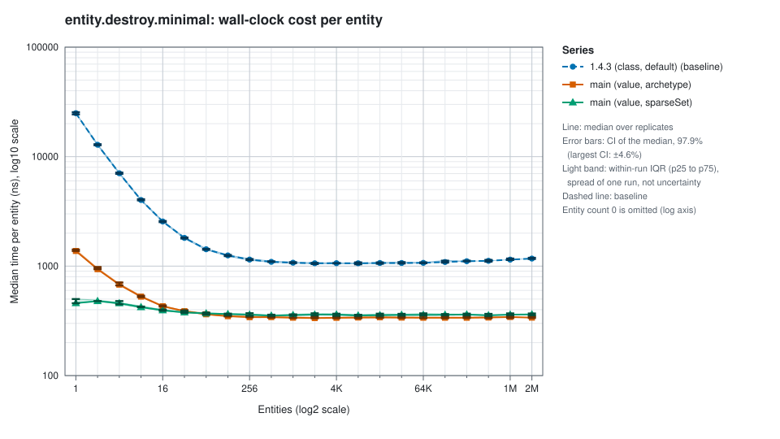
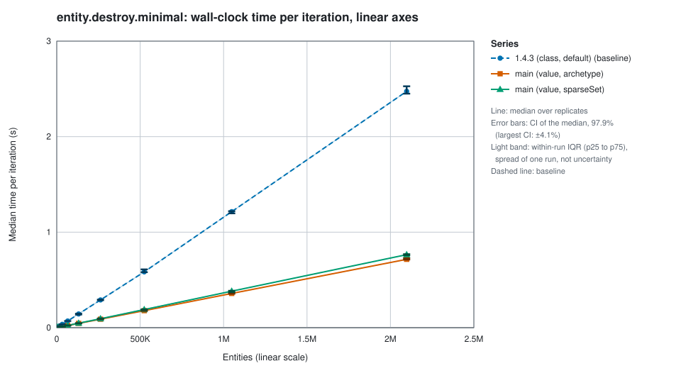
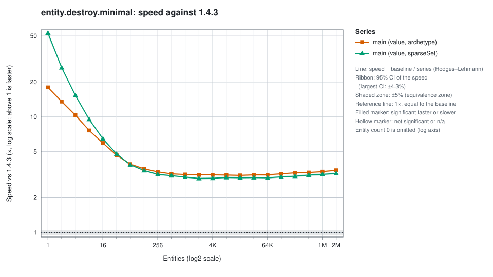

# `entity.destroy.minimal`

[Back to the report](../REPORT.md) · [Glossary](../REPORT.md#glossary). FirebladeECS benchmark comparison.

- Parity (1.4.3, main): adapted: nexus teardown is outside the timed region; upstream times registry teardown; per-iteration untimed setup counts against the package's 0.5 s wall budget, so measured time and sample count are below upstream's 0.5 s of measured time, especially at large scales

`median`, `CI low`, `CI high`, `replicates` and `iterations` are defined in the [report](../REPORT.md). `mean` is the median over replicates of each replicate's mean per iteration; it is descriptive (upstream parity), not an inference input. Percentile columns are the median over replicates of each replicate's percentile.

## Time (wall clock) (smaller is better)

### Time (wall clock): Entity counts up to 1,024

<table>
<thead>
<tr><th rowspan="3">Entities</th><th colspan="6">1.4.3 (class) - baseline</th><th colspan="24">main (value)</th></tr>
<tr><th colspan="6">default</th><th colspan="12">archetype</th><th colspan="12">sparseSet</th></tr>
<tr><th>median (μs)</th><th>CI low (μs)</th><th>CI high (μs)</th><th>mean (μs)</th><th>replicates</th><th>iterations</th><th>median (μs)</th><th>CI low (μs)</th><th>CI high (μs)</th><th>mean (μs)</th><th>replicates</th><th>iterations</th><th>speed (×)</th><th>CI low (×)</th><th>CI high (×)</th><th>change (%)</th><th>q</th><th>verdict</th><th>median (μs)</th><th>CI low (μs)</th><th>CI high (μs)</th><th>mean (μs)</th><th>replicates</th><th>iterations</th><th>speed (×)</th><th>CI low (×)</th><th>CI high (×)</th><th>change (%)</th><th>q</th><th>verdict</th></tr>
</thead>
<tbody>
<tr><td align="right">0</td><td align="right">0.0420</td><td align="right">0.0420</td><td align="right">0.0420</td><td align="right">0.0435</td><td align="right">10</td><td align="right">115,952</td><td align="right">0.0420</td><td align="right">0.0420</td><td align="right">0.0420</td><td align="right">0.0434</td><td align="right">10</td><td align="right">98,260</td><td align="right">1.00</td><td align="right">1.00</td><td align="right">1.00</td><td align="right">0</td><td align="right">1.000</td><td align="right">equivalent</td><td align="right">0.0420</td><td align="right">0.0420</td><td align="right">0.0420</td><td align="right">0.0425</td><td align="right">10</td><td align="right">108,610</td><td align="right">1.00</td><td align="right">1.00</td><td align="right">1.00</td><td align="right">0</td><td align="right">1.000</td><td align="right">equivalent</td></tr>
<tr><td align="right">1</td><td align="right">24.9</td><td align="right">24.3</td><td align="right">25.5</td><td align="right">25.0</td><td align="right">10</td><td align="right">15,058</td><td align="right">1.38</td><td align="right">1.38</td><td align="right">1.42</td><td align="right">1.40</td><td align="right">10</td><td align="right">46,425</td><td align="right">18.0</td><td align="right">17.6</td><td align="right">18.2</td><td align="right">-94.4</td><td align="right">&lt;0.001</td><td align="right">faster</td><td align="right">0.459</td><td align="right">0.458</td><td align="right">0.500</td><td align="right">0.482</td><td align="right">10</td><td align="right">67,339</td><td align="right">53.1</td><td align="right">49.9</td><td align="right">54.4</td><td align="right">-98.1</td><td align="right">&lt;0.001</td><td align="right">faster</td></tr>
<tr><td align="right">2</td><td align="right">25.7</td><td align="right">25.4</td><td align="right">26.0</td><td align="right">25.9</td><td align="right">10</td><td align="right">14,279</td><td align="right">1.88</td><td align="right">1.88</td><td align="right">1.96</td><td align="right">1.90</td><td align="right">10</td><td align="right">42,250</td><td align="right">13.6</td><td align="right">13.3</td><td align="right">13.8</td><td align="right">-92.6</td><td align="right">&lt;0.001</td><td align="right">faster</td><td align="right">0.958</td><td align="right">0.958</td><td align="right">0.959</td><td align="right">0.970</td><td align="right">10</td><td align="right">58,476</td><td align="right">26.6</td><td align="right">26.5</td><td align="right">27.0</td><td align="right">-96.2</td><td align="right">&lt;0.001</td><td align="right">faster</td></tr>
<tr><td align="right">4</td><td align="right">28.2</td><td align="right">27.8</td><td align="right">28.6</td><td align="right">28.4</td><td align="right">10</td><td align="right">12,580</td><td align="right">2.71</td><td align="right">2.67</td><td align="right">2.83</td><td align="right">2.76</td><td align="right">10</td><td align="right">36,358</td><td align="right">10.3</td><td align="right">10.1</td><td align="right">10.5</td><td align="right">-90.3</td><td align="right">&lt;0.001</td><td align="right">faster</td><td align="right">1.83</td><td align="right">1.79</td><td align="right">1.92</td><td align="right">1.85</td><td align="right">10</td><td align="right">49,671</td><td align="right">15.3</td><td align="right">14.9</td><td align="right">15.6</td><td align="right">-93.5</td><td align="right">&lt;0.001</td><td align="right">faster</td></tr>
<tr><td align="right">8</td><td align="right">32.1</td><td align="right">31.9</td><td align="right">32.7</td><td align="right">32.3</td><td align="right">10</td><td align="right">10,519</td><td align="right">4.21</td><td align="right">4.17</td><td align="right">4.29</td><td align="right">4.26</td><td align="right">10</td><td align="right">29,602</td><td align="right">7.63</td><td align="right">7.54</td><td align="right">7.72</td><td align="right">-86.9</td><td align="right">&lt;0.001</td><td align="right">faster</td><td align="right">3.38</td><td align="right">3.38</td><td align="right">3.42</td><td align="right">3.43</td><td align="right">10</td><td align="right">38,754</td><td align="right">9.52</td><td align="right">9.41</td><td align="right">9.63</td><td align="right">-89.5</td><td align="right">&lt;0.001</td><td align="right">faster</td></tr>
<tr><td align="right">16</td><td align="right">40.9</td><td align="right">40.4</td><td align="right">41.3</td><td align="right">41.2</td><td align="right">10</td><td align="right">7,788</td><td align="right">6.88</td><td align="right">6.84</td><td align="right">7.00</td><td align="right">6.97</td><td align="right">10</td><td align="right">22,419</td><td align="right">5.94</td><td align="right">5.86</td><td align="right">6.01</td><td align="right">-83.2</td><td align="right">&lt;0.001</td><td align="right">faster</td><td align="right">6.32</td><td align="right">6.25</td><td align="right">6.42</td><td align="right">6.35</td><td align="right">10</td><td align="right">27,437</td><td align="right">6.47</td><td align="right">6.40</td><td align="right">6.54</td><td align="right">-84.5</td><td align="right">&lt;0.001</td><td align="right">faster</td></tr>
<tr><td align="right">32</td><td align="right">57.9</td><td align="right">57.2</td><td align="right">58.4</td><td align="right">58.4</td><td align="right">10</td><td align="right">5,124</td><td align="right">12.4</td><td align="right">12.3</td><td align="right">12.7</td><td align="right">12.5</td><td align="right">10</td><td align="right">14,983</td><td align="right">4.66</td><td align="right">4.60</td><td align="right">4.71</td><td align="right">-78.6</td><td align="right">&lt;0.001</td><td align="right">faster</td><td align="right">12.1</td><td align="right">12.0</td><td align="right">12.5</td><td align="right">12.2</td><td align="right">10</td><td align="right">17,674</td><td align="right">4.78</td><td align="right">4.71</td><td align="right">4.83</td><td align="right">-79.1</td><td align="right">&lt;0.001</td><td align="right">faster</td></tr>
<tr><td align="right">64</td><td align="right">91.2</td><td align="right">90.2</td><td align="right">92.0</td><td align="right">92.0</td><td align="right">10</td><td align="right">3,087</td><td align="right">23.2</td><td align="right">23.1</td><td align="right">23.9</td><td align="right">23.7</td><td align="right">10</td><td align="right">9,011</td><td align="right">3.90</td><td align="right">3.85</td><td align="right">3.96</td><td align="right">-74.4</td><td align="right">&lt;0.001</td><td align="right">faster</td><td align="right">23.7</td><td align="right">23.3</td><td align="right">24.0</td><td align="right">23.8</td><td align="right">10</td><td align="right">10,391</td><td align="right">3.85</td><td align="right">3.79</td><td align="right">3.92</td><td align="right">-74.1</td><td align="right">&lt;0.001</td><td align="right">faster</td></tr>
<tr><td align="right">128</td><td align="right">160</td><td align="right">158</td><td align="right">162</td><td align="right">161</td><td align="right">10</td><td align="right">1,691</td><td align="right">44.6</td><td align="right">44.4</td><td align="right">45.7</td><td align="right">45.2</td><td align="right">10</td><td align="right">5,163</td><td align="right">3.56</td><td align="right">3.49</td><td align="right">3.61</td><td align="right">-71.9</td><td align="right">&lt;0.001</td><td align="right">faster</td><td align="right">46.7</td><td align="right">45.7</td><td align="right">47.1</td><td align="right">47.0</td><td align="right">10</td><td align="right">5,777</td><td align="right">3.44</td><td align="right">3.40</td><td align="right">3.48</td><td align="right">-70.9</td><td align="right">&lt;0.001</td><td align="right">faster</td></tr>
<tr><td align="right">256</td><td align="right">294</td><td align="right">290</td><td align="right">297</td><td align="right">297</td><td align="right">10</td><td align="right">898</td><td align="right">87.5</td><td align="right">87.2</td><td align="right">89.0</td><td align="right">89.6</td><td align="right">10</td><td align="right">2,748</td><td align="right">3.35</td><td align="right">3.29</td><td align="right">3.38</td><td align="right">-70.1</td><td align="right">&lt;0.001</td><td align="right">faster</td><td align="right">92.2</td><td align="right">90.2</td><td align="right">95.0</td><td align="right">93.4</td><td align="right">10</td><td align="right">3,056</td><td align="right">3.18</td><td align="right">3.12</td><td align="right">3.24</td><td align="right">-68.6</td><td align="right">&lt;0.001</td><td align="right">faster</td></tr>
<tr><td align="right">512</td><td align="right">560</td><td align="right">559</td><td align="right">566</td><td align="right">565</td><td align="right">10</td><td align="right">466</td><td align="right">175</td><td align="right">173</td><td align="right">178</td><td align="right">175</td><td align="right">10</td><td align="right">1,450</td><td align="right">3.22</td><td align="right">3.17</td><td align="right">3.24</td><td align="right">-68.9</td><td align="right">&lt;0.001</td><td align="right">faster</td><td align="right">181</td><td align="right">180</td><td align="right">184</td><td align="right">184</td><td align="right">10</td><td align="right">1,599</td><td align="right">3.10</td><td align="right">3.05</td><td align="right">3.12</td><td align="right">-67.8</td><td align="right">&lt;0.001</td><td align="right">faster</td></tr>
<tr><td align="right">1,024</td><td align="right">1,100</td><td align="right">1,090</td><td align="right">1,110</td><td align="right">1,110</td><td align="right">10</td><td align="right">238</td><td align="right">346</td><td align="right">343</td><td align="right">366</td><td align="right">350</td><td align="right">10</td><td align="right">737</td><td align="right">3.17</td><td align="right">3.12</td><td align="right">3.21</td><td align="right">-68.5</td><td align="right">&lt;0.001</td><td align="right">faster</td><td align="right">366</td><td align="right">361</td><td align="right">371</td><td align="right">369</td><td align="right">10</td><td align="right">808</td><td align="right">3.02</td><td align="right">2.97</td><td align="right">3.05</td><td align="right">-66.8</td><td align="right">&lt;0.001</td><td align="right">faster</td></tr>
</tbody>
</table>

### Time (wall clock): Entity counts above 1,024

<table>
<thead>
<tr><th rowspan="3">Entities</th><th colspan="6">1.4.3 (class) - baseline</th><th colspan="24">main (value)</th></tr>
<tr><th colspan="6">default</th><th colspan="12">archetype</th><th colspan="12">sparseSet</th></tr>
<tr><th>median (ms)</th><th>CI low (ms)</th><th>CI high (ms)</th><th>mean (ms)</th><th>replicates</th><th>iterations</th><th>median (ms)</th><th>CI low (ms)</th><th>CI high (ms)</th><th>mean (ms)</th><th>replicates</th><th>iterations</th><th>speed (×)</th><th>CI low (×)</th><th>CI high (×)</th><th>change (%)</th><th>q</th><th>verdict</th><th>median (ms)</th><th>CI low (ms)</th><th>CI high (ms)</th><th>mean (ms)</th><th>replicates</th><th>iterations</th><th>speed (×)</th><th>CI low (×)</th><th>CI high (×)</th><th>change (%)</th><th>q</th><th>verdict</th></tr>
</thead>
<tbody>
<tr><td align="right">2,048</td><td align="right">2.17</td><td align="right">2.14</td><td align="right">2.19</td><td align="right">2.18</td><td align="right">10</td><td align="right">121</td><td align="right">0.687</td><td align="right">0.684</td><td align="right">0.700</td><td align="right">0.692</td><td align="right">10</td><td align="right">376</td><td align="right">3.15</td><td align="right">3.12</td><td align="right">3.18</td><td align="right">-68.3</td><td align="right">&lt;0.001</td><td align="right">faster</td><td align="right">0.738</td><td align="right">0.726</td><td align="right">0.759</td><td align="right">0.746</td><td align="right">10</td><td align="right">404</td><td align="right">2.94</td><td align="right">2.87</td><td align="right">2.98</td><td align="right">-65.9</td><td align="right">&lt;0.001</td><td align="right">faster</td></tr>
<tr><td align="right">4,096</td><td align="right">4.36</td><td align="right">4.33</td><td align="right">4.37</td><td align="right">4.36</td><td align="right">10</td><td align="right">60</td><td align="right">1.38</td><td align="right">1.37</td><td align="right">1.41</td><td align="right">1.39</td><td align="right">10</td><td align="right">188</td><td align="right">3.15</td><td align="right">3.12</td><td align="right">3.18</td><td align="right">-68.3</td><td align="right">&lt;0.001</td><td align="right">faster</td><td align="right">1.48</td><td align="right">1.44</td><td align="right">1.51</td><td align="right">1.49</td><td align="right">10</td><td align="right">204</td><td align="right">2.95</td><td align="right">2.90</td><td align="right">3.01</td><td align="right">-66.1</td><td align="right">&lt;0.001</td><td align="right">faster</td></tr>
<tr><td align="right">8,192</td><td align="right">8.70</td><td align="right">8.51</td><td align="right">8.86</td><td align="right">8.68</td><td align="right">10</td><td align="right">30</td><td align="right">2.78</td><td align="right">2.74</td><td align="right">2.80</td><td align="right">2.77</td><td align="right">10</td><td align="right">95</td><td align="right">3.14</td><td align="right">3.09</td><td align="right">3.19</td><td align="right">-68.2</td><td align="right">&lt;0.001</td><td align="right">faster</td><td align="right">2.90</td><td align="right">2.88</td><td align="right">2.94</td><td align="right">2.93</td><td align="right">10</td><td align="right">104</td><td align="right">2.99</td><td align="right">2.94</td><td align="right">3.04</td><td align="right">-66.6</td><td align="right">&lt;0.001</td><td align="right">faster</td></tr>
<tr><td align="right">16,384</td><td align="right">17.5</td><td align="right">17.2</td><td align="right">17.7</td><td align="right">17.5</td><td align="right">10</td><td align="right">15</td><td align="right">5.58</td><td align="right">5.51</td><td align="right">5.78</td><td align="right">5.59</td><td align="right">10</td><td align="right">47</td><td align="right">3.12</td><td align="right">3.06</td><td align="right">3.17</td><td align="right">-67.9</td><td align="right">&lt;0.001</td><td align="right">faster</td><td align="right">5.84</td><td align="right">5.77</td><td align="right">6.03</td><td align="right">5.91</td><td align="right">10</td><td align="right">52</td><td align="right">2.98</td><td align="right">2.91</td><td align="right">3.03</td><td align="right">-66.4</td><td align="right">&lt;0.001</td><td align="right">faster</td></tr>
<tr><td align="right">32,768</td><td align="right">35.0</td><td align="right">34.6</td><td align="right">35.6</td><td align="right">35.4</td><td align="right">10</td><td align="right">8</td><td align="right">11.1</td><td align="right">11.0</td><td align="right">11.2</td><td align="right">11.1</td><td align="right">10</td><td align="right">24</td><td align="right">3.15</td><td align="right">3.10</td><td align="right">3.20</td><td align="right">-68.3</td><td align="right">&lt;0.001</td><td align="right">faster</td><td align="right">11.8</td><td align="right">11.6</td><td align="right">12.0</td><td align="right">11.8</td><td align="right">10</td><td align="right">26</td><td align="right">2.99</td><td align="right">2.93</td><td align="right">3.03</td><td align="right">-66.5</td><td align="right">&lt;0.001</td><td align="right">faster</td></tr>
<tr><td align="right">65,536</td><td align="right">70.2</td><td align="right">69.6</td><td align="right">70.9</td><td align="right">70.4</td><td align="right">10</td><td align="right">4</td><td align="right">22.1</td><td align="right">21.9</td><td align="right">23.0</td><td align="right">22.2</td><td align="right">10</td><td align="right">12</td><td align="right">3.16</td><td align="right">3.08</td><td align="right">3.20</td><td align="right">-68.3</td><td align="right">&lt;0.001</td><td align="right">faster</td><td align="right">23.5</td><td align="right">23.3</td><td align="right">24.3</td><td align="right">23.7</td><td align="right">10</td><td align="right">13</td><td align="right">2.97</td><td align="right">2.91</td><td align="right">3.01</td><td align="right">-66.3</td><td align="right">&lt;0.001</td><td align="right">faster</td></tr>
<tr><td align="right">131,072</td><td align="right">143</td><td align="right">141</td><td align="right">147</td><td align="right">146</td><td align="right">10</td><td align="right">2</td><td align="right">44.3</td><td align="right">43.8</td><td align="right">45.3</td><td align="right">44.6</td><td align="right">10</td><td align="right">6</td><td align="right">3.22</td><td align="right">3.17</td><td align="right">3.27</td><td align="right">-68.9</td><td align="right">&lt;0.001</td><td align="right">faster</td><td align="right">47.1</td><td align="right">46.6</td><td align="right">47.8</td><td align="right">47.1</td><td align="right">10</td><td align="right">7</td><td align="right">3.03</td><td align="right">2.98</td><td align="right">3.09</td><td align="right">-67.0</td><td align="right">&lt;0.001</td><td align="right">faster</td></tr>
<tr><td align="right">262,144</td><td align="right">290</td><td align="right">290</td><td align="right">294</td><td align="right">290</td><td align="right">10</td><td align="right">1</td><td align="right">88.5</td><td align="right">87.9</td><td align="right">89.9</td><td align="right">88.6</td><td align="right">10</td><td align="right">3</td><td align="right">3.28</td><td align="right">3.24</td><td align="right">3.31</td><td align="right">-69.5</td><td align="right">&lt;0.001</td><td align="right">faster</td><td align="right">94.7</td><td align="right">93.1</td><td align="right">96.5</td><td align="right">94.7</td><td align="right">10</td><td align="right">4</td><td align="right">3.07</td><td align="right">3.01</td><td align="right">3.12</td><td align="right">-67.4</td><td align="right">&lt;0.001</td><td align="right">faster</td></tr>
<tr><td align="right">524,288</td><td align="right">586</td><td align="right">576</td><td align="right">597</td><td align="right">586</td><td align="right">10</td><td align="right">1</td><td align="right">178</td><td align="right">175</td><td align="right">180</td><td align="right">180</td><td align="right">10</td><td align="right">2</td><td align="right">3.30</td><td align="right">3.25</td><td align="right">3.36</td><td align="right">-69.7</td><td align="right">&lt;0.001</td><td align="right">faster</td><td align="right">186</td><td align="right">184</td><td align="right">192</td><td align="right">187</td><td align="right">10</td><td align="right">2</td><td align="right">3.14</td><td align="right">3.08</td><td align="right">3.21</td><td align="right">-68.1</td><td align="right">&lt;0.001</td><td align="right">faster</td></tr>
<tr><td align="right">1,048,576</td><td align="right">1,200</td><td align="right">1,190</td><td align="right">1,230</td><td align="right">1,200</td><td align="right">10</td><td align="right">1</td><td align="right">360</td><td align="right">352</td><td align="right">366</td><td align="right">360</td><td align="right">10</td><td align="right">1</td><td align="right">3.36</td><td align="right">3.29</td><td align="right">3.43</td><td align="right">-70.2</td><td align="right">&lt;0.001</td><td align="right">faster</td><td align="right">378</td><td align="right">375</td><td align="right">388</td><td align="right">378</td><td align="right">10</td><td align="right">1</td><td align="right">3.18</td><td align="right">3.11</td><td align="right">3.25</td><td align="right">-68.5</td><td align="right">&lt;0.001</td><td align="right">faster</td></tr>
<tr><td align="right">2,097,152</td><td align="right">2,460</td><td align="right">2,440</td><td align="right">2,500</td><td align="right">2,460</td><td align="right">10</td><td align="right">1</td><td align="right">710</td><td align="right">705</td><td align="right">723</td><td align="right">710</td><td align="right">10</td><td align="right">1</td><td align="right">3.45</td><td align="right">3.42</td><td align="right">3.50</td><td align="right">-71.0</td><td align="right">&lt;0.001</td><td align="right">faster</td><td align="right">759</td><td align="right">745</td><td align="right">775</td><td align="right">759</td><td align="right">10</td><td align="right">1</td><td align="right">3.24</td><td align="right">3.20</td><td align="right">3.30</td><td align="right">-69.2</td><td align="right">&lt;0.001</td><td align="right">faster</td></tr>
</tbody>
</table>

### Percentiles, entity counts up to 1,024

<table>
<thead>
<tr><th rowspan="3">Entities</th><th colspan="7">1.4.3 (class) - baseline</th><th colspan="14">main (value)</th></tr>
<tr><th colspan="7">default</th><th colspan="7">archetype</th><th colspan="7">sparseSet</th></tr>
<tr><th>p0 (μs)</th><th>p25 (μs)</th><th>p50 (μs)</th><th>p75 (μs)</th><th>p90 (μs)</th><th>p99 (μs)</th><th>p100 (μs)</th><th>p0 (μs)</th><th>p25 (μs)</th><th>p50 (μs)</th><th>p75 (μs)</th><th>p90 (μs)</th><th>p99 (μs)</th><th>p100 (μs)</th><th>p0 (μs)</th><th>p25 (μs)</th><th>p50 (μs)</th><th>p75 (μs)</th><th>p90 (μs)</th><th>p99 (μs)</th><th>p100 (μs)</th></tr>
</thead>
<tbody>
<tr><td align="right">0</td><td align="right">0.0410</td><td align="right">0.0410</td><td align="right">0.0420</td><td align="right">0.0420</td><td align="right">0.0420</td><td align="right">0.0835</td><td align="right">5.90</td><td align="right">0.0410</td><td align="right">0.0410</td><td align="right">0.0420</td><td align="right">0.0420</td><td align="right">0.0420</td><td align="right">0.0840</td><td align="right">9.02</td><td align="right">0.0410</td><td align="right">0.0410</td><td align="right">0.0420</td><td align="right">0.0420</td><td align="right">0.0420</td><td align="right">0.0830</td><td align="right">7.02</td></tr>
<tr><td align="right">1</td><td align="right">24.2</td><td align="right">24.8</td><td align="right">24.9</td><td align="right">25.0</td><td align="right">25.4</td><td align="right">26.7</td><td align="right">97.4</td><td align="right">1.27</td><td align="right">1.38</td><td align="right">1.38</td><td align="right">1.42</td><td align="right">1.46</td><td align="right">1.54</td><td align="right">25.1</td><td align="right">0.375</td><td align="right">0.458</td><td align="right">0.459</td><td align="right">0.500</td><td align="right">0.500</td><td align="right">0.584</td><td align="right">18.4</td></tr>
<tr><td align="right">2</td><td align="right">25.1</td><td align="right">25.3</td><td align="right">25.7</td><td align="right">26.0</td><td align="right">26.4</td><td align="right">27.9</td><td align="right">52.2</td><td align="right">1.75</td><td align="right">1.88</td><td align="right">1.88</td><td align="right">1.92</td><td align="right">1.96</td><td align="right">2.08</td><td align="right">25.0</td><td align="right">0.833</td><td align="right">0.958</td><td align="right">0.958</td><td align="right">0.980</td><td align="right">1.00</td><td align="right">1.13</td><td align="right">20.6</td></tr>
<tr><td align="right">4</td><td align="right">27.3</td><td align="right">27.9</td><td align="right">28.2</td><td align="right">28.7</td><td align="right">29.0</td><td align="right">34.0</td><td align="right">126</td><td align="right">2.58</td><td align="right">2.69</td><td align="right">2.71</td><td align="right">2.77</td><td align="right">2.83</td><td align="right">3.04</td><td align="right">22.4</td><td align="right">1.67</td><td align="right">1.79</td><td align="right">1.83</td><td align="right">1.85</td><td align="right">1.90</td><td align="right">2.04</td><td align="right">25.8</td></tr>
<tr><td align="right">8</td><td align="right">31.5</td><td align="right">31.7</td><td align="right">32.1</td><td align="right">32.4</td><td align="right">32.9</td><td align="right">35.0</td><td align="right">130</td><td align="right">4.02</td><td align="right">4.17</td><td align="right">4.21</td><td align="right">4.29</td><td align="right">4.34</td><td align="right">4.56</td><td align="right">53.1</td><td align="right">3.25</td><td align="right">3.34</td><td align="right">3.38</td><td align="right">3.46</td><td align="right">3.50</td><td align="right">3.69</td><td align="right">60.9</td></tr>
<tr><td align="right">16</td><td align="right">39.9</td><td align="right">40.4</td><td align="right">40.9</td><td align="right">41.4</td><td align="right">42.0</td><td align="right">44.0</td><td align="right">90.9</td><td align="right">6.71</td><td align="right">6.84</td><td align="right">6.88</td><td align="right">6.96</td><td align="right">7.07</td><td align="right">7.40</td><td align="right">29.0</td><td align="right">6.10</td><td align="right">6.25</td><td align="right">6.32</td><td align="right">6.40</td><td align="right">6.48</td><td align="right">6.82</td><td align="right">29.8</td></tr>
<tr><td align="right">32</td><td align="right">56.4</td><td align="right">57.2</td><td align="right">57.9</td><td align="right">58.7</td><td align="right">59.3</td><td align="right">63.8</td><td align="right">89.9</td><td align="right">12.1</td><td align="right">12.3</td><td align="right">12.4</td><td align="right">12.5</td><td align="right">12.7</td><td align="right">13.4</td><td align="right">58.8</td><td align="right">11.7</td><td align="right">12.0</td><td align="right">12.1</td><td align="right">12.3</td><td align="right">12.4</td><td align="right">13.1</td><td align="right">42.7</td></tr>
<tr><td align="right">64</td><td align="right">88.9</td><td align="right">90.0</td><td align="right">91.2</td><td align="right">92.4</td><td align="right">93.6</td><td align="right">103</td><td align="right">139</td><td align="right">22.8</td><td align="right">23.1</td><td align="right">23.2</td><td align="right">23.8</td><td align="right">24.0</td><td align="right">26.5</td><td align="right">123</td><td align="right">23.1</td><td align="right">23.6</td><td align="right">23.7</td><td align="right">23.9</td><td align="right">24.1</td><td align="right">25.2</td><td align="right">48.1</td></tr>
<tr><td align="right">128</td><td align="right">155</td><td align="right">158</td><td align="right">160</td><td align="right">162</td><td align="right">164</td><td align="right">180</td><td align="right">199</td><td align="right">44.2</td><td align="right">44.5</td><td align="right">44.6</td><td align="right">45.3</td><td align="right">45.8</td><td align="right">48.4</td><td align="right">83.1</td><td align="right">45.5</td><td align="right">46.5</td><td align="right">46.7</td><td align="right">47.1</td><td align="right">47.6</td><td align="right">51.4</td><td align="right">135</td></tr>
<tr><td align="right">256</td><td align="right">286</td><td align="right">289</td><td align="right">294</td><td align="right">299</td><td align="right">302</td><td align="right">329</td><td align="right">403</td><td align="right">86.7</td><td align="right">87.1</td><td align="right">87.5</td><td align="right">89.9</td><td align="right">92.2</td><td align="right">105</td><td align="right">186</td><td align="right">89.9</td><td align="right">91.3</td><td align="right">92.2</td><td align="right">93.7</td><td align="right">95.6</td><td align="right">106</td><td align="right">172</td></tr>
<tr><td align="right">512</td><td align="right">549</td><td align="right">555</td><td align="right">560</td><td align="right">569</td><td align="right">579</td><td align="right">639</td><td align="right">660</td><td align="right">172</td><td align="right">173</td><td align="right">175</td><td align="right">176</td><td align="right">178</td><td align="right">190</td><td align="right">274</td><td align="right">179</td><td align="right">180</td><td align="right">181</td><td align="right">183</td><td align="right">185</td><td align="right">197</td><td align="right">225</td></tr>
<tr><td align="right">1,024</td><td align="right">1,080</td><td align="right">1,090</td><td align="right">1,100</td><td align="right">1,110</td><td align="right">1,130</td><td align="right">1,190</td><td align="right">1,220</td><td align="right">342</td><td align="right">344</td><td align="right">346</td><td align="right">352</td><td align="right">358</td><td align="right">377</td><td align="right">395</td><td align="right">360</td><td align="right">362</td><td align="right">366</td><td align="right">371</td><td align="right">376</td><td align="right">398</td><td align="right">447</td></tr>
</tbody>
</table>

### Percentiles, entity counts above 1,024

<table>
<thead>
<tr><th rowspan="3">Entities</th><th colspan="7">1.4.3 (class) - baseline</th><th colspan="14">main (value)</th></tr>
<tr><th colspan="7">default</th><th colspan="7">archetype</th><th colspan="7">sparseSet</th></tr>
<tr><th>p0 (ms)</th><th>p25 (ms)</th><th>p50 (ms)</th><th>p75 (ms)</th><th>p90 (ms)</th><th>p99 (ms)</th><th>p100 (ms)</th><th>p0 (ms)</th><th>p25 (ms)</th><th>p50 (ms)</th><th>p75 (ms)</th><th>p90 (ms)</th><th>p99 (ms)</th><th>p100 (ms)</th><th>p0 (ms)</th><th>p25 (ms)</th><th>p50 (ms)</th><th>p75 (ms)</th><th>p90 (ms)</th><th>p99 (ms)</th><th>p100 (ms)</th></tr>
</thead>
<tbody>
<tr><td align="right">2,048</td><td align="right">2.13</td><td align="right">2.15</td><td align="right">2.17</td><td align="right">2.20</td><td align="right">2.22</td><td align="right">2.28</td><td align="right">2.30</td><td align="right">0.683</td><td align="right">0.685</td><td align="right">0.687</td><td align="right">0.697</td><td align="right">0.706</td><td align="right">0.740</td><td align="right">0.770</td><td align="right">0.722</td><td align="right">0.733</td><td align="right">0.738</td><td align="right">0.754</td><td align="right">0.779</td><td align="right">0.815</td><td align="right">0.827</td></tr>
<tr><td align="right">4,096</td><td align="right">4.26</td><td align="right">4.30</td><td align="right">4.36</td><td align="right">4.40</td><td align="right">4.42</td><td align="right">4.54</td><td align="right">4.54</td><td align="right">1.36</td><td align="right">1.37</td><td align="right">1.38</td><td align="right">1.40</td><td align="right">1.42</td><td align="right">1.48</td><td align="right">1.49</td><td align="right">1.43</td><td align="right">1.46</td><td align="right">1.48</td><td align="right">1.50</td><td align="right">1.52</td><td align="right">1.58</td><td align="right">1.61</td></tr>
<tr><td align="right">8,192</td><td align="right">8.54</td><td align="right">8.60</td><td align="right">8.70</td><td align="right">8.73</td><td align="right">8.79</td><td align="right">8.99</td><td align="right">8.99</td><td align="right">2.73</td><td align="right">2.74</td><td align="right">2.78</td><td align="right">2.80</td><td align="right">2.82</td><td align="right">2.91</td><td align="right">2.91</td><td align="right">2.86</td><td align="right">2.87</td><td align="right">2.90</td><td align="right">2.95</td><td align="right">3.00</td><td align="right">3.09</td><td align="right">3.10</td></tr>
<tr><td align="right">16,384</td><td align="right">17.2</td><td align="right">17.3</td><td align="right">17.5</td><td align="right">17.7</td><td align="right">17.8</td><td align="right">18.0</td><td align="right">18.0</td><td align="right">5.47</td><td align="right">5.49</td><td align="right">5.58</td><td align="right">5.63</td><td align="right">5.74</td><td align="right">5.91</td><td align="right">5.91</td><td align="right">5.76</td><td align="right">5.80</td><td align="right">5.84</td><td align="right">5.99</td><td align="right">6.08</td><td align="right">6.18</td><td align="right">6.18</td></tr>
<tr><td align="right">32,768</td><td align="right">34.3</td><td align="right">34.7</td><td align="right">35.0</td><td align="right">35.7</td><td align="right">36.0</td><td align="right">36.0</td><td align="right">36.0</td><td align="right">10.9</td><td align="right">11.0</td><td align="right">11.1</td><td align="right">11.2</td><td align="right">11.4</td><td align="right">11.5</td><td align="right">11.5</td><td align="right">11.5</td><td align="right">11.6</td><td align="right">11.8</td><td align="right">11.9</td><td align="right">12.1</td><td align="right">12.2</td><td align="right">12.2</td></tr>
<tr><td align="right">65,536</td><td align="right">69.8</td><td align="right">69.8</td><td align="right">70.2</td><td align="right">70.7</td><td align="right">71.0</td><td align="right">71.0</td><td align="right">71.0</td><td align="right">21.9</td><td align="right">22.0</td><td align="right">22.1</td><td align="right">22.4</td><td align="right">22.8</td><td align="right">22.9</td><td align="right">22.9</td><td align="right">23.2</td><td align="right">23.4</td><td align="right">23.5</td><td align="right">24.2</td><td align="right">24.4</td><td align="right">24.6</td><td align="right">24.6</td></tr>
<tr><td align="right">131,072</td><td align="right">143</td><td align="right">143</td><td align="right">143</td><td align="right">148</td><td align="right">148</td><td align="right">148</td><td align="right">148</td><td align="right">43.8</td><td align="right">44.1</td><td align="right">44.3</td><td align="right">44.8</td><td align="right">45.5</td><td align="right">45.5</td><td align="right">45.5</td><td align="right">46.4</td><td align="right">46.7</td><td align="right">47.1</td><td align="right">47.9</td><td align="right">48.3</td><td align="right">48.3</td><td align="right">48.3</td></tr>
<tr><td align="right">262,144</td><td align="right">290</td><td align="right">290</td><td align="right">290</td><td align="right">290</td><td align="right">290</td><td align="right">290</td><td align="right">290</td><td align="right">88.1</td><td align="right">88.1</td><td align="right">88.5</td><td align="right">89.4</td><td align="right">89.4</td><td align="right">89.4</td><td align="right">89.4</td><td align="right">93.7</td><td align="right">93.7</td><td align="right">94.7</td><td align="right">95.2</td><td align="right">95.7</td><td align="right">95.7</td><td align="right">95.7</td></tr>
<tr><td align="right">524,288</td><td align="right">586</td><td align="right">586</td><td align="right">586</td><td align="right">586</td><td align="right">586</td><td align="right">586</td><td align="right">586</td><td align="right">178</td><td align="right">178</td><td align="right">178</td><td align="right">181</td><td align="right">181</td><td align="right">181</td><td align="right">181</td><td align="right">186</td><td align="right">186</td><td align="right">186</td><td align="right">188</td><td align="right">188</td><td align="right">188</td><td align="right">188</td></tr>
<tr><td align="right">1,048,576</td><td align="right">1,200</td><td align="right">1,200</td><td align="right">1,200</td><td align="right">1,200</td><td align="right">1,200</td><td align="right">1,200</td><td align="right">1,200</td><td align="right">360</td><td align="right">360</td><td align="right">360</td><td align="right">360</td><td align="right">360</td><td align="right">360</td><td align="right">360</td><td align="right">378</td><td align="right">378</td><td align="right">378</td><td align="right">378</td><td align="right">378</td><td align="right">378</td><td align="right">378</td></tr>
<tr><td align="right">2,097,152</td><td align="right">2,460</td><td align="right">2,460</td><td align="right">2,460</td><td align="right">2,460</td><td align="right">2,460</td><td align="right">2,460</td><td align="right">2,460</td><td align="right">710</td><td align="right">710</td><td align="right">710</td><td align="right">710</td><td align="right">710</td><td align="right">710</td><td align="right">710</td><td align="right">759</td><td align="right">759</td><td align="right">759</td><td align="right">759</td><td align="right">759</td><td align="right">759</td><td align="right">759</td></tr>
</tbody>
</table>

## Time (total CPU) (smaller is better)

### Time (total CPU): Entity counts up to 1,024

<table>
<thead>
<tr><th rowspan="3">Entities</th><th colspan="6">1.4.3 (class) - baseline</th><th colspan="12">main (value)</th></tr>
<tr><th colspan="6">default</th><th colspan="6">archetype</th><th colspan="6">sparseSet</th></tr>
<tr><th>median (μs)</th><th>CI low (μs)</th><th>CI high (μs)</th><th>mean (μs)</th><th>replicates</th><th>iterations</th><th>median (μs)</th><th>CI low (μs)</th><th>CI high (μs)</th><th>mean (μs)</th><th>replicates</th><th>iterations</th><th>median (μs)</th><th>CI low (μs)</th><th>CI high (μs)</th><th>mean (μs)</th><th>replicates</th><th>iterations</th></tr>
</thead>
<tbody>
<tr><td align="right">0</td><td align="right">0.730</td><td align="right">0.708</td><td align="right">0.791</td><td align="right">0.743</td><td align="right">10</td><td align="right">118,460</td><td align="right">0.709</td><td align="right">0.708</td><td align="right">0.791</td><td align="right">0.733</td><td align="right">10</td><td align="right">100,815</td><td align="right">0.708</td><td align="right">0.667</td><td align="right">0.791</td><td align="right">0.716</td><td align="right">10</td><td align="right">119,916</td></tr>
<tr><td align="right">1</td><td align="right">25.7</td><td align="right">25.1</td><td align="right">26.2</td><td align="right">25.7</td><td align="right">10</td><td align="right">15,058</td><td align="right">2.13</td><td align="right">2.04</td><td align="right">2.17</td><td align="right">2.14</td><td align="right">10</td><td align="right">46,425</td><td align="right">1.19</td><td align="right">1.17</td><td align="right">1.25</td><td align="right">1.20</td><td align="right">10</td><td align="right">67,339</td></tr>
<tr><td align="right">2</td><td align="right">26.4</td><td align="right">26.1</td><td align="right">26.7</td><td align="right">26.6</td><td align="right">10</td><td align="right">14,279</td><td align="right">2.63</td><td align="right">2.59</td><td align="right">2.67</td><td align="right">2.63</td><td align="right">10</td><td align="right">42,250</td><td align="right">1.69</td><td align="right">1.63</td><td align="right">1.75</td><td align="right">1.70</td><td align="right">10</td><td align="right">58,476</td></tr>
<tr><td align="right">4</td><td align="right">28.9</td><td align="right">28.5</td><td align="right">29.4</td><td align="right">29.1</td><td align="right">10</td><td align="right">12,580</td><td align="right">3.46</td><td align="right">3.38</td><td align="right">3.54</td><td align="right">3.51</td><td align="right">10</td><td align="right">36,358</td><td align="right">2.54</td><td align="right">2.50</td><td align="right">2.67</td><td align="right">2.57</td><td align="right">10</td><td align="right">49,671</td></tr>
<tr><td align="right">8</td><td align="right">32.9</td><td align="right">32.6</td><td align="right">33.4</td><td align="right">33.1</td><td align="right">10</td><td align="right">10,519</td><td align="right">4.92</td><td align="right">4.84</td><td align="right">5.00</td><td align="right">4.98</td><td align="right">10</td><td align="right">29,602</td><td align="right">4.13</td><td align="right">4.13</td><td align="right">4.17</td><td align="right">4.17</td><td align="right">10</td><td align="right">38,754</td></tr>
<tr><td align="right">16</td><td align="right">41.6</td><td align="right">41.2</td><td align="right">42.1</td><td align="right">42.0</td><td align="right">10</td><td align="right">7,788</td><td align="right">7.63</td><td align="right">7.54</td><td align="right">7.67</td><td align="right">7.69</td><td align="right">10</td><td align="right">22,419</td><td align="right">7.04</td><td align="right">6.96</td><td align="right">7.13</td><td align="right">7.13</td><td align="right">10</td><td align="right">27,437</td></tr>
<tr><td align="right">32</td><td align="right">58.7</td><td align="right">57.9</td><td align="right">59.1</td><td align="right">59.1</td><td align="right">10</td><td align="right">5,124</td><td align="right">13.1</td><td align="right">13.1</td><td align="right">13.5</td><td align="right">13.2</td><td align="right">10</td><td align="right">14,983</td><td align="right">12.9</td><td align="right">12.6</td><td align="right">13.2</td><td align="right">12.9</td><td align="right">10</td><td align="right">17,674</td></tr>
<tr><td align="right">64</td><td align="right">92.0</td><td align="right">91.1</td><td align="right">92.8</td><td align="right">92.7</td><td align="right">10</td><td align="right">3,087</td><td align="right">24.0</td><td align="right">23.9</td><td align="right">24.8</td><td align="right">24.4</td><td align="right">10</td><td align="right">9,011</td><td align="right">24.4</td><td align="right">24.0</td><td align="right">24.8</td><td align="right">24.6</td><td align="right">10</td><td align="right">10,391</td></tr>
<tr><td align="right">128</td><td align="right">161</td><td align="right">159</td><td align="right">162</td><td align="right">162</td><td align="right">10</td><td align="right">1,691</td><td align="right">45.5</td><td align="right">45.2</td><td align="right">46.5</td><td align="right">45.7</td><td align="right">10</td><td align="right">5,163</td><td align="right">47.5</td><td align="right">46.5</td><td align="right">47.9</td><td align="right">47.7</td><td align="right">10</td><td align="right">5,777</td></tr>
<tr><td align="right">256</td><td align="right">296</td><td align="right">291</td><td align="right">298</td><td align="right">298</td><td align="right">10</td><td align="right">898</td><td align="right">88.3</td><td align="right">87.9</td><td align="right">89.8</td><td align="right">90.2</td><td align="right">10</td><td align="right">2,748</td><td align="right">92.9</td><td align="right">91.1</td><td align="right">95.9</td><td align="right">94.1</td><td align="right">10</td><td align="right">3,056</td></tr>
<tr><td align="right">512</td><td align="right">561</td><td align="right">560</td><td align="right">567</td><td align="right">566</td><td align="right">10</td><td align="right">466</td><td align="right">176</td><td align="right">174</td><td align="right">179</td><td align="right">176</td><td align="right">10</td><td align="right">1,450</td><td align="right">181</td><td align="right">181</td><td align="right">185</td><td align="right">185</td><td align="right">10</td><td align="right">1,599</td></tr>
<tr><td align="right">1,024</td><td align="right">1,100</td><td align="right">1,090</td><td align="right">1,110</td><td align="right">1,110</td><td align="right">10</td><td align="right">238</td><td align="right">347</td><td align="right">344</td><td align="right">367</td><td align="right">350</td><td align="right">10</td><td align="right">737</td><td align="right">367</td><td align="right">362</td><td align="right">372</td><td align="right">370</td><td align="right">10</td><td align="right">808</td></tr>
</tbody>
</table>

### Time (total CPU): Entity counts above 1,024

<table>
<thead>
<tr><th rowspan="3">Entities</th><th colspan="6">1.4.3 (class) - baseline</th><th colspan="12">main (value)</th></tr>
<tr><th colspan="6">default</th><th colspan="6">archetype</th><th colspan="6">sparseSet</th></tr>
<tr><th>median (ms)</th><th>CI low (ms)</th><th>CI high (ms)</th><th>mean (ms)</th><th>replicates</th><th>iterations</th><th>median (ms)</th><th>CI low (ms)</th><th>CI high (ms)</th><th>mean (ms)</th><th>replicates</th><th>iterations</th><th>median (ms)</th><th>CI low (ms)</th><th>CI high (ms)</th><th>mean (ms)</th><th>replicates</th><th>iterations</th></tr>
</thead>
<tbody>
<tr><td align="right">2,048</td><td align="right">2.18</td><td align="right">2.14</td><td align="right">2.20</td><td align="right">2.18</td><td align="right">10</td><td align="right">121</td><td align="right">0.688</td><td align="right">0.685</td><td align="right">0.701</td><td align="right">0.693</td><td align="right">10</td><td align="right">376</td><td align="right">0.739</td><td align="right">0.728</td><td align="right">0.759</td><td align="right">0.745</td><td align="right">10</td><td align="right">404</td></tr>
<tr><td align="right">4,096</td><td align="right">4.36</td><td align="right">4.33</td><td align="right">4.37</td><td align="right">4.36</td><td align="right">10</td><td align="right">60</td><td align="right">1.38</td><td align="right">1.37</td><td align="right">1.41</td><td align="right">1.39</td><td align="right">10</td><td align="right">188</td><td align="right">1.48</td><td align="right">1.44</td><td align="right">1.51</td><td align="right">1.49</td><td align="right">10</td><td align="right">204</td></tr>
<tr><td align="right">8,192</td><td align="right">8.70</td><td align="right">8.51</td><td align="right">8.86</td><td align="right">8.68</td><td align="right">10</td><td align="right">30</td><td align="right">2.78</td><td align="right">2.74</td><td align="right">2.80</td><td align="right">2.78</td><td align="right">10</td><td align="right">95</td><td align="right">2.90</td><td align="right">2.88</td><td align="right">2.95</td><td align="right">2.93</td><td align="right">10</td><td align="right">104</td></tr>
<tr><td align="right">16,384</td><td align="right">17.5</td><td align="right">17.2</td><td align="right">17.7</td><td align="right">17.5</td><td align="right">10</td><td align="right">15</td><td align="right">5.58</td><td align="right">5.52</td><td align="right">5.78</td><td align="right">5.59</td><td align="right">10</td><td align="right">47</td><td align="right">5.84</td><td align="right">5.77</td><td align="right">6.00</td><td align="right">5.91</td><td align="right">10</td><td align="right">52</td></tr>
<tr><td align="right">32,768</td><td align="right">35.0</td><td align="right">34.6</td><td align="right">35.6</td><td align="right">35.3</td><td align="right">10</td><td align="right">8</td><td align="right">11.1</td><td align="right">11.0</td><td align="right">11.2</td><td align="right">11.1</td><td align="right">10</td><td align="right">24</td><td align="right">11.7</td><td align="right">11.6</td><td align="right">12.0</td><td align="right">11.8</td><td align="right">10</td><td align="right">26</td></tr>
<tr><td align="right">65,536</td><td align="right">70.2</td><td align="right">69.6</td><td align="right">70.9</td><td align="right">70.4</td><td align="right">10</td><td align="right">4</td><td align="right">22.1</td><td align="right">21.9</td><td align="right">22.8</td><td align="right">22.2</td><td align="right">10</td><td align="right">12</td><td align="right">23.5</td><td align="right">23.3</td><td align="right">24.3</td><td align="right">23.7</td><td align="right">10</td><td align="right">13</td></tr>
<tr><td align="right">131,072</td><td align="right">143</td><td align="right">141</td><td align="right">146</td><td align="right">145</td><td align="right">10</td><td align="right">2</td><td align="right">44.3</td><td align="right">43.8</td><td align="right">45.3</td><td align="right">44.6</td><td align="right">10</td><td align="right">6</td><td align="right">46.9</td><td align="right">46.5</td><td align="right">47.7</td><td align="right">47.1</td><td align="right">10</td><td align="right">7</td></tr>
<tr><td align="right">262,144</td><td align="right">291</td><td align="right">289</td><td align="right">294</td><td align="right">291</td><td align="right">10</td><td align="right">1</td><td align="right">88.5</td><td align="right">87.9</td><td align="right">89.7</td><td align="right">88.7</td><td align="right">10</td><td align="right">3</td><td align="right">94.7</td><td align="right">92.7</td><td align="right">96.5</td><td align="right">94.7</td><td align="right">10</td><td align="right">4</td></tr>
<tr><td align="right">524,288</td><td align="right">586</td><td align="right">576</td><td align="right">595</td><td align="right">586</td><td align="right">10</td><td align="right">1</td><td align="right">178</td><td align="right">175</td><td align="right">180</td><td align="right">180</td><td align="right">10</td><td align="right">2</td><td align="right">186</td><td align="right">184</td><td align="right">192</td><td align="right">187</td><td align="right">10</td><td align="right">2</td></tr>
<tr><td align="right">1,048,576</td><td align="right">1,200</td><td align="right">1,190</td><td align="right">1,230</td><td align="right">1,200</td><td align="right">10</td><td align="right">1</td><td align="right">359</td><td align="right">352</td><td align="right">365</td><td align="right">359</td><td align="right">10</td><td align="right">1</td><td align="right">378</td><td align="right">375</td><td align="right">387</td><td align="right">378</td><td align="right">10</td><td align="right">1</td></tr>
<tr><td align="right">2,097,152</td><td align="right">2,460</td><td align="right">2,440</td><td align="right">2,490</td><td align="right">2,460</td><td align="right">10</td><td align="right">1</td><td align="right">710</td><td align="right">704</td><td align="right">723</td><td align="right">710</td><td align="right">10</td><td align="right">1</td><td align="right">758</td><td align="right">746</td><td align="right">775</td><td align="right">758</td><td align="right">10</td><td align="right">1</td></tr>
</tbody>
</table>

### Percentiles, entity counts up to 1,024

<table>
<thead>
<tr><th rowspan="3">Entities</th><th colspan="7">1.4.3 (class) - baseline</th><th colspan="14">main (value)</th></tr>
<tr><th colspan="7">default</th><th colspan="7">archetype</th><th colspan="7">sparseSet</th></tr>
<tr><th>p0 (μs)</th><th>p25 (μs)</th><th>p50 (μs)</th><th>p75 (μs)</th><th>p90 (μs)</th><th>p99 (μs)</th><th>p100 (μs)</th><th>p0 (μs)</th><th>p25 (μs)</th><th>p50 (μs)</th><th>p75 (μs)</th><th>p90 (μs)</th><th>p99 (μs)</th><th>p100 (μs)</th><th>p0 (μs)</th><th>p25 (μs)</th><th>p50 (μs)</th><th>p75 (μs)</th><th>p90 (μs)</th><th>p99 (μs)</th><th>p100 (μs)</th></tr>
</thead>
<tbody>
<tr><td align="right">0</td><td align="right">0.604</td><td align="right">0.709</td><td align="right">0.730</td><td align="right">0.771</td><td align="right">0.792</td><td align="right">0.896</td><td align="right">17.5</td><td align="right">0.584</td><td align="right">0.708</td><td align="right">0.709</td><td align="right">0.750</td><td align="right">0.792</td><td align="right">0.917</td><td align="right">16.9</td><td align="right">0.583</td><td align="right">0.667</td><td align="right">0.708</td><td align="right">0.730</td><td align="right">0.771</td><td align="right">0.876</td><td align="right">24.3</td></tr>
<tr><td align="right">1</td><td align="right">25.0</td><td align="right">25.5</td><td align="right">25.7</td><td align="right">25.8</td><td align="right">26.2</td><td align="right">27.6</td><td align="right">78.0</td><td align="right">1.96</td><td align="right">2.08</td><td align="right">2.13</td><td align="right">2.17</td><td align="right">2.23</td><td align="right">2.38</td><td align="right">22.5</td><td align="right">1.04</td><td align="right">1.17</td><td align="right">1.19</td><td align="right">1.21</td><td align="right">1.25</td><td align="right">1.40</td><td align="right">19.5</td></tr>
<tr><td align="right">2</td><td align="right">25.8</td><td align="right">26.0</td><td align="right">26.4</td><td align="right">26.8</td><td align="right">27.1</td><td align="right">29.1</td><td align="right">48.3</td><td align="right">2.42</td><td align="right">2.58</td><td align="right">2.63</td><td align="right">2.67</td><td align="right">2.73</td><td align="right">2.92</td><td align="right">30.1</td><td align="right">1.52</td><td align="right">1.65</td><td align="right">1.69</td><td align="right">1.73</td><td align="right">1.77</td><td align="right">1.96</td><td align="right">23.7</td></tr>
<tr><td align="right">4</td><td align="right">28.0</td><td align="right">28.7</td><td align="right">28.9</td><td align="right">29.4</td><td align="right">29.8</td><td align="right">34.2</td><td align="right">108</td><td align="right">3.25</td><td align="right">3.42</td><td align="right">3.46</td><td align="right">3.52</td><td align="right">3.61</td><td align="right">3.83</td><td align="right">24.4</td><td align="right">2.37</td><td align="right">2.50</td><td align="right">2.54</td><td align="right">2.59</td><td align="right">2.67</td><td align="right">2.88</td><td align="right">29.3</td></tr>
<tr><td align="right">8</td><td align="right">32.2</td><td align="right">32.4</td><td align="right">32.9</td><td align="right">33.2</td><td align="right">33.6</td><td align="right">36.6</td><td align="right">111</td><td align="right">4.67</td><td align="right">4.86</td><td align="right">4.92</td><td align="right">5.02</td><td align="right">5.13</td><td align="right">5.42</td><td align="right">41.8</td><td align="right">3.96</td><td align="right">4.08</td><td align="right">4.13</td><td align="right">4.21</td><td align="right">4.29</td><td align="right">4.58</td><td align="right">45.5</td></tr>
<tr><td align="right">16</td><td align="right">40.5</td><td align="right">41.2</td><td align="right">41.6</td><td align="right">42.3</td><td align="right">42.8</td><td align="right">46.8</td><td align="right">80.7</td><td align="right">7.38</td><td align="right">7.58</td><td align="right">7.63</td><td align="right">7.73</td><td align="right">7.84</td><td align="right">8.21</td><td align="right">34.1</td><td align="right">6.81</td><td align="right">6.98</td><td align="right">7.04</td><td align="right">7.19</td><td align="right">7.32</td><td align="right">7.75</td><td align="right">29.6</td></tr>
<tr><td align="right">32</td><td align="right">57.1</td><td align="right">58.0</td><td align="right">58.7</td><td align="right">59.5</td><td align="right">60.1</td><td align="right">66.6</td><td align="right">85.4</td><td align="right">12.8</td><td align="right">13.0</td><td align="right">13.1</td><td align="right">13.3</td><td align="right">13.5</td><td align="right">14.3</td><td align="right">54.1</td><td align="right">12.4</td><td align="right">12.7</td><td align="right">12.9</td><td align="right">13.0</td><td align="right">13.2</td><td align="right">14.0</td><td align="right">37.8</td></tr>
<tr><td align="right">64</td><td align="right">89.6</td><td align="right">90.8</td><td align="right">92.0</td><td align="right">93.2</td><td align="right">94.4</td><td align="right">104</td><td align="right">146</td><td align="right">23.5</td><td align="right">23.8</td><td align="right">24.0</td><td align="right">24.5</td><td align="right">24.9</td><td align="right">29.2</td><td align="right">104</td><td align="right">23.8</td><td align="right">24.3</td><td align="right">24.4</td><td align="right">24.7</td><td align="right">25.0</td><td align="right">26.1</td><td align="right">45.8</td></tr>
<tr><td align="right">128</td><td align="right">156</td><td align="right">158</td><td align="right">161</td><td align="right">163</td><td align="right">165</td><td align="right">178</td><td align="right">197</td><td align="right">45.0</td><td align="right">45.3</td><td align="right">45.5</td><td align="right">46.0</td><td align="right">46.6</td><td align="right">50.6</td><td align="right">77.8</td><td align="right">46.2</td><td align="right">47.3</td><td align="right">47.5</td><td align="right">48.0</td><td align="right">48.4</td><td align="right">54.4</td><td align="right">114</td></tr>
<tr><td align="right">256</td><td align="right">287</td><td align="right">290</td><td align="right">296</td><td align="right">300</td><td align="right">304</td><td align="right">324</td><td align="right">386</td><td align="right">87.4</td><td align="right">87.9</td><td align="right">88.3</td><td align="right">90.8</td><td align="right">93.4</td><td align="right">103</td><td align="right">171</td><td align="right">90.6</td><td align="right">92.1</td><td align="right">92.9</td><td align="right">94.5</td><td align="right">96.6</td><td align="right">105</td><td align="right">151</td></tr>
<tr><td align="right">512</td><td align="right">550</td><td align="right">556</td><td align="right">561</td><td align="right">570</td><td align="right">579</td><td align="right">626</td><td align="right">652</td><td align="right">173</td><td align="right">174</td><td align="right">176</td><td align="right">177</td><td align="right">179</td><td align="right">190</td><td align="right">256</td><td align="right">180</td><td align="right">181</td><td align="right">181</td><td align="right">184</td><td align="right">186</td><td align="right">200</td><td align="right">226</td></tr>
<tr><td align="right">1,024</td><td align="right">1,080</td><td align="right">1,090</td><td align="right">1,100</td><td align="right">1,120</td><td align="right">1,130</td><td align="right">1,180</td><td align="right">1,210</td><td align="right">343</td><td align="right">344</td><td align="right">347</td><td align="right">353</td><td align="right">359</td><td align="right">378</td><td align="right">405</td><td align="right">360</td><td align="right">363</td><td align="right">367</td><td align="right">373</td><td align="right">377</td><td align="right">395</td><td align="right">435</td></tr>
</tbody>
</table>

### Percentiles, entity counts above 1,024

<table>
<thead>
<tr><th rowspan="3">Entities</th><th colspan="7">1.4.3 (class) - baseline</th><th colspan="14">main (value)</th></tr>
<tr><th colspan="7">default</th><th colspan="7">archetype</th><th colspan="7">sparseSet</th></tr>
<tr><th>p0 (ms)</th><th>p25 (ms)</th><th>p50 (ms)</th><th>p75 (ms)</th><th>p90 (ms)</th><th>p99 (ms)</th><th>p100 (ms)</th><th>p0 (ms)</th><th>p25 (ms)</th><th>p50 (ms)</th><th>p75 (ms)</th><th>p90 (ms)</th><th>p99 (ms)</th><th>p100 (ms)</th><th>p0 (ms)</th><th>p25 (ms)</th><th>p50 (ms)</th><th>p75 (ms)</th><th>p90 (ms)</th><th>p99 (ms)</th><th>p100 (ms)</th></tr>
</thead>
<tbody>
<tr><td align="right">2,048</td><td align="right">2.14</td><td align="right">2.15</td><td align="right">2.18</td><td align="right">2.20</td><td align="right">2.22</td><td align="right">2.28</td><td align="right">2.30</td><td align="right">0.684</td><td align="right">0.686</td><td align="right">0.688</td><td align="right">0.698</td><td align="right">0.708</td><td align="right">0.742</td><td align="right">0.764</td><td align="right">0.723</td><td align="right">0.734</td><td align="right">0.739</td><td align="right">0.755</td><td align="right">0.773</td><td align="right">0.802</td><td align="right">0.815</td></tr>
<tr><td align="right">4,096</td><td align="right">4.26</td><td align="right">4.31</td><td align="right">4.36</td><td align="right">4.40</td><td align="right">4.42</td><td align="right">4.52</td><td align="right">4.52</td><td align="right">1.37</td><td align="right">1.37</td><td align="right">1.38</td><td align="right">1.40</td><td align="right">1.42</td><td align="right">1.47</td><td align="right">1.48</td><td align="right">1.43</td><td align="right">1.46</td><td align="right">1.48</td><td align="right">1.50</td><td align="right">1.52</td><td align="right">1.57</td><td align="right">1.59</td></tr>
<tr><td align="right">8,192</td><td align="right">8.55</td><td align="right">8.61</td><td align="right">8.70</td><td align="right">8.73</td><td align="right">8.79</td><td align="right">8.98</td><td align="right">8.98</td><td align="right">2.73</td><td align="right">2.74</td><td align="right">2.78</td><td align="right">2.80</td><td align="right">2.82</td><td align="right">2.91</td><td align="right">2.91</td><td align="right">2.86</td><td align="right">2.87</td><td align="right">2.90</td><td align="right">2.96</td><td align="right">3.00</td><td align="right">3.07</td><td align="right">3.09</td></tr>
<tr><td align="right">16,384</td><td align="right">17.2</td><td align="right">17.3</td><td align="right">17.5</td><td align="right">17.7</td><td align="right">17.7</td><td align="right">17.9</td><td align="right">17.9</td><td align="right">5.47</td><td align="right">5.49</td><td align="right">5.58</td><td align="right">5.63</td><td align="right">5.74</td><td align="right">5.86</td><td align="right">5.86</td><td align="right">5.76</td><td align="right">5.81</td><td align="right">5.84</td><td align="right">5.98</td><td align="right">6.06</td><td align="right">6.14</td><td align="right">6.14</td></tr>
<tr><td align="right">32,768</td><td align="right">34.4</td><td align="right">34.7</td><td align="right">35.0</td><td align="right">35.7</td><td align="right">35.9</td><td align="right">35.9</td><td align="right">35.9</td><td align="right">10.9</td><td align="right">11.0</td><td align="right">11.1</td><td align="right">11.2</td><td align="right">11.4</td><td align="right">11.4</td><td align="right">11.4</td><td align="right">11.5</td><td align="right">11.6</td><td align="right">11.7</td><td align="right">11.9</td><td align="right">12.0</td><td align="right">12.2</td><td align="right">12.2</td></tr>
<tr><td align="right">65,536</td><td align="right">69.9</td><td align="right">69.9</td><td align="right">70.2</td><td align="right">70.7</td><td align="right">71.0</td><td align="right">71.0</td><td align="right">71.0</td><td align="right">22.0</td><td align="right">22.0</td><td align="right">22.1</td><td align="right">22.3</td><td align="right">22.7</td><td align="right">22.8</td><td align="right">22.8</td><td align="right">23.2</td><td align="right">23.4</td><td align="right">23.5</td><td align="right">24.1</td><td align="right">24.3</td><td align="right">24.5</td><td align="right">24.5</td></tr>
<tr><td align="right">131,072</td><td align="right">143</td><td align="right">143</td><td align="right">143</td><td align="right">148</td><td align="right">148</td><td align="right">148</td><td align="right">148</td><td align="right">43.9</td><td align="right">44.2</td><td align="right">44.3</td><td align="right">44.8</td><td align="right">45.4</td><td align="right">45.4</td><td align="right">45.4</td><td align="right">46.4</td><td align="right">46.7</td><td align="right">46.9</td><td align="right">47.8</td><td align="right">48.2</td><td align="right">48.2</td><td align="right">48.2</td></tr>
<tr><td align="right">262,144</td><td align="right">291</td><td align="right">291</td><td align="right">291</td><td align="right">291</td><td align="right">291</td><td align="right">291</td><td align="right">291</td><td align="right">88.2</td><td align="right">88.2</td><td align="right">88.5</td><td align="right">89.4</td><td align="right">89.4</td><td align="right">89.4</td><td align="right">89.4</td><td align="right">93.7</td><td align="right">93.7</td><td align="right">94.7</td><td align="right">94.8</td><td align="right">95.6</td><td align="right">95.6</td><td align="right">95.6</td></tr>
<tr><td align="right">524,288</td><td align="right">586</td><td align="right">586</td><td align="right">586</td><td align="right">586</td><td align="right">586</td><td align="right">586</td><td align="right">586</td><td align="right">178</td><td align="right">178</td><td align="right">178</td><td align="right">181</td><td align="right">181</td><td align="right">181</td><td align="right">181</td><td align="right">186</td><td align="right">186</td><td align="right">186</td><td align="right">188</td><td align="right">188</td><td align="right">188</td><td align="right">188</td></tr>
<tr><td align="right">1,048,576</td><td align="right">1,200</td><td align="right">1,200</td><td align="right">1,200</td><td align="right">1,200</td><td align="right">1,200</td><td align="right">1,200</td><td align="right">1,200</td><td align="right">359</td><td align="right">359</td><td align="right">359</td><td align="right">359</td><td align="right">359</td><td align="right">359</td><td align="right">359</td><td align="right">378</td><td align="right">378</td><td align="right">378</td><td align="right">378</td><td align="right">378</td><td align="right">378</td><td align="right">378</td></tr>
<tr><td align="right">2,097,152</td><td align="right">2,460</td><td align="right">2,460</td><td align="right">2,460</td><td align="right">2,460</td><td align="right">2,460</td><td align="right">2,460</td><td align="right">2,460</td><td align="right">710</td><td align="right">710</td><td align="right">710</td><td align="right">710</td><td align="right">710</td><td align="right">710</td><td align="right">710</td><td align="right">758</td><td align="right">758</td><td align="right">758</td><td align="right">758</td><td align="right">758</td><td align="right">758</td><td align="right">758</td></tr>
</tbody>
</table>

## Throughput (# / s) (larger is better)

### Throughput (# / s): Entity counts up to 1,024

<table>
<thead>
<tr><th rowspan="3">Entities</th><th colspan="6">1.4.3 (class) - baseline</th><th colspan="12">main (value)</th></tr>
<tr><th colspan="6">default</th><th colspan="6">archetype</th><th colspan="6">sparseSet</th></tr>
<tr><th>median (Kops/s)</th><th>CI low (Kops/s)</th><th>CI high (Kops/s)</th><th>mean (Kops/s)</th><th>replicates</th><th>iterations</th><th>median (Kops/s)</th><th>CI low (Kops/s)</th><th>CI high (Kops/s)</th><th>mean (Kops/s)</th><th>replicates</th><th>iterations</th><th>median (Kops/s)</th><th>CI low (Kops/s)</th><th>CI high (Kops/s)</th><th>mean (Kops/s)</th><th>replicates</th><th>iterations</th></tr>
</thead>
<tbody>
<tr><td align="right">0</td><td align="right">23,800</td><td align="right">23,800</td><td align="right">23,800</td><td align="right">23,500</td><td align="right">10</td><td align="right">115,952</td><td align="right">23,800</td><td align="right">23,800</td><td align="right">23,800</td><td align="right">23,600</td><td align="right">10</td><td align="right">98,260</td><td align="right">23,800</td><td align="right">23,800</td><td align="right">23,800</td><td align="right">23,800</td><td align="right">10</td><td align="right">108,610</td></tr>
<tr><td align="right">1</td><td align="right">40.2</td><td align="right">39.3</td><td align="right">41.2</td><td align="right">40.0</td><td align="right">10</td><td align="right">15,058</td><td align="right">728</td><td align="right">706</td><td align="right">728</td><td align="right">716</td><td align="right">10</td><td align="right">46,425</td><td align="right">2,180</td><td align="right">2,000</td><td align="right">2,190</td><td align="right">2,090</td><td align="right">10</td><td align="right">67,339</td></tr>
<tr><td align="right">2</td><td align="right">39.0</td><td align="right">38.5</td><td align="right">39.4</td><td align="right">38.7</td><td align="right">10</td><td align="right">14,279</td><td align="right">534</td><td align="right">511</td><td align="right">534</td><td align="right">526</td><td align="right">10</td><td align="right">42,250</td><td align="right">1,040</td><td align="right">1,040</td><td align="right">1,040</td><td align="right">1,040</td><td align="right">10</td><td align="right">58,476</td></tr>
<tr><td align="right">4</td><td align="right">35.5</td><td align="right">35.0</td><td align="right">35.9</td><td align="right">35.3</td><td align="right">10</td><td align="right">12,580</td><td align="right">369</td><td align="right">353</td><td align="right">375</td><td align="right">365</td><td align="right">10</td><td align="right">36,358</td><td align="right">546</td><td align="right">522</td><td align="right">558</td><td align="right">544</td><td align="right">10</td><td align="right">49,671</td></tr>
<tr><td align="right">8</td><td align="right">31.1</td><td align="right">30.6</td><td align="right">31.4</td><td align="right">31.0</td><td align="right">10</td><td align="right">10,519</td><td align="right">238</td><td align="right">233</td><td align="right">240</td><td align="right">236</td><td align="right">10</td><td align="right">29,602</td><td align="right">296</td><td align="right">293</td><td align="right">296</td><td align="right">293</td><td align="right">10</td><td align="right">38,754</td></tr>
<tr><td align="right">16</td><td align="right">24.5</td><td align="right">24.2</td><td align="right">24.8</td><td align="right">24.3</td><td align="right">10</td><td align="right">7,788</td><td align="right">146</td><td align="right">143</td><td align="right">146</td><td align="right">144</td><td align="right">10</td><td align="right">22,419</td><td align="right">158</td><td align="right">156</td><td align="right">160</td><td align="right">158</td><td align="right">10</td><td align="right">27,437</td></tr>
<tr><td align="right">32</td><td align="right">17.3</td><td align="right">17.1</td><td align="right">17.5</td><td align="right">17.2</td><td align="right">10</td><td align="right">5,124</td><td align="right">80.7</td><td align="right">79.0</td><td align="right">81.4</td><td align="right">80.3</td><td align="right">10</td><td align="right">14,983</td><td align="right">82.8</td><td align="right">80.3</td><td align="right">83.6</td><td align="right">82.5</td><td align="right">10</td><td align="right">17,674</td></tr>
<tr><td align="right">64</td><td align="right">11.0</td><td align="right">10.9</td><td align="right">11.1</td><td align="right">10.9</td><td align="right">10</td><td align="right">3,087</td><td align="right">43.1</td><td align="right">41.9</td><td align="right">43.3</td><td align="right">42.5</td><td align="right">10</td><td align="right">9,011</td><td align="right">42.3</td><td align="right">41.6</td><td align="right">43.0</td><td align="right">42.0</td><td align="right">10</td><td align="right">10,391</td></tr>
<tr><td align="right">128</td><td align="right">6.24</td><td align="right">6.19</td><td align="right">6.34</td><td align="right">6.22</td><td align="right">10</td><td align="right">1,691</td><td align="right">22.4</td><td align="right">21.9</td><td align="right">22.5</td><td align="right">22.3</td><td align="right">10</td><td align="right">5,163</td><td align="right">21.4</td><td align="right">21.2</td><td align="right">21.9</td><td align="right">21.3</td><td align="right">10</td><td align="right">5,777</td></tr>
<tr><td align="right">256</td><td align="right">3.41</td><td align="right">3.37</td><td align="right">3.45</td><td align="right">3.37</td><td align="right">10</td><td align="right">898</td><td align="right">11.4</td><td align="right">11.2</td><td align="right">11.5</td><td align="right">11.2</td><td align="right">10</td><td align="right">2,748</td><td align="right">10.9</td><td align="right">10.5</td><td align="right">11.1</td><td align="right">10.7</td><td align="right">10</td><td align="right">3,056</td></tr>
<tr><td align="right">512</td><td align="right">1.79</td><td align="right">1.77</td><td align="right">1.79</td><td align="right">1.77</td><td align="right">10</td><td align="right">466</td><td align="right">5.71</td><td align="right">5.62</td><td align="right">5.78</td><td align="right">5.72</td><td align="right">10</td><td align="right">1,450</td><td align="right">5.54</td><td align="right">5.44</td><td align="right">5.56</td><td align="right">5.47</td><td align="right">10</td><td align="right">1,599</td></tr>
<tr><td align="right">1,024</td><td align="right">0.910</td><td align="right">0.899</td><td align="right">0.917</td><td align="right">0.905</td><td align="right">10</td><td align="right">238</td><td align="right">2.89</td><td align="right">2.73</td><td align="right">2.92</td><td align="right">2.86</td><td align="right">10</td><td align="right">737</td><td align="right">2.73</td><td align="right">2.70</td><td align="right">2.77</td><td align="right">2.71</td><td align="right">10</td><td align="right">808</td></tr>
</tbody>
</table>

### Throughput (# / s): Entity counts above 1,024

<table>
<thead>
<tr><th rowspan="3">Entities</th><th colspan="6">1.4.3 (class) - baseline</th><th colspan="12">main (value)</th></tr>
<tr><th colspan="6">default</th><th colspan="6">archetype</th><th colspan="6">sparseSet</th></tr>
<tr><th>median (ops/s)</th><th>CI low (ops/s)</th><th>CI high (ops/s)</th><th>mean (ops/s)</th><th>replicates</th><th>iterations</th><th>median (ops/s)</th><th>CI low (ops/s)</th><th>CI high (ops/s)</th><th>mean (ops/s)</th><th>replicates</th><th>iterations</th><th>median (ops/s)</th><th>CI low (ops/s)</th><th>CI high (ops/s)</th><th>mean (ops/s)</th><th>replicates</th><th>iterations</th></tr>
</thead>
<tbody>
<tr><td align="right">2,048</td><td align="right">460</td><td align="right">456</td><td align="right">467</td><td align="right">459</td><td align="right">10</td><td align="right">121</td><td align="right">1,460</td><td align="right">1,430</td><td align="right">1,460</td><td align="right">1,450</td><td align="right">10</td><td align="right">376</td><td align="right">1,360</td><td align="right">1,320</td><td align="right">1,380</td><td align="right">1,340</td><td align="right">10</td><td align="right">404</td></tr>
<tr><td align="right">4,096</td><td align="right">230</td><td align="right">229</td><td align="right">231</td><td align="right">229</td><td align="right">10</td><td align="right">60</td><td align="right">725</td><td align="right">708</td><td align="right">731</td><td align="right">720</td><td align="right">10</td><td align="right">188</td><td align="right">676</td><td align="right">665</td><td align="right">694</td><td align="right">672</td><td align="right">10</td><td align="right">204</td></tr>
<tr><td align="right">8,192</td><td align="right">115</td><td align="right">113</td><td align="right">118</td><td align="right">115</td><td align="right">10</td><td align="right">30</td><td align="right">360</td><td align="right">358</td><td align="right">366</td><td align="right">360</td><td align="right">10</td><td align="right">95</td><td align="right">345</td><td align="right">340</td><td align="right">348</td><td align="right">341</td><td align="right">10</td><td align="right">104</td></tr>
<tr><td align="right">16,384</td><td align="right">57.0</td><td align="right">56</td><td align="right">58</td><td align="right">57.2</td><td align="right">10</td><td align="right">15</td><td align="right">180</td><td align="right">173</td><td align="right">181</td><td align="right">179</td><td align="right">10</td><td align="right">47</td><td align="right">172</td><td align="right">166</td><td align="right">173</td><td align="right">169</td><td align="right">10</td><td align="right">52</td></tr>
<tr><td align="right">32,768</td><td align="right">28.5</td><td align="right">28</td><td align="right">29</td><td align="right">28.3</td><td align="right">10</td><td align="right">8</td><td align="right">90.0</td><td align="right">89</td><td align="right">91</td><td align="right">90.0</td><td align="right">10</td><td align="right">24</td><td align="right">85.0</td><td align="right">83</td><td align="right">86</td><td align="right">84.5</td><td align="right">10</td><td align="right">26</td></tr>
<tr><td align="right">65,536</td><td align="right">14.0</td><td align="right">14</td><td align="right">14</td><td align="right">14.0</td><td align="right">10</td><td align="right">4</td><td align="right">45.0</td><td align="right">43</td><td align="right">46</td><td align="right">45.0</td><td align="right">10</td><td align="right">12</td><td align="right">43.0</td><td align="right">41</td><td align="right">43</td><td align="right">42.3</td><td align="right">10</td><td align="right">13</td></tr>
<tr><td align="right">131,072</td><td align="right">7.00</td><td align="right">7</td><td align="right">7</td><td align="right">7.00</td><td align="right">10</td><td align="right">2</td><td align="right">22.0</td><td align="right">22</td><td align="right">23</td><td align="right">22.5</td><td align="right">10</td><td align="right">6</td><td align="right">21.0</td><td align="right">21</td><td align="right">21</td><td align="right">21.1</td><td align="right">10</td><td align="right">7</td></tr>
<tr><td align="right">262,144</td><td align="right">3.00</td><td align="right">3</td><td align="right">3</td><td align="right">3.00</td><td align="right">10</td><td align="right">1</td><td align="right">11.0</td><td align="right">11</td><td align="right">11</td><td align="right">11.0</td><td align="right">10</td><td align="right">3</td><td align="right">10.5</td><td align="right">10</td><td align="right">11</td><td align="right">10.6</td><td align="right">10</td><td align="right">4</td></tr>
<tr><td align="right">524,288</td><td align="right">2.00</td><td align="right">2</td><td align="right">2</td><td align="right">2.00</td><td align="right">10</td><td align="right">1</td><td align="right">6.00</td><td align="right">5</td><td align="right">6</td><td align="right">6.00</td><td align="right">10</td><td align="right">2</td><td align="right">5.00</td><td align="right">5</td><td align="right">5</td><td align="right">5.00</td><td align="right">10</td><td align="right">2</td></tr>
<tr><td align="right">1,048,576</td><td align="right">1.00</td><td align="right">1</td><td align="right">1</td><td align="right">1.00</td><td align="right">10</td><td align="right">1</td><td align="right">3.00</td><td align="right">3</td><td align="right">3</td><td align="right">3.00</td><td align="right">10</td><td align="right">1</td><td align="right">3.00</td><td align="right">3</td><td align="right">3</td><td align="right">3.00</td><td align="right">10</td><td align="right">1</td></tr>
<tr><td align="right">2,097,152</td><td align="right" title="not recorded: throughput not recorded by Benchmark 1.38.1: an iteration of about 2 s or longer rounds to 0 operations per second and the package records only throughput above 0">n/a</td><td align="right" title="not recorded: throughput not recorded by Benchmark 1.38.1: an iteration of about 2 s or longer rounds to 0 operations per second and the package records only throughput above 0">n/a</td><td align="right" title="not recorded: throughput not recorded by Benchmark 1.38.1: an iteration of about 2 s or longer rounds to 0 operations per second and the package records only throughput above 0">n/a</td><td align="right" title="not recorded: throughput not recorded by Benchmark 1.38.1: an iteration of about 2 s or longer rounds to 0 operations per second and the package records only throughput above 0">n/a</td><td align="right" title="not recorded: throughput not recorded by Benchmark 1.38.1: an iteration of about 2 s or longer rounds to 0 operations per second and the package records only throughput above 0">n/a</td><td align="right" title="not recorded: throughput not recorded by Benchmark 1.38.1: an iteration of about 2 s or longer rounds to 0 operations per second and the package records only throughput above 0">n/a</td><td align="right">1.00</td><td align="right">1</td><td align="right">1</td><td align="right">1.00</td><td align="right">10</td><td align="right">1</td><td align="right">1.00</td><td align="right">1</td><td align="right">1</td><td align="right">1.00</td><td align="right">10</td><td align="right">1</td></tr>
</tbody>
</table>

### Percentiles, entity counts up to 1,024

<table>
<thead>
<tr><th rowspan="3">Entities</th><th colspan="7">1.4.3 (class) - baseline</th><th colspan="14">main (value)</th></tr>
<tr><th colspan="7">default</th><th colspan="7">archetype</th><th colspan="7">sparseSet</th></tr>
<tr><th>p0 (Kops/s)</th><th>p25 (Kops/s)</th><th>p50 (Kops/s)</th><th>p75 (Kops/s)</th><th>p90 (Kops/s)</th><th>p99 (Kops/s)</th><th>p100 (Kops/s)</th><th>p0 (Kops/s)</th><th>p25 (Kops/s)</th><th>p50 (Kops/s)</th><th>p75 (Kops/s)</th><th>p90 (Kops/s)</th><th>p99 (Kops/s)</th><th>p100 (Kops/s)</th><th>p0 (Kops/s)</th><th>p25 (Kops/s)</th><th>p50 (Kops/s)</th><th>p75 (Kops/s)</th><th>p90 (Kops/s)</th><th>p99 (Kops/s)</th><th>p100 (Kops/s)</th></tr>
</thead>
<tbody>
<tr><td align="right">0</td><td align="right">24,400</td><td align="right">24,400</td><td align="right">23,800</td><td align="right">23,800</td><td align="right">23,800</td><td align="right">12,000</td><td align="right">171</td><td align="right">24,400</td><td align="right">24,400</td><td align="right">23,800</td><td align="right">23,800</td><td align="right">23,800</td><td align="right">11,900</td><td align="right">111</td><td align="right">24,400</td><td align="right">24,400</td><td align="right">23,800</td><td align="right">23,800</td><td align="right">23,800</td><td align="right">12,100</td><td align="right">153</td></tr>
<tr><td align="right">1</td><td align="right">41.3</td><td align="right">40.4</td><td align="right">40.2</td><td align="right">40.0</td><td align="right">39.4</td><td align="right">37.5</td><td align="right">10.8</td><td align="right">787</td><td align="right">728</td><td align="right">728</td><td align="right">706</td><td align="right">686</td><td align="right">649</td><td align="right">40.4</td><td align="right">2,670</td><td align="right">2,190</td><td align="right">2,180</td><td align="right">2,000</td><td align="right">2,000</td><td align="right">1,710</td><td align="right">54.5</td></tr>
<tr><td align="right">2</td><td align="right">39.8</td><td align="right">39.5</td><td align="right">39.0</td><td align="right">38.4</td><td align="right">37.9</td><td align="right">35.8</td><td align="right">19.2</td><td align="right">571</td><td align="right">534</td><td align="right">534</td><td align="right">522</td><td align="right">511</td><td align="right">480</td><td align="right">40.2</td><td align="right">1,200</td><td align="right">1,040</td><td align="right">1,040</td><td align="right">1,020</td><td align="right">1,000</td><td align="right">889</td><td align="right">48.6</td></tr>
<tr><td align="right">4</td><td align="right">36.7</td><td align="right">35.8</td><td align="right">35.5</td><td align="right">34.9</td><td align="right">34.5</td><td align="right">29.6</td><td align="right">7.94</td><td align="right">387</td><td align="right">372</td><td align="right">369</td><td align="right">361</td><td align="right">353</td><td align="right">329</td><td align="right">44.8</td><td align="right">600</td><td align="right">558</td><td align="right">546</td><td align="right">539</td><td align="right">528</td><td align="right">490</td><td align="right">39.0</td></tr>
<tr><td align="right">8</td><td align="right">31.7</td><td align="right">31.5</td><td align="right">31.1</td><td align="right">30.8</td><td align="right">30.4</td><td align="right">28.6</td><td align="right">7.67</td><td align="right">249</td><td align="right">240</td><td align="right">238</td><td align="right">233</td><td align="right">231</td><td align="right">219</td><td align="right">19.0</td><td align="right">308</td><td align="right">300</td><td align="right">296</td><td align="right">289</td><td align="right">286</td><td align="right">271</td><td align="right">16.4</td></tr>
<tr><td align="right">16</td><td align="right">25.1</td><td align="right">24.8</td><td align="right">24.5</td><td align="right">24.2</td><td align="right">23.8</td><td align="right">22.8</td><td align="right">11.7</td><td align="right">149</td><td align="right">146</td><td align="right">146</td><td align="right">144</td><td align="right">142</td><td align="right">135</td><td align="right">34.6</td><td align="right">164</td><td align="right">160</td><td align="right">158</td><td align="right">156</td><td align="right">154</td><td align="right">147</td><td align="right">33.5</td></tr>
<tr><td align="right">32</td><td align="right">17.7</td><td align="right">17.5</td><td align="right">17.3</td><td align="right">17.1</td><td align="right">16.9</td><td align="right">15.7</td><td align="right">11.2</td><td align="right">82.5</td><td align="right">81.4</td><td align="right">80.7</td><td align="right">79.7</td><td align="right">78.8</td><td align="right">74.8</td><td align="right">17.6</td><td align="right">85.3</td><td align="right">83.6</td><td align="right">82.8</td><td align="right">81.7</td><td align="right">80.6</td><td align="right">76.4</td><td align="right">23.5</td></tr>
<tr><td align="right">64</td><td align="right">11.2</td><td align="right">11.1</td><td align="right">11.0</td><td align="right">10.8</td><td align="right">10.7</td><td align="right">9.70</td><td align="right">7.19</td><td align="right">43.8</td><td align="right">43.3</td><td align="right">43.1</td><td align="right">42.0</td><td align="right">41.7</td><td align="right">37.8</td><td align="right">8.13</td><td align="right">43.2</td><td align="right">42.4</td><td align="right">42.3</td><td align="right">42.0</td><td align="right">41.5</td><td align="right">39.8</td><td align="right">20.9</td></tr>
<tr><td align="right">128</td><td align="right">6.45</td><td align="right">6.35</td><td align="right">6.24</td><td align="right">6.19</td><td align="right">6.10</td><td align="right">5.56</td><td align="right">5.03</td><td align="right">22.6</td><td align="right">22.5</td><td align="right">22.4</td><td align="right">22.1</td><td align="right">21.9</td><td align="right">20.7</td><td align="right">12.1</td><td align="right">22.0</td><td align="right">21.5</td><td align="right">21.4</td><td align="right">21.2</td><td align="right">21.0</td><td align="right">19.5</td><td align="right">7.42</td></tr>
<tr><td align="right">256</td><td align="right">3.49</td><td align="right">3.46</td><td align="right">3.41</td><td align="right">3.35</td><td align="right">3.31</td><td align="right">3.04</td><td align="right">2.48</td><td align="right">11.5</td><td align="right">11.5</td><td align="right">11.4</td><td align="right">11.1</td><td align="right">10.9</td><td align="right">9.51</td><td align="right">5.37</td><td align="right">11.1</td><td align="right">11.0</td><td align="right">10.9</td><td align="right">10.7</td><td align="right">10.5</td><td align="right">9.46</td><td align="right">6.28</td></tr>
<tr><td align="right">512</td><td align="right">1.82</td><td align="right">1.80</td><td align="right">1.79</td><td align="right">1.76</td><td align="right">1.73</td><td align="right">1.57</td><td align="right">1.52</td><td align="right">5.81</td><td align="right">5.78</td><td align="right">5.71</td><td align="right">5.67</td><td align="right">5.62</td><td align="right">5.27</td><td align="right">3.65</td><td align="right">5.58</td><td align="right">5.56</td><td align="right">5.54</td><td align="right">5.46</td><td align="right">5.41</td><td align="right">5.08</td><td align="right">4.45</td></tr>
<tr><td align="right">1,024</td><td align="right">0.928</td><td align="right">0.920</td><td align="right">0.910</td><td align="right">0.898</td><td align="right">0.889</td><td align="right">0.839</td><td align="right">0.821</td><td align="right">2.92</td><td align="right">2.91</td><td align="right">2.89</td><td align="right">2.84</td><td align="right">2.80</td><td align="right">2.66</td><td align="right">2.53</td><td align="right">2.78</td><td align="right">2.76</td><td align="right">2.73</td><td align="right">2.69</td><td align="right">2.66</td><td align="right">2.51</td><td align="right">2.24</td></tr>
</tbody>
</table>

### Percentiles, entity counts above 1,024

<table>
<thead>
<tr><th rowspan="3">Entities</th><th colspan="7">1.4.3 (class) - baseline</th><th colspan="14">main (value)</th></tr>
<tr><th colspan="7">default</th><th colspan="7">archetype</th><th colspan="7">sparseSet</th></tr>
<tr><th>p0 (ops/s)</th><th>p25 (ops/s)</th><th>p50 (ops/s)</th><th>p75 (ops/s)</th><th>p90 (ops/s)</th><th>p99 (ops/s)</th><th>p100 (ops/s)</th><th>p0 (ops/s)</th><th>p25 (ops/s)</th><th>p50 (ops/s)</th><th>p75 (ops/s)</th><th>p90 (ops/s)</th><th>p99 (ops/s)</th><th>p100 (ops/s)</th><th>p0 (ops/s)</th><th>p25 (ops/s)</th><th>p50 (ops/s)</th><th>p75 (ops/s)</th><th>p90 (ops/s)</th><th>p99 (ops/s)</th><th>p100 (ops/s)</th></tr>
</thead>
<tbody>
<tr><td align="right">2,048</td><td align="right">469</td><td align="right">465</td><td align="right">460</td><td align="right">456</td><td align="right">450</td><td align="right">440</td><td align="right">434</td><td align="right">1,460</td><td align="right">1,460</td><td align="right">1,460</td><td align="right">1,440</td><td align="right">1,420</td><td align="right">1,350</td><td align="right">1,300</td><td align="right">1,390</td><td align="right">1,360</td><td align="right">1,360</td><td align="right">1,330</td><td align="right">1,280</td><td align="right">1,230</td><td align="right">1,210</td></tr>
<tr><td align="right">4,096</td><td align="right">235</td><td align="right">232</td><td align="right">230</td><td align="right">228</td><td align="right">226</td><td align="right">220</td><td align="right">220</td><td align="right">733</td><td align="right">729</td><td align="right">725</td><td align="right">716</td><td align="right">706</td><td align="right">678</td><td align="right">671</td><td align="right">698</td><td align="right">688</td><td align="right">676</td><td align="right">667</td><td align="right">657</td><td align="right">632</td><td align="right">621</td></tr>
<tr><td align="right">8,192</td><td align="right">117</td><td align="right">117</td><td align="right">115</td><td align="right">115</td><td align="right">114</td><td align="right">111</td><td align="right">111</td><td align="right">367</td><td align="right">366</td><td align="right">360</td><td align="right">357</td><td align="right">355</td><td align="right">344</td><td align="right">344</td><td align="right">350</td><td align="right">348</td><td align="right">345</td><td align="right">339</td><td align="right">334</td><td align="right">324</td><td align="right">323</td></tr>
<tr><td align="right">16,384</td><td align="right">58.0</td><td align="right">58.0</td><td align="right">57.0</td><td align="right">56.5</td><td align="right">56.0</td><td align="right">56.0</td><td align="right">56.0</td><td align="right">183</td><td align="right">182</td><td align="right">180</td><td align="right">177</td><td align="right">175</td><td align="right">169</td><td align="right">169</td><td align="right">174</td><td align="right">173</td><td align="right">172</td><td align="right">167</td><td align="right">165</td><td align="right">162</td><td align="right">162</td></tr>
<tr><td align="right">32,768</td><td align="right">29.0</td><td align="right">29.0</td><td align="right">28.5</td><td align="right">28.0</td><td align="right">28.0</td><td align="right">28.0</td><td align="right">28.0</td><td align="right">91.5</td><td align="right">90.5</td><td align="right">90.0</td><td align="right">88.0</td><td align="right">87.5</td><td align="right">87.0</td><td align="right">87.0</td><td align="right">87.0</td><td align="right">86.0</td><td align="right">85.0</td><td align="right">84.0</td><td align="right">83.0</td><td align="right">82</td><td align="right">82.0</td></tr>
<tr><td align="right">65,536</td><td align="right">14.0</td><td align="right">14.0</td><td align="right">14.0</td><td align="right">14.0</td><td align="right">14.0</td><td align="right">14.0</td><td align="right">14.0</td><td align="right">46.0</td><td align="right">45.0</td><td align="right">45.0</td><td align="right">44.0</td><td align="right">44.0</td><td align="right">43.5</td><td align="right">43.5</td><td align="right">43.0</td><td align="right">43.0</td><td align="right">43.0</td><td align="right">41.5</td><td align="right">41.0</td><td align="right">41</td><td align="right">41.0</td></tr>
<tr><td align="right">131,072</td><td align="right">7.00</td><td align="right">7.00</td><td align="right">7.00</td><td align="right">7.00</td><td align="right">7.00</td><td align="right">7.00</td><td align="right">7.00</td><td align="right">23.0</td><td align="right">23.0</td><td align="right">22.0</td><td align="right">22.0</td><td align="right">22.0</td><td align="right">22.0</td><td align="right">22.0</td><td align="right">22.0</td><td align="right">21.0</td><td align="right">21.0</td><td align="right">21.0</td><td align="right">21.0</td><td align="right">21</td><td align="right">21.0</td></tr>
<tr><td align="right">262,144</td><td align="right">3.00</td><td align="right">3.00</td><td align="right">3.00</td><td align="right">3.00</td><td align="right">3.00</td><td align="right">3.00</td><td align="right">3.00</td><td align="right">11.0</td><td align="right">11.0</td><td align="right">11.0</td><td align="right">11.0</td><td align="right">11.0</td><td align="right">11.0</td><td align="right">11.0</td><td align="right">11.0</td><td align="right">11.0</td><td align="right">10.5</td><td align="right">10.0</td><td align="right">10.0</td><td align="right">10</td><td align="right">10.0</td></tr>
<tr><td align="right">524,288</td><td align="right">2.00</td><td align="right">2.00</td><td align="right">2.00</td><td align="right">2.00</td><td align="right">2.00</td><td align="right">2.00</td><td align="right">2.00</td><td align="right">6.00</td><td align="right">6.00</td><td align="right">6.00</td><td align="right">6.00</td><td align="right">6.00</td><td align="right">6.00</td><td align="right">6.00</td><td align="right">5.00</td><td align="right">5.00</td><td align="right">5.00</td><td align="right">5.00</td><td align="right">5.00</td><td align="right">5</td><td align="right">5.00</td></tr>
<tr><td align="right">1,048,576</td><td align="right">1.00</td><td align="right">1.00</td><td align="right">1.00</td><td align="right">1.00</td><td align="right">1.00</td><td align="right">1.00</td><td align="right">1.00</td><td align="right">3.00</td><td align="right">3.00</td><td align="right">3.00</td><td align="right">3.00</td><td align="right">3.00</td><td align="right">3.00</td><td align="right">3.00</td><td align="right">3.00</td><td align="right">3.00</td><td align="right">3.00</td><td align="right">3.00</td><td align="right">3.00</td><td align="right">3</td><td align="right">3.00</td></tr>
<tr><td align="right">2,097,152</td><td align="right" title="not recorded: throughput not recorded by Benchmark 1.38.1: an iteration of about 2 s or longer rounds to 0 operations per second and the package records only throughput above 0">n/a</td><td align="right" title="not recorded: throughput not recorded by Benchmark 1.38.1: an iteration of about 2 s or longer rounds to 0 operations per second and the package records only throughput above 0">n/a</td><td align="right" title="not recorded: throughput not recorded by Benchmark 1.38.1: an iteration of about 2 s or longer rounds to 0 operations per second and the package records only throughput above 0">n/a</td><td align="right" title="not recorded: throughput not recorded by Benchmark 1.38.1: an iteration of about 2 s or longer rounds to 0 operations per second and the package records only throughput above 0">n/a</td><td align="right" title="not recorded: throughput not recorded by Benchmark 1.38.1: an iteration of about 2 s or longer rounds to 0 operations per second and the package records only throughput above 0">n/a</td><td align="right" title="not recorded: throughput not recorded by Benchmark 1.38.1: an iteration of about 2 s or longer rounds to 0 operations per second and the package records only throughput above 0">n/a</td><td align="right" title="not recorded: throughput not recorded by Benchmark 1.38.1: an iteration of about 2 s or longer rounds to 0 operations per second and the package records only throughput above 0">n/a</td><td align="right">1.00</td><td align="right">1.00</td><td align="right">1.00</td><td align="right">1.00</td><td align="right">1.00</td><td align="right">1.00</td><td align="right">1.00</td><td align="right">1.00</td><td align="right">1.00</td><td align="right">1.00</td><td align="right">1.00</td><td align="right">1.00</td><td align="right">1</td><td align="right">1.00</td></tr>
</tbody>
</table>

## Memory (resident peak) (smaller is better)

### Memory (resident peak): Entity counts up to 1,024

<table>
<thead>
<tr><th rowspan="3">Entities</th><th colspan="6">1.4.3 (class) - baseline</th><th colspan="12">main (value)</th></tr>
<tr><th colspan="6">default</th><th colspan="6">archetype</th><th colspan="6">sparseSet</th></tr>
<tr><th>median (MB)</th><th>CI low (MB)</th><th>CI high (MB)</th><th>mean (MB)</th><th>replicates</th><th>iterations</th><th>median (MB)</th><th>CI low (MB)</th><th>CI high (MB)</th><th>mean (MB)</th><th>replicates</th><th>iterations</th><th>median (MB)</th><th>CI low (MB)</th><th>CI high (MB)</th><th>mean (MB)</th><th>replicates</th><th>iterations</th></tr>
</thead>
<tbody>
<tr><td align="right">0</td><td align="right">10.4</td><td align="right">10.4</td><td align="right">10.5</td><td align="right">10.4</td><td align="right">10</td><td align="right">118,460</td><td align="right">10.9</td><td align="right">10.8</td><td align="right">11.0</td><td align="right">10.9</td><td align="right">10</td><td align="right">100,815</td><td align="right">10.9</td><td align="right">10.8</td><td align="right">10.9</td><td align="right">10.8</td><td align="right">10</td><td align="right">119,916</td></tr>
<tr><td align="right">1</td><td align="right">10.8</td><td align="right">10.6</td><td align="right">10.9</td><td align="right">10.7</td><td align="right">10</td><td align="right">15,058</td><td align="right">11.1</td><td align="right">11.0</td><td align="right">11.2</td><td align="right">11.1</td><td align="right">10</td><td align="right">46,425</td><td align="right">11.0</td><td align="right">11.0</td><td align="right">11.1</td><td align="right">11.0</td><td align="right">10</td><td align="right">67,339</td></tr>
<tr><td align="right">2</td><td align="right">10.6</td><td align="right">10.6</td><td align="right">10.8</td><td align="right">10.6</td><td align="right">10</td><td align="right">14,279</td><td align="right">11.1</td><td align="right">11.0</td><td align="right">11.2</td><td align="right">11.1</td><td align="right">10</td><td align="right">42,250</td><td align="right">11.1</td><td align="right">11.0</td><td align="right">11.1</td><td align="right">11.1</td><td align="right">10</td><td align="right">58,476</td></tr>
<tr><td align="right">4</td><td align="right">10.8</td><td align="right">10.6</td><td align="right">10.8</td><td align="right">10.7</td><td align="right">10</td><td align="right">12,580</td><td align="right">11.1</td><td align="right">11.0</td><td align="right">11.2</td><td align="right">11.1</td><td align="right">10</td><td align="right">36,358</td><td align="right">11.1</td><td align="right">11.1</td><td align="right">11.1</td><td align="right">11.1</td><td align="right">10</td><td align="right">49,671</td></tr>
<tr><td align="right">8</td><td align="right">10.8</td><td align="right">10.6</td><td align="right">10.8</td><td align="right">10.7</td><td align="right">10</td><td align="right">10,519</td><td align="right">11.2</td><td align="right">11.1</td><td align="right">11.2</td><td align="right">11.1</td><td align="right">10</td><td align="right">29,602</td><td align="right">11.1</td><td align="right">11.1</td><td align="right">11.3</td><td align="right">11.1</td><td align="right">10</td><td align="right">38,754</td></tr>
<tr><td align="right">16</td><td align="right">10.6</td><td align="right">10.6</td><td align="right">10.9</td><td align="right">10.6</td><td align="right">10</td><td align="right">7,788</td><td align="right">11.1</td><td align="right">11.1</td><td align="right">11.2</td><td align="right">11.1</td><td align="right">10</td><td align="right">22,419</td><td align="right">11.1</td><td align="right">11.1</td><td align="right">11.2</td><td align="right">11.1</td><td align="right">10</td><td align="right">27,437</td></tr>
<tr><td align="right">32</td><td align="right">10.7</td><td align="right">10.6</td><td align="right">10.9</td><td align="right">10.7</td><td align="right">10</td><td align="right">5,124</td><td align="right">11.2</td><td align="right">11.1</td><td align="right">11.2</td><td align="right">11.2</td><td align="right">10</td><td align="right">14,983</td><td align="right">11.1</td><td align="right">11.1</td><td align="right">11.2</td><td align="right">11.1</td><td align="right">10</td><td align="right">17,674</td></tr>
<tr><td align="right">64</td><td align="right">10.8</td><td align="right">10.7</td><td align="right">11.0</td><td align="right">10.8</td><td align="right">10</td><td align="right">3,087</td><td align="right">11.3</td><td align="right">11.2</td><td align="right">11.3</td><td align="right">11.2</td><td align="right">10</td><td align="right">9,011</td><td align="right">11.2</td><td align="right">11.2</td><td align="right">11.3</td><td align="right">11.2</td><td align="right">10</td><td align="right">10,391</td></tr>
<tr><td align="right">128</td><td align="right">10.8</td><td align="right">10.7</td><td align="right">11.0</td><td align="right">10.8</td><td align="right">10</td><td align="right">1,691</td><td align="right">11.4</td><td align="right">11.3</td><td align="right">11.4</td><td align="right">11.3</td><td align="right">10</td><td align="right">5,163</td><td align="right">11.3</td><td align="right">11.2</td><td align="right">11.3</td><td align="right">11.3</td><td align="right">10</td><td align="right">5,777</td></tr>
<tr><td align="right">256</td><td align="right">10.9</td><td align="right">10.8</td><td align="right">11.1</td><td align="right">10.9</td><td align="right">10</td><td align="right">898</td><td align="right">11.4</td><td align="right">11.3</td><td align="right">11.5</td><td align="right">11.4</td><td align="right">10</td><td align="right">2,748</td><td align="right">11.3</td><td align="right">11.2</td><td align="right">11.4</td><td align="right">11.3</td><td align="right">10</td><td align="right">3,056</td></tr>
<tr><td align="right">512</td><td align="right">11.0</td><td align="right">10.9</td><td align="right">11.2</td><td align="right">11.0</td><td align="right">10</td><td align="right">466</td><td align="right">11.5</td><td align="right">11.4</td><td align="right">11.5</td><td align="right">11.5</td><td align="right">10</td><td align="right">1,450</td><td align="right">11.4</td><td align="right">11.3</td><td align="right">11.4</td><td align="right">11.4</td><td align="right">10</td><td align="right">1,599</td></tr>
<tr><td align="right">1,024</td><td align="right">11.1</td><td align="right">11.1</td><td align="right">11.4</td><td align="right">11.1</td><td align="right">10</td><td align="right">238</td><td align="right">11.6</td><td align="right">11.6</td><td align="right">11.7</td><td align="right">11.6</td><td align="right">10</td><td align="right">737</td><td align="right">11.5</td><td align="right">11.4</td><td align="right">11.6</td><td align="right">11.5</td><td align="right">10</td><td align="right">808</td></tr>
</tbody>
</table>

### Memory (resident peak): Entity counts above 1,024

<table>
<thead>
<tr><th rowspan="3">Entities</th><th colspan="6">1.4.3 (class) - baseline</th><th colspan="12">main (value)</th></tr>
<tr><th colspan="6">default</th><th colspan="6">archetype</th><th colspan="6">sparseSet</th></tr>
<tr><th>median (MB)</th><th>CI low (MB)</th><th>CI high (MB)</th><th>mean (MB)</th><th>replicates</th><th>iterations</th><th>median (MB)</th><th>CI low (MB)</th><th>CI high (MB)</th><th>mean (MB)</th><th>replicates</th><th>iterations</th><th>median (MB)</th><th>CI low (MB)</th><th>CI high (MB)</th><th>mean (MB)</th><th>replicates</th><th>iterations</th></tr>
</thead>
<tbody>
<tr><td align="right">2,048</td><td align="right">11.6</td><td align="right">11.6</td><td align="right">11.9</td><td align="right">11.6</td><td align="right">10</td><td align="right">121</td><td align="right">11.8</td><td align="right">11.8</td><td align="right">12.1</td><td align="right">11.8</td><td align="right">10</td><td align="right">376</td><td align="right">11.8</td><td align="right">11.7</td><td align="right">12.0</td><td align="right">11.8</td><td align="right">10</td><td align="right">404</td></tr>
<tr><td align="right">4,096</td><td align="right">12.3</td><td align="right">12.1</td><td align="right">12.7</td><td align="right">12.3</td><td align="right">10</td><td align="right">60</td><td align="right">12.2</td><td align="right">12.1</td><td align="right">12.7</td><td align="right">12.2</td><td align="right">10</td><td align="right">188</td><td align="right">12.3</td><td align="right">12.0</td><td align="right">12.5</td><td align="right">12.2</td><td align="right">10</td><td align="right">204</td></tr>
<tr><td align="right">8,192</td><td align="right">13.5</td><td align="right">13.5</td><td align="right">14.0</td><td align="right">13.5</td><td align="right">10</td><td align="right">30</td><td align="right">12.9</td><td align="right">12.8</td><td align="right">14.0</td><td align="right">12.9</td><td align="right">10</td><td align="right">95</td><td align="right">13.7</td><td align="right">12.8</td><td align="right">13.9</td><td align="right">13.5</td><td align="right">10</td><td align="right">104</td></tr>
<tr><td align="right">16,384</td><td align="right">16.5</td><td align="right">16.2</td><td align="right">17.3</td><td align="right">16.7</td><td align="right">10</td><td align="right">15</td><td align="right">16.2</td><td align="right">14.2</td><td align="right">16.4</td><td align="right">15.5</td><td align="right">10</td><td align="right">47</td><td align="right">14.4</td><td align="right">14.3</td><td align="right">16.5</td><td align="right">14.7</td><td align="right">10</td><td align="right">52</td></tr>
<tr><td align="right">32,768</td><td align="right">22.3</td><td align="right">21.8</td><td align="right">24.2</td><td align="right">22.2</td><td align="right">10</td><td align="right">8</td><td align="right">20.4</td><td align="right">16.8</td><td align="right">21.2</td><td align="right">18.8</td><td align="right">10</td><td align="right">24</td><td align="right">20.0</td><td align="right">16.5</td><td align="right">21.3</td><td align="right">19.4</td><td align="right">10</td><td align="right">26</td></tr>
<tr><td align="right">65,536</td><td align="right">32.9</td><td align="right">32.8</td><td align="right">34.5</td><td align="right">32.6</td><td align="right">10</td><td align="right">4</td><td align="right">21.7</td><td align="right">20.7</td><td align="right">27.1</td><td align="right">21.6</td><td align="right">10</td><td align="right">12</td><td align="right">21.2</td><td align="right">21.1</td><td align="right">26.9</td><td align="right">21.7</td><td align="right">10</td><td align="right">13</td></tr>
<tr><td align="right">131,072</td><td align="right">53.1</td><td align="right">52.5</td><td align="right">53.5</td><td align="right">53.8</td><td align="right">10</td><td align="right">2</td><td align="right">33.0</td><td align="right">32.1</td><td align="right">35.0</td><td align="right">33.3</td><td align="right">10</td><td align="right">6</td><td align="right">34.9</td><td align="right">33.4</td><td align="right">37.0</td><td align="right">34.8</td><td align="right">10</td><td align="right">7</td></tr>
<tr><td align="right">262,144</td><td align="right">97.9</td><td align="right">97.7</td><td align="right">97.9</td><td align="right">97.9</td><td align="right">10</td><td align="right">1</td><td align="right">54.5</td><td align="right">53.8</td><td align="right">56.8</td><td align="right">53.8</td><td align="right">10</td><td align="right">3</td><td align="right">53.0</td><td align="right">52.9</td><td align="right">57.1</td><td align="right">52.2</td><td align="right">10</td><td align="right">4</td></tr>
<tr><td align="right">524,288</td><td align="right">188</td><td align="right">188</td><td align="right">189</td><td align="right">188</td><td align="right">10</td><td align="right">1</td><td align="right">92.0</td><td align="right">91.9</td><td align="right">93.3</td><td align="right">95.7</td><td align="right">10</td><td align="right">2</td><td align="right">90.9</td><td align="right">90.8</td><td align="right">91.1</td><td align="right">94.0</td><td align="right">10</td><td align="right">2</td></tr>
<tr><td align="right">1,048,576</td><td align="right">370</td><td align="right">370</td><td align="right">372</td><td align="right">370</td><td align="right">10</td><td align="right">1</td><td align="right">177</td><td align="right">177</td><td align="right">181</td><td align="right">177</td><td align="right">10</td><td align="right">1</td><td align="right">175</td><td align="right">175</td><td align="right">176</td><td align="right">175</td><td align="right">10</td><td align="right">1</td></tr>
<tr><td align="right">2,097,152</td><td align="right">732</td><td align="right">732</td><td align="right">732</td><td align="right">732</td><td align="right">10</td><td align="right">1</td><td align="right">345</td><td align="right">345</td><td align="right">345</td><td align="right">345</td><td align="right">10</td><td align="right">1</td><td align="right">341</td><td align="right">341</td><td align="right">342</td><td align="right">341</td><td align="right">10</td><td align="right">1</td></tr>
</tbody>
</table>

### Percentiles, entity counts up to 1,024

<table>
<thead>
<tr><th rowspan="3">Entities</th><th colspan="7">1.4.3 (class) - baseline</th><th colspan="14">main (value)</th></tr>
<tr><th colspan="7">default</th><th colspan="7">archetype</th><th colspan="7">sparseSet</th></tr>
<tr><th>p0 (MB)</th><th>p25 (MB)</th><th>p50 (MB)</th><th>p75 (MB)</th><th>p90 (MB)</th><th>p99 (MB)</th><th>p100 (MB)</th><th>p0 (MB)</th><th>p25 (MB)</th><th>p50 (MB)</th><th>p75 (MB)</th><th>p90 (MB)</th><th>p99 (MB)</th><th>p100 (MB)</th><th>p0 (MB)</th><th>p25 (MB)</th><th>p50 (MB)</th><th>p75 (MB)</th><th>p90 (MB)</th><th>p99 (MB)</th><th>p100 (MB)</th></tr>
</thead>
<tbody>
<tr><td align="right">0</td><td align="right">9.96</td><td align="right">10.4</td><td align="right">10.4</td><td align="right">10.4</td><td align="right">10.4</td><td align="right">10.4</td><td align="right">10.4</td><td align="right">10.4</td><td align="right">10.9</td><td align="right">10.9</td><td align="right">10.9</td><td align="right">10.9</td><td align="right">10.9</td><td align="right">10.9</td><td align="right">10.4</td><td align="right">10.9</td><td align="right">10.9</td><td align="right">10.9</td><td align="right">10.9</td><td align="right">10.9</td><td align="right">10.9</td></tr>
<tr><td align="right">1</td><td align="right">9.98</td><td align="right">10.6</td><td align="right">10.8</td><td align="right">10.8</td><td align="right">10.8</td><td align="right">10.8</td><td align="right">10.8</td><td align="right">10.3</td><td align="right">11.1</td><td align="right">11.1</td><td align="right">11.1</td><td align="right">11.1</td><td align="right">11.1</td><td align="right">11.1</td><td align="right">10.3</td><td align="right">11.0</td><td align="right">11.0</td><td align="right">11.1</td><td align="right">11.1</td><td align="right">11.1</td><td align="right">11.1</td></tr>
<tr><td align="right">2</td><td align="right">9.96</td><td align="right">10.6</td><td align="right">10.6</td><td align="right">10.6</td><td align="right">10.6</td><td align="right">10.6</td><td align="right">10.6</td><td align="right">10.4</td><td align="right">11.1</td><td align="right">11.1</td><td align="right">11.1</td><td align="right">11.1</td><td align="right">11.1</td><td align="right">11.1</td><td align="right">10.3</td><td align="right">11.1</td><td align="right">11.1</td><td align="right">11.1</td><td align="right">11.1</td><td align="right">11.1</td><td align="right">11.1</td></tr>
<tr><td align="right">4</td><td align="right">9.98</td><td align="right">10.7</td><td align="right">10.8</td><td align="right">10.8</td><td align="right">10.8</td><td align="right">10.8</td><td align="right">10.8</td><td align="right">10.3</td><td align="right">11.1</td><td align="right">11.1</td><td align="right">11.1</td><td align="right">11.1</td><td align="right">11.1</td><td align="right">11.1</td><td align="right">10.3</td><td align="right">11.1</td><td align="right">11.1</td><td align="right">11.1</td><td align="right">11.1</td><td align="right">11.1</td><td align="right">11.1</td></tr>
<tr><td align="right">8</td><td align="right">9.97</td><td align="right">10.6</td><td align="right">10.8</td><td align="right">10.8</td><td align="right">10.8</td><td align="right">10.8</td><td align="right">10.8</td><td align="right">10.3</td><td align="right">11.2</td><td align="right">11.2</td><td align="right">11.2</td><td align="right">11.2</td><td align="right">11.2</td><td align="right">11.2</td><td align="right">10.4</td><td align="right">11.1</td><td align="right">11.1</td><td align="right">11.1</td><td align="right">11.1</td><td align="right">11.1</td><td align="right">11.1</td></tr>
<tr><td align="right">16</td><td align="right">9.98</td><td align="right">10.6</td><td align="right">10.6</td><td align="right">10.6</td><td align="right">10.6</td><td align="right">10.7</td><td align="right">10.7</td><td align="right">10.3</td><td align="right">11.1</td><td align="right">11.1</td><td align="right">11.1</td><td align="right">11.1</td><td align="right">11.1</td><td align="right">11.1</td><td align="right">10.3</td><td align="right">11.1</td><td align="right">11.1</td><td align="right">11.1</td><td align="right">11.1</td><td align="right">11.1</td><td align="right">11.1</td></tr>
<tr><td align="right">32</td><td align="right">9.96</td><td align="right">10.7</td><td align="right">10.7</td><td align="right">10.7</td><td align="right">10.7</td><td align="right">10.7</td><td align="right">10.7</td><td align="right">10.3</td><td align="right">11.2</td><td align="right">11.2</td><td align="right">11.2</td><td align="right">11.2</td><td align="right">11.2</td><td align="right">11.2</td><td align="right">10.3</td><td align="right">11.1</td><td align="right">11.1</td><td align="right">11.1</td><td align="right">11.2</td><td align="right">11.2</td><td align="right">11.2</td></tr>
<tr><td align="right">64</td><td align="right">9.98</td><td align="right">10.7</td><td align="right">10.8</td><td align="right">10.8</td><td align="right">10.8</td><td align="right">10.8</td><td align="right">10.8</td><td align="right">10.3</td><td align="right">11.2</td><td align="right">11.3</td><td align="right">11.3</td><td align="right">11.3</td><td align="right">11.3</td><td align="right">11.3</td><td align="right">10.3</td><td align="right">11.2</td><td align="right">11.2</td><td align="right">11.2</td><td align="right">11.2</td><td align="right">11.2</td><td align="right">11.2</td></tr>
<tr><td align="right">128</td><td align="right">9.96</td><td align="right">10.7</td><td align="right">10.8</td><td align="right">11.0</td><td align="right">11.0</td><td align="right">11.0</td><td align="right">11.0</td><td align="right">10.4</td><td align="right">11.4</td><td align="right">11.4</td><td align="right">11.4</td><td align="right">11.4</td><td align="right">11.4</td><td align="right">11.4</td><td align="right">10.3</td><td align="right">11.3</td><td align="right">11.3</td><td align="right">11.3</td><td align="right">11.3</td><td align="right">11.3</td><td align="right">11.3</td></tr>
<tr><td align="right">256</td><td align="right">9.96</td><td align="right">10.8</td><td align="right">10.9</td><td align="right">11.0</td><td align="right">11.0</td><td align="right">11.0</td><td align="right">11.0</td><td align="right">10.3</td><td align="right">11.4</td><td align="right">11.4</td><td align="right">11.4</td><td align="right">11.4</td><td align="right">11.4</td><td align="right">11.4</td><td align="right">10.4</td><td align="right">11.3</td><td align="right">11.3</td><td align="right">11.3</td><td align="right">11.3</td><td align="right">11.3</td><td align="right">11.3</td></tr>
<tr><td align="right">512</td><td align="right">9.98</td><td align="right">11.0</td><td align="right">11.0</td><td align="right">11.1</td><td align="right">11.1</td><td align="right">11.1</td><td align="right">11.1</td><td align="right">10.3</td><td align="right">11.5</td><td align="right">11.5</td><td align="right">11.5</td><td align="right">11.5</td><td align="right">11.5</td><td align="right">11.5</td><td align="right">10.3</td><td align="right">11.4</td><td align="right">11.4</td><td align="right">11.4</td><td align="right">11.4</td><td align="right">11.4</td><td align="right">11.4</td></tr>
<tr><td align="right">1,024</td><td align="right">9.97</td><td align="right">11.1</td><td align="right">11.1</td><td align="right">11.1</td><td align="right">11.1</td><td align="right">11.2</td><td align="right">11.3</td><td align="right">10.3</td><td align="right">11.6</td><td align="right">11.6</td><td align="right">11.6</td><td align="right">11.6</td><td align="right">11.7</td><td align="right">11.7</td><td align="right">10.3</td><td align="right">11.5</td><td align="right">11.5</td><td align="right">11.5</td><td align="right">11.5</td><td align="right">11.5</td><td align="right">11.5</td></tr>
</tbody>
</table>

### Percentiles, entity counts above 1,024

<table>
<thead>
<tr><th rowspan="3">Entities</th><th colspan="7">1.4.3 (class) - baseline</th><th colspan="14">main (value)</th></tr>
<tr><th colspan="7">default</th><th colspan="7">archetype</th><th colspan="7">sparseSet</th></tr>
<tr><th>p0 (MB)</th><th>p25 (MB)</th><th>p50 (MB)</th><th>p75 (MB)</th><th>p90 (MB)</th><th>p99 (MB)</th><th>p100 (MB)</th><th>p0 (MB)</th><th>p25 (MB)</th><th>p50 (MB)</th><th>p75 (MB)</th><th>p90 (MB)</th><th>p99 (MB)</th><th>p100 (MB)</th><th>p0 (MB)</th><th>p25 (MB)</th><th>p50 (MB)</th><th>p75 (MB)</th><th>p90 (MB)</th><th>p99 (MB)</th><th>p100 (MB)</th></tr>
</thead>
<tbody>
<tr><td align="right">2,048</td><td align="right">9.98</td><td align="right">11.6</td><td align="right">11.6</td><td align="right">11.6</td><td align="right">11.6</td><td align="right">11.6</td><td align="right">11.6</td><td align="right">10.3</td><td align="right">11.8</td><td align="right">11.8</td><td align="right">11.8</td><td align="right">11.9</td><td align="right">11.9</td><td align="right">11.9</td><td align="right">10.3</td><td align="right">11.7</td><td align="right">11.8</td><td align="right">11.9</td><td align="right">11.9</td><td align="right">11.9</td><td align="right">11.9</td></tr>
<tr><td align="right">4,096</td><td align="right">9.96</td><td align="right">12.3</td><td align="right">12.3</td><td align="right">12.5</td><td align="right">12.6</td><td align="right">12.6</td><td align="right">12.6</td><td align="right">10.3</td><td align="right">12.2</td><td align="right">12.2</td><td align="right">12.2</td><td align="right">12.5</td><td align="right">12.5</td><td align="right">12.5</td><td align="right">10.3</td><td align="right">12.3</td><td align="right">12.3</td><td align="right">12.5</td><td align="right">12.5</td><td align="right">12.5</td><td align="right">12.5</td></tr>
<tr><td align="right">8,192</td><td align="right">13.0</td><td align="right">13.5</td><td align="right">13.5</td><td align="right">13.5</td><td align="right">13.5</td><td align="right">13.5</td><td align="right">13.5</td><td align="right">10.3</td><td align="right">12.9</td><td align="right">12.9</td><td align="right">12.9</td><td align="right">12.9</td><td align="right">12.9</td><td align="right">12.9</td><td align="right">10.3</td><td align="right">13.3</td><td align="right">13.7</td><td align="right">13.8</td><td align="right">13.8</td><td align="right">13.8</td><td align="right">13.8</td></tr>
<tr><td align="right">16,384</td><td align="right">15.4</td><td align="right">16.1</td><td align="right">16.5</td><td align="right">17.3</td><td align="right">17.3</td><td align="right">17.3</td><td align="right">17.3</td><td align="right">10.3</td><td align="right">14.2</td><td align="right">16.2</td><td align="right">16.2</td><td align="right">16.2</td><td align="right">16.3</td><td align="right">16.3</td><td align="right">10.3</td><td align="right">14.4</td><td align="right">14.4</td><td align="right">15.2</td><td align="right">16.2</td><td align="right">16.2</td><td align="right">16.2</td></tr>
<tr><td align="right">32,768</td><td align="right">21.3</td><td align="right">21.9</td><td align="right">22.3</td><td align="right">22.3</td><td align="right">22.4</td><td align="right">22.4</td><td align="right">22.4</td><td align="right">15.3</td><td align="right">16.7</td><td align="right">20.4</td><td align="right">20.6</td><td align="right">20.7</td><td align="right">20.7</td><td align="right">20.7</td><td align="right">15.6</td><td align="right">18.2</td><td align="right">20.0</td><td align="right">20.5</td><td align="right">20.5</td><td align="right">20.5</td><td align="right">20.5</td></tr>
<tr><td align="right">65,536</td><td align="right">31.7</td><td align="right">31.7</td><td align="right">32.9</td><td align="right">32.9</td><td align="right">32.9</td><td align="right">32.9</td><td align="right">32.9</td><td align="right">19.7</td><td align="right">20.9</td><td align="right">21.7</td><td align="right">22.0</td><td align="right">22.1</td><td align="right">22.1</td><td align="right">22.1</td><td align="right">20.2</td><td align="right">21.1</td><td align="right">21.2</td><td align="right">21.5</td><td align="right">24.5</td><td align="right">24.5</td><td align="right">24.5</td></tr>
<tr><td align="right">131,072</td><td align="right">53.0</td><td align="right">53.1</td><td align="right">53.1</td><td align="right">54.5</td><td align="right">54.5</td><td align="right">54.5</td><td align="right">54.5</td><td align="right">29.8</td><td align="right">33.0</td><td align="right">33.0</td><td align="right">34.2</td><td align="right">34.2</td><td align="right">34.2</td><td align="right">34.2</td><td align="right">30.5</td><td align="right">33.0</td><td align="right">34.9</td><td align="right">36.3</td><td align="right">37.4</td><td align="right">37.4</td><td align="right">37.4</td></tr>
<tr><td align="right">262,144</td><td align="right">97.9</td><td align="right">97.9</td><td align="right">97.9</td><td align="right">97.9</td><td align="right">97.9</td><td align="right">97.9</td><td align="right">97.9</td><td align="right">48.8</td><td align="right">48.8</td><td align="right">54.5</td><td align="right">56.6</td><td align="right">56.6</td><td align="right">56.6</td><td align="right">56.6</td><td align="right">49.1</td><td align="right">49.1</td><td align="right">53.0</td><td align="right">53.2</td><td align="right">53.8</td><td align="right">53.8</td><td align="right">53.8</td></tr>
<tr><td align="right">524,288</td><td align="right">188</td><td align="right">188</td><td align="right">188</td><td align="right">188</td><td align="right">188</td><td align="right">188</td><td align="right">188</td><td align="right">91.9</td><td align="right">92.0</td><td align="right">92.0</td><td align="right">99.5</td><td align="right">99.5</td><td align="right">99.5</td><td align="right">99.5</td><td align="right">90.9</td><td align="right">90.9</td><td align="right">90.9</td><td align="right">97.1</td><td align="right">97.1</td><td align="right">97.1</td><td align="right">97.1</td></tr>
<tr><td align="right">1,048,576</td><td align="right">370</td><td align="right">370</td><td align="right">370</td><td align="right">370</td><td align="right">370</td><td align="right">370</td><td align="right">370</td><td align="right">177</td><td align="right">177</td><td align="right">177</td><td align="right">177</td><td align="right">177</td><td align="right">177</td><td align="right">177</td><td align="right">175</td><td align="right">175</td><td align="right">175</td><td align="right">175</td><td align="right">175</td><td align="right">175</td><td align="right">175</td></tr>
<tr><td align="right">2,097,152</td><td align="right">732</td><td align="right">732</td><td align="right">732</td><td align="right">732</td><td align="right">732</td><td align="right">732</td><td align="right">732</td><td align="right">345</td><td align="right">345</td><td align="right">345</td><td align="right">345</td><td align="right">345</td><td align="right">345</td><td align="right">345</td><td align="right">341</td><td align="right">341</td><td align="right">341</td><td align="right">341</td><td align="right">341</td><td align="right">341</td><td align="right">341</td></tr>
</tbody>
</table>

## Malloc (total) (smaller is better)

### Malloc (total): Entity counts up to 1,024

<table>
<thead>
<tr><th rowspan="3">Entities</th><th colspan="6">1.4.3 (class) - baseline</th><th colspan="12">main (value)</th></tr>
<tr><th colspan="6">default</th><th colspan="6">archetype</th><th colspan="6">sparseSet</th></tr>
<tr><th>median</th><th>CI low</th><th>CI high</th><th>mean</th><th>replicates</th><th>iterations</th><th>median</th><th>CI low</th><th>CI high</th><th>mean</th><th>replicates</th><th>iterations</th><th>median</th><th>CI low</th><th>CI high</th><th>mean</th><th>replicates</th><th>iterations</th></tr>
</thead>
<tbody>
<tr><td align="right">0</td><td align="right">0</td><td align="right">0</td><td align="right">0</td><td align="right">0</td><td align="right">10</td><td align="right">118,460</td><td align="right">0</td><td align="right">0</td><td align="right">0</td><td align="right">0</td><td align="right">10</td><td align="right">100,815</td><td align="right">0</td><td align="right">0</td><td align="right">0</td><td align="right">0</td><td align="right">10</td><td align="right">119,916</td></tr>
<tr><td align="right">1</td><td align="right">11</td><td align="right">11</td><td align="right">11</td><td align="right">11</td><td align="right">10</td><td align="right">15,058</td><td align="right">13</td><td align="right">13</td><td align="right">13</td><td align="right">13</td><td align="right">10</td><td align="right">46,425</td><td align="right">1</td><td align="right">1</td><td align="right">1</td><td align="right">1.00</td><td align="right">10</td><td align="right">67,339</td></tr>
<tr><td align="right">2</td><td align="right">22</td><td align="right">22</td><td align="right">22</td><td align="right">22</td><td align="right">10</td><td align="right">14,279</td><td align="right">15</td><td align="right">15</td><td align="right">15</td><td align="right">15</td><td align="right">10</td><td align="right">42,250</td><td align="right">3</td><td align="right">3</td><td align="right">3</td><td align="right">3.00</td><td align="right">10</td><td align="right">58,476</td></tr>
<tr><td align="right">4</td><td align="right">45</td><td align="right">45</td><td align="right">45</td><td align="right">45</td><td align="right">10</td><td align="right">12,580</td><td align="right">18</td><td align="right">18</td><td align="right">18</td><td align="right">18</td><td align="right">10</td><td align="right">36,358</td><td align="right">6</td><td align="right">6</td><td align="right">6</td><td align="right">6.00</td><td align="right">10</td><td align="right">49,671</td></tr>
<tr><td align="right">8</td><td align="right">90</td><td align="right">90</td><td align="right">90</td><td align="right">90</td><td align="right">10</td><td align="right">10,519</td><td align="right">23</td><td align="right">23</td><td align="right">23</td><td align="right">23</td><td align="right">10</td><td align="right">29,602</td><td align="right">11</td><td align="right">11</td><td align="right">11</td><td align="right">11.0</td><td align="right">10</td><td align="right">38,754</td></tr>
<tr><td align="right">16</td><td align="right">179</td><td align="right">179</td><td align="right">179</td><td align="right">179</td><td align="right">10</td><td align="right">7,788</td><td align="right">31</td><td align="right">31</td><td align="right">31</td><td align="right">31</td><td align="right">10</td><td align="right">22,419</td><td align="right">19</td><td align="right">19</td><td align="right">19</td><td align="right">19.0</td><td align="right">10</td><td align="right">27,437</td></tr>
<tr><td align="right">32</td><td align="right">355</td><td align="right">355</td><td align="right">355</td><td align="right">355</td><td align="right">10</td><td align="right">5,124</td><td align="right">48</td><td align="right">48</td><td align="right">48</td><td align="right">48</td><td align="right">10</td><td align="right">14,983</td><td align="right">36</td><td align="right">36</td><td align="right">36</td><td align="right">36.0</td><td align="right">10</td><td align="right">17,674</td></tr>
<tr><td align="right">64</td><td align="right">708</td><td align="right">708</td><td align="right">708</td><td align="right">708</td><td align="right">10</td><td align="right">3,087</td><td align="right">81</td><td align="right">81</td><td align="right">81</td><td align="right">81</td><td align="right">10</td><td align="right">9,011</td><td align="right">69</td><td align="right">69</td><td align="right">69</td><td align="right">69.0</td><td align="right">10</td><td align="right">10,391</td></tr>
<tr><td align="right">128</td><td align="right">1,410</td><td align="right">1,410</td><td align="right">1,410</td><td align="right">1,410</td><td align="right">10</td><td align="right">1,691</td><td align="right">146</td><td align="right">146</td><td align="right">146</td><td align="right">146</td><td align="right">10</td><td align="right">5,163</td><td align="right">134</td><td align="right">134</td><td align="right">134</td><td align="right">134</td><td align="right">10</td><td align="right">5,777</td></tr>
<tr><td align="right">256</td><td align="right">2,820</td><td align="right">2,820</td><td align="right">2,820</td><td align="right">2,820</td><td align="right">10</td><td align="right">898</td><td align="right">275</td><td align="right">275</td><td align="right">275</td><td align="right">275</td><td align="right">10</td><td align="right">2,748</td><td align="right">263</td><td align="right">263</td><td align="right">263</td><td align="right">263</td><td align="right">10</td><td align="right">3,056</td></tr>
<tr><td align="right">512</td><td align="right">5,640</td><td align="right">5,640</td><td align="right">5,640</td><td align="right">5,640</td><td align="right">10</td><td align="right">466</td><td align="right">532</td><td align="right">532</td><td align="right">532</td><td align="right">532</td><td align="right">10</td><td align="right">1,450</td><td align="right">520</td><td align="right">520</td><td align="right">520</td><td align="right">520</td><td align="right">10</td><td align="right">1,599</td></tr>
<tr><td align="right">1,024</td><td align="right">11,300</td><td align="right">11,300</td><td align="right">11,300</td><td align="right">11,300</td><td align="right">10</td><td align="right">238</td><td align="right">1,050</td><td align="right">1,050</td><td align="right">1,050</td><td align="right">1,050</td><td align="right">10</td><td align="right">737</td><td align="right">1,030</td><td align="right">1,030</td><td align="right">1,030</td><td align="right">1,030</td><td align="right">10</td><td align="right">808</td></tr>
</tbody>
</table>

### Malloc (total): Entity counts above 1,024

<table>
<thead>
<tr><th rowspan="3">Entities</th><th colspan="6">1.4.3 (class) - baseline</th><th colspan="12">main (value)</th></tr>
<tr><th colspan="6">default</th><th colspan="6">archetype</th><th colspan="6">sparseSet</th></tr>
<tr><th>median (K)</th><th>CI low (K)</th><th>CI high (K)</th><th>mean (K)</th><th>replicates</th><th>iterations</th><th>median (K)</th><th>CI low (K)</th><th>CI high (K)</th><th>mean (K)</th><th>replicates</th><th>iterations</th><th>median (K)</th><th>CI low (K)</th><th>CI high (K)</th><th>mean (K)</th><th>replicates</th><th>iterations</th></tr>
</thead>
<tbody>
<tr><td align="right">2,048</td><td align="right">22.5</td><td align="right">22.5</td><td align="right">22.5</td><td align="right">22.5</td><td align="right">10</td><td align="right">121</td><td align="right">2.07</td><td align="right">2.07</td><td align="right">2.07</td><td align="right">2.07</td><td align="right">10</td><td align="right">376</td><td align="right">2.06</td><td align="right">2.06</td><td align="right">2.06</td><td align="right">2.06</td><td align="right">10</td><td align="right">404</td></tr>
<tr><td align="right">4,096</td><td align="right">45.1</td><td align="right">45.1</td><td align="right">45.1</td><td align="right">45.1</td><td align="right">10</td><td align="right">60</td><td align="right">4.12</td><td align="right">4.12</td><td align="right">4.12</td><td align="right">4.12</td><td align="right">10</td><td align="right">188</td><td align="right">4.11</td><td align="right">4.11</td><td align="right">4.11</td><td align="right">4.11</td><td align="right">10</td><td align="right">204</td></tr>
<tr><td align="right">8,192</td><td align="right">90.1</td><td align="right">90.1</td><td align="right">90.1</td><td align="right">90.1</td><td align="right">10</td><td align="right">30</td><td align="right">8.22</td><td align="right">8.22</td><td align="right">8.22</td><td align="right">8.22</td><td align="right">10</td><td align="right">95</td><td align="right">8.21</td><td align="right">8.21</td><td align="right">8.21</td><td align="right">8.20</td><td align="right">10</td><td align="right">104</td></tr>
<tr><td align="right">16,384</td><td align="right">180</td><td align="right">180</td><td align="right">180</td><td align="right">180</td><td align="right">10</td><td align="right">15</td><td align="right">16.4</td><td align="right">16.4</td><td align="right">16.4</td><td align="right">16.4</td><td align="right">10</td><td align="right">47</td><td align="right">16.4</td><td align="right">16.4</td><td align="right">16.4</td><td align="right">16.4</td><td align="right">10</td><td align="right">52</td></tr>
<tr><td align="right">32,768</td><td align="right">360</td><td align="right">360</td><td align="right">360</td><td align="right">361</td><td align="right">10</td><td align="right">8</td><td align="right">32.8</td><td align="right">32.8</td><td align="right">32.8</td><td align="right">32.8</td><td align="right">10</td><td align="right">24</td><td align="right">32.8</td><td align="right">32.8</td><td align="right">32.8</td><td align="right">32.8</td><td align="right">10</td><td align="right">26</td></tr>
<tr><td align="right">65,536</td><td align="right">721</td><td align="right">721</td><td align="right">721</td><td align="right">721</td><td align="right">10</td><td align="right">4</td><td align="right">65.6</td><td align="right">65.6</td><td align="right">65.6</td><td align="right">65.6</td><td align="right">10</td><td align="right">12</td><td align="right">65.6</td><td align="right">65.6</td><td align="right">65.6</td><td align="right">65.6</td><td align="right">10</td><td align="right">13</td></tr>
<tr><td align="right">131,072</td><td align="right">1,440</td><td align="right">1,440</td><td align="right">1,440</td><td align="right">1,440</td><td align="right">10</td><td align="right">2</td><td align="right">131</td><td align="right">131</td><td align="right">131</td><td align="right">131</td><td align="right">10</td><td align="right">6</td><td align="right">131</td><td align="right">131</td><td align="right">131</td><td align="right">131</td><td align="right">10</td><td align="right">7</td></tr>
<tr><td align="right">262,144</td><td align="right">2,880</td><td align="right">2,880</td><td align="right">2,880</td><td align="right">2,880</td><td align="right">10</td><td align="right">1</td><td align="right">262</td><td align="right">262</td><td align="right">262</td><td align="right">262</td><td align="right">10</td><td align="right">3</td><td align="right">262</td><td align="right">262</td><td align="right">262</td><td align="right">262</td><td align="right">10</td><td align="right">4</td></tr>
<tr><td align="right">524,288</td><td align="right">5,770</td><td align="right">5,770</td><td align="right">5,770</td><td align="right">5,770</td><td align="right">10</td><td align="right">1</td><td align="right">524</td><td align="right">524</td><td align="right">524</td><td align="right">525</td><td align="right">10</td><td align="right">2</td><td align="right">524</td><td align="right">524</td><td align="right">524</td><td align="right">525</td><td align="right">10</td><td align="right">2</td></tr>
<tr><td align="right">1,048,576</td><td align="right">11,500</td><td align="right">11,500</td><td align="right">11,500</td><td align="right">11,500</td><td align="right">10</td><td align="right">1</td><td align="right">1,050</td><td align="right">1,050</td><td align="right">1,050</td><td align="right">1,050</td><td align="right">10</td><td align="right">1</td><td align="right">1,050</td><td align="right">1,050</td><td align="right">1,050</td><td align="right">1,050</td><td align="right">10</td><td align="right">1</td></tr>
<tr><td align="right">2,097,152</td><td align="right">23,100</td><td align="right">23,100</td><td align="right">23,100</td><td align="right">23,100</td><td align="right">10</td><td align="right">1</td><td align="right">2,100</td><td align="right">2,100</td><td align="right">2,100</td><td align="right">2,100</td><td align="right">10</td><td align="right">1</td><td align="right">2,100</td><td align="right">2,100</td><td align="right">2,100</td><td align="right">2,100</td><td align="right">10</td><td align="right">1</td></tr>
</tbody>
</table>

### Percentiles, entity counts up to 1,024

<table>
<thead>
<tr><th rowspan="3">Entities</th><th colspan="7">1.4.3 (class) - baseline</th><th colspan="14">main (value)</th></tr>
<tr><th colspan="7">default</th><th colspan="7">archetype</th><th colspan="7">sparseSet</th></tr>
<tr><th>p0</th><th>p25</th><th>p50</th><th>p75</th><th>p90</th><th>p99</th><th>p100</th><th>p0</th><th>p25</th><th>p50</th><th>p75</th><th>p90</th><th>p99</th><th>p100</th><th>p0</th><th>p25</th><th>p50</th><th>p75</th><th>p90</th><th>p99</th><th>p100</th></tr>
</thead>
<tbody>
<tr><td align="right">0</td><td align="right">0</td><td align="right">0</td><td align="right">0</td><td align="right">0</td><td align="right">0</td><td align="right">0</td><td align="right">0</td><td align="right">0</td><td align="right">0</td><td align="right">0</td><td align="right">0</td><td align="right">0</td><td align="right">0</td><td align="right">0</td><td align="right">0</td><td align="right">0</td><td align="right">0</td><td align="right">0</td><td align="right">0</td><td align="right">0</td><td align="right">0</td></tr>
<tr><td align="right">1</td><td align="right">11</td><td align="right">11</td><td align="right">11</td><td align="right">11</td><td align="right">11</td><td align="right">11</td><td align="right">11</td><td align="right">13</td><td align="right">13</td><td align="right">13</td><td align="right">13</td><td align="right">13</td><td align="right">13</td><td align="right">13</td><td align="right">1</td><td align="right">1</td><td align="right">1</td><td align="right">1</td><td align="right">1</td><td align="right">1</td><td align="right">4</td></tr>
<tr><td align="right">2</td><td align="right">22</td><td align="right">22</td><td align="right">22</td><td align="right">22</td><td align="right">22</td><td align="right">22</td><td align="right">22</td><td align="right">15</td><td align="right">15</td><td align="right">15</td><td align="right">15</td><td align="right">15</td><td align="right">15</td><td align="right">15</td><td align="right">3</td><td align="right">3</td><td align="right">3</td><td align="right">3</td><td align="right">3</td><td align="right">3</td><td align="right">6</td></tr>
<tr><td align="right">4</td><td align="right">45</td><td align="right">45</td><td align="right">45</td><td align="right">45</td><td align="right">45</td><td align="right">45</td><td align="right">45</td><td align="right">18</td><td align="right">18</td><td align="right">18</td><td align="right">18</td><td align="right">18</td><td align="right">18</td><td align="right">18</td><td align="right">6</td><td align="right">6</td><td align="right">6</td><td align="right">6</td><td align="right">6</td><td align="right">6</td><td align="right">9</td></tr>
<tr><td align="right">8</td><td align="right">90</td><td align="right">90</td><td align="right">90</td><td align="right">90</td><td align="right">90</td><td align="right">90</td><td align="right">90</td><td align="right">23</td><td align="right">23</td><td align="right">23</td><td align="right">23</td><td align="right">23</td><td align="right">23</td><td align="right">23</td><td align="right">11</td><td align="right">11</td><td align="right">11</td><td align="right">11</td><td align="right">11</td><td align="right">11</td><td align="right">14</td></tr>
<tr><td align="right">16</td><td align="right">179</td><td align="right">179</td><td align="right">179</td><td align="right">179</td><td align="right">179</td><td align="right">179</td><td align="right">179</td><td align="right">31</td><td align="right">31</td><td align="right">31</td><td align="right">31</td><td align="right">31</td><td align="right">31</td><td align="right">31</td><td align="right">19</td><td align="right">19</td><td align="right">19</td><td align="right">19</td><td align="right">19</td><td align="right">19</td><td align="right">22</td></tr>
<tr><td align="right">32</td><td align="right">355</td><td align="right">355</td><td align="right">355</td><td align="right">355</td><td align="right">355</td><td align="right">355</td><td align="right">355</td><td align="right">48</td><td align="right">48</td><td align="right">48</td><td align="right">48</td><td align="right">48</td><td align="right">48</td><td align="right">48</td><td align="right">36</td><td align="right">36</td><td align="right">36</td><td align="right">36</td><td align="right">36</td><td align="right">36</td><td align="right">39</td></tr>
<tr><td align="right">64</td><td align="right">708</td><td align="right">708</td><td align="right">708</td><td align="right">708</td><td align="right">708</td><td align="right">708</td><td align="right">708</td><td align="right">81</td><td align="right">81</td><td align="right">81</td><td align="right">81</td><td align="right">81</td><td align="right">81</td><td align="right">81</td><td align="right">69</td><td align="right">69</td><td align="right">69</td><td align="right">69</td><td align="right">69</td><td align="right">69</td><td align="right">72</td></tr>
<tr><td align="right">128</td><td align="right">1,410</td><td align="right">1,410</td><td align="right">1,410</td><td align="right">1,410</td><td align="right">1,410</td><td align="right">1,410</td><td align="right">1,410</td><td align="right">146</td><td align="right">146</td><td align="right">146</td><td align="right">146</td><td align="right">146</td><td align="right">146</td><td align="right">146</td><td align="right">134</td><td align="right">134</td><td align="right">134</td><td align="right">134</td><td align="right">134</td><td align="right">134</td><td align="right">137</td></tr>
<tr><td align="right">256</td><td align="right">2,820</td><td align="right">2,820</td><td align="right">2,820</td><td align="right">2,820</td><td align="right">2,820</td><td align="right">2,820</td><td align="right">2,820</td><td align="right">275</td><td align="right">275</td><td align="right">275</td><td align="right">275</td><td align="right">275</td><td align="right">275</td><td align="right">275</td><td align="right">263</td><td align="right">263</td><td align="right">263</td><td align="right">263</td><td align="right">263</td><td align="right">263</td><td align="right">266</td></tr>
<tr><td align="right">512</td><td align="right">5,640</td><td align="right">5,640</td><td align="right">5,640</td><td align="right">5,640</td><td align="right">5,640</td><td align="right">5,640</td><td align="right">5,640</td><td align="right">532</td><td align="right">532</td><td align="right">532</td><td align="right">532</td><td align="right">532</td><td align="right">532</td><td align="right">532</td><td align="right">520</td><td align="right">520</td><td align="right">520</td><td align="right">520</td><td align="right">520</td><td align="right">520</td><td align="right">523</td></tr>
<tr><td align="right">1,024</td><td align="right">11,300</td><td align="right">11,300</td><td align="right">11,300</td><td align="right">11,300</td><td align="right">11,300</td><td align="right">11,300</td><td align="right">11,300</td><td align="right">1,050</td><td align="right">1,050</td><td align="right">1,050</td><td align="right">1,050</td><td align="right">1,050</td><td align="right">1,050</td><td align="right">1,050</td><td align="right">1,030</td><td align="right">1,030</td><td align="right">1,030</td><td align="right">1,030</td><td align="right">1,030</td><td align="right">1,030</td><td align="right">1,040</td></tr>
</tbody>
</table>

### Percentiles, entity counts above 1,024

<table>
<thead>
<tr><th rowspan="3">Entities</th><th colspan="7">1.4.3 (class) - baseline</th><th colspan="14">main (value)</th></tr>
<tr><th colspan="7">default</th><th colspan="7">archetype</th><th colspan="7">sparseSet</th></tr>
<tr><th>p0 (K)</th><th>p25 (K)</th><th>p50 (K)</th><th>p75 (K)</th><th>p90 (K)</th><th>p99 (K)</th><th>p100 (K)</th><th>p0 (K)</th><th>p25 (K)</th><th>p50 (K)</th><th>p75 (K)</th><th>p90 (K)</th><th>p99 (K)</th><th>p100 (K)</th><th>p0 (K)</th><th>p25 (K)</th><th>p50 (K)</th><th>p75 (K)</th><th>p90 (K)</th><th>p99 (K)</th><th>p100 (K)</th></tr>
</thead>
<tbody>
<tr><td align="right">2,048</td><td align="right">22.5</td><td align="right">22.5</td><td align="right">22.5</td><td align="right">22.5</td><td align="right">22.5</td><td align="right">22.5</td><td align="right">22.5</td><td align="right">2.07</td><td align="right">2.07</td><td align="right">2.07</td><td align="right">2.07</td><td align="right">2.07</td><td align="right">2.07</td><td align="right">2.07</td><td align="right">2.06</td><td align="right">2.06</td><td align="right">2.06</td><td align="right">2.06</td><td align="right">2.06</td><td align="right">2.06</td><td align="right">2.06</td></tr>
<tr><td align="right">4,096</td><td align="right">45.1</td><td align="right">45.1</td><td align="right">45.1</td><td align="right">45.1</td><td align="right">45.1</td><td align="right">45.1</td><td align="right">45.1</td><td align="right">4.12</td><td align="right">4.12</td><td align="right">4.12</td><td align="right">4.12</td><td align="right">4.12</td><td align="right">4.12</td><td align="right">4.12</td><td align="right">4.11</td><td align="right">4.11</td><td align="right">4.11</td><td align="right">4.11</td><td align="right">4.11</td><td align="right">4.11</td><td align="right">4.11</td></tr>
<tr><td align="right">8,192</td><td align="right">90.1</td><td align="right">90.1</td><td align="right">90.1</td><td align="right">90.1</td><td align="right">90.1</td><td align="right">90.1</td><td align="right">90.1</td><td align="right">8.22</td><td align="right">8.22</td><td align="right">8.22</td><td align="right">8.22</td><td align="right">8.22</td><td align="right">8.22</td><td align="right">8.22</td><td align="right">8.20</td><td align="right">8.21</td><td align="right">8.21</td><td align="right">8.21</td><td align="right">8.21</td><td align="right">8.21</td><td align="right">8.21</td></tr>
<tr><td align="right">16,384</td><td align="right">180</td><td align="right">180</td><td align="right">180</td><td align="right">180</td><td align="right">180</td><td align="right">180</td><td align="right">180</td><td align="right">16.4</td><td align="right">16.4</td><td align="right">16.4</td><td align="right">16.4</td><td align="right">16.4</td><td align="right">16.4</td><td align="right">16.4</td><td align="right">16.4</td><td align="right">16.4</td><td align="right">16.4</td><td align="right">16.4</td><td align="right">16.4</td><td align="right">16.4</td><td align="right">16.4</td></tr>
<tr><td align="right">32,768</td><td align="right">360</td><td align="right">360</td><td align="right">360</td><td align="right">360</td><td align="right">360</td><td align="right">360</td><td align="right">360</td><td align="right">32.8</td><td align="right">32.8</td><td align="right">32.8</td><td align="right">32.8</td><td align="right">32.8</td><td align="right">32.8</td><td align="right">32.8</td><td align="right">32.8</td><td align="right">32.8</td><td align="right">32.8</td><td align="right">32.8</td><td align="right">32.8</td><td align="right">32.8</td><td align="right">32.8</td></tr>
<tr><td align="right">65,536</td><td align="right">721</td><td align="right">721</td><td align="right">721</td><td align="right">721</td><td align="right">721</td><td align="right">721</td><td align="right">721</td><td align="right">65.6</td><td align="right">65.6</td><td align="right">65.6</td><td align="right">65.6</td><td align="right">65.6</td><td align="right">65.6</td><td align="right">65.6</td><td align="right">65.6</td><td align="right">65.6</td><td align="right">65.6</td><td align="right">65.6</td><td align="right">65.6</td><td align="right">65.6</td><td align="right">65.6</td></tr>
<tr><td align="right">131,072</td><td align="right">1,440</td><td align="right">1,440</td><td align="right">1,440</td><td align="right">1,440</td><td align="right">1,440</td><td align="right">1,440</td><td align="right">1,440</td><td align="right">131</td><td align="right">131</td><td align="right">131</td><td align="right">131</td><td align="right">131</td><td align="right">131</td><td align="right">131</td><td align="right">131</td><td align="right">131</td><td align="right">131</td><td align="right">131</td><td align="right">131</td><td align="right">131</td><td align="right">131</td></tr>
<tr><td align="right">262,144</td><td align="right">2,880</td><td align="right">2,880</td><td align="right">2,880</td><td align="right">2,880</td><td align="right">2,880</td><td align="right">2,880</td><td align="right">2,880</td><td align="right">262</td><td align="right">262</td><td align="right">262</td><td align="right">262</td><td align="right">262</td><td align="right">262</td><td align="right">262</td><td align="right">262</td><td align="right">262</td><td align="right">262</td><td align="right">262</td><td align="right">262</td><td align="right">262</td><td align="right">262</td></tr>
<tr><td align="right">524,288</td><td align="right">5,770</td><td align="right">5,770</td><td align="right">5,770</td><td align="right">5,770</td><td align="right">5,770</td><td align="right">5,770</td><td align="right">5,770</td><td align="right">524</td><td align="right">524</td><td align="right">524</td><td align="right">524</td><td align="right">524</td><td align="right">524</td><td align="right">524</td><td align="right">524</td><td align="right">524</td><td align="right">524</td><td align="right">524</td><td align="right">524</td><td align="right">524</td><td align="right">524</td></tr>
<tr><td align="right">1,048,576</td><td align="right">11,500</td><td align="right">11,500</td><td align="right">11,500</td><td align="right">11,500</td><td align="right">11,500</td><td align="right">11,500</td><td align="right">11,500</td><td align="right">1,050</td><td align="right">1,050</td><td align="right">1,050</td><td align="right">1,050</td><td align="right">1,050</td><td align="right">1,050</td><td align="right">1,050</td><td align="right">1,050</td><td align="right">1,050</td><td align="right">1,050</td><td align="right">1,050</td><td align="right">1,050</td><td align="right">1,050</td><td align="right">1,050</td></tr>
<tr><td align="right">2,097,152</td><td align="right">23,100</td><td align="right">23,100</td><td align="right">23,100</td><td align="right">23,100</td><td align="right">23,100</td><td align="right">23,100</td><td align="right">23,100</td><td align="right">2,100</td><td align="right">2,100</td><td align="right">2,100</td><td align="right">2,100</td><td align="right">2,100</td><td align="right">2,100</td><td align="right">2,100</td><td align="right">2,100</td><td align="right">2,100</td><td align="right">2,100</td><td align="right">2,100</td><td align="right">2,100</td><td align="right">2,100</td><td align="right">2,100</td></tr>
</tbody>
</table>

